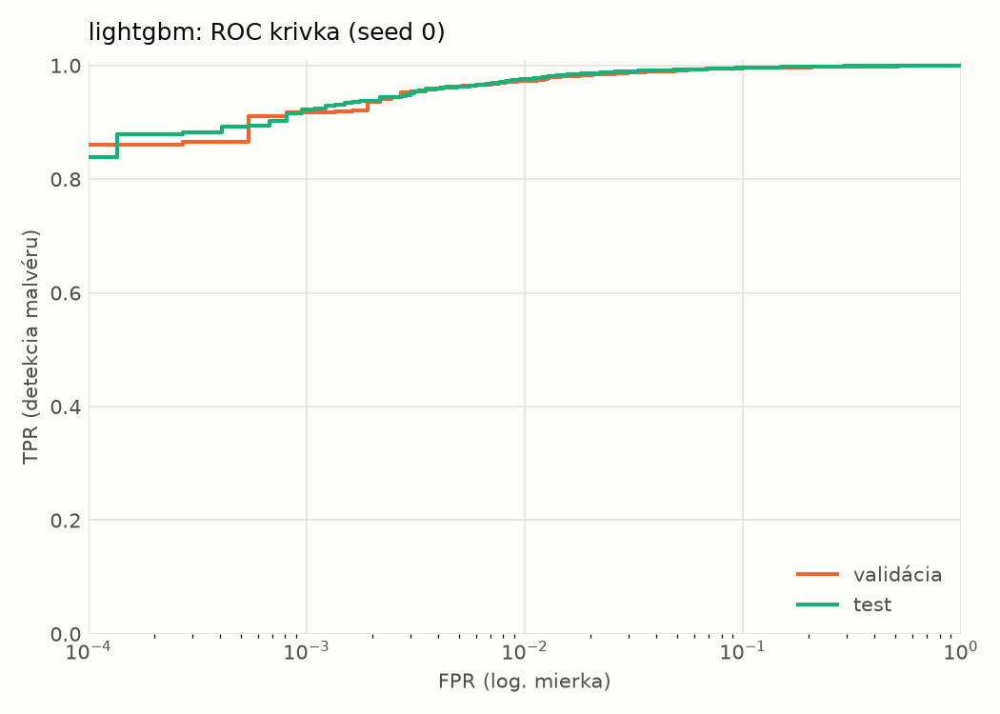
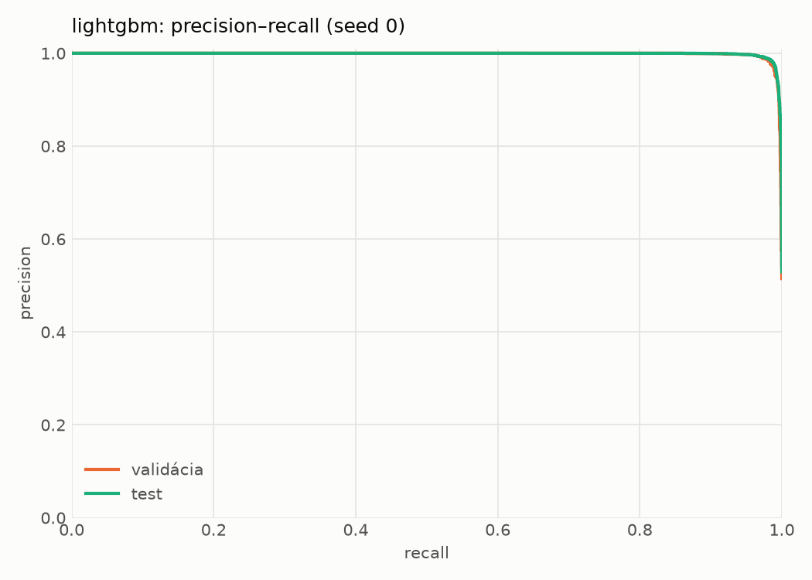
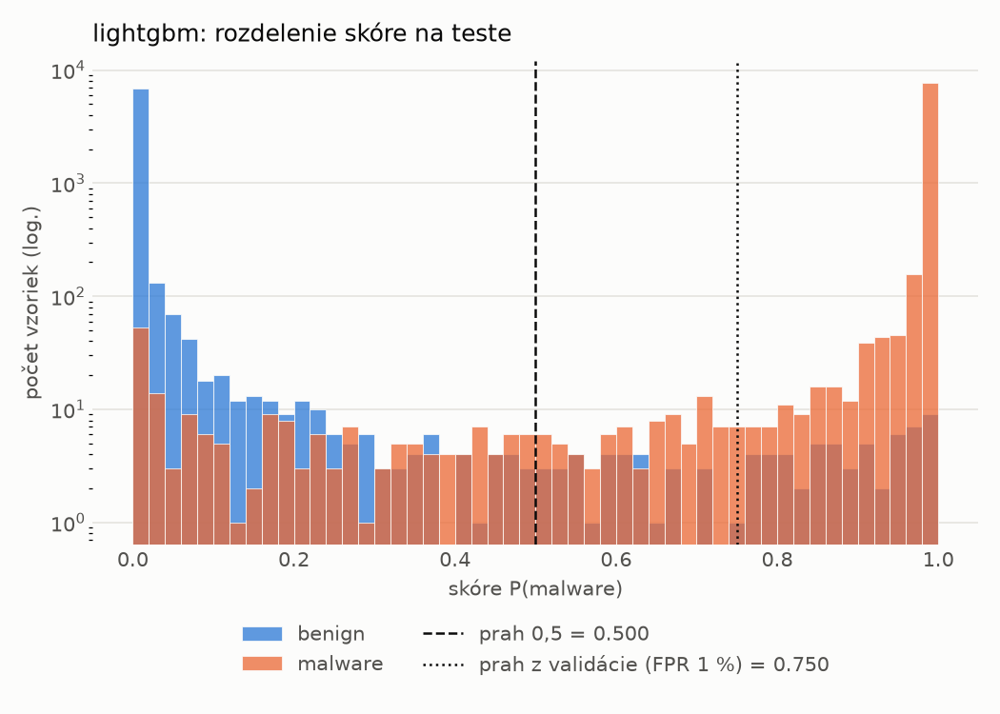
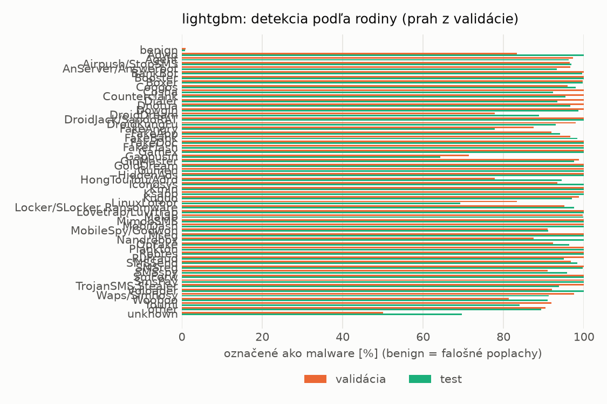
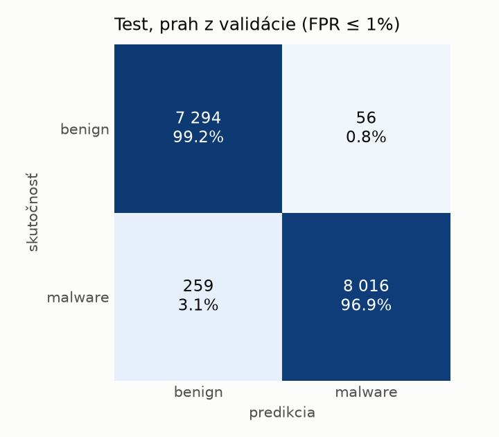
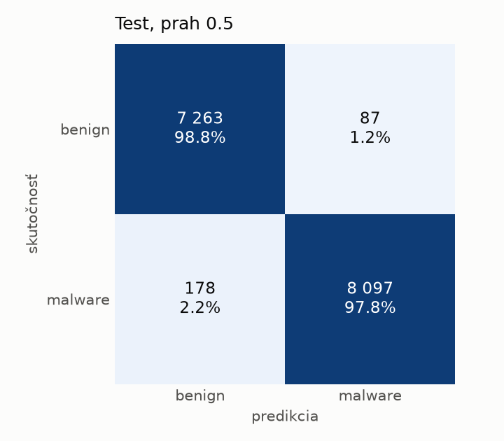
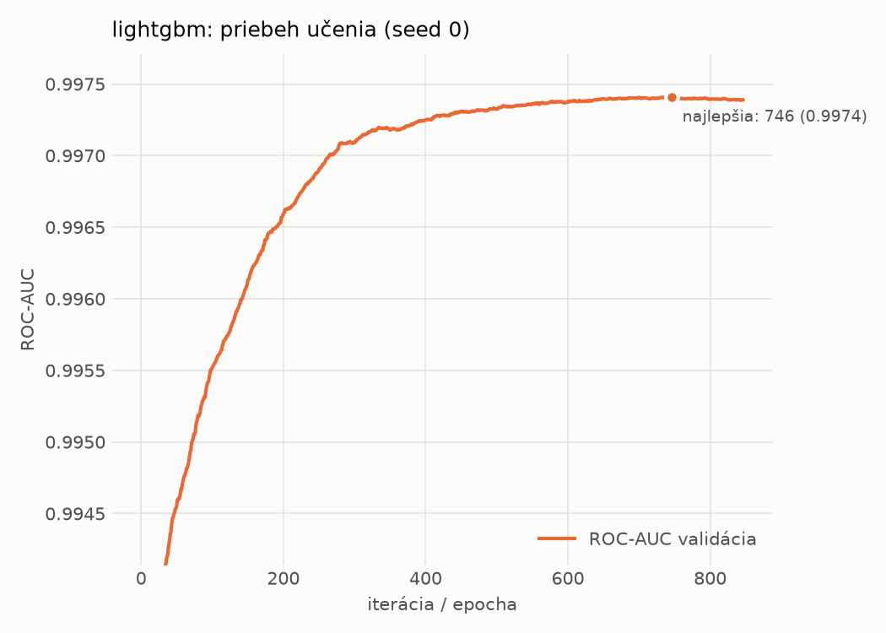

# hybrid/lightgbm – beh `20261122-221513`

> Automaticky generované (`src/training/run_tabular.py`). Konfigurácia: `config.yaml`, protokol: `protocol.yaml`.

- **Model:** `lightgbm` – LightGBM, gradient boosting stromov s early stopping na validácii (pôvodné hodnoty príznakov)
- **Ladenie:** bez ladenia – hyperparametre prevzaté z `runs_v4/real_full/full/hybrid/lightgbm/20261122-195127`
- **Finálne modely:** seedy [0, 1, 2]; hodnoty sú priemer ± smerodajná odchýlka cez seedy
- **Najlepšie hyperparametre:** `{"num_boost_round": 5000, "early_stopping_rounds": 100, "learning_rate": 0.018196998780495684, "num_leaves": 233, "min_child_samples": 23, "feature_fraction": 0.6390322800765896, "bagging_fraction": 0.9532240144545877, "lambda_l1": 0.008505404243799093, "lambda_l2": 0.007794186652208281}`

## Detekčná kvalita (bez prahu)
| metrika | train (podvzorka) | validácia | test |
|---|---|---|---|
| ROC-AUC | 1.0000 ± 0.0000 | 0.9974 ± 0.0000 | 0.9981 ± 0.0000 |
| PR-AUC | 1.0000 ± 0.0000 | 0.9981 ± 0.0000 | 0.9986 ± 0.0000 |
| TPR pri FPR 1 % | 1.0000 ± 0.0000 | 0.9722 ± 0.0003 | 0.9764 ± 0.0008 |
| TPR pri FPR 0,1 % | 1.0000 ± 0.0000 | 0.9170 ± 0.0014 | 0.9227 ± 0.0024 |
| log loss | 0.0010 ± 0.0005 | 0.0603 ± 0.0033 | 0.0543 ± 0.0024 |
| Brier skóre | 0.0000 ± 0.0000 | 0.0142 ± 0.0001 | 0.0132 ± 0.0000 |

Rozdiel ROC-AUC train − validácia: **0.0026** (veľký rozdiel = preučenie).

## Pri prahu z validácie (FPR ≤ 1% na validácii)
| metrika | train (podvzorka) | validácia | test |
|---|---|---|---|
| accuracy | 0.9999 ± 0.0001 | 0.9811 ± 0.0002 | 0.9805 ± 0.0007 |
| balanced accuracy | 0.9999 ± 0.0001 | 0.9814 ± 0.0002 | 0.9812 ± 0.0006 |
| precision | 1.0000 ± 0.0000 | 0.9909 ± 0.0003 | 0.9932 ± 0.0002 |
| recall (TPR) | 0.9999 ± 0.0001 | 0.9722 ± 0.0003 | 0.9699 ± 0.0011 |
| FPR | 0.0000 ± 0.0000 | 0.0095 ± 0.0003 | 0.0075 ± 0.0002 |
| F1 | 0.9999 ± 0.0001 | 0.9815 ± 0.0002 | 0.9814 ± 0.0007 |
| MCC | 0.9999 ± 0.0001 | 0.9623 ± 0.0004 | 0.9613 ± 0.0013 |

## Pri pevnom prahu 0.5
| metrika | train (podvzorka) | validácia | test |
|---|---|---|---|
| accuracy | 1.0000 ± 0.0000 | 0.9824 ± 0.0007 | 0.9834 ± 0.0004 |
| balanced accuracy | 1.0000 ± 0.0000 | 0.9825 ± 0.0006 | 0.9837 ± 0.0004 |
| precision | 1.0000 ± 0.0000 | 0.9860 ± 0.0002 | 0.9897 ± 0.0006 |
| recall (TPR) | 1.0000 ± 0.0000 | 0.9797 ± 0.0011 | 0.9788 ± 0.0003 |
| FPR | 0.0000 ± 0.0000 | 0.0148 ± 0.0002 | 0.0114 ± 0.0007 |
| F1 | 1.0000 ± 0.0000 | 0.9829 ± 0.0006 | 0.9842 ± 0.0004 |
| MCC | 1.0000 ± 0.0000 | 0.9648 ± 0.0013 | 0.9668 ± 0.0009 |

## Výpočtové nároky (seed 0, testovacia množina)
| meranie | hodnota |
|---|---|
| tréning finálneho modelu | 19.7 s (priemer cez seedy) |
| ladenie spolu | 0 s |
| počet parametrov / uzlov | 346 890 |
| veľkosť modelu na disku | 19.31 MB |
| CPU latencia modelu (batch 1, 1 vlákno) | 0.126 ms (p95 0.152) |
| CPU priepustnosť (24 vlákien) | 114 756 vzoriek/s |

## Grafy
| | |
|---|---|
|  |  |
|  |  |
|  |  |
|  |  |

## Súbory
`metrics.json` (všetky metriky po seedoch vrátane rodín), `timing.json`, `hpo_trials.csv`,
`predictions/<časť>_seed<N>.parquet` (sha256, family, label, score), `model/seed_<N>/`, `log.txt`.
