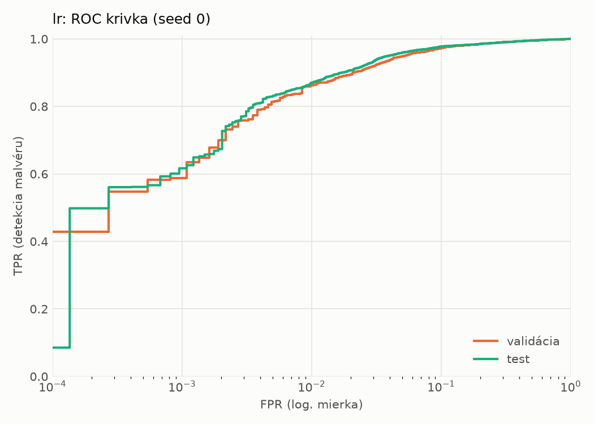
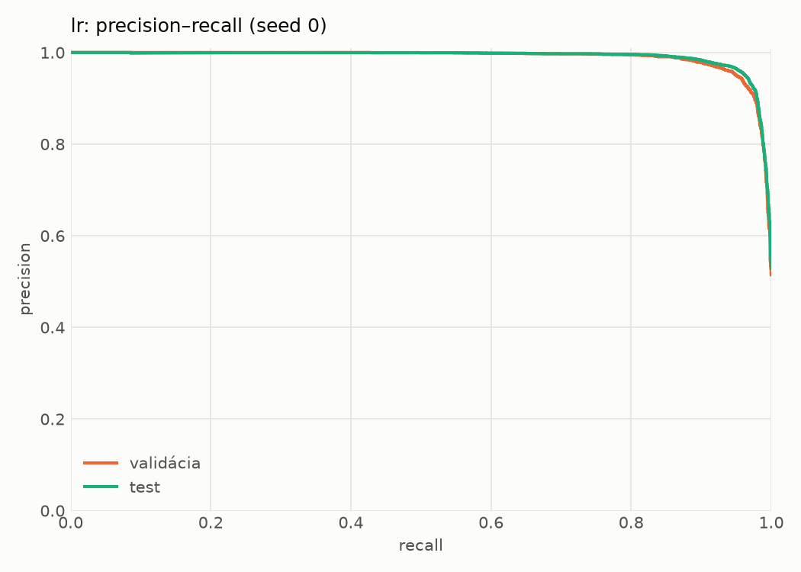
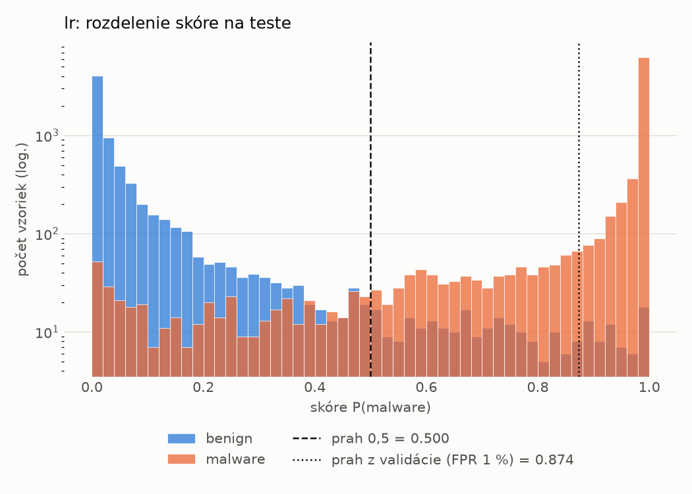
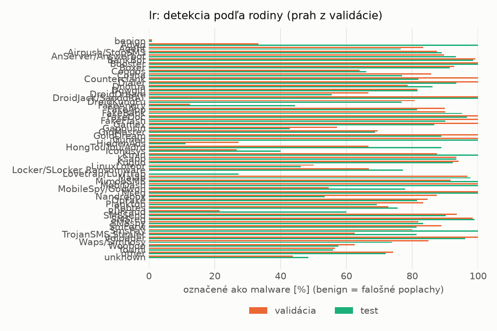
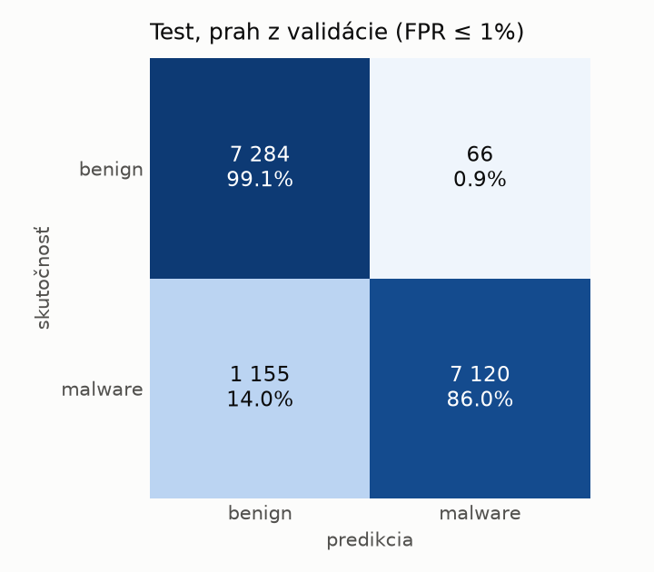
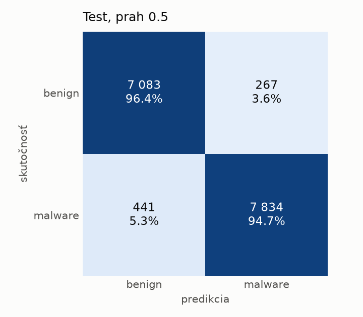

# hybrid/lr – beh `20261122-221501`

> Automaticky generované (`src/training/run_tabular.py`). Konfigurácia: `config.yaml`, protokol: `protocol.yaml`.

- **Model:** `logreg` – logistická regresia s L2 regularizáciou (vstup signed log1p + štandardizácia)
- **Ladenie:** bez ladenia – hyperparametre prevzaté z `runs_v4/real_full/full/hybrid/lr/20261122-195001`
- **Finálne modely:** seedy [0, 1, 2]; hodnoty sú priemer ± smerodajná odchýlka cez seedy
- **Najlepšie hyperparametre:** `{"max_iter": 2000, "C": 0.30240503427727145}`

## Detekčná kvalita (bez prahu)
| metrika | train (podvzorka) | validácia | test |
|---|---|---|---|
| ROC-AUC | 0.9899 ± 0.0000 | 0.9866 ± 0.0000 | 0.9878 ± 0.0000 |
| PR-AUC | 0.9916 ± 0.0000 | 0.9893 ± 0.0000 | 0.9906 ± 0.0000 |
| TPR pri FPR 1 % | 0.8898 ± 0.0000 | 0.8621 ± 0.0000 | 0.8698 ± 0.0000 |
| TPR pri FPR 0,1 % | 0.6820 ± 0.0000 | 0.5873 ± 0.0000 | 0.6167 ± 0.0000 |
| log loss | 0.1206 ± 0.0000 | 0.1416 ± 0.0000 | 0.1324 ± 0.0000 |
| Brier skóre | 0.0336 ± 0.0000 | 0.0391 ± 0.0000 | 0.0360 ± 0.0000 |

Rozdiel ROC-AUC train − validácia: **0.0032** (veľký rozdiel = preučenie).

## Pri prahu z validácie (FPR ≤ 1% na validácii)
| metrika | train (podvzorka) | validácia | test |
|---|---|---|---|
| accuracy | 0.9285 ± 0.0000 | 0.9242 ± 0.0000 | 0.9219 ± 0.0000 |
| balanced accuracy | 0.9293 ± 0.0000 | 0.9261 ± 0.0000 | 0.9257 ± 0.0000 |
| precision | 0.9925 ± 0.0000 | 0.9894 ± 0.0000 | 0.9908 ± 0.0000 |
| recall (TPR) | 0.8653 ± 0.0000 | 0.8621 ± 0.0000 | 0.8604 ± 0.0000 |
| FPR | 0.0067 ± 0.0000 | 0.0098 ± 0.0000 | 0.0090 ± 0.0000 |
| F1 | 0.9246 ± 0.0000 | 0.9214 ± 0.0000 | 0.9210 ± 0.0000 |
| MCC | 0.8645 ± 0.0000 | 0.8564 ± 0.0000 | 0.8527 ± 0.0000 |

## Pri pevnom prahu 0.5
| metrika | train (podvzorka) | validácia | test |
|---|---|---|---|
| accuracy | 0.9569 ± 0.0000 | 0.9477 ± 0.0000 | 0.9547 ± 0.0000 |
| balanced accuracy | 0.9570 ± 0.0000 | 0.9481 ± 0.0000 | 0.9552 ± 0.0000 |
| precision | 0.9688 ± 0.0000 | 0.9613 ± 0.0000 | 0.9670 ± 0.0000 |
| recall (TPR) | 0.9453 ± 0.0000 | 0.9362 ± 0.0000 | 0.9467 ± 0.0000 |
| FPR | 0.0312 ± 0.0000 | 0.0400 ± 0.0000 | 0.0363 ± 0.0000 |
| F1 | 0.9569 ± 0.0000 | 0.9486 ± 0.0000 | 0.9568 ± 0.0000 |
| MCC | 0.9141 ± 0.0000 | 0.8958 ± 0.0000 | 0.9094 ± 0.0000 |

## Výpočtové nároky (seed 0, testovacia množina)
| meranie | hodnota |
|---|---|
| tréning finálneho modelu | 0.4 s (priemer cez seedy) |
| ladenie spolu | 0 s |
| počet parametrov / uzlov | 296 |
| veľkosť modelu na disku | 0.01 MB |
| transformácia vstupu – latencia (1 vlákno) | 0.007 ms |
| transformácia vstupu – priepustnosť | 493 796 vzoriek/s |
| CPU latencia modelu (batch 1, 1 vlákno) | 0.004 ms (p95 0.004) |
| CPU priepustnosť (24 vlákien) | 2 206 952 vzoriek/s |

## Grafy
| | |
|---|---|
|  |  |
|  |  |
|  |  |
|  |  |

## Súbory
`metrics.json` (všetky metriky po seedoch vrátane rodín), `timing.json`, `hpo_trials.csv`,
`predictions/<časť>_seed<N>.parquet` (sha256, family, label, score), `model/seed_<N>/`, `log.txt`.
