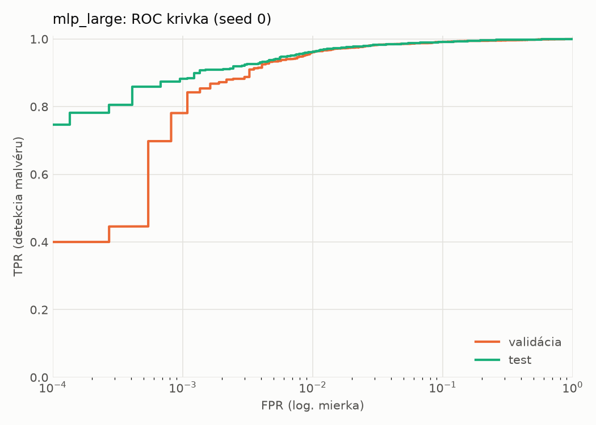
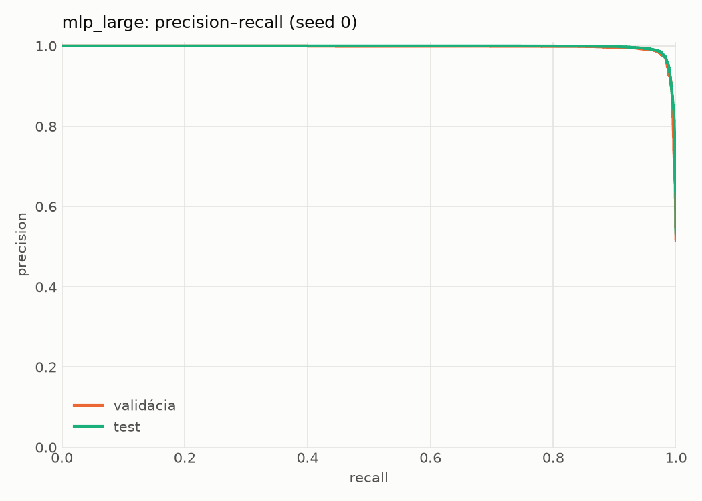
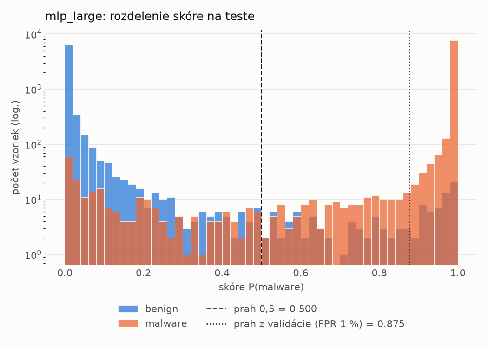
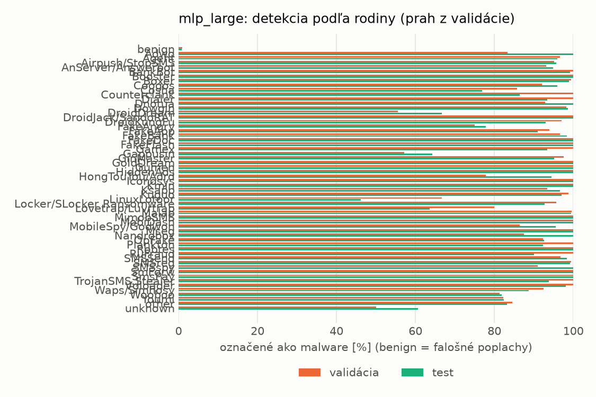
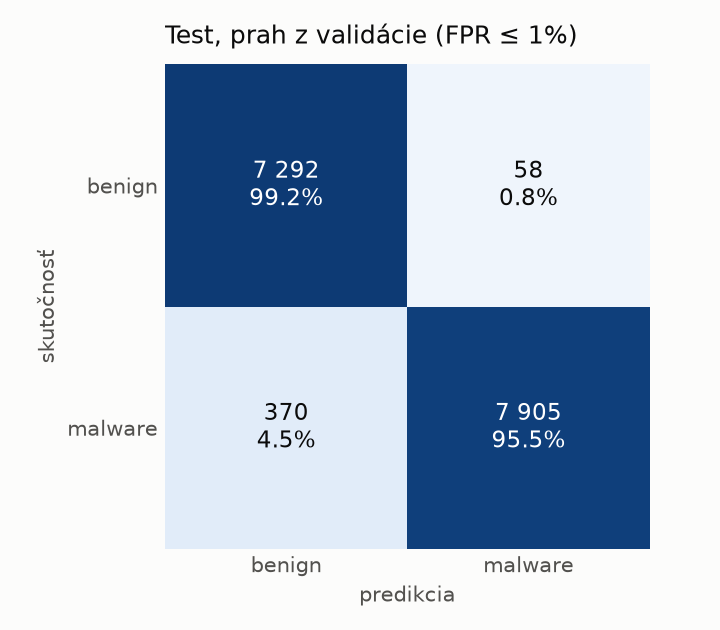
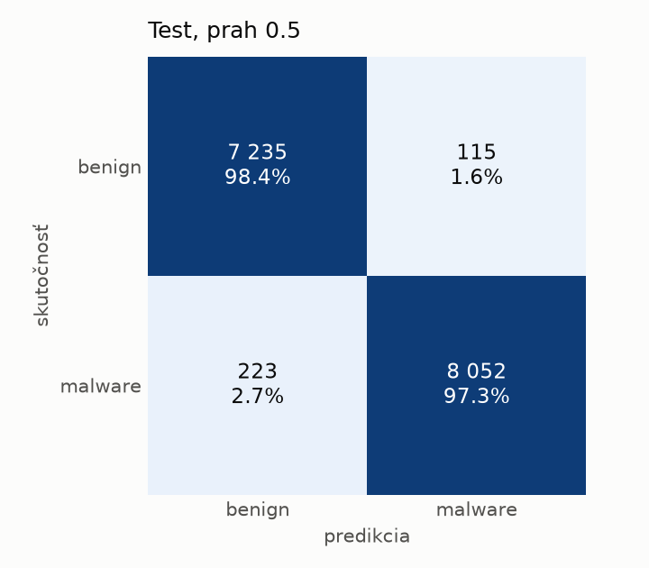
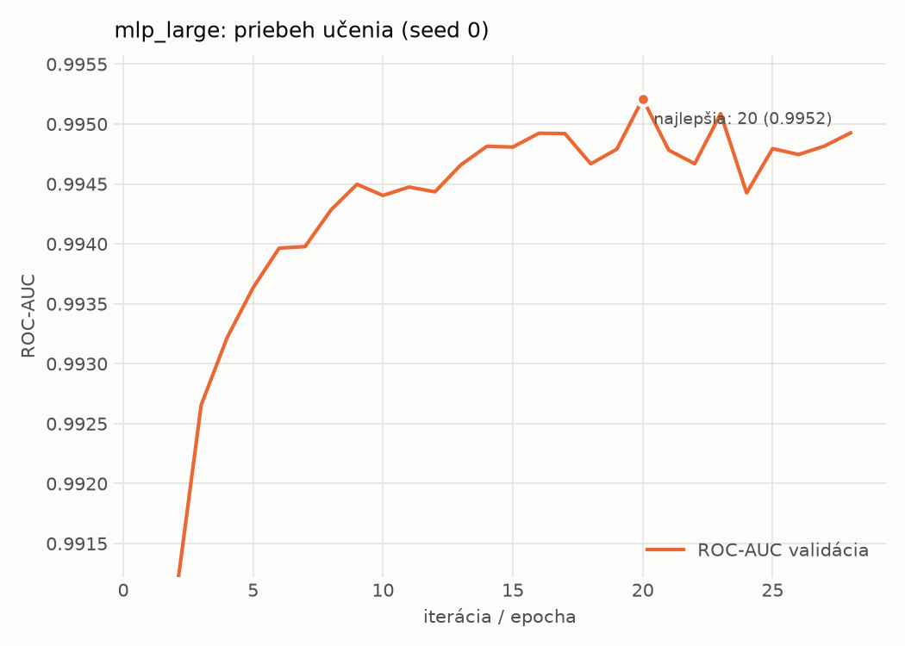

# hybrid/mlp_large – beh `20261122-221659`

> Automaticky generované (`src/training/run_tabular.py`). Konfigurácia: `config.yaml`, protokol: `protocol.yaml`.

- **Model:** `mlp` – veľká neurónová sieť (3–5 skrytých vrstiev, 512–2048 neurónov), kandidát na učiteľa
- **Ladenie:** bez ladenia – hyperparametre prevzaté z `runs_v4/real_full/full/hybrid/mlp_large/20261122-201300`
- **Finálne modely:** seedy [0, 1, 2]; hodnoty sú priemer ± smerodajná odchýlka cez seedy
- **Najlepšie hyperparametre:** `{"max_epochs": 100, "patience": 8, "hidden_layers": 3, "hidden_width": 512, "width_decay": 0.5, "dropout": 0.18171623767667733, "lr": 0.00010022812541545209, "weight_decay": 7.819097276436122e-06, "batch_size": 256}`

## Detekčná kvalita (bez prahu)
| metrika | train (podvzorka) | validácia | test |
|---|---|---|---|
| ROC-AUC | 0.9992 ± 0.0000 | 0.9953 ± 0.0002 | 0.9963 ± 0.0001 |
| PR-AUC | 0.9994 ± 0.0000 | 0.9958 ± 0.0008 | 0.9972 ± 0.0001 |
| TPR pri FPR 1 % | 0.9908 ± 0.0002 | 0.9639 ± 0.0027 | 0.9635 ± 0.0015 |
| TPR pri FPR 0,1 % | 0.9783 ± 0.0014 | 0.8137 ± 0.0287 | 0.8931 ± 0.0113 |
| log loss | 0.0277 ± 0.0014 | 0.0752 ± 0.0025 | 0.0701 ± 0.0023 |
| Brier skóre | 0.0070 ± 0.0004 | 0.0179 ± 0.0005 | 0.0178 ± 0.0004 |

Rozdiel ROC-AUC train − validácia: **0.0039** (veľký rozdiel = preučenie).

## Pri prahu z validácie (FPR ≤ 1% na validácii)
| metrika | train (podvzorka) | validácia | test |
|---|---|---|---|
| accuracy | 0.9876 ± 0.0004 | 0.9766 ± 0.0014 | 0.9742 ± 0.0014 |
| balanced accuracy | 0.9877 ± 0.0004 | 0.9770 ± 0.0014 | 0.9752 ± 0.0013 |
| precision | 0.9993 ± 0.0001 | 0.9905 ± 0.0000 | 0.9923 ± 0.0004 |
| recall (TPR) | 0.9762 ± 0.0009 | 0.9639 ± 0.0027 | 0.9588 ± 0.0030 |
| FPR | 0.0007 ± 0.0001 | 0.0098 ± 0.0000 | 0.0084 ± 0.0005 |
| F1 | 0.9876 ± 0.0004 | 0.9770 ± 0.0014 | 0.9753 ± 0.0014 |
| MCC | 0.9754 ± 0.0008 | 0.9536 ± 0.0027 | 0.9490 ± 0.0027 |

## Pri pevnom prahu 0.5
| metrika | train (podvzorka) | validácia | test |
|---|---|---|---|
| accuracy | 0.9913 ± 0.0006 | 0.9776 ± 0.0010 | 0.9780 ± 0.0003 |
| balanced accuracy | 0.9914 ± 0.0006 | 0.9778 ± 0.0010 | 0.9784 ± 0.0002 |
| precision | 0.9962 ± 0.0002 | 0.9823 ± 0.0023 | 0.9865 ± 0.0007 |
| recall (TPR) | 0.9866 ± 0.0014 | 0.9741 ± 0.0018 | 0.9718 ± 0.0012 |
| FPR | 0.0038 ± 0.0002 | 0.0186 ± 0.0025 | 0.0150 ± 0.0008 |
| F1 | 0.9914 ± 0.0006 | 0.9782 ± 0.0010 | 0.9791 ± 0.0003 |
| MCC | 0.9826 ± 0.0012 | 0.9553 ± 0.0020 | 0.9561 ± 0.0005 |

## Výpočtové nároky (seed 0, testovacia množina)
| meranie | hodnota |
|---|---|
| tréning finálneho modelu | 11.9 s (priemer cez seedy) |
| ladenie spolu | 0 s |
| počet parametrov / uzlov | 317 697 |
| veľkosť modelu na disku | 1.29 MB |
| transformácia vstupu – latencia (1 vlákno) | 0.017 ms |
| transformácia vstupu – priepustnosť | 283 557 vzoriek/s |
| CPU latencia modelu (batch 1, 1 vlákno) | 0.145 ms (p95 0.322) |
| CPU priepustnosť (24 vlákien) | 644 319 vzoriek/s |
| GPU latencia (batch 1) | 0.430 ms (p95 0.955) |
| GPU priepustnosť | 547 096 vzoriek/s |
| GPU špičková pamäť | 216 MB |

## Grafy
| | |
|---|---|
|  |  |
|  |  |
|  |  |
|  |  |

## Súbory
`metrics.json` (všetky metriky po seedoch vrátane rodín), `timing.json`, `hpo_trials.csv`,
`predictions/<časť>_seed<N>.parquet` (sha256, family, label, score), `model/seed_<N>/`, `log.txt`.
