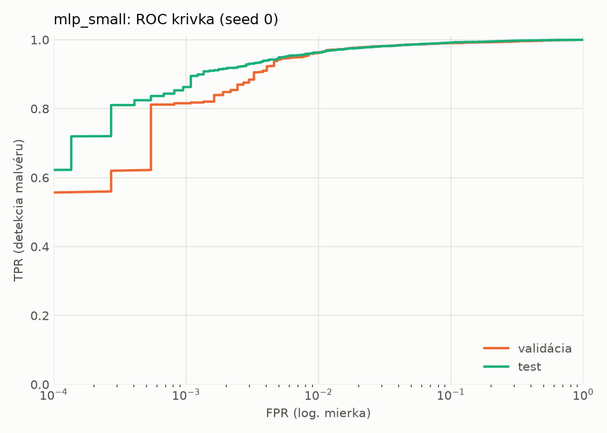
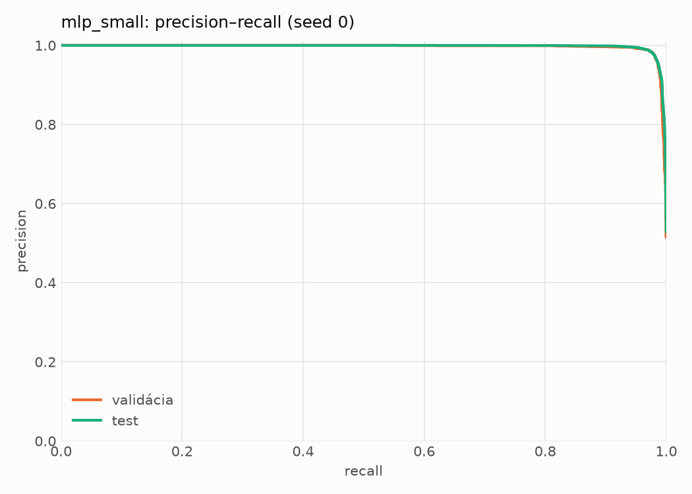
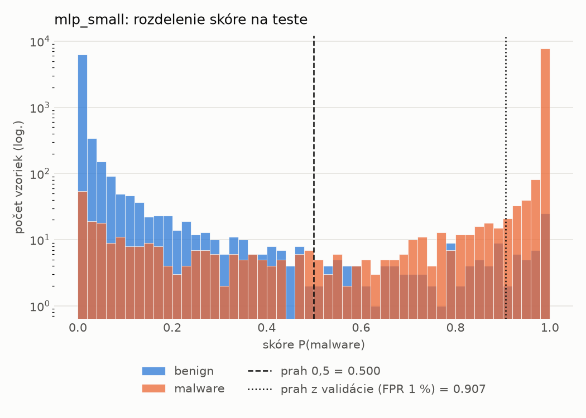
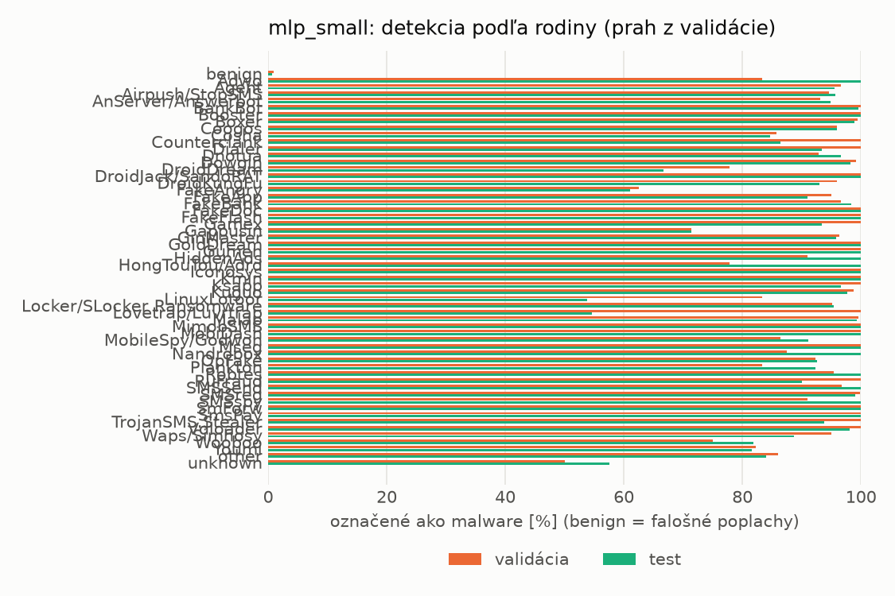
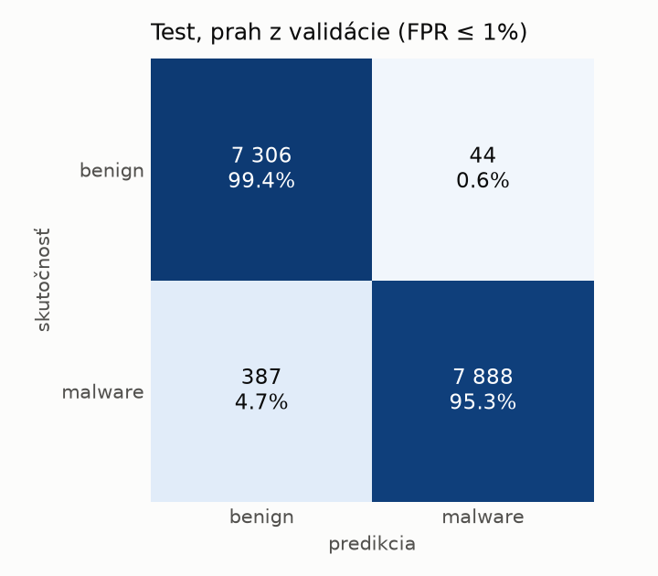
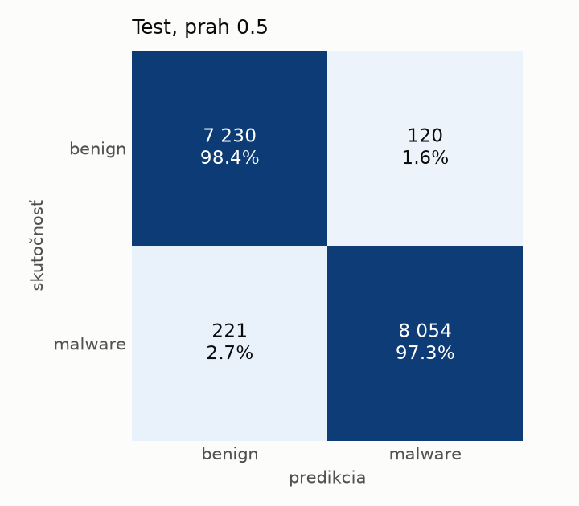
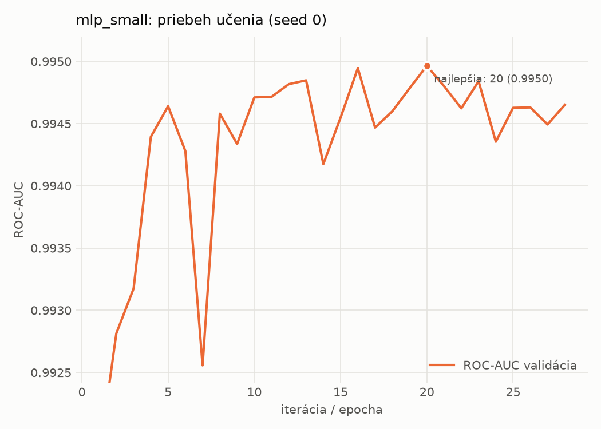

# hybrid/mlp_small – beh `20261122-221625`

> Automaticky generované (`src/training/run_tabular.py`). Konfigurácia: `config.yaml`, protokol: `protocol.yaml`.

- **Model:** `mlp` – malá neurónová sieť (1–2 skryté vrstvy), kandidát na ľahkého študenta
- **Ladenie:** bez ladenia – hyperparametre prevzaté z `runs_v4/real_full/full/hybrid/mlp_small/20261122-200826`
- **Finálne modely:** seedy [0, 1, 2]; hodnoty sú priemer ± smerodajná odchýlka cez seedy
- **Najlepšie hyperparametre:** `{"width_decay": 0.5, "max_epochs": 100, "patience": 8, "hidden_layers": 2, "hidden_width": 256, "dropout": 0.19625503285105284, "lr": 0.0008594281758471675, "weight_decay": 0.001025897876119634, "batch_size": 256}`

## Detekčná kvalita (bez prahu)
| metrika | train (podvzorka) | validácia | test |
|---|---|---|---|
| ROC-AUC | 0.9992 ± 0.0001 | 0.9951 ± 0.0001 | 0.9960 ± 0.0002 |
| PR-AUC | 0.9994 ± 0.0001 | 0.9960 ± 0.0004 | 0.9971 ± 0.0001 |
| TPR pri FPR 1 % | 0.9918 ± 0.0010 | 0.9610 ± 0.0028 | 0.9646 ± 0.0015 |
| TPR pri FPR 0,1 % | 0.9780 ± 0.0032 | 0.7513 ± 0.1303 | 0.8777 ± 0.0129 |
| log loss | 0.0256 ± 0.0019 | 0.0829 ± 0.0028 | 0.0740 ± 0.0003 |
| Brier skóre | 0.0065 ± 0.0005 | 0.0179 ± 0.0001 | 0.0177 ± 0.0001 |

Rozdiel ROC-AUC train − validácia: **0.0042** (veľký rozdiel = preučenie).

## Pri prahu z validácie (FPR ≤ 1% na validácii)
| metrika | train (podvzorka) | validácia | test |
|---|---|---|---|
| accuracy | 0.9870 ± 0.0007 | 0.9752 ± 0.0014 | 0.9731 ± 0.0014 |
| balanced accuracy | 0.9872 ± 0.0007 | 0.9756 ± 0.0013 | 0.9742 ± 0.0013 |
| precision | 0.9993 ± 0.0004 | 0.9906 ± 0.0001 | 0.9938 ± 0.0006 |
| recall (TPR) | 0.9751 ± 0.0016 | 0.9610 ± 0.0028 | 0.9552 ± 0.0031 |
| FPR | 0.0007 ± 0.0004 | 0.0097 ± 0.0002 | 0.0067 ± 0.0007 |
| F1 | 0.9870 ± 0.0007 | 0.9755 ± 0.0014 | 0.9741 ± 0.0014 |
| MCC | 0.9744 ± 0.0014 | 0.9508 ± 0.0027 | 0.9470 ± 0.0026 |

## Pri pevnom prahu 0.5
| metrika | train (podvzorka) | validácia | test |
|---|---|---|---|
| accuracy | 0.9916 ± 0.0007 | 0.9783 ± 0.0007 | 0.9781 ± 0.0001 |
| balanced accuracy | 0.9916 ± 0.0007 | 0.9783 ± 0.0007 | 0.9784 ± 0.0002 |
| precision | 0.9954 ± 0.0006 | 0.9802 ± 0.0008 | 0.9851 ± 0.0002 |
| recall (TPR) | 0.9880 ± 0.0009 | 0.9775 ± 0.0008 | 0.9734 ± 0.0001 |
| FPR | 0.0047 ± 0.0006 | 0.0210 ± 0.0008 | 0.0166 ± 0.0003 |
| F1 | 0.9917 ± 0.0007 | 0.9789 ± 0.0007 | 0.9792 ± 0.0001 |
| MCC | 0.9832 ± 0.0013 | 0.9565 ± 0.0015 | 0.9561 ± 0.0003 |

## Výpočtové nároky (seed 0, testovacia množina)
| meranie | hodnota |
|---|---|
| tréning finálneho modelu | 10.5 s (priemer cez seedy) |
| ladenie spolu | 0 s |
| počet parametrov / uzlov | 109 569 |
| veľkosť modelu na disku | 0.45 MB |
| transformácia vstupu – latencia (1 vlákno) | 0.017 ms |
| transformácia vstupu – priepustnosť | 299 305 vzoriek/s |
| CPU latencia modelu (batch 1, 1 vlákno) | 0.108 ms (p95 0.243) |
| CPU priepustnosť (24 vlákien) | 973 490 vzoriek/s |
| GPU latencia (batch 1) | 0.659 ms (p95 0.696) |
| GPU priepustnosť | 771 594 vzoriek/s |
| GPU špičková pamäť | 125 MB |

## Grafy
| | |
|---|---|
|  |  |
|  |  |
|  |  |
|  |  |

## Súbory
`metrics.json` (všetky metriky po seedoch vrátane rodín), `timing.json`, `hpo_trials.csv`,
`predictions/<časť>_seed<N>.parquet` (sha256, family, label, score), `model/seed_<N>/`, `log.txt`.
