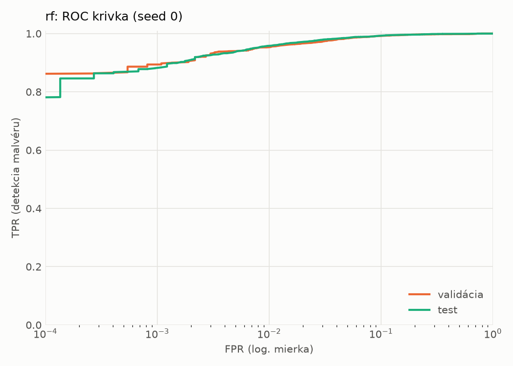
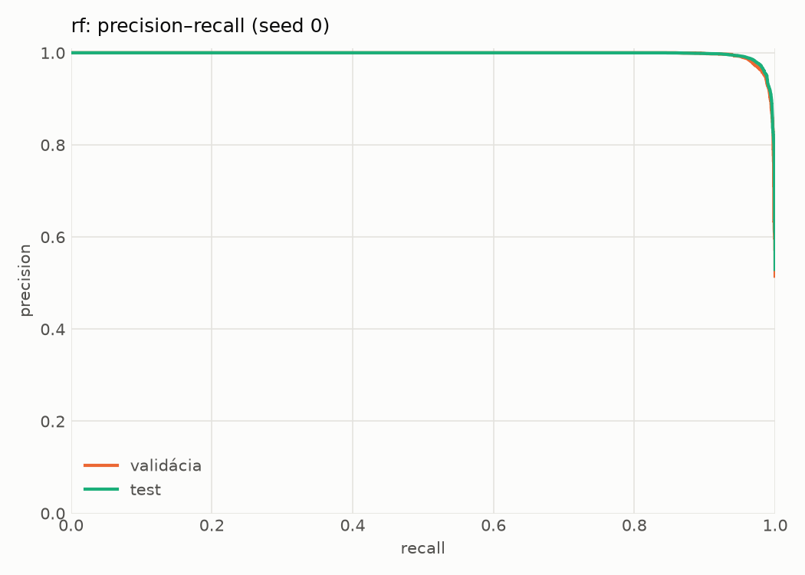
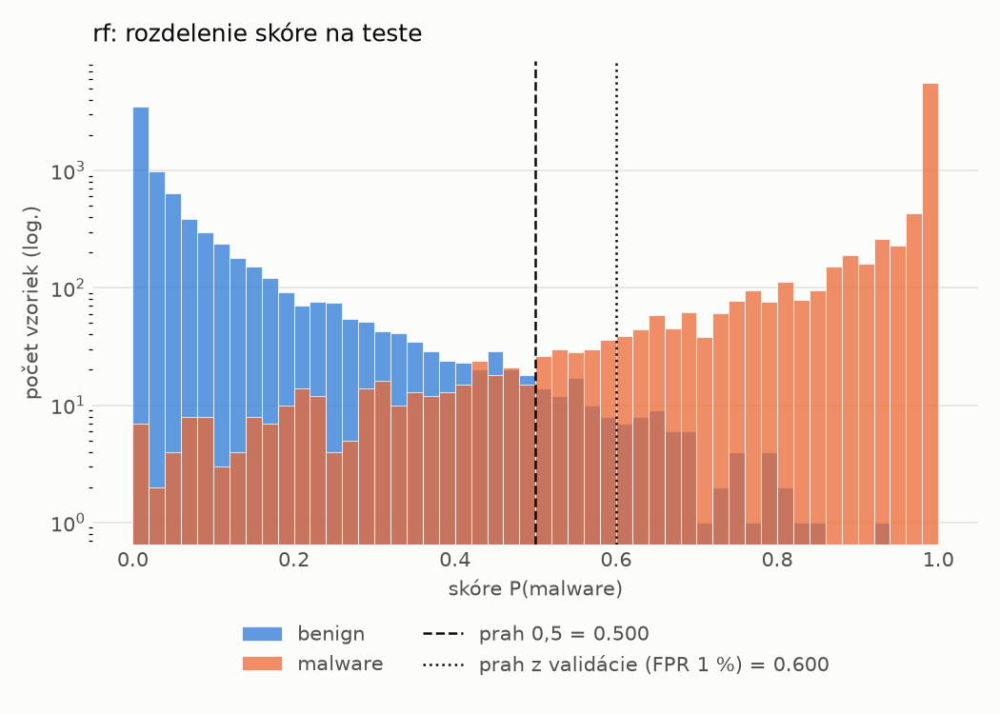
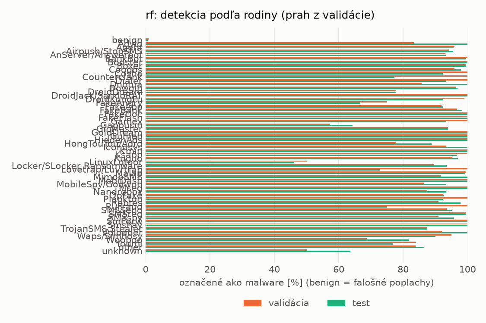
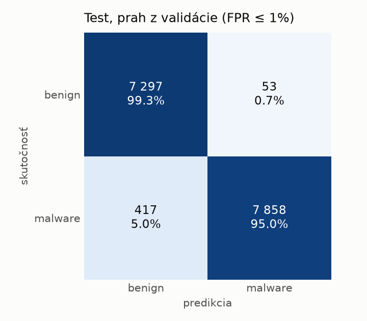
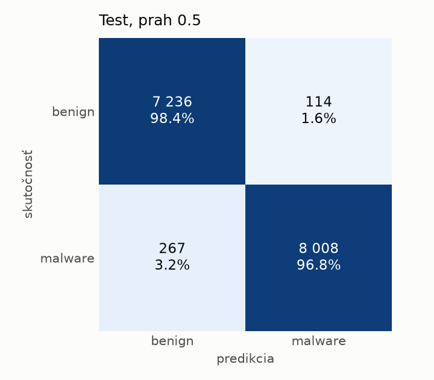

# hybrid/rf – beh `20261122-221504`

> Automaticky generované (`src/training/run_tabular.py`). Konfigurácia: `config.yaml`, protokol: `protocol.yaml`.

- **Model:** `random_forest` – Random Forest (pôvodné hodnoty príznakov)
- **Ladenie:** bez ladenia – hyperparametre prevzaté z `runs_v4/real_full/full/hybrid/rf/20261122-195013`
- **Finálne modely:** seedy [0, 1, 2]; hodnoty sú priemer ± smerodajná odchýlka cez seedy
- **Najlepšie hyperparametre:** `{"n_estimators": 150, "max_depth": 32, "min_samples_leaf": 1, "max_features": 0.05}`

## Detekčná kvalita (bez prahu)
| metrika | train (podvzorka) | validácia | test |
|---|---|---|---|
| ROC-AUC | 1.0000 ± 0.0000 | 0.9961 ± 0.0001 | 0.9967 ± 0.0000 |
| PR-AUC | 1.0000 ± 0.0000 | 0.9970 ± 0.0001 | 0.9974 ± 0.0000 |
| TPR pri FPR 1 % | 1.0000 ± 0.0000 | 0.9541 ± 0.0020 | 0.9571 ± 0.0007 |
| TPR pri FPR 0,1 % | 1.0000 ± 0.0000 | 0.8976 ± 0.0043 | 0.8891 ± 0.0085 |
| log loss | 0.0243 ± 0.0001 | 0.0891 ± 0.0003 | 0.0913 ± 0.0004 |
| Brier skóre | 0.0029 ± 0.0000 | 0.0225 ± 0.0001 | 0.0231 ± 0.0001 |

Rozdiel ROC-AUC train − validácia: **0.0039** (veľký rozdiel = preučenie).

## Pri prahu z validácie (FPR ≤ 1% na validácii)
| metrika | train (podvzorka) | validácia | test |
|---|---|---|---|
| accuracy | 0.9994 ± 0.0000 | 0.9717 ± 0.0010 | 0.9692 ± 0.0009 |
| balanced accuracy | 0.9994 ± 0.0000 | 0.9722 ± 0.0009 | 0.9705 ± 0.0008 |
| precision | 1.0000 ± 0.0000 | 0.9906 ± 0.0001 | 0.9929 ± 0.0008 |
| recall (TPR) | 0.9988 ± 0.0000 | 0.9541 ± 0.0020 | 0.9486 ± 0.0020 |
| FPR | 0.0000 ± 0.0000 | 0.0096 ± 0.0002 | 0.0076 ± 0.0008 |
| F1 | 0.9994 ± 0.0000 | 0.9720 ± 0.0010 | 0.9702 ± 0.0009 |
| MCC | 0.9988 ± 0.0000 | 0.9441 ± 0.0019 | 0.9394 ± 0.0017 |

## Pri pevnom prahu 0.5
| metrika | train (podvzorka) | validácia | test |
|---|---|---|---|
| accuracy | 0.9998 ± 0.0001 | 0.9726 ± 0.0004 | 0.9756 ± 0.0003 |
| balanced accuracy | 0.9998 ± 0.0001 | 0.9728 ± 0.0004 | 0.9761 ± 0.0003 |
| precision | 1.0000 ± 0.0000 | 0.9791 ± 0.0001 | 0.9860 ± 0.0005 |
| recall (TPR) | 0.9997 ± 0.0001 | 0.9675 ± 0.0008 | 0.9676 ± 0.0001 |
| FPR | 0.0000 ± 0.0000 | 0.0220 ± 0.0002 | 0.0155 ± 0.0006 |
| F1 | 0.9998 ± 0.0001 | 0.9733 ± 0.0004 | 0.9767 ± 0.0002 |
| MCC | 0.9997 ± 0.0001 | 0.9453 ± 0.0008 | 0.9512 ± 0.0005 |

## Výpočtové nároky (seed 0, testovacia množina)
| meranie | hodnota |
|---|---|
| tréning finálneho modelu | 1.3 s (priemer cez seedy) |
| ladenie spolu | 0 s |
| počet parametrov / uzlov | 755 642 |
| veľkosť modelu na disku | 60.73 MB |
| CPU latencia modelu (batch 1, 1 vlákno) | 4.682 ms (p95 4.927) |
| CPU priepustnosť (24 vlákien) | 239 828 vzoriek/s |

## Grafy
| | |
|---|---|
|  |  |
|  |  |
|  |  |
|  |  |

## Súbory
`metrics.json` (všetky metriky po seedoch vrátane rodín), `timing.json`, `hpo_trials.csv`,
`predictions/<časť>_seed<N>.parquet` (sha256, family, label, score), `model/seed_<N>/`, `log.txt`.
