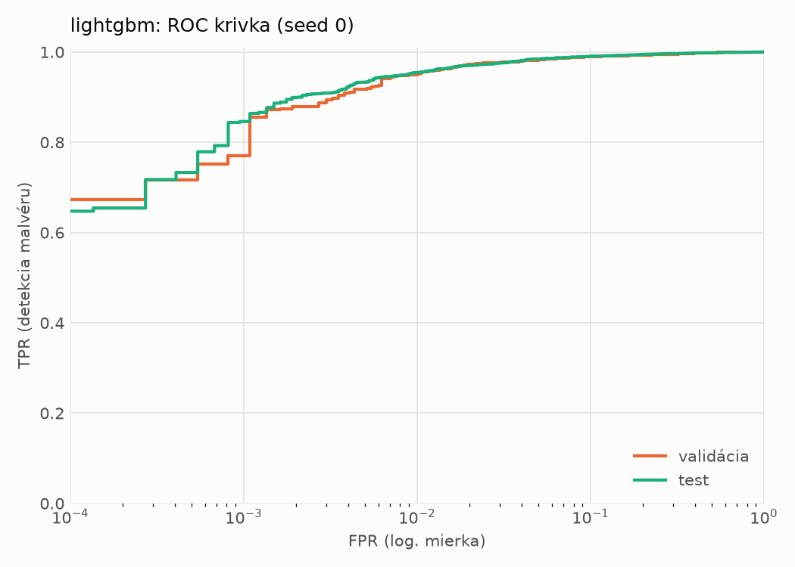
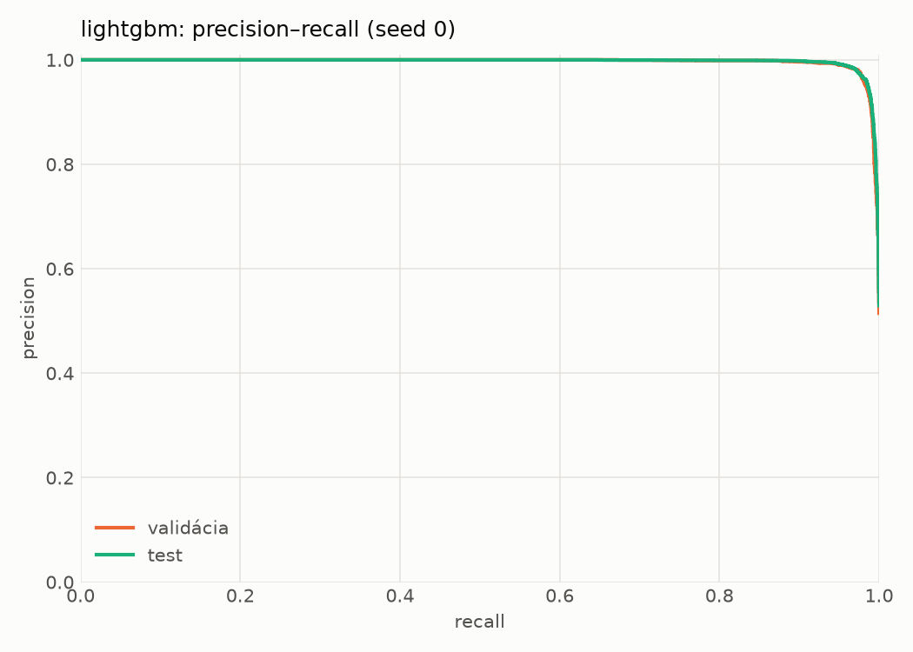
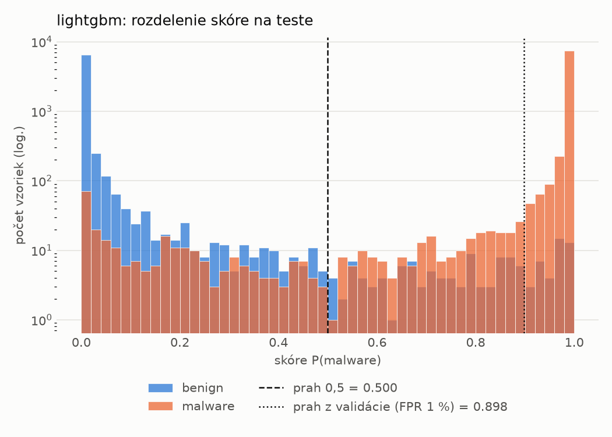
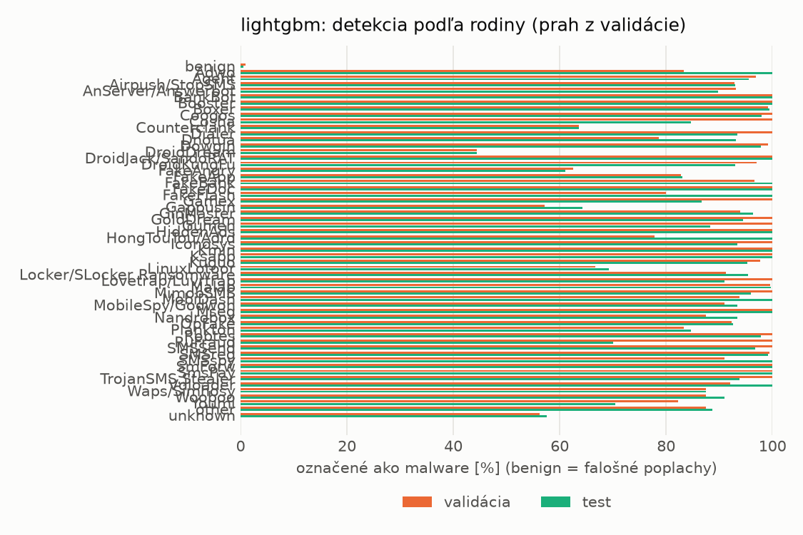
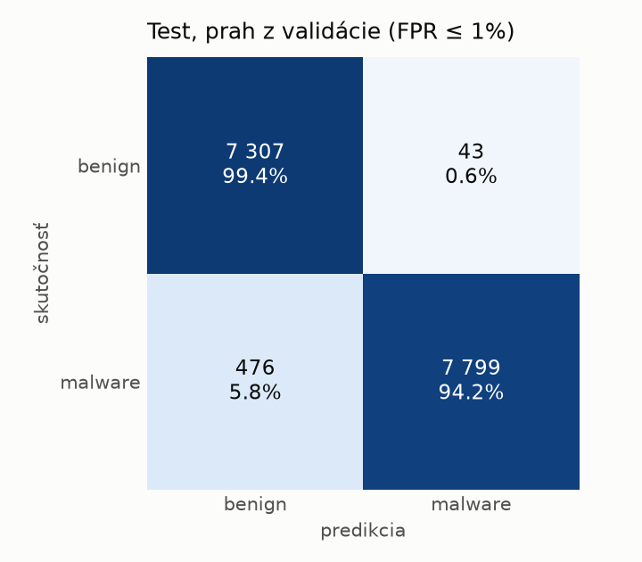
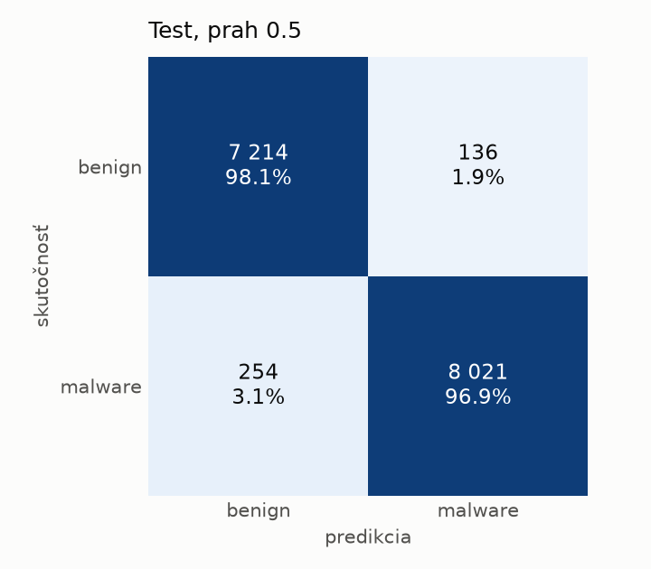
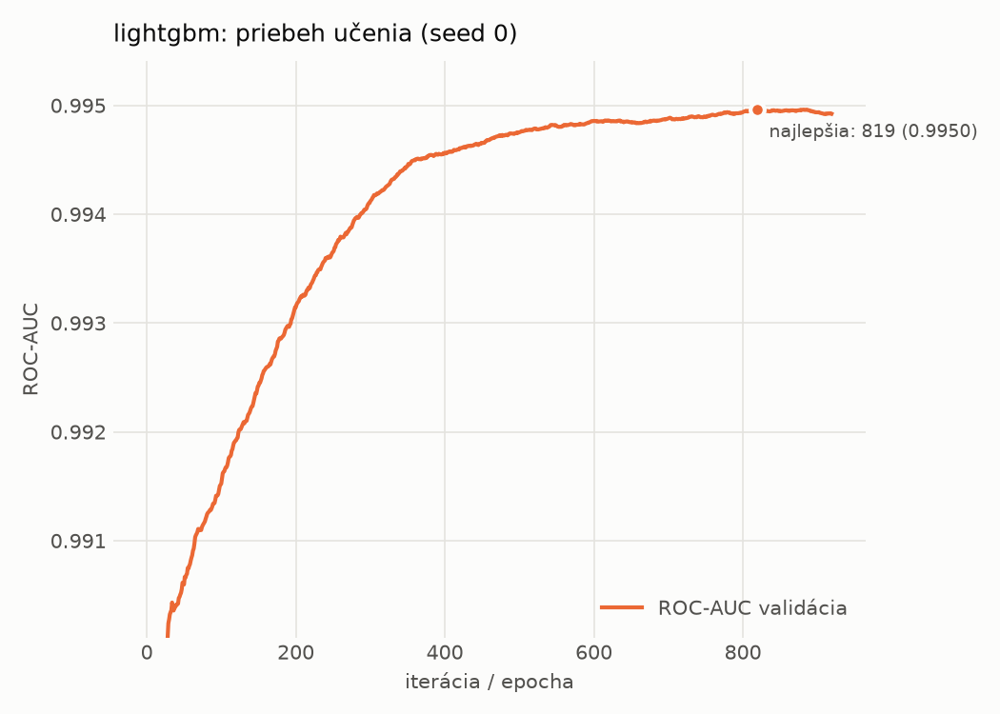

# static/lightgbm – beh `20261122-220910`

> Automaticky generované (`src/training/run_tabular.py`). Konfigurácia: `config.yaml`, protokol: `protocol.yaml`.

- **Model:** `lightgbm` – LightGBM, gradient boosting stromov s early stopping na validácii (pôvodné hodnoty príznakov)
- **Ladenie:** bez ladenia – hyperparametre prevzaté z `runs_v4/real_full/full/static/lightgbm/20261122-184829`
- **Finálne modely:** seedy [0, 1, 2]; hodnoty sú priemer ± smerodajná odchýlka cez seedy
- **Najlepšie hyperparametre:** `{"num_boost_round": 5000, "early_stopping_rounds": 100, "learning_rate": 0.015567978603457627, "num_leaves": 372, "min_child_samples": 12, "feature_fraction": 0.7551391358223217, "bagging_fraction": 0.6871892431836363, "lambda_l1": 1.3651906778474808e-06, "lambda_l2": 0.003382199534052785}`

## Detekčná kvalita (bez prahu)
| metrika | train (podvzorka) | validácia | test |
|---|---|---|---|
| ROC-AUC | 1.0000 ± 0.0000 | 0.9949 ± 0.0000 | 0.9955 ± 0.0000 |
| PR-AUC | 1.0000 ± 0.0000 | 0.9961 ± 0.0000 | 0.9966 ± 0.0000 |
| TPR pri FPR 1 % | 0.9999 ± 0.0001 | 0.9512 ± 0.0010 | 0.9535 ± 0.0008 |
| TPR pri FPR 0,1 % | 0.9998 ± 0.0000 | 0.7805 ± 0.0090 | 0.8432 ± 0.0030 |
| log loss | 0.0064 ± 0.0020 | 0.0847 ± 0.0021 | 0.0792 ± 0.0016 |
| Brier skóre | 0.0006 ± 0.0003 | 0.0205 ± 0.0000 | 0.0201 ± 0.0001 |

Rozdiel ROC-AUC train − validácia: **0.0051** (veľký rozdiel = preučenie).

## Pri prahu z validácie (FPR ≤ 1% na validácii)
| metrika | train (podvzorka) | validácia | test |
|---|---|---|---|
| accuracy | 0.9943 ± 0.0012 | 0.9701 ± 0.0005 | 0.9668 ± 0.0002 |
| balanced accuracy | 0.9944 ± 0.0012 | 0.9707 ± 0.0005 | 0.9683 ± 0.0002 |
| precision | 1.0000 ± 0.0000 | 0.9904 ± 0.0000 | 0.9943 ± 0.0002 |
| recall (TPR) | 0.9887 ± 0.0024 | 0.9512 ± 0.0010 | 0.9427 ± 0.0003 |
| FPR | 0.0000 ± 0.0000 | 0.0098 ± 0.0000 | 0.0061 ± 0.0002 |
| F1 | 0.9943 ± 0.0012 | 0.9704 ± 0.0005 | 0.9678 ± 0.0002 |
| MCC | 0.9887 ± 0.0024 | 0.9411 ± 0.0010 | 0.9350 ± 0.0004 |

## Pri pevnom prahu 0.5
| metrika | train (podvzorka) | validácia | test |
|---|---|---|---|
| accuracy | 0.9998 ± 0.0001 | 0.9753 ± 0.0005 | 0.9747 ± 0.0007 |
| balanced accuracy | 0.9998 ± 0.0001 | 0.9754 ± 0.0005 | 0.9751 ± 0.0007 |
| precision | 1.0000 ± 0.0000 | 0.9780 ± 0.0006 | 0.9827 ± 0.0006 |
| recall (TPR) | 0.9996 ± 0.0002 | 0.9739 ± 0.0010 | 0.9693 ± 0.0009 |
| FPR | 0.0000 ± 0.0000 | 0.0232 ± 0.0007 | 0.0192 ± 0.0007 |
| F1 | 0.9998 ± 0.0001 | 0.9760 ± 0.0005 | 0.9760 ± 0.0007 |
| MCC | 0.9996 ± 0.0002 | 0.9506 ± 0.0011 | 0.9494 ± 0.0014 |

## Výpočtové nároky (seed 0, testovacia množina)
| meranie | hodnota |
|---|---|
| tréning finálneho modelu | 12.5 s (priemer cez seedy) |
| ladenie spolu | 0 s |
| počet parametrov / uzlov | 608 517 |
| veľkosť modelu na disku | 33.80 MB |
| CPU latencia modelu (batch 1, 1 vlákno) | 0.174 ms (p95 0.214) |
| CPU priepustnosť (24 vlákien) | 80 288 vzoriek/s |

## Grafy
| | |
|---|---|
|  |  |
|  |  |
|  |  |
|  |  |

## Súbory
`metrics.json` (všetky metriky po seedoch vrátane rodín), `timing.json`, `hpo_trials.csv`,
`predictions/<časť>_seed<N>.parquet` (sha256, family, label, score), `model/seed_<N>/`, `log.txt`.
