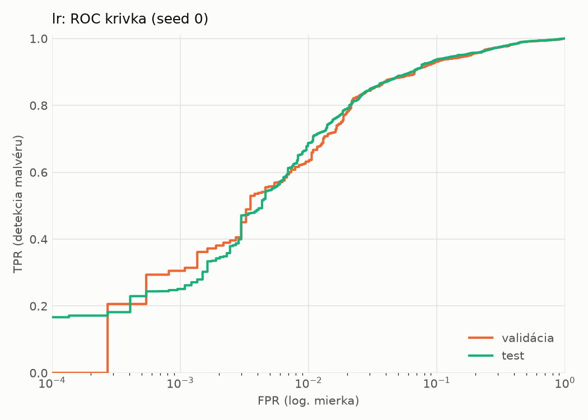
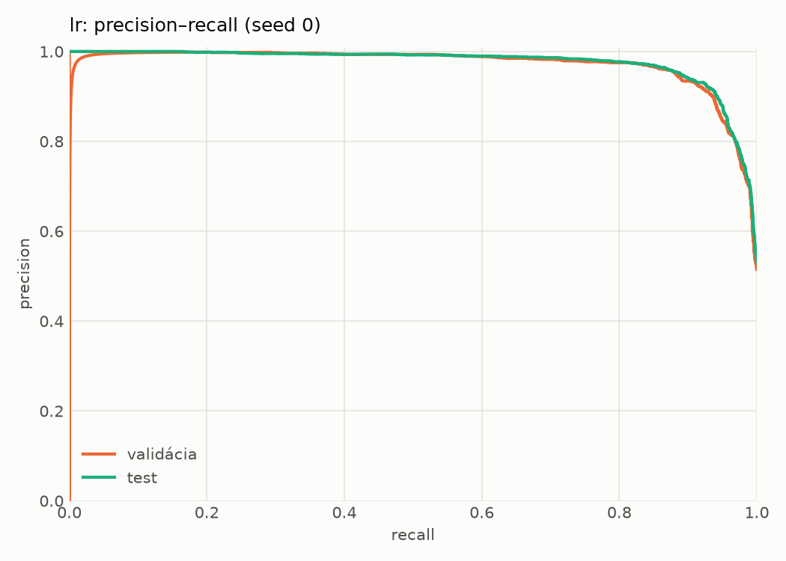
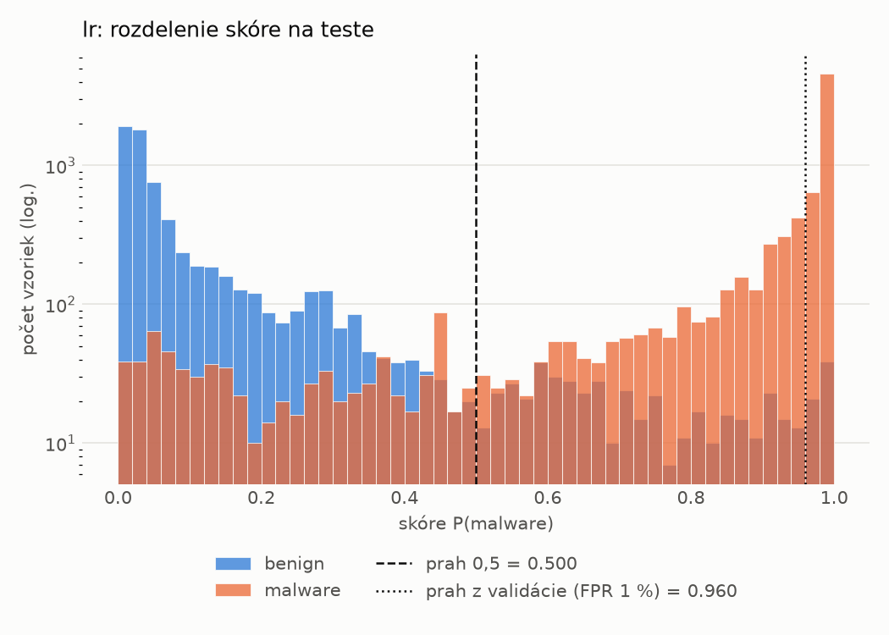
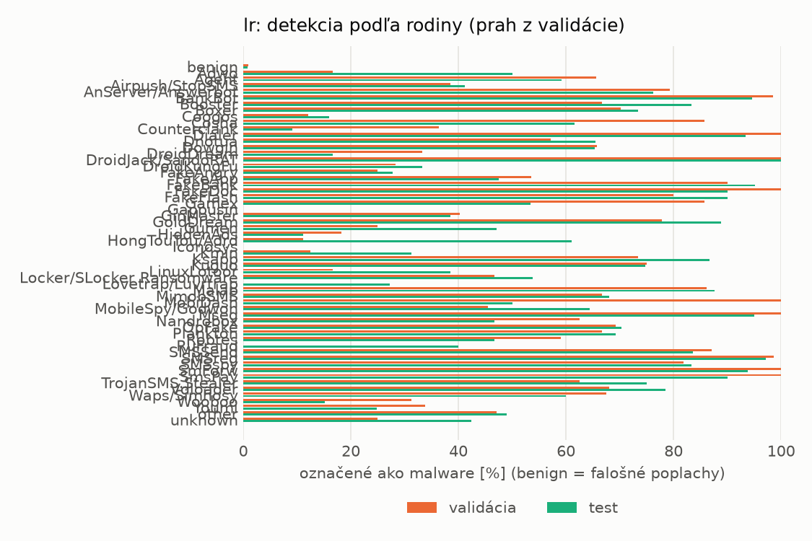
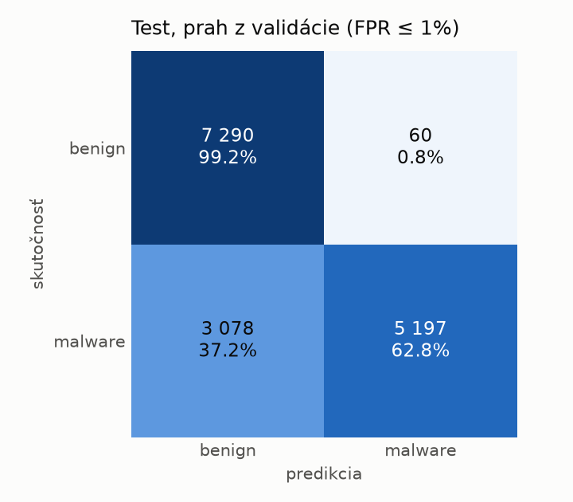
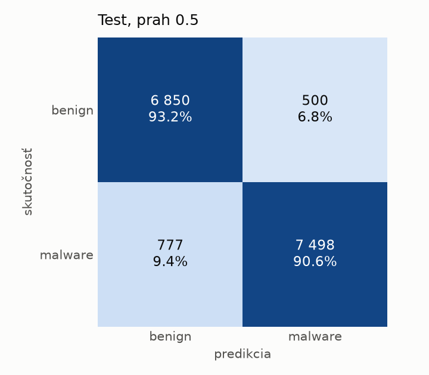

# static/lr – beh `20261122-220852`

> Automaticky generované (`src/training/run_tabular.py`). Konfigurácia: `config.yaml`, protokol: `protocol.yaml`.

- **Model:** `logreg` – logistická regresia s L2 regularizáciou (vstup signed log1p + štandardizácia)
- **Ladenie:** bez ladenia – hyperparametre prevzaté z `runs_v4/real_full/full/static/lr/20261122-184714`
- **Finálne modely:** seedy [0, 1, 2]; hodnoty sú priemer ± smerodajná odchýlka cez seedy
- **Najlepšie hyperparametre:** `{"max_iter": 2000, "C": 2.1423021757741068}`

## Detekčná kvalita (bez prahu)
| metrika | train (podvzorka) | validácia | test |
|---|---|---|---|
| ROC-AUC | 0.9704 ± 0.0000 | 0.9681 ± 0.0000 | 0.9696 ± 0.0000 |
| PR-AUC | 0.9738 ± 0.0000 | 0.9720 ± 0.0000 | 0.9751 ± 0.0000 |
| TPR pri FPR 1 % | 0.7045 ± 0.0000 | 0.6316 ± 0.0000 | 0.6869 ± 0.0000 |
| TPR pri FPR 0,1 % | 0.3067 ± 0.0000 | 0.3053 ± 0.0000 | 0.2509 ± 0.0000 |
| log loss | 0.2159 ± 0.0000 | 0.2267 ± 0.0000 | 0.2206 ± 0.0000 |
| Brier skóre | 0.0618 ± 0.0000 | 0.0633 ± 0.0000 | 0.0620 ± 0.0000 |

Rozdiel ROC-AUC train − validácia: **0.0023** (veľký rozdiel = preučenie).

## Pri prahu z validácie (FPR ≤ 1% na validácii)
| metrika | train (podvzorka) | validácia | test |
|---|---|---|---|
| accuracy | 0.8095 ± 0.0000 | 0.8057 ± 0.0000 | 0.7992 ± 0.0000 |
| balanced accuracy | 0.8118 ± 0.0000 | 0.8111 ± 0.0000 | 0.8099 ± 0.0000 |
| precision | 0.9889 ± 0.0000 | 0.9860 ± 0.0000 | 0.9886 ± 0.0000 |
| recall (TPR) | 0.6309 ± 0.0000 | 0.6316 ± 0.0000 | 0.6280 ± 0.0000 |
| FPR | 0.0073 ± 0.0000 | 0.0095 ± 0.0000 | 0.0082 ± 0.0000 |
| F1 | 0.7703 ± 0.0000 | 0.7700 ± 0.0000 | 0.7681 ± 0.0000 |
| MCC | 0.6667 ± 0.0000 | 0.6613 ± 0.0000 | 0.6548 ± 0.0000 |

## Pri pevnom prahu 0.5
| metrika | train (podvzorka) | validácia | test |
|---|---|---|---|
| accuracy | 0.9197 ± 0.0000 | 0.9183 ± 0.0000 | 0.9183 ± 0.0000 |
| balanced accuracy | 0.9199 ± 0.0000 | 0.9187 ± 0.0000 | 0.9190 ± 0.0000 |
| precision | 0.9359 ± 0.0000 | 0.9339 ± 0.0000 | 0.9375 ± 0.0000 |
| recall (TPR) | 0.9032 ± 0.0000 | 0.9054 ± 0.0000 | 0.9061 ± 0.0000 |
| FPR | 0.0634 ± 0.0000 | 0.0680 ± 0.0000 | 0.0680 ± 0.0000 |
| F1 | 0.9193 ± 0.0000 | 0.9194 ± 0.0000 | 0.9215 ± 0.0000 |
| MCC | 0.8400 ± 0.0000 | 0.8370 ± 0.0000 | 0.8368 ± 0.0000 |

## Výpočtové nároky (seed 0, testovacia množina)
| meranie | hodnota |
|---|---|
| tréning finálneho modelu | 0.2 s (priemer cez seedy) |
| ladenie spolu | 0 s |
| počet parametrov / uzlov | 165 |
| veľkosť modelu na disku | 0.01 MB |
| transformácia vstupu – latencia (1 vlákno) | 0.005 ms |
| transformácia vstupu – priepustnosť | 1 095 323 vzoriek/s |
| CPU latencia modelu (batch 1, 1 vlákno) | 0.004 ms (p95 0.004) |
| CPU priepustnosť (24 vlákien) | 3 996 368 vzoriek/s |

## Grafy
| | |
|---|---|
|  |  |
|  |  |
|  |  |
|  |  |

## Súbory
`metrics.json` (všetky metriky po seedoch vrátane rodín), `timing.json`, `hpo_trials.csv`,
`predictions/<časť>_seed<N>.parquet` (sha256, family, label, score), `model/seed_<N>/`, `log.txt`.
