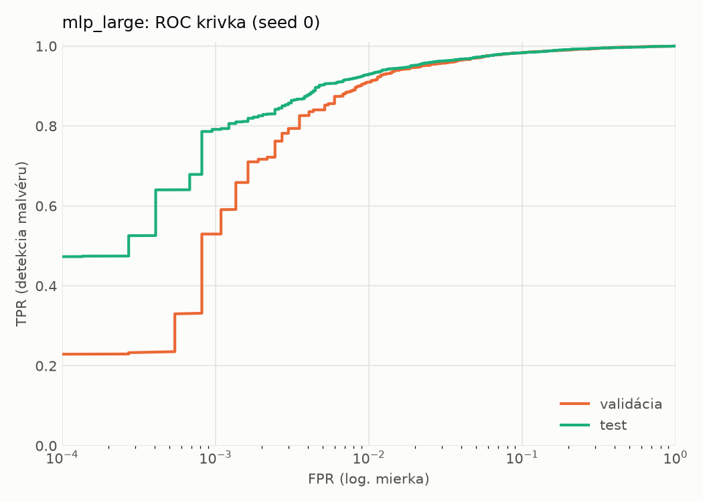
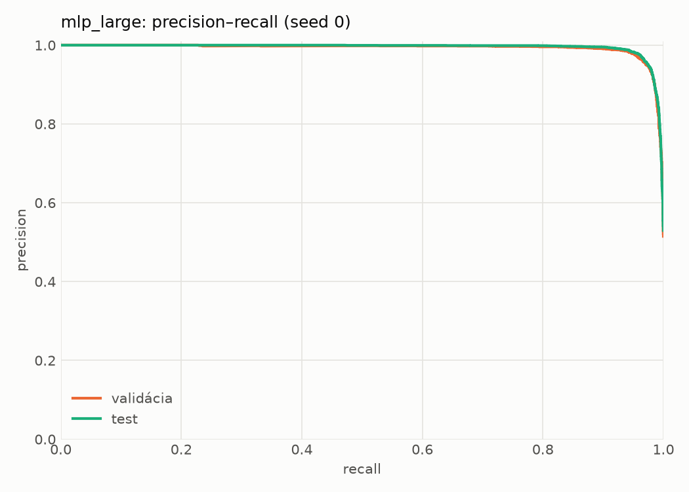
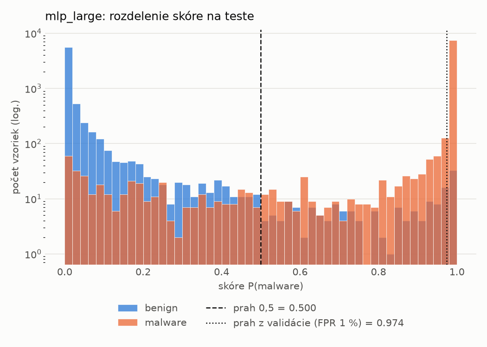
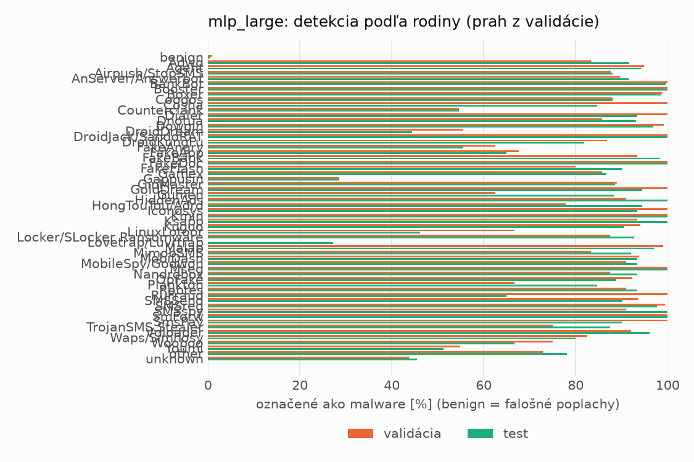
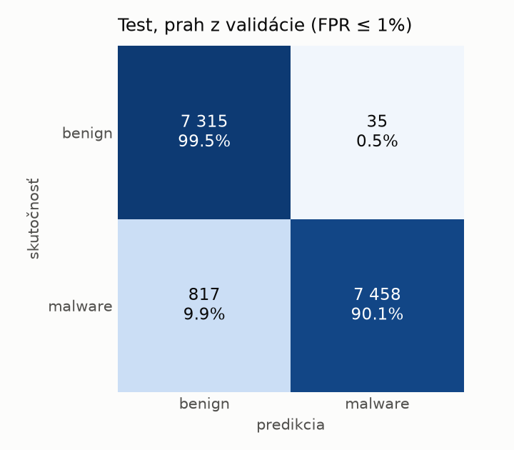
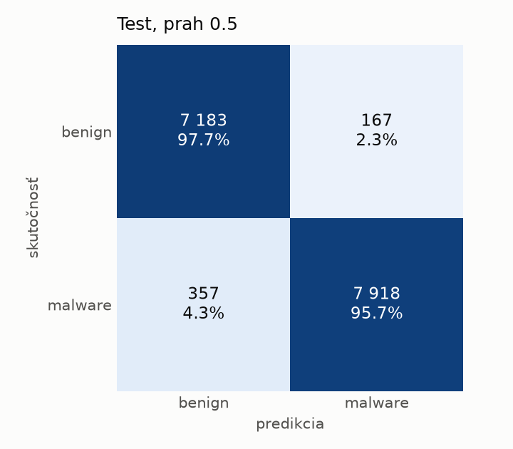
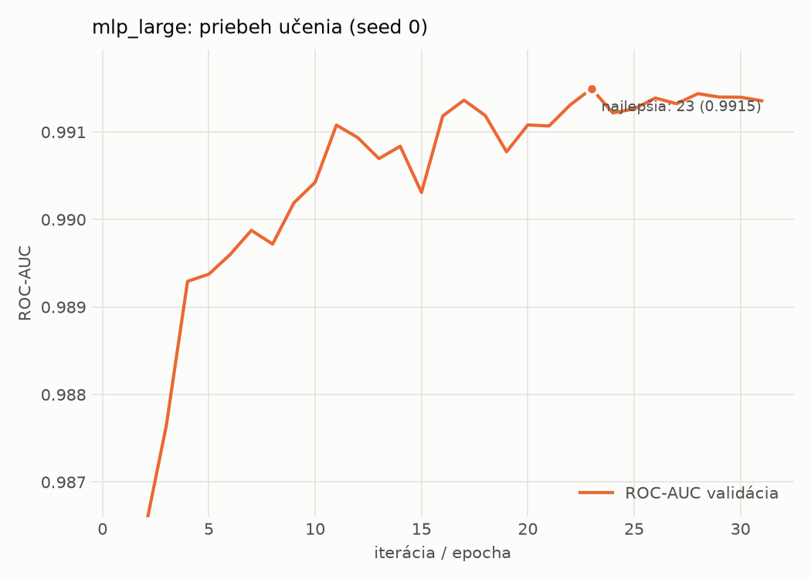

# static/mlp_large – beh `20261122-221059`

> Automaticky generované (`src/training/run_tabular.py`). Konfigurácia: `config.yaml`, protokol: `protocol.yaml`.

- **Model:** `mlp` – veľká neurónová sieť (3–5 skrytých vrstiev, 512–2048 neurónov), kandidát na učiteľa
- **Ladenie:** bez ladenia – hyperparametre prevzaté z `runs_v4/real_full/full/static/mlp_large/20261122-190815`
- **Finálne modely:** seedy [0, 1, 2]; hodnoty sú priemer ± smerodajná odchýlka cez seedy
- **Najlepšie hyperparametre:** `{"max_epochs": 100, "patience": 8, "hidden_layers": 3, "hidden_width": 512, "width_decay": 0.5, "dropout": 0.18301180344828658, "lr": 0.000378062291460712, "weight_decay": 1.421525321060219e-06, "batch_size": 256}`

## Detekčná kvalita (bez prahu)
| metrika | train (podvzorka) | validácia | test |
|---|---|---|---|
| ROC-AUC | 0.9980 ± 0.0002 | 0.9916 ± 0.0002 | 0.9917 ± 0.0008 |
| PR-AUC | 0.9984 ± 0.0002 | 0.9926 ± 0.0001 | 0.9938 ± 0.0006 |
| TPR pri FPR 1 % | 0.9775 ± 0.0024 | 0.9117 ± 0.0026 | 0.9328 ± 0.0042 |
| TPR pri FPR 0,1 % | 0.9421 ± 0.0079 | 0.5763 ± 0.0700 | 0.7789 ± 0.0153 |
| log loss | 0.0479 ± 0.0028 | 0.1179 ± 0.0017 | 0.1123 ± 0.0069 |
| Brier skóre | 0.0128 ± 0.0008 | 0.0275 ± 0.0012 | 0.0271 ± 0.0001 |

Rozdiel ROC-AUC train − validácia: **0.0063** (veľký rozdiel = preučenie).

## Pri prahu z validácie (FPR ≤ 1% na validácii)
| metrika | train (podvzorka) | validácia | test |
|---|---|---|---|
| accuracy | 0.9647 ± 0.0003 | 0.9498 ± 0.0013 | 0.9452 ± 0.0007 |
| balanced accuracy | 0.9651 ± 0.0003 | 0.9510 ± 0.0013 | 0.9479 ± 0.0006 |
| precision | 0.9994 ± 0.0000 | 0.9900 ± 0.0000 | 0.9948 ± 0.0008 |
| recall (TPR) | 0.9309 ± 0.0007 | 0.9117 ± 0.0026 | 0.9012 ± 0.0018 |
| FPR | 0.0006 ± 0.0000 | 0.0098 ± 0.0000 | 0.0053 ± 0.0008 |
| F1 | 0.9639 ± 0.0004 | 0.9492 ± 0.0014 | 0.9457 ± 0.0007 |
| MCC | 0.9317 ± 0.0006 | 0.9027 ± 0.0024 | 0.8950 ± 0.0012 |

## Pri pevnom prahu 0.5
| metrika | train (podvzorka) | validácia | test |
|---|---|---|---|
| accuracy | 0.9831 ± 0.0011 | 0.9650 ± 0.0027 | 0.9661 ± 0.0003 |
| balanced accuracy | 0.9832 ± 0.0011 | 0.9652 ± 0.0027 | 0.9668 ± 0.0002 |
| precision | 0.9930 ± 0.0010 | 0.9725 ± 0.0034 | 0.9805 ± 0.0020 |
| recall (TPR) | 0.9734 ± 0.0017 | 0.9591 ± 0.0033 | 0.9550 ± 0.0023 |
| FPR | 0.0070 ± 0.0010 | 0.0288 ± 0.0036 | 0.0214 ± 0.0022 |
| F1 | 0.9831 ± 0.0011 | 0.9658 ± 0.0026 | 0.9676 ± 0.0003 |
| MCC | 0.9663 ± 0.0022 | 0.9300 ± 0.0053 | 0.9325 ± 0.0005 |

## Výpočtové nároky (seed 0, testovacia množina)
| meranie | hodnota |
|---|---|
| tréning finálneho modelu | 14.6 s (priemer cez seedy) |
| ladenie spolu | 0 s |
| počet parametrov / uzlov | 250 625 |
| veľkosť modelu na disku | 1.02 MB |
| transformácia vstupu – latencia (1 vlákno) | 0.015 ms |
| transformácia vstupu – priepustnosť | 618 498 vzoriek/s |
| CPU latencia modelu (batch 1, 1 vlákno) | 0.134 ms (p95 0.323) |
| CPU priepustnosť (24 vlákien) | 896 273 vzoriek/s |
| GPU latencia (batch 1) | 0.443 ms (p95 0.905) |
| GPU priepustnosť | 865 392 vzoriek/s |
| GPU špičková pamäť | 144 MB |

## Grafy
| | |
|---|---|
|  |  |
|  |  |
|  |  |
|  |  |

## Súbory
`metrics.json` (všetky metriky po seedoch vrátane rodín), `timing.json`, `hpo_trials.csv`,
`predictions/<časť>_seed<N>.parquet` (sha256, family, label, score), `model/seed_<N>/`, `log.txt`.
