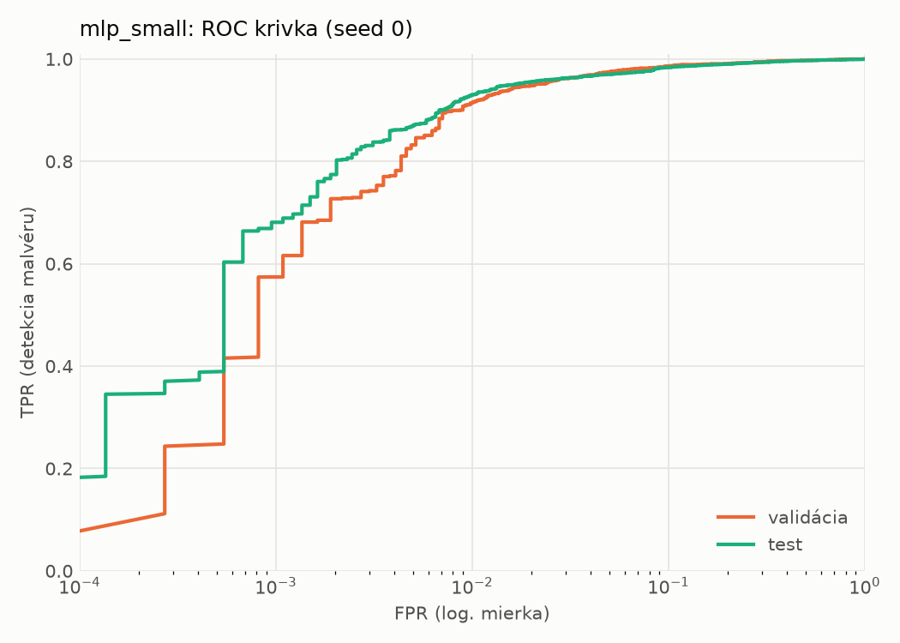
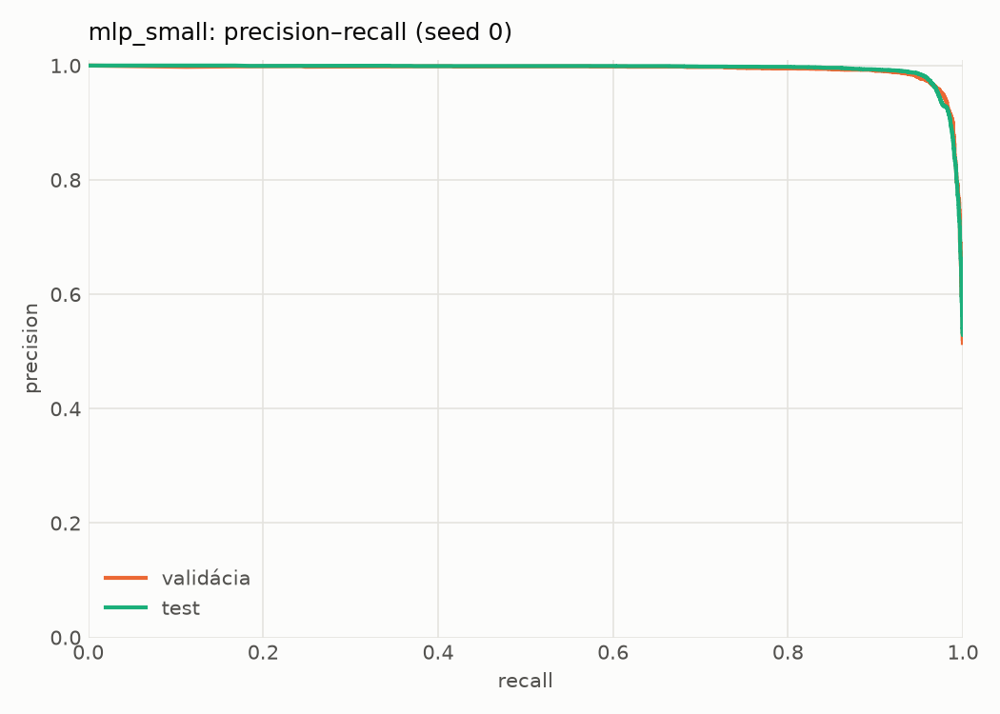
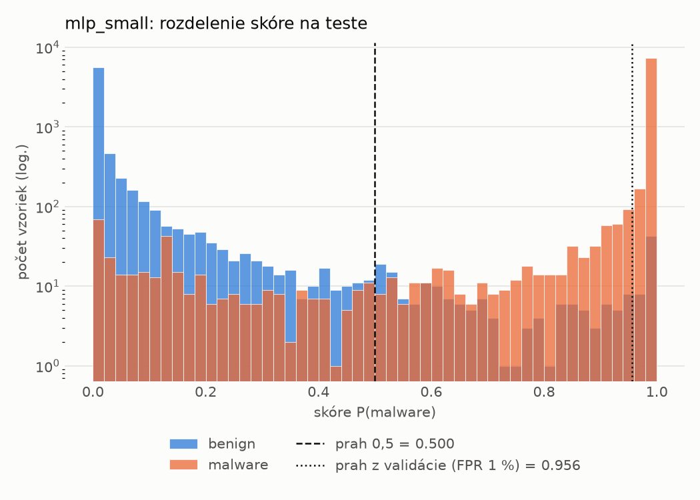
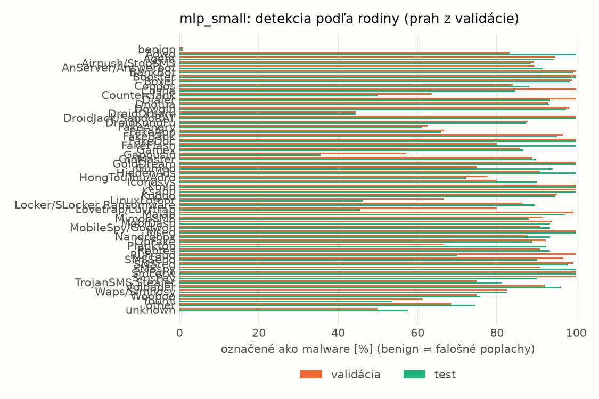
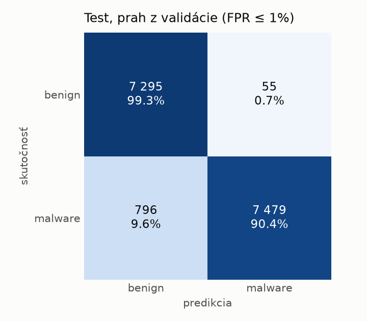
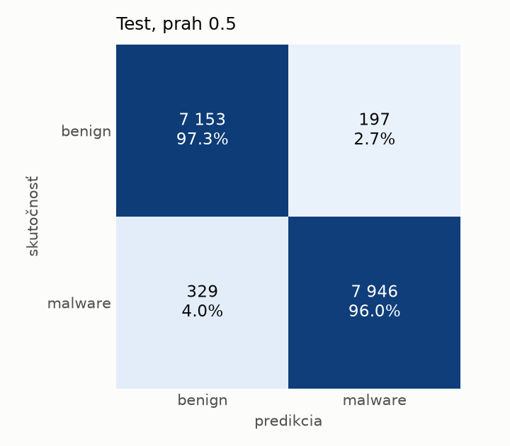
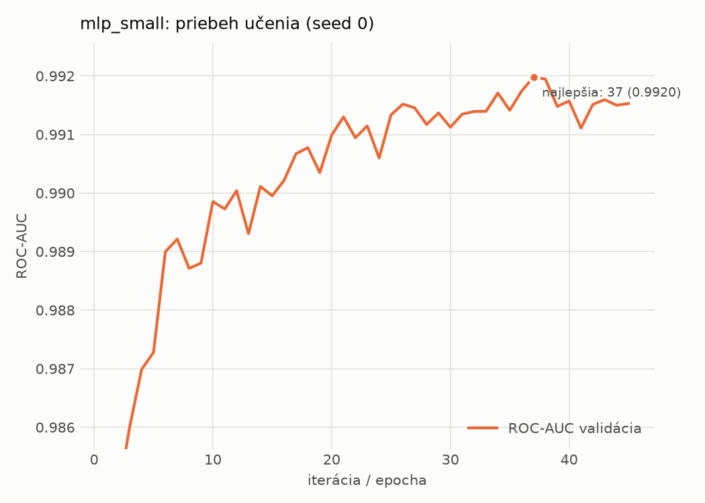

# static/mlp_small – beh `20261122-221006`

> Automaticky generované (`src/training/run_tabular.py`). Konfigurácia: `config.yaml`, protokol: `protocol.yaml`.

- **Model:** `mlp` – malá neurónová sieť (1–2 skryté vrstvy), kandidát na ľahkého študenta
- **Ladenie:** bez ladenia – hyperparametre prevzaté z `runs_v4/real_full/full/static/mlp_small/20261122-190134`
- **Finálne modely:** seedy [0, 1, 2]; hodnoty sú priemer ± smerodajná odchýlka cez seedy
- **Najlepšie hyperparametre:** `{"width_decay": 0.5, "max_epochs": 100, "patience": 8, "hidden_layers": 2, "hidden_width": 256, "dropout": 0.05428236214064427, "lr": 0.00041374253133077954, "weight_decay": 5.569517746104647e-06, "batch_size": 256}`

## Detekčná kvalita (bez prahu)
| metrika | train (podvzorka) | validácia | test |
|---|---|---|---|
| ROC-AUC | 0.9982 ± 0.0002 | 0.9918 ± 0.0002 | 0.9916 ± 0.0009 |
| PR-AUC | 0.9985 ± 0.0001 | 0.9925 ± 0.0006 | 0.9935 ± 0.0004 |
| TPR pri FPR 1 % | 0.9817 ± 0.0037 | 0.9143 ± 0.0027 | 0.9285 ± 0.0027 |
| TPR pri FPR 0,1 % | 0.9336 ± 0.0074 | 0.5999 ± 0.0339 | 0.6785 ± 0.0021 |
| log loss | 0.0454 ± 0.0028 | 0.1156 ± 0.0013 | 0.1132 ± 0.0044 |
| Brier skóre | 0.0116 ± 0.0009 | 0.0277 ± 0.0008 | 0.0268 ± 0.0002 |

Rozdiel ROC-AUC train − validácia: **0.0064** (veľký rozdiel = preučenie).

## Pri prahu z validácie (FPR ≤ 1% na validácii)
| metrika | train (podvzorka) | validácia | test |
|---|---|---|---|
| accuracy | 0.9657 ± 0.0020 | 0.9511 ± 0.0014 | 0.9464 ± 0.0024 |
| balanced accuracy | 0.9661 ± 0.0020 | 0.9522 ± 0.0014 | 0.9490 ± 0.0023 |
| precision | 0.9992 ± 0.0002 | 0.9900 ± 0.0000 | 0.9930 ± 0.0003 |
| recall (TPR) | 0.9331 ± 0.0039 | 0.9143 ± 0.0027 | 0.9052 ± 0.0044 |
| FPR | 0.0008 ± 0.0002 | 0.0098 ± 0.0000 | 0.0072 ± 0.0003 |
| F1 | 0.9650 ± 0.0021 | 0.9506 ± 0.0015 | 0.9470 ± 0.0025 |
| MCC | 0.9336 ± 0.0038 | 0.9052 ± 0.0026 | 0.8969 ± 0.0045 |

## Pri pevnom prahu 0.5
| metrika | train (podvzorka) | validácia | test |
|---|---|---|---|
| accuracy | 0.9856 ± 0.0014 | 0.9648 ± 0.0011 | 0.9663 ± 0.0002 |
| balanced accuracy | 0.9856 ± 0.0014 | 0.9648 ± 0.0011 | 0.9667 ± 0.0001 |
| precision | 0.9910 ± 0.0015 | 0.9671 ± 0.0016 | 0.9762 ± 0.0015 |
| recall (TPR) | 0.9804 ± 0.0025 | 0.9644 ± 0.0004 | 0.9598 ± 0.0019 |
| FPR | 0.0091 ± 0.0015 | 0.0348 ± 0.0018 | 0.0263 ± 0.0018 |
| F1 | 0.9857 ± 0.0014 | 0.9657 ± 0.0010 | 0.9679 ± 0.0002 |
| MCC | 0.9712 ± 0.0028 | 0.9295 ± 0.0022 | 0.9327 ± 0.0003 |

## Výpočtové nároky (seed 0, testovacia množina)
| meranie | hodnota |
|---|---|
| tréning finálneho modelu | 16.8 s (priemer cez seedy) |
| ladenie spolu | 0 s |
| počet parametrov / uzlov | 76 033 |
| veľkosť modelu na disku | 0.32 MB |
| transformácia vstupu – latencia (1 vlákno) | 0.015 ms |
| transformácia vstupu – priepustnosť | 548 469 vzoriek/s |
| CPU latencia modelu (batch 1, 1 vlákno) | 0.230 ms (p95 0.244) |
| CPU priepustnosť (24 vlákien) | 1 417 825 vzoriek/s |
| GPU latencia (batch 1) | 0.646 ms (p95 0.674) |
| GPU priepustnosť | 1 413 464 vzoriek/s |
| GPU špičková pamäť | 85 MB |

## Grafy
| | |
|---|---|
|  |  |
|  |  |
|  |  |
|  |  |

## Súbory
`metrics.json` (všetky metriky po seedoch vrátane rodín), `timing.json`, `hpo_trials.csv`,
`predictions/<časť>_seed<N>.parquet` (sha256, family, label, score), `model/seed_<N>/`, `log.txt`.
