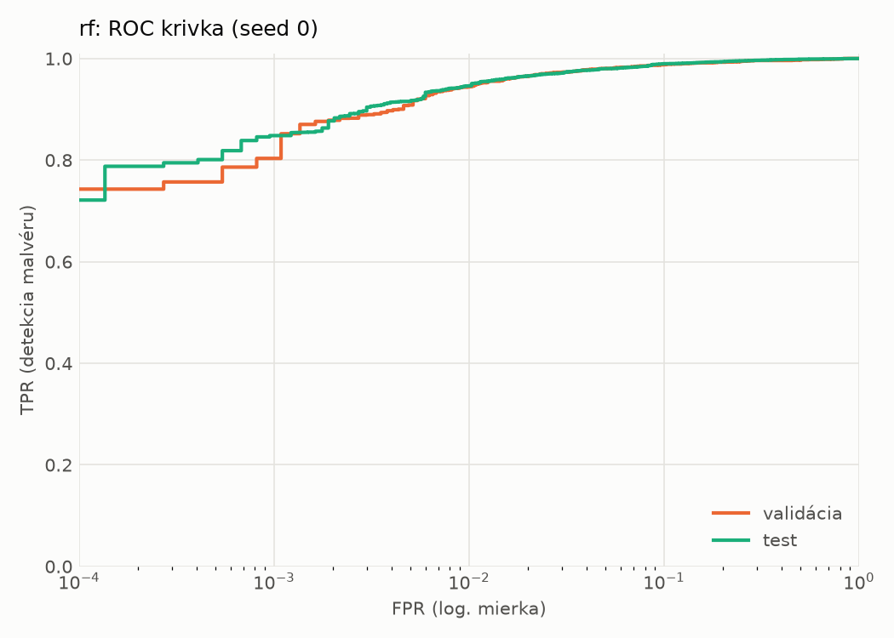
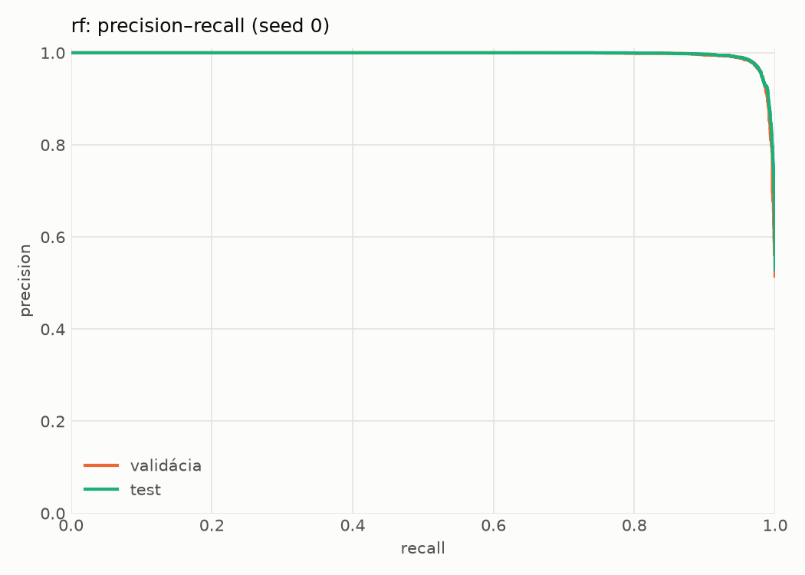
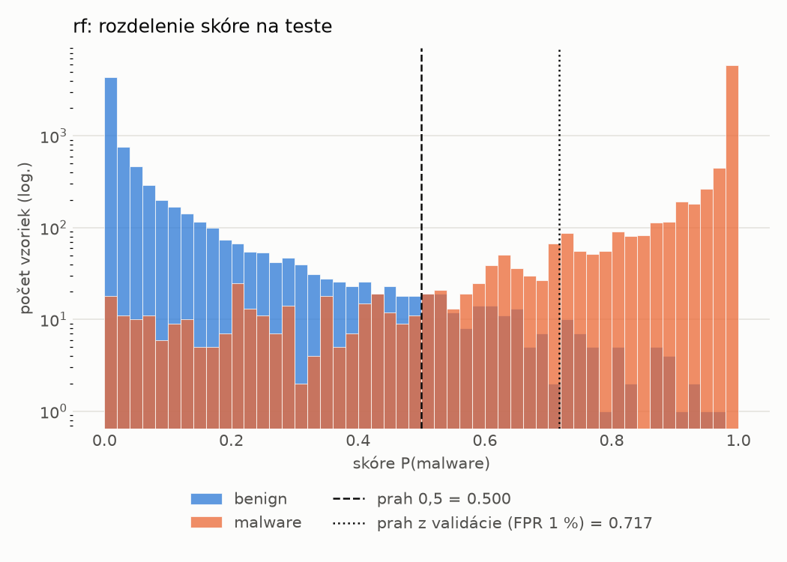
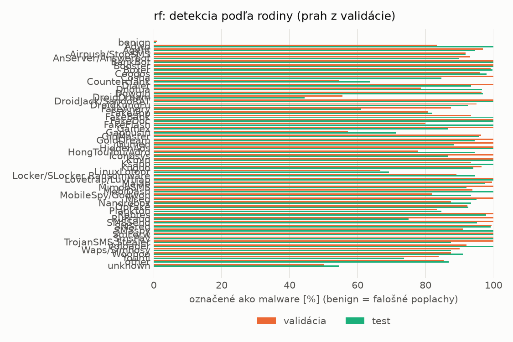
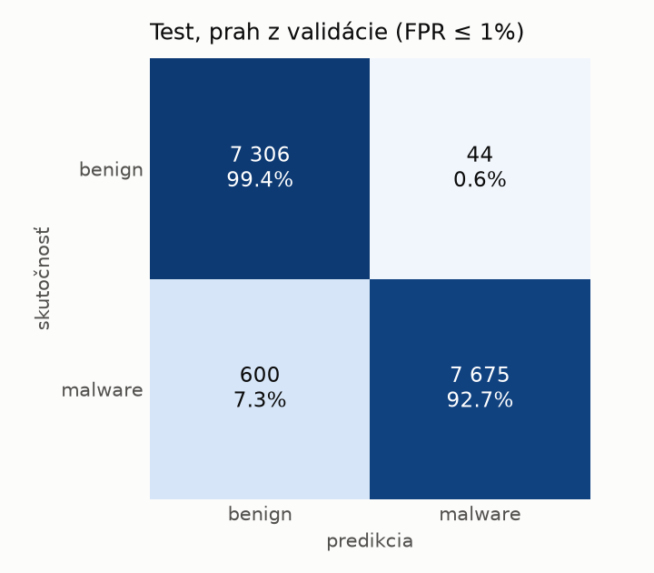
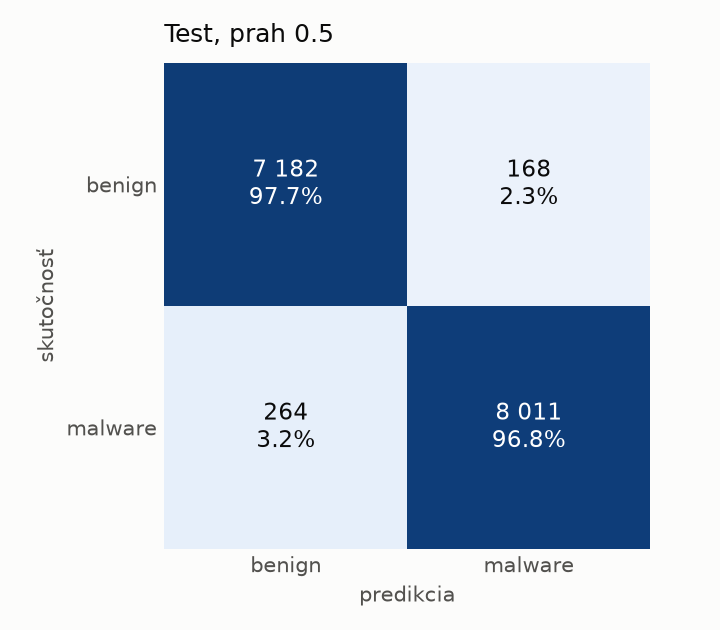

# static/rf – beh `20261122-220856`

> Automaticky generované (`src/training/run_tabular.py`). Konfigurácia: `config.yaml`, protokol: `protocol.yaml`.

- **Model:** `random_forest` – Random Forest (pôvodné hodnoty príznakov)
- **Ladenie:** bez ladenia – hyperparametre prevzaté z `runs_v4/real_full/full/static/rf/20261122-184723`
- **Finálne modely:** seedy [0, 1, 2]; hodnoty sú priemer ± smerodajná odchýlka cez seedy
- **Najlepšie hyperparametre:** `{"n_estimators": 400, "max_depth": 32, "min_samples_leaf": 1, "max_features": "sqrt"}`

## Detekčná kvalita (bez prahu)
| metrika | train (podvzorka) | validácia | test |
|---|---|---|---|
| ROC-AUC | 1.0000 ± 0.0000 | 0.9943 ± 0.0000 | 0.9950 ± 0.0001 |
| PR-AUC | 1.0000 ± 0.0000 | 0.9957 ± 0.0000 | 0.9962 ± 0.0000 |
| TPR pri FPR 1 % | 1.0000 ± 0.0000 | 0.9481 ± 0.0037 | 0.9454 ± 0.0021 |
| TPR pri FPR 0,1 % | 1.0000 ± 0.0000 | 0.8209 ± 0.0165 | 0.8539 ± 0.0049 |
| log loss | 0.0256 ± 0.0002 | 0.0907 ± 0.0003 | 0.0922 ± 0.0003 |
| Brier skóre | 0.0038 ± 0.0001 | 0.0235 ± 0.0000 | 0.0241 ± 0.0001 |

Rozdiel ROC-AUC train − validácia: **0.0057** (veľký rozdiel = preučenie).

## Pri prahu z validácie (FPR ≤ 1% na validácii)
| metrika | train (podvzorka) | validácia | test |
|---|---|---|---|
| accuracy | 0.9915 ± 0.0007 | 0.9685 ± 0.0019 | 0.9597 ± 0.0023 |
| balanced accuracy | 0.9916 ± 0.0007 | 0.9692 ± 0.0018 | 0.9616 ± 0.0022 |
| precision | 1.0000 ± 0.0000 | 0.9904 ± 0.0000 | 0.9938 ± 0.0006 |
| recall (TPR) | 0.9831 ± 0.0013 | 0.9481 ± 0.0037 | 0.9296 ± 0.0049 |
| FPR | 0.0000 ± 0.0000 | 0.0098 ± 0.0000 | 0.0065 ± 0.0006 |
| F1 | 0.9915 ± 0.0007 | 0.9688 ± 0.0019 | 0.9606 ± 0.0024 |
| MCC | 0.9831 ± 0.0013 | 0.9380 ± 0.0036 | 0.9215 ± 0.0043 |

## Pri pevnom prahu 0.5
| metrika | train (podvzorka) | validácia | test |
|---|---|---|---|
| accuracy | 0.9994 ± 0.0001 | 0.9715 ± 0.0004 | 0.9722 ± 0.0002 |
| balanced accuracy | 0.9994 ± 0.0001 | 0.9715 ± 0.0004 | 0.9725 ± 0.0002 |
| precision | 1.0000 ± 0.0000 | 0.9721 ± 0.0005 | 0.9796 ± 0.0004 |
| recall (TPR) | 0.9988 ± 0.0002 | 0.9727 ± 0.0008 | 0.9677 ± 0.0003 |
| FPR | 0.0000 ± 0.0000 | 0.0297 ± 0.0005 | 0.0227 ± 0.0004 |
| F1 | 0.9994 ± 0.0001 | 0.9724 ± 0.0004 | 0.9736 ± 0.0002 |
| MCC | 0.9988 ± 0.0002 | 0.9430 ± 0.0008 | 0.9444 ± 0.0004 |

## Výpočtové nároky (seed 0, testovacia množina)
| meranie | hodnota |
|---|---|
| tréning finálneho modelu | 1.9 s (priemer cez seedy) |
| ladenie spolu | 0 s |
| počet parametrov / uzlov | 2 567 808 |
| veľkosť modelu na disku | 205.80 MB |
| CPU latencia modelu (batch 1, 1 vlákno) | 12.041 ms (p95 12.466) |
| CPU priepustnosť (24 vlákien) | 148 901 vzoriek/s |

## Grafy
| | |
|---|---|
|  |  |
|  |  |
|  |  |
|  |  |

## Súbory
`metrics.json` (všetky metriky po seedoch vrátane rodín), `timing.json`, `hpo_trials.csv`,
`predictions/<časť>_seed<N>.parquet` (sha256, family, label, score), `model/seed_<N>/`, `log.txt`.
