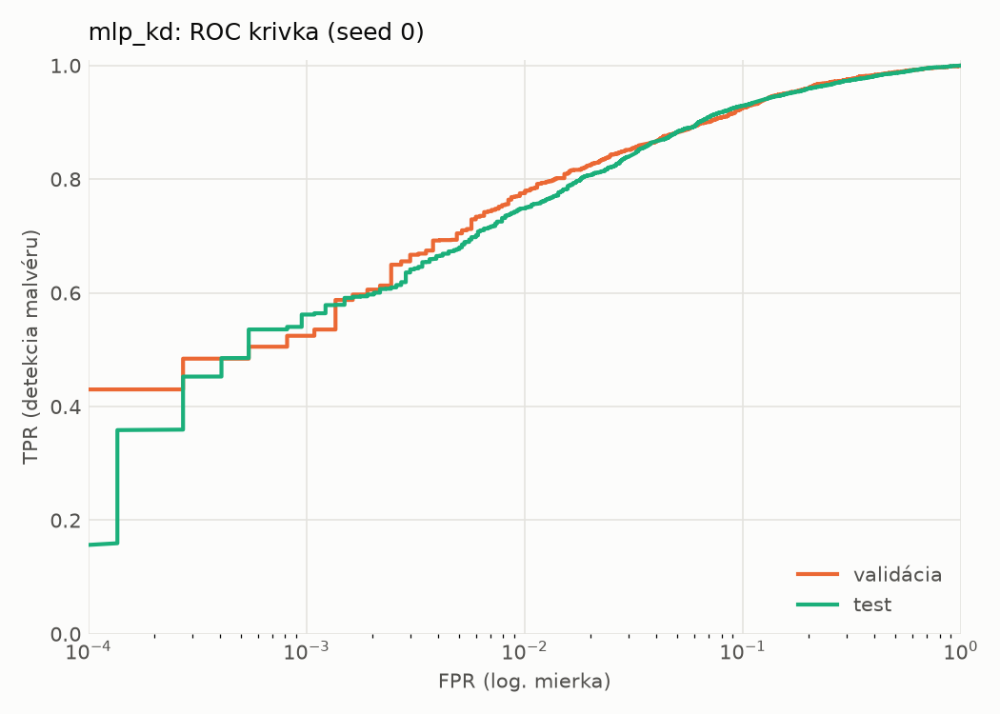
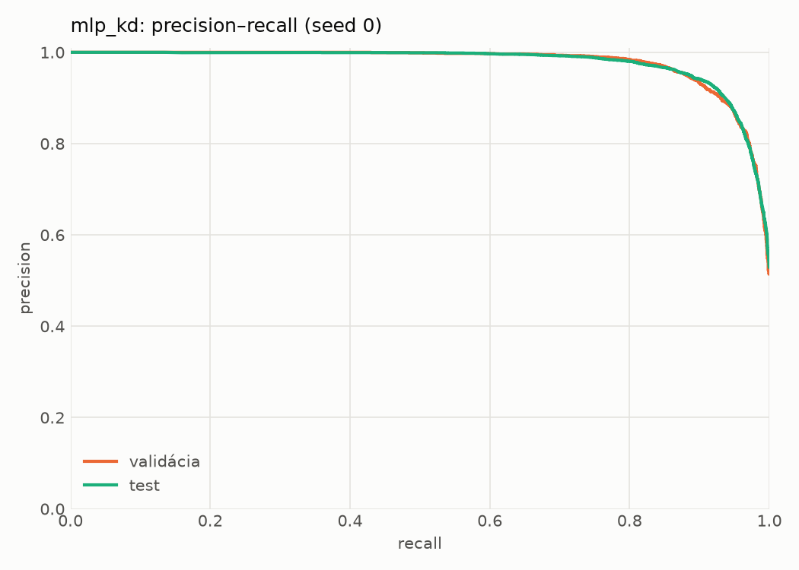
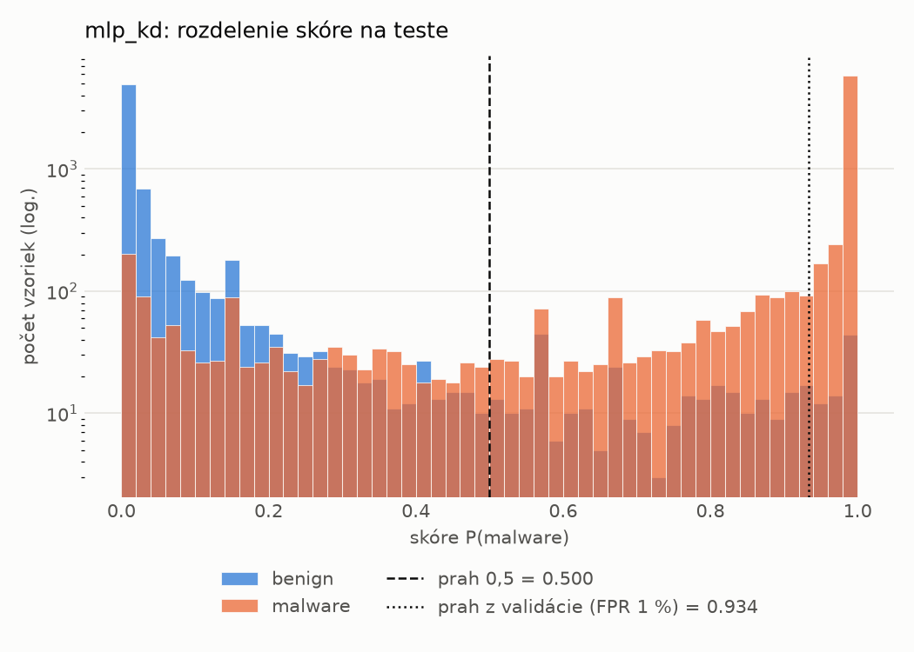
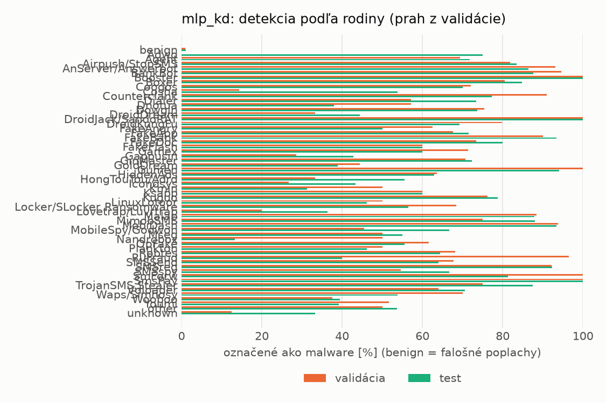
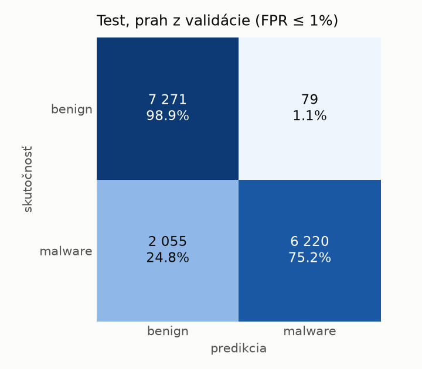
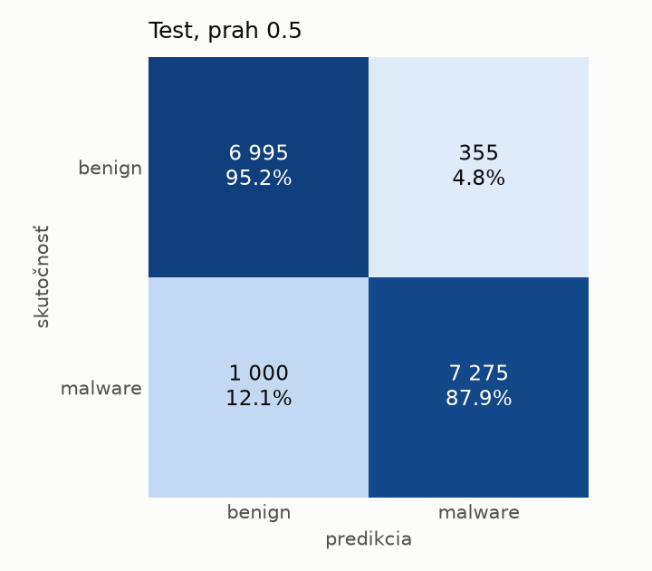
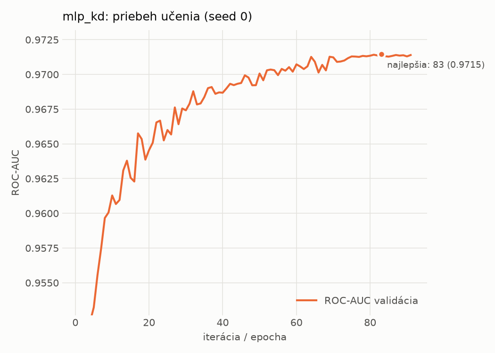

# dynamic/mlp_kd – beh `20261122-222429`

> Automaticky generované (`src/training/run_tabular.py`). Konfigurácia: `config.yaml`, protokol: `protocol.yaml`.

- **Model:** `mlp` – študent – malé MLP učené destiláciou z hybridného učiteľa
- **Ladenie:** bez ladenia – hyperparametre prevzaté z `runs_v4/real_full/full/students_dynamic/mlp_kd/20261122-205301`
- **Finálne modely:** seedy [0, 1, 2]; hodnoty sú priemer ± smerodajná odchýlka cez seedy
- **Najlepšie hyperparametre:** `{"hidden_layers": 1, "max_epochs": 100, "patience": 8, "hidden_width": 64, "dropout": 0.03643763137351852, "lr": 0.0028753520300020953, "weight_decay": 0.00022273244560059002, "batch_size": 512, "kd_alpha": 0.33129867518829337, "kd_temperature": 1.9602594769462303}`

## Detekčná kvalita (bez prahu)
| metrika | train (podvzorka) | validácia | test |
|---|---|---|---|
| ROC-AUC | 0.9802 ± 0.0008 | 0.9712 ± 0.0008 | 0.9703 ± 0.0006 |
| PR-AUC | 0.9842 ± 0.0006 | 0.9771 ± 0.0007 | 0.9774 ± 0.0006 |
| TPR pri FPR 1 % | 0.8366 ± 0.0081 | 0.7691 ± 0.0084 | 0.7481 ± 0.0053 |
| TPR pri FPR 0,1 % | 0.6739 ± 0.0186 | 0.5398 ± 0.0484 | 0.5662 ± 0.0054 |
| log loss | 0.1823 ± 0.0042 | 0.2458 ± 0.0035 | 0.2509 ± 0.0035 |
| Brier skóre | 0.0498 ± 0.0012 | 0.0651 ± 0.0008 | 0.0665 ± 0.0010 |

Rozdiel ROC-AUC train − validácia: **0.0090** (veľký rozdiel = preučenie).

## Pri prahu z validácie (FPR ≤ 1% na validácii)
| metrika | train (podvzorka) | validácia | test |
|---|---|---|---|
| accuracy | 0.8902 ± 0.0046 | 0.8764 ± 0.0043 | 0.8604 ± 0.0047 |
| balanced accuracy | 0.8915 ± 0.0046 | 0.8797 ± 0.0042 | 0.8676 ± 0.0044 |
| precision | 0.9939 ± 0.0012 | 0.9881 ± 0.0001 | 0.9886 ± 0.0011 |
| recall (TPR) | 0.7879 ± 0.0093 | 0.7691 ± 0.0084 | 0.7449 ± 0.0092 |
| FPR | 0.0049 ± 0.0010 | 0.0098 ± 0.0000 | 0.0097 ± 0.0010 |
| F1 | 0.8790 ± 0.0057 | 0.8650 ± 0.0054 | 0.8496 ± 0.0059 |
| MCC | 0.7987 ± 0.0078 | 0.7744 ± 0.0072 | 0.7494 ± 0.0075 |

## Pri pevnom prahu 0.5
| metrika | train (podvzorka) | validácia | test |
|---|---|---|---|
| accuracy | 0.9343 ± 0.0028 | 0.9151 ± 0.0006 | 0.9141 ± 0.0009 |
| balanced accuracy | 0.9346 ± 0.0028 | 0.9157 ± 0.0006 | 0.9162 ± 0.0008 |
| precision | 0.9540 ± 0.0018 | 0.9386 ± 0.0030 | 0.9534 ± 0.0010 |
| recall (TPR) | 0.9144 ± 0.0039 | 0.8935 ± 0.0033 | 0.8808 ± 0.0026 |
| FPR | 0.0452 ± 0.0017 | 0.0620 ± 0.0034 | 0.0484 ± 0.0012 |
| F1 | 0.9338 ± 0.0029 | 0.9155 ± 0.0007 | 0.9157 ± 0.0010 |
| MCC | 0.8695 ± 0.0055 | 0.8313 ± 0.0012 | 0.8311 ± 0.0016 |

## Výpočtové nároky (seed 0, testovacia množina)
| meranie | hodnota |
|---|---|
| tréning finálneho modelu | 15.5 s (priemer cez seedy) |
| ladenie spolu | 0 s |
| počet parametrov / uzlov | 8 641 |
| veľkosť modelu na disku | 0.04 MB |
| transformácia vstupu – latencia (1 vlákno) | 0.006 ms |
| transformácia vstupu – priepustnosť | 1 185 760 vzoriek/s |
| CPU latencia modelu (batch 1, 1 vlákno) | 0.072 ms (p95 0.079) |
| CPU priepustnosť (24 vlákien) | 7 206 438 vzoriek/s |
| GPU latencia (batch 1) | 0.284 ms (p95 0.326) |
| GPU priepustnosť | 2 888 971 vzoriek/s |
| GPU špičková pamäť | 62 MB |

## Grafy
| | |
|---|---|
|  |  |
|  |  |
|  |  |
|  |  |

## Súbory
`metrics.json` (všetky metriky po seedoch vrátane rodín), `timing.json`, `hpo_trials.csv`,
`predictions/<časť>_seed<N>.parquet` (sha256, family, label, score), `model/seed_<N>/`, `log.txt`.
