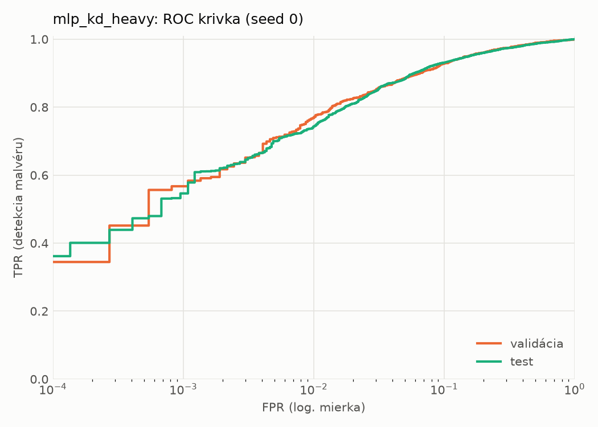
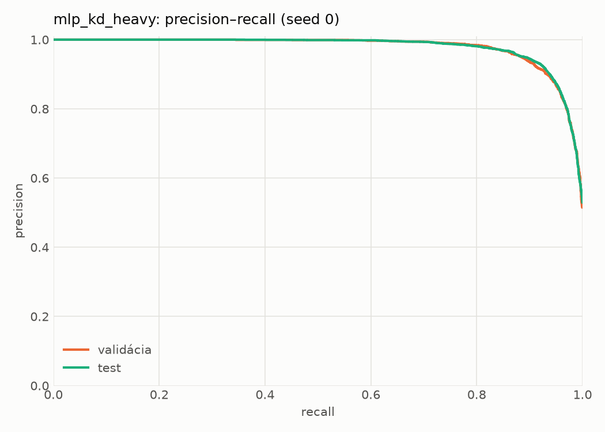
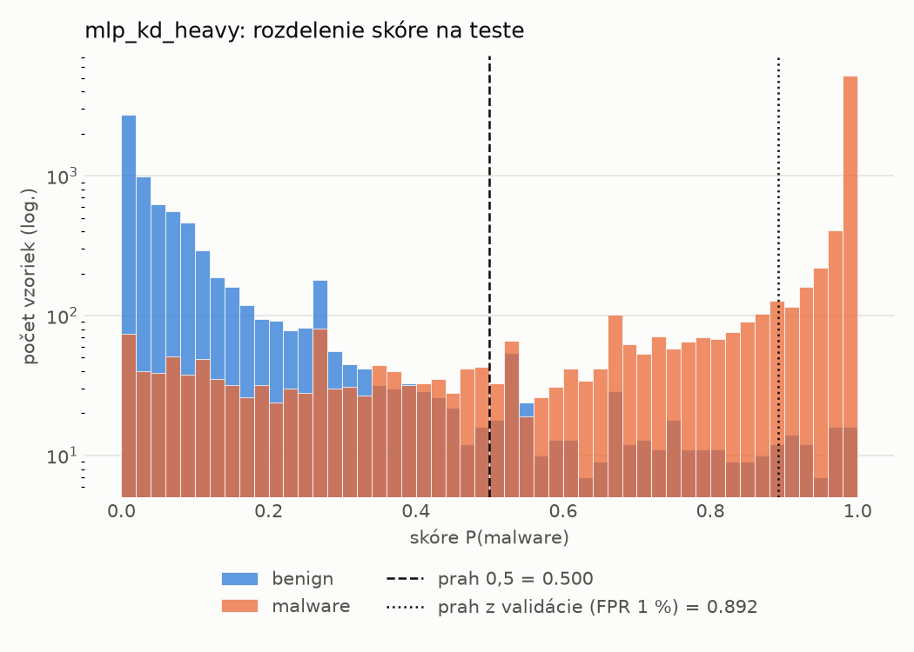
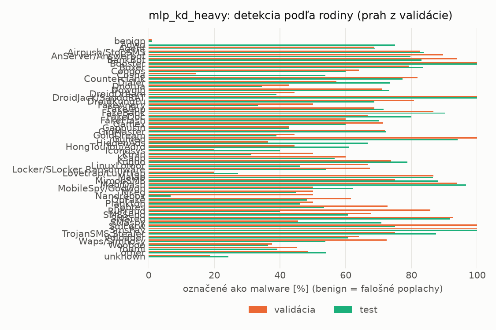
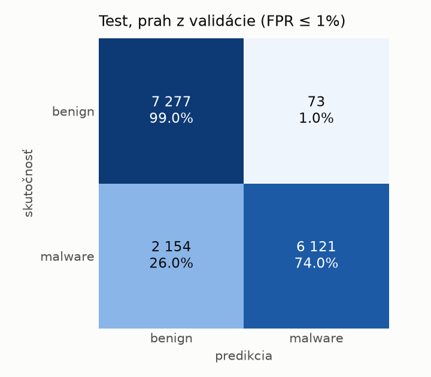
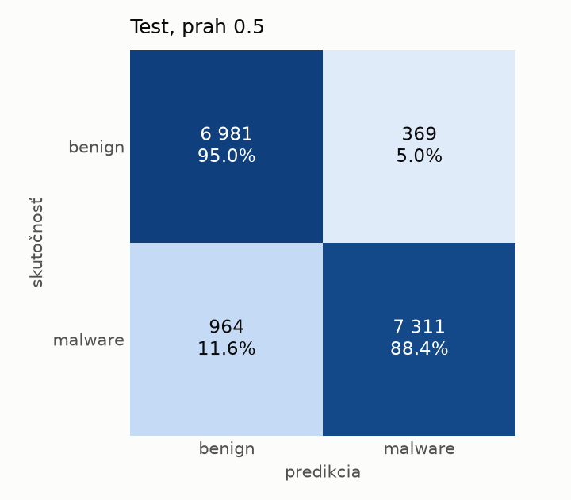
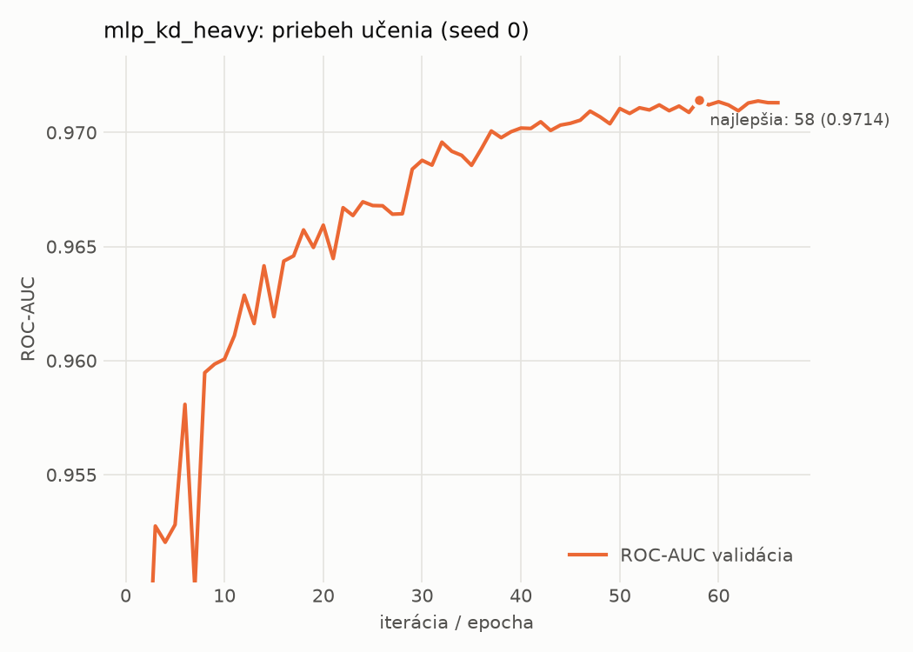

# dynamic/mlp_kd_heavy – beh `20261122-222652`

> Automaticky generované (`src/training/run_tabular.py`). Konfigurácia: `config.yaml`, protokol: `protocol.yaml`.

- **Model:** `mlp` – študent – malé MLP učené destiláciou z mlp_large hybridu (V4)
- **Ladenie:** bez ladenia – hyperparametre prevzaté z `runs_v4/real_full/full/students_dynamic/mlp_kd_heavy/20261122-211545`
- **Finálne modely:** seedy [0, 1, 2]; hodnoty sú priemer ± smerodajná odchýlka cez seedy
- **Najlepšie hyperparametre:** `{"hidden_layers": 1, "max_epochs": 100, "patience": 8, "hidden_width": 64, "dropout": 0.029123066185724737, "lr": 0.0017081972585601675, "weight_decay": 1.0334419171964511e-06, "batch_size": 256, "kd_alpha": 0.8514630095462001, "kd_temperature": 1.2684929468645387}`

## Detekčná kvalita (bez prahu)
| metrika | train (podvzorka) | validácia | test |
|---|---|---|---|
| ROC-AUC | 0.9812 ± 0.0007 | 0.9710 ± 0.0005 | 0.9700 ± 0.0004 |
| PR-AUC | 0.9849 ± 0.0006 | 0.9771 ± 0.0005 | 0.9776 ± 0.0003 |
| TPR pri FPR 1 % | 0.8369 ± 0.0092 | 0.7629 ± 0.0087 | 0.7426 ± 0.0017 |
| TPR pri FPR 0,1 % | 0.6818 ± 0.0227 | 0.5444 ± 0.0370 | 0.5767 ± 0.0321 |
| log loss | 0.1674 ± 0.0043 | 0.2151 ± 0.0028 | 0.2206 ± 0.0016 |
| Brier skóre | 0.0483 ± 0.0013 | 0.0623 ± 0.0011 | 0.0639 ± 0.0009 |

Rozdiel ROC-AUC train − validácia: **0.0102** (veľký rozdiel = preučenie).

## Pri prahu z validácie (FPR ≤ 1% na validácii)
| metrika | train (podvzorka) | validácia | test |
|---|---|---|---|
| accuracy | 0.8895 ± 0.0035 | 0.8732 ± 0.0045 | 0.8567 ± 0.0045 |
| balanced accuracy | 0.8909 ± 0.0034 | 0.8765 ± 0.0043 | 0.8642 ± 0.0042 |
| precision | 0.9948 ± 0.0006 | 0.9880 ± 0.0001 | 0.9889 ± 0.0013 |
| recall (TPR) | 0.7860 ± 0.0071 | 0.7629 ± 0.0087 | 0.7377 ± 0.0096 |
| FPR | 0.0043 ± 0.0005 | 0.0098 ± 0.0000 | 0.0093 ± 0.0012 |
| F1 | 0.8781 ± 0.0043 | 0.8610 ± 0.0056 | 0.8450 ± 0.0059 |
| MCC | 0.7978 ± 0.0057 | 0.7691 ± 0.0074 | 0.7437 ± 0.0068 |

## Pri pevnom prahu 0.5
| metrika | train (podvzorka) | validácia | test |
|---|---|---|---|
| accuracy | 0.9362 ± 0.0019 | 0.9150 ± 0.0014 | 0.9145 ± 0.0005 |
| balanced accuracy | 0.9365 ± 0.0018 | 0.9158 ± 0.0013 | 0.9167 ± 0.0005 |
| precision | 0.9595 ± 0.0041 | 0.9412 ± 0.0034 | 0.9561 ± 0.0036 |
| recall (TPR) | 0.9126 ± 0.0080 | 0.8906 ± 0.0066 | 0.8788 ± 0.0042 |
| FPR | 0.0396 ± 0.0045 | 0.0590 ± 0.0041 | 0.0454 ± 0.0042 |
| F1 | 0.9354 ± 0.0023 | 0.9152 ± 0.0019 | 0.9158 ± 0.0007 |
| MCC | 0.8736 ± 0.0032 | 0.8315 ± 0.0024 | 0.8322 ± 0.0009 |

## Výpočtové nároky (seed 0, testovacia množina)
| meranie | hodnota |
|---|---|
| tréning finálneho modelu | 20.5 s (priemer cez seedy) |
| ladenie spolu | 0 s |
| počet parametrov / uzlov | 8 641 |
| veľkosť modelu na disku | 0.04 MB |
| transformácia vstupu – latencia (1 vlákno) | 0.015 ms |
| transformácia vstupu – priepustnosť | 741 055 vzoriek/s |
| CPU latencia modelu (batch 1, 1 vlákno) | 0.157 ms (p95 0.167) |
| CPU priepustnosť (24 vlákien) | 5 163 241 vzoriek/s |
| GPU latencia (batch 1) | 0.451 ms (p95 0.481) |
| GPU priepustnosť | 3 108 092 vzoriek/s |
| GPU špičková pamäť | 93 MB |

## Grafy
| | |
|---|---|
|  |  |
|  |  |
|  |  |
|  |  |

## Súbory
`metrics.json` (všetky metriky po seedoch vrátane rodín), `timing.json`, `hpo_trials.csv`,
`predictions/<časť>_seed<N>.parquet` (sha256, family, label, score), `model/seed_<N>/`, `log.txt`.
