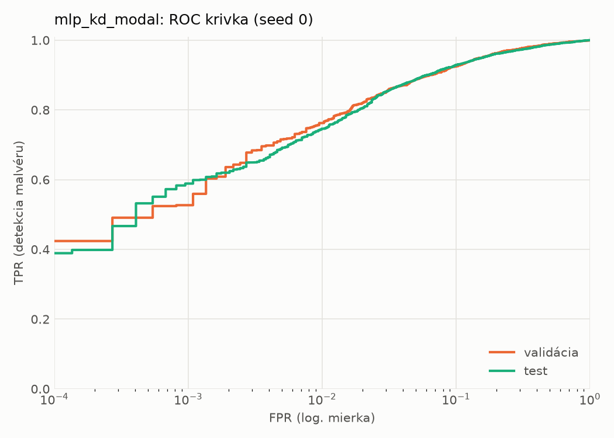
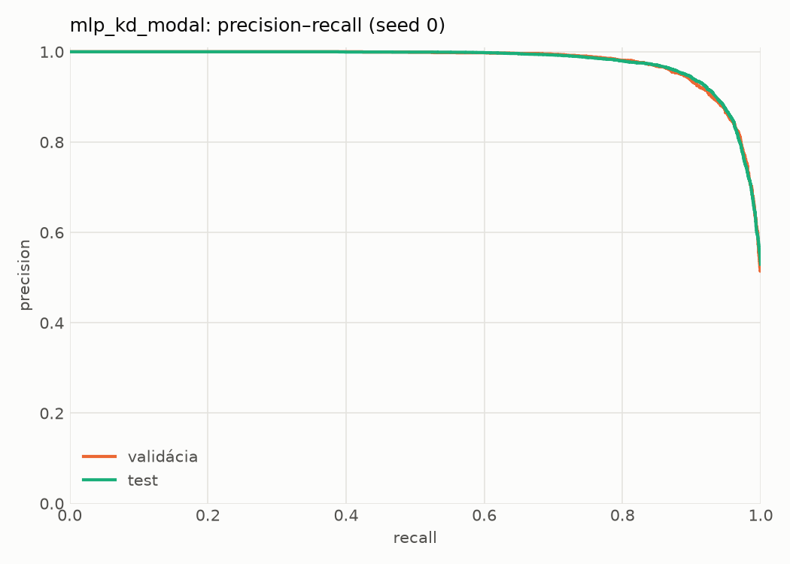
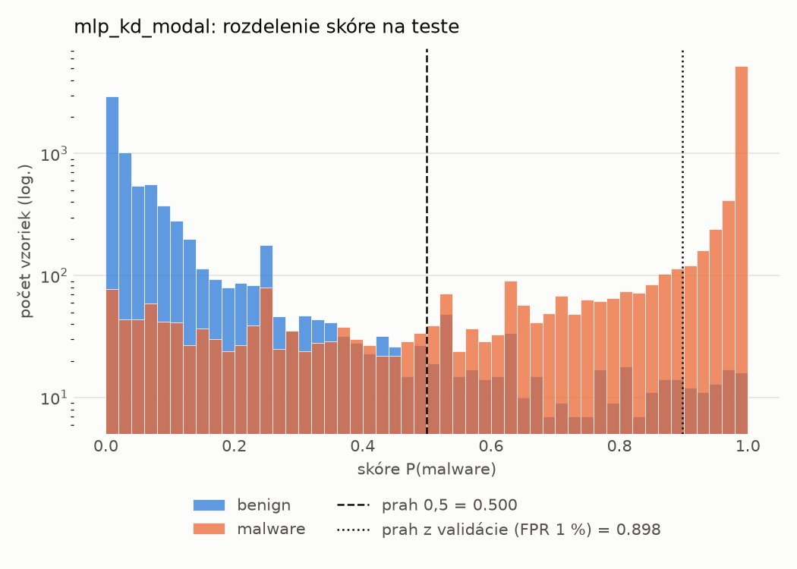
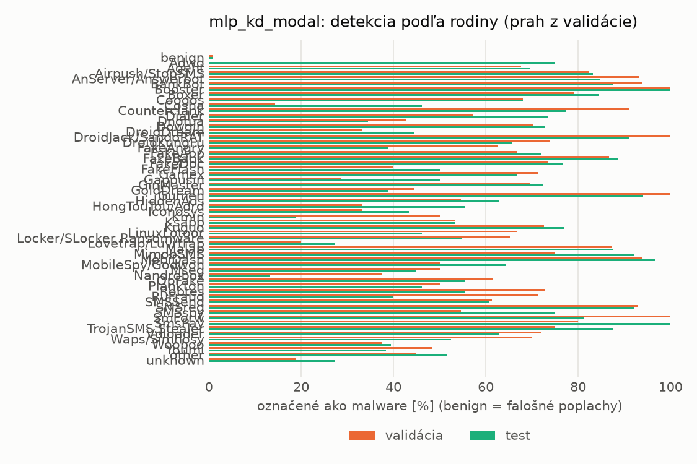
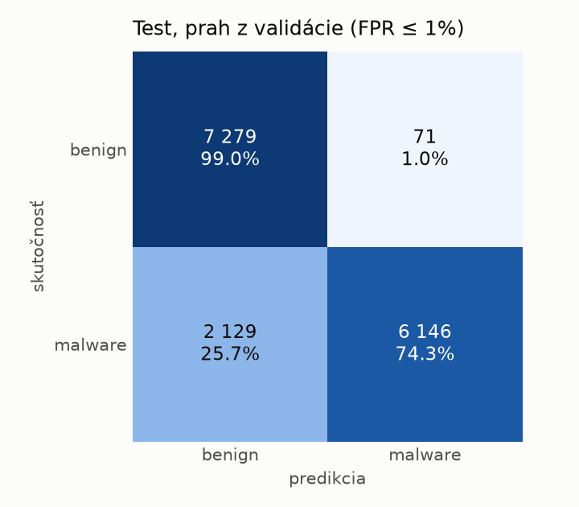
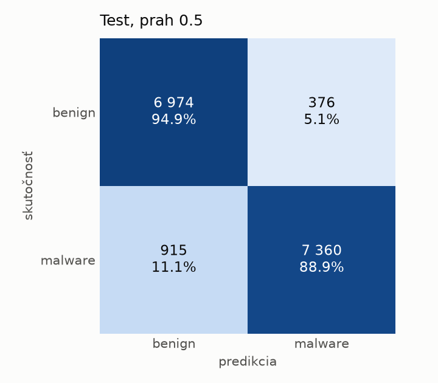
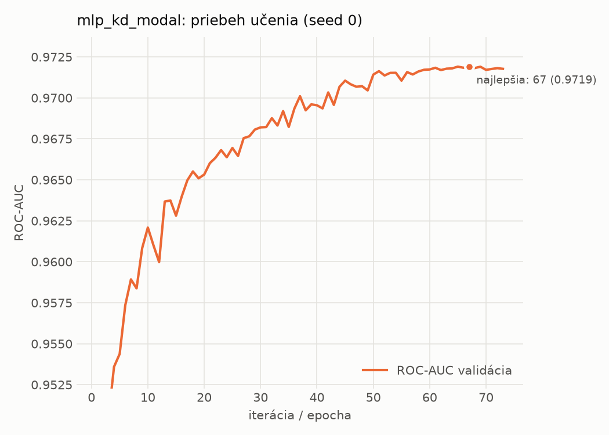

# dynamic/mlp_kd_modal – beh `20261122-222607`

> Automaticky generované (`src/training/run_tabular.py`). Konfigurácia: `config.yaml`, protokol: `protocol.yaml`.

- **Model:** `mlp` – študent – malé MLP učené destiláciou z učiteľa rovnakej modality (variant A)
- **Ladenie:** bez ladenia – hyperparametre prevzaté z `runs_v4/real_full/full/students_dynamic/mlp_kd_modal/20261122-210858`
- **Finálne modely:** seedy [0, 1, 2]; hodnoty sú priemer ± smerodajná odchýlka cez seedy
- **Najlepšie hyperparametre:** `{"hidden_layers": 1, "max_epochs": 100, "patience": 8, "hidden_width": 64, "dropout": 0.014842517384265013, "lr": 0.0018389280483922955, "weight_decay": 7.464279126466132e-05, "batch_size": 512, "kd_alpha": 0.45301900884301544, "kd_temperature": 1.2914074151312493}`

## Detekčná kvalita (bez prahu)
| metrika | train (podvzorka) | validácia | test |
|---|---|---|---|
| ROC-AUC | 0.9801 ± 0.0004 | 0.9715 ± 0.0005 | 0.9704 ± 0.0004 |
| PR-AUC | 0.9841 ± 0.0003 | 0.9774 ± 0.0004 | 0.9778 ± 0.0002 |
| TPR pri FPR 1 % | 0.8333 ± 0.0029 | 0.7560 ± 0.0135 | 0.7519 ± 0.0055 |
| TPR pri FPR 0,1 % | 0.6567 ± 0.0145 | 0.5482 ± 0.0270 | 0.5807 ± 0.0111 |
| log loss | 0.1707 ± 0.0020 | 0.2138 ± 0.0022 | 0.2182 ± 0.0023 |
| Brier skóre | 0.0494 ± 0.0006 | 0.0623 ± 0.0007 | 0.0635 ± 0.0007 |

Rozdiel ROC-AUC train − validácia: **0.0086** (veľký rozdiel = preučenie).

## Pri prahu z validácie (FPR ≤ 1% na validácii)
| metrika | train (podvzorka) | validácia | test |
|---|---|---|---|
| accuracy | 0.8856 ± 0.0059 | 0.8697 ± 0.0069 | 0.8568 ± 0.0054 |
| balanced accuracy | 0.8870 ± 0.0058 | 0.8732 ± 0.0067 | 0.8643 ± 0.0050 |
| precision | 0.9952 ± 0.0013 | 0.9882 ± 0.0002 | 0.9902 ± 0.0022 |
| recall (TPR) | 0.7779 ± 0.0126 | 0.7560 ± 0.0135 | 0.7369 ± 0.0119 |
| FPR | 0.0038 ± 0.0011 | 0.0096 ± 0.0002 | 0.0082 ± 0.0020 |
| F1 | 0.8732 ± 0.0075 | 0.8566 ± 0.0087 | 0.8449 ± 0.0071 |
| MCC | 0.7914 ± 0.0094 | 0.7635 ± 0.0113 | 0.7443 ± 0.0079 |

## Pri pevnom prahu 0.5
| metrika | train (podvzorka) | validácia | test |
|---|---|---|---|
| accuracy | 0.9341 ± 0.0013 | 0.9159 ± 0.0014 | 0.9158 ± 0.0018 |
| balanced accuracy | 0.9343 ± 0.0013 | 0.9165 ± 0.0013 | 0.9177 ± 0.0016 |
| precision | 0.9518 ± 0.0004 | 0.9377 ± 0.0012 | 0.9524 ± 0.0012 |
| recall (TPR) | 0.9162 ± 0.0027 | 0.8963 ± 0.0037 | 0.8853 ± 0.0047 |
| FPR | 0.0475 ± 0.0005 | 0.0632 ± 0.0015 | 0.0498 ± 0.0015 |
| F1 | 0.9337 ± 0.0014 | 0.9165 ± 0.0015 | 0.9176 ± 0.0020 |
| MCC | 0.8689 ± 0.0025 | 0.8328 ± 0.0026 | 0.8341 ± 0.0031 |

## Výpočtové nároky (seed 0, testovacia množina)
| meranie | hodnota |
|---|---|
| tréning finálneho modelu | 14.5 s (priemer cez seedy) |
| ladenie spolu | 0 s |
| počet parametrov / uzlov | 8 641 |
| veľkosť modelu na disku | 0.04 MB |
| transformácia vstupu – latencia (1 vlákno) | 0.015 ms |
| transformácia vstupu – priepustnosť | 720 963 vzoriek/s |
| CPU latencia modelu (batch 1, 1 vlákno) | 0.158 ms (p95 0.169) |
| CPU priepustnosť (24 vlákien) | 5 634 285 vzoriek/s |
| GPU latencia (batch 1) | 0.452 ms (p95 0.471) |
| GPU priepustnosť | 3 383 060 vzoriek/s |
| GPU špičková pamäť | 62 MB |

## Grafy
| | |
|---|---|
|  |  |
|  |  |
|  |  |
|  |  |

## Súbory
`metrics.json` (všetky metriky po seedoch vrátane rodín), `timing.json`, `hpo_trials.csv`,
`predictions/<časť>_seed<N>.parquet` (sha256, family, label, score), `model/seed_<N>/`, `log.txt`.
