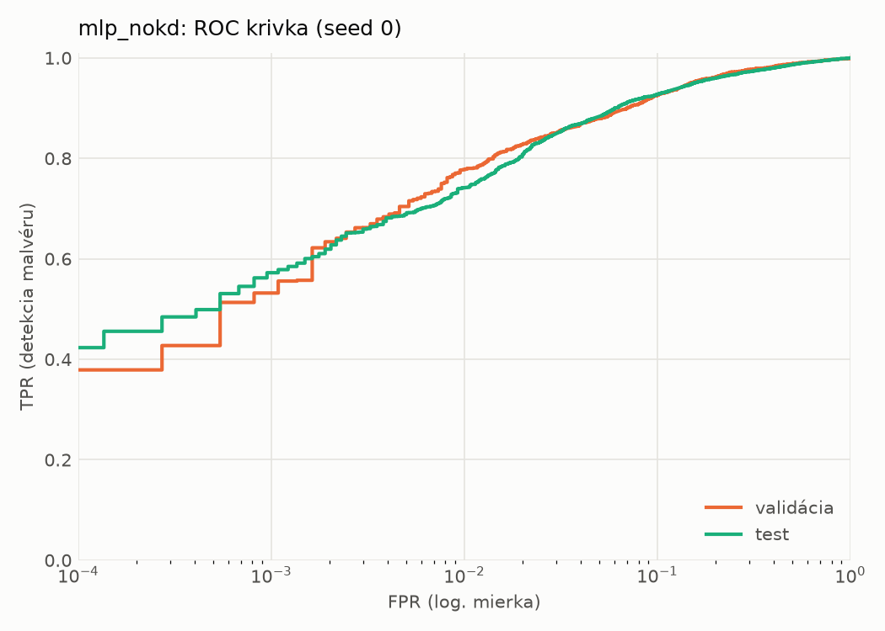
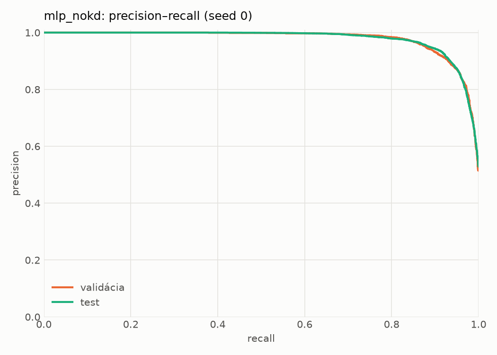
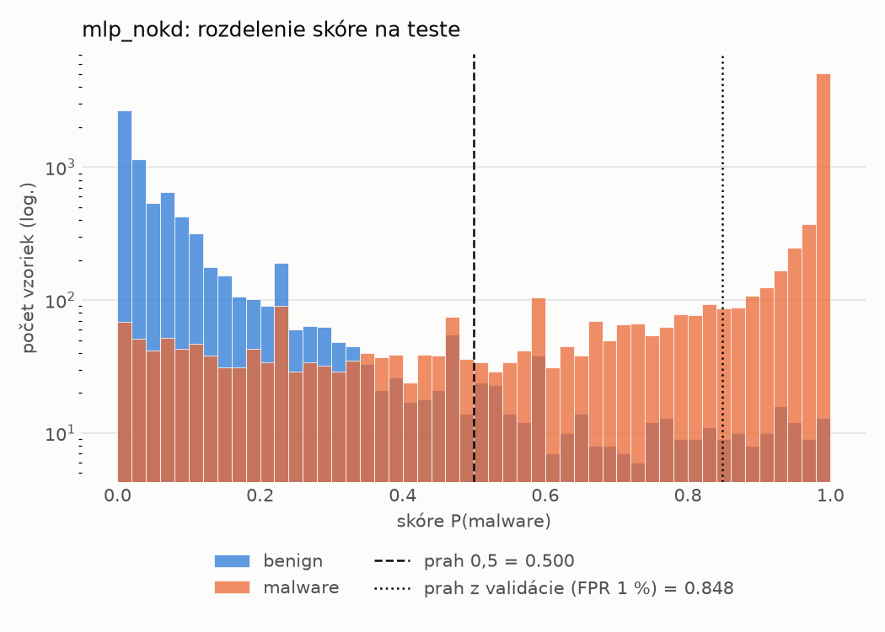
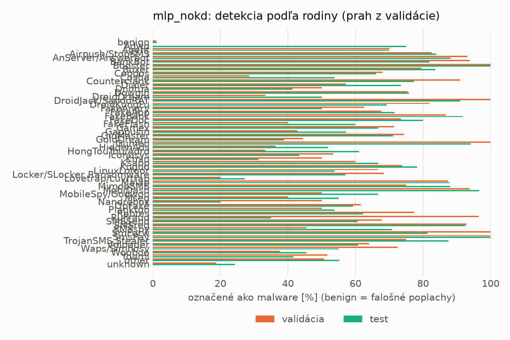
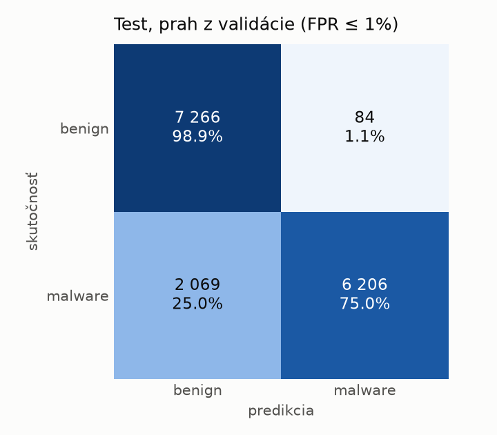
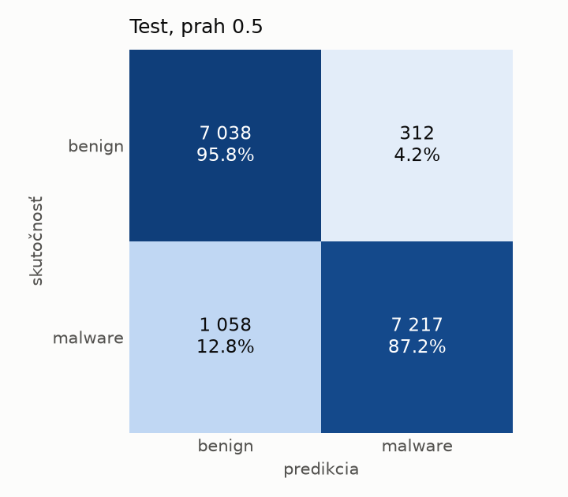
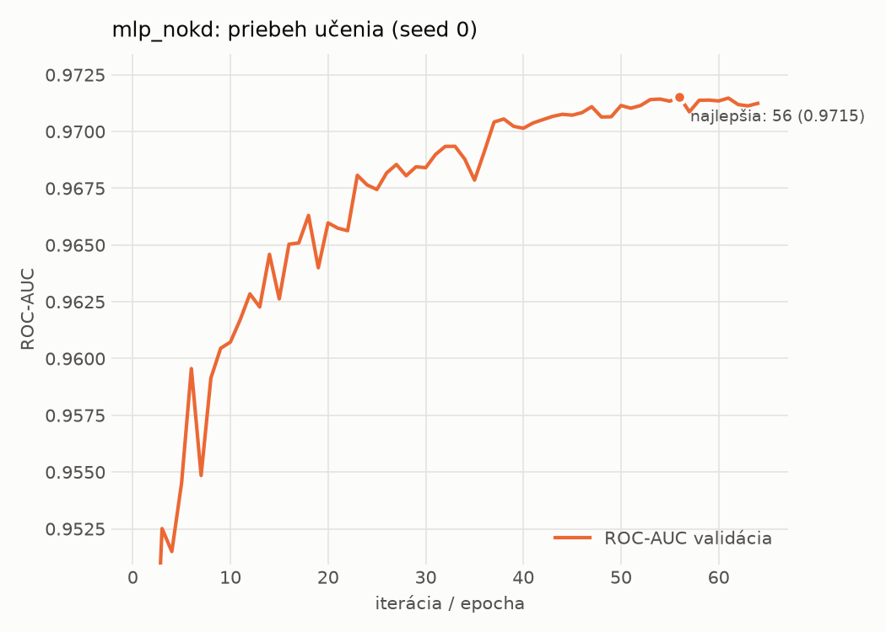

# dynamic/mlp_nokd – beh `20261122-222518`

> Automaticky generované (`src/training/run_tabular.py`). Konfigurácia: `config.yaml`, protokol: `protocol.yaml`.

- **Model:** `mlp` – kontrola – rovnaké malé MLP bez destilácie (iba skutočné označenia)
- **Ladenie:** bez ladenia – hyperparametre prevzaté z `runs_v4/real_full/full/students_dynamic/mlp_nokd/20261122-205917`
- **Finálne modely:** seedy [0, 1, 2]; hodnoty sú priemer ± smerodajná odchýlka cez seedy
- **Najlepšie hyperparametre:** `{"hidden_layers": 1, "max_epochs": 100, "patience": 8, "hidden_width": 64, "dropout": 0.014622282919838341, "lr": 0.0013105433289036465, "weight_decay": 1.7870054646247664e-05, "batch_size": 256}`

## Detekčná kvalita (bez prahu)
| metrika | train (podvzorka) | validácia | test |
|---|---|---|---|
| ROC-AUC | 0.9816 ± 0.0005 | 0.9715 ± 0.0005 | 0.9702 ± 0.0004 |
| PR-AUC | 0.9853 ± 0.0004 | 0.9774 ± 0.0004 | 0.9778 ± 0.0002 |
| TPR pri FPR 1 % | 0.8476 ± 0.0059 | 0.7715 ± 0.0066 | 0.7513 ± 0.0088 |
| TPR pri FPR 0,1 % | 0.6823 ± 0.0306 | 0.5457 ± 0.0263 | 0.5646 ± 0.0125 |
| log loss | 0.1661 ± 0.0027 | 0.2136 ± 0.0029 | 0.2215 ± 0.0034 |
| Brier skóre | 0.0479 ± 0.0010 | 0.0622 ± 0.0010 | 0.0640 ± 0.0011 |

Rozdiel ROC-AUC train − validácia: **0.0101** (veľký rozdiel = preučenie).

## Pri prahu z validácie (FPR ≤ 1% na validácii)
| metrika | train (podvzorka) | validácia | test |
|---|---|---|---|
| accuracy | 0.8926 ± 0.0046 | 0.8776 ± 0.0033 | 0.8606 ± 0.0038 |
| balanced accuracy | 0.8939 ± 0.0046 | 0.8809 ± 0.0032 | 0.8678 ± 0.0035 |
| precision | 0.9948 ± 0.0004 | 0.9883 ± 0.0001 | 0.9883 ± 0.0016 |
| recall (TPR) | 0.7920 ± 0.0095 | 0.7715 ± 0.0066 | 0.7456 ± 0.0083 |
| FPR | 0.0043 ± 0.0004 | 0.0097 ± 0.0002 | 0.0099 ± 0.0015 |
| F1 | 0.8819 ± 0.0058 | 0.8665 ± 0.0041 | 0.8500 ± 0.0049 |
| MCC | 0.8029 ± 0.0077 | 0.7765 ± 0.0055 | 0.7497 ± 0.0057 |

## Pri pevnom prahu 0.5
| metrika | train (podvzorka) | validácia | test |
|---|---|---|---|
| accuracy | 0.9359 ± 0.0023 | 0.9157 ± 0.0026 | 0.9139 ± 0.0022 |
| balanced accuracy | 0.9362 ± 0.0023 | 0.9165 ± 0.0025 | 0.9162 ± 0.0019 |
| precision | 0.9612 ± 0.0042 | 0.9433 ± 0.0028 | 0.9566 ± 0.0020 |
| recall (TPR) | 0.9101 ± 0.0065 | 0.8899 ± 0.0079 | 0.8772 ± 0.0063 |
| FPR | 0.0377 ± 0.0045 | 0.0568 ± 0.0034 | 0.0448 ± 0.0025 |
| F1 | 0.9349 ± 0.0025 | 0.9158 ± 0.0031 | 0.9152 ± 0.0025 |
| MCC | 0.8731 ± 0.0044 | 0.8331 ± 0.0048 | 0.8313 ± 0.0036 |

## Výpočtové nároky (seed 0, testovacia množina)
| meranie | hodnota |
|---|---|
| tréning finálneho modelu | 15.9 s (priemer cez seedy) |
| ladenie spolu | 0 s |
| počet parametrov / uzlov | 8 641 |
| veľkosť modelu na disku | 0.04 MB |
| transformácia vstupu – latencia (1 vlákno) | 0.015 ms |
| transformácia vstupu – priepustnosť | 740 718 vzoriek/s |
| CPU latencia modelu (batch 1, 1 vlákno) | 0.157 ms (p95 0.166) |
| CPU priepustnosť (24 vlákien) | 6 256 006 vzoriek/s |
| GPU latencia (batch 1) | 0.451 ms (p95 0.484) |
| GPU priepustnosť | 2 359 310 vzoriek/s |
| GPU špičková pamäť | 93 MB |

## Grafy
| | |
|---|---|
|  |  |
|  |  |
|  |  |
|  |  |

## Súbory
`metrics.json` (všetky metriky po seedoch vrátane rodín), `timing.json`, `hpo_trials.csv`,
`predictions/<časť>_seed<N>.parquet` (sha256, family, label, score), `model/seed_<N>/`, `log.txt`.
