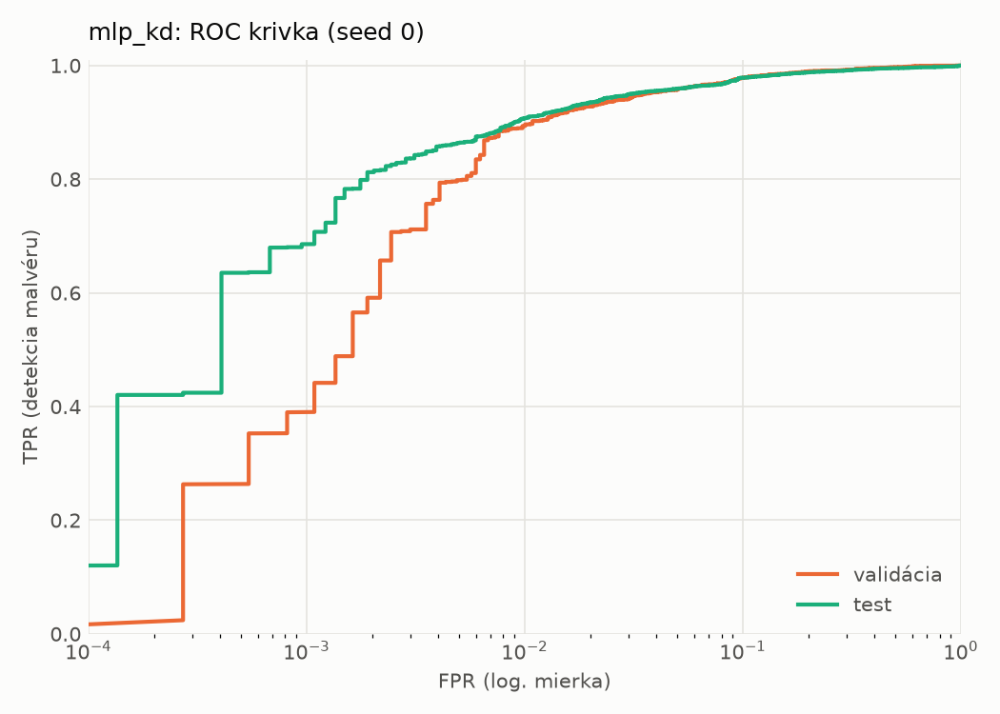
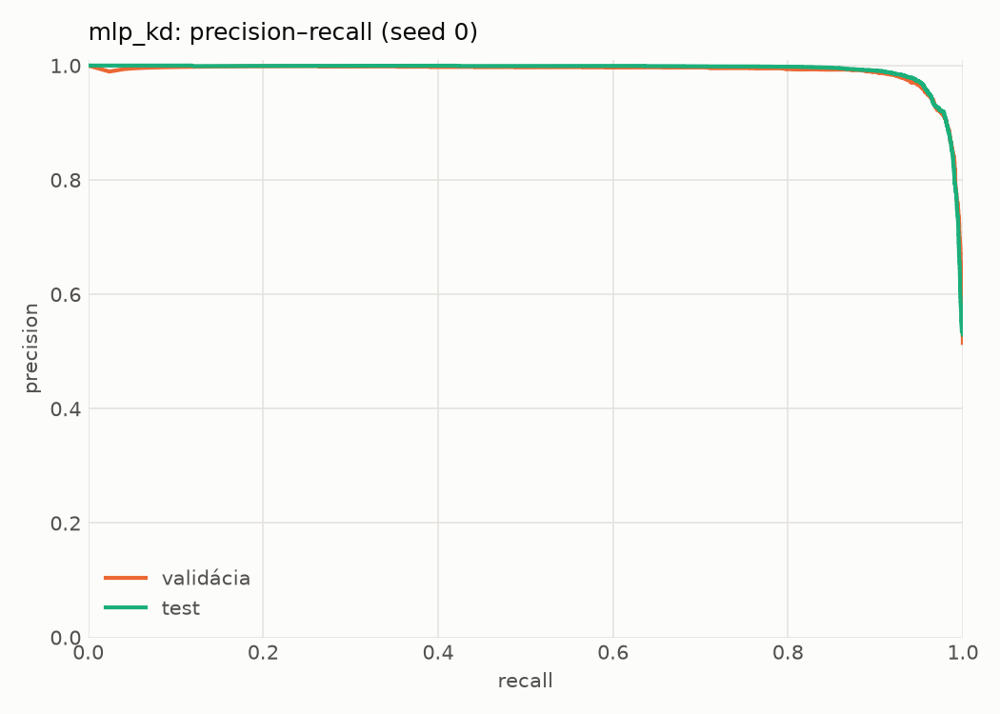
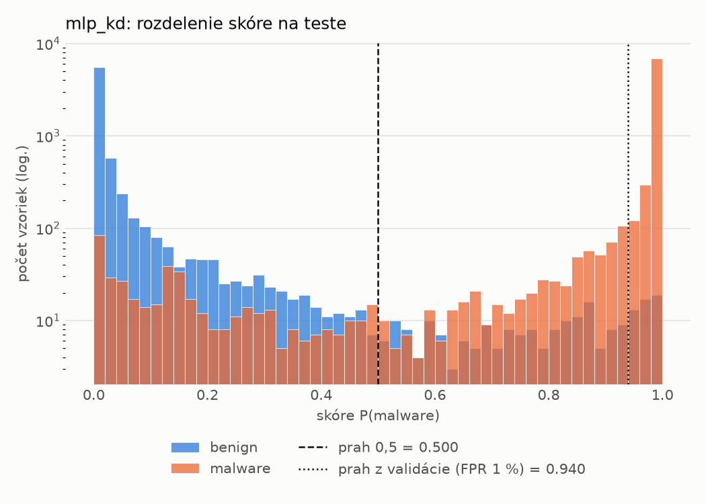
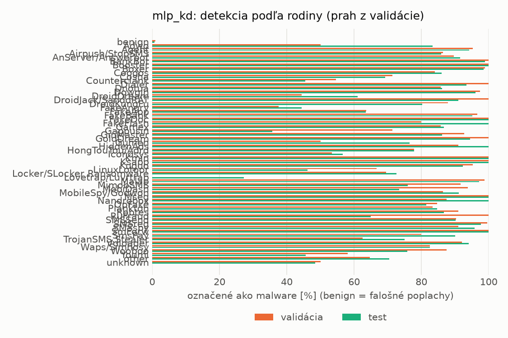
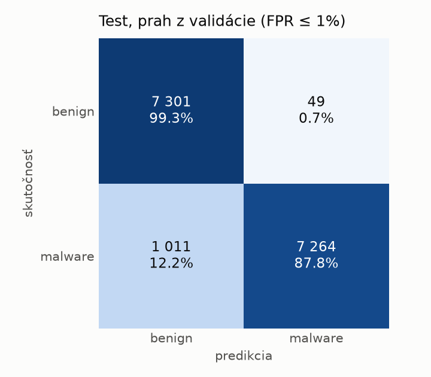
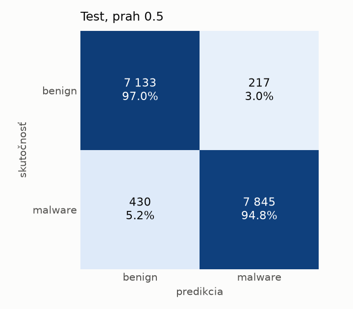
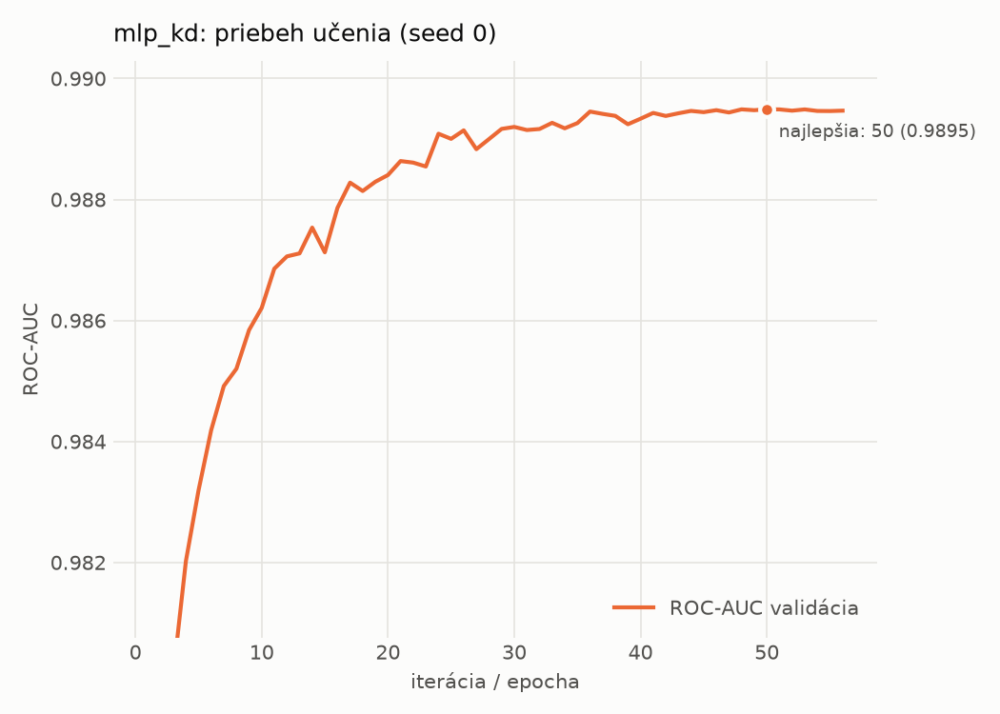

# static/mlp_kd – beh `20261122-222255`

> Automaticky generované (`src/training/run_tabular.py`). Konfigurácia: `config.yaml`, protokol: `protocol.yaml`.

- **Model:** `mlp` – študent – malé MLP učené destiláciou z hybridného učiteľa
- **Ladenie:** bez ladenia – hyperparametre prevzaté z `runs_v4/real_full/full/students_static/mlp_kd/20261122-203423`
- **Finálne modely:** seedy [0, 1, 2]; hodnoty sú priemer ± smerodajná odchýlka cez seedy
- **Najlepšie hyperparametre:** `{"hidden_layers": 1, "max_epochs": 100, "patience": 8, "hidden_width": 64, "dropout": 0.018096880153353218, "lr": 0.002445898909575082, "weight_decay": 6.315937377471515e-05, "batch_size": 1024, "kd_alpha": 0.6461462865023861, "kd_temperature": 1.5048732616232385}`

## Detekčná kvalita (bez prahu)
| metrika | train (podvzorka) | validácia | test |
|---|---|---|---|
| ROC-AUC | 0.9943 ± 0.0003 | 0.9893 ± 0.0004 | 0.9895 ± 0.0009 |
| PR-AUC | 0.9954 ± 0.0003 | 0.9903 ± 0.0009 | 0.9922 ± 0.0005 |
| TPR pri FPR 1 % | 0.9378 ± 0.0029 | 0.8842 ± 0.0167 | 0.9002 ± 0.0108 |
| TPR pri FPR 0,1 % | 0.8057 ± 0.0266 | 0.4407 ± 0.1167 | 0.6937 ± 0.0074 |
| log loss | 0.0863 ± 0.0033 | 0.1328 ± 0.0030 | 0.1285 ± 0.0084 |
| Brier skóre | 0.0228 ± 0.0010 | 0.0341 ± 0.0006 | 0.0323 ± 0.0015 |

Rozdiel ROC-AUC train − validácia: **0.0049** (veľký rozdiel = preučenie).

## Pri prahu z validácie (FPR ≤ 1% na validácii)
| metrika | train (podvzorka) | validácia | test |
|---|---|---|---|
| accuracy | 0.9444 ± 0.0062 | 0.9356 ± 0.0086 | 0.9302 ± 0.0054 |
| balanced accuracy | 0.9450 ± 0.0061 | 0.9372 ± 0.0084 | 0.9337 ± 0.0051 |
| precision | 0.9967 ± 0.0004 | 0.9897 ± 0.0002 | 0.9927 ± 0.0007 |
| recall (TPR) | 0.8931 ± 0.0126 | 0.8842 ± 0.0167 | 0.8747 ± 0.0107 |
| FPR | 0.0030 ± 0.0004 | 0.0098 ± 0.0000 | 0.0073 ± 0.0008 |
| F1 | 0.9420 ± 0.0069 | 0.9339 ± 0.0095 | 0.9300 ± 0.0059 |
| MCC | 0.8939 ± 0.0111 | 0.8769 ± 0.0155 | 0.8679 ± 0.0095 |

## Pri pevnom prahu 0.5
| metrika | train (podvzorka) | validácia | test |
|---|---|---|---|
| accuracy | 0.9712 ± 0.0012 | 0.9575 ± 0.0009 | 0.9598 ± 0.0022 |
| balanced accuracy | 0.9714 ± 0.0012 | 0.9576 ± 0.0009 | 0.9604 ± 0.0022 |
| precision | 0.9814 ± 0.0014 | 0.9642 ± 0.0014 | 0.9730 ± 0.0021 |
| recall (TPR) | 0.9614 ± 0.0013 | 0.9528 ± 0.0005 | 0.9505 ± 0.0025 |
| FPR | 0.0186 ± 0.0014 | 0.0376 ± 0.0015 | 0.0297 ± 0.0024 |
| F1 | 0.9713 ± 0.0012 | 0.9585 ± 0.0008 | 0.9616 ± 0.0021 |
| MCC | 0.9427 ± 0.0023 | 0.9150 ± 0.0017 | 0.9197 ± 0.0043 |

## Výpočtové nároky (seed 0, testovacia množina)
| meranie | hodnota |
|---|---|
| tréning finálneho modelu | 6.1 s (priemer cez seedy) |
| ladenie spolu | 0 s |
| počet parametrov / uzlov | 10 753 |
| veľkosť modelu na disku | 0.05 MB |
| transformácia vstupu – latencia (1 vlákno) | 0.006 ms |
| transformácia vstupu – priepustnosť | 946 029 vzoriek/s |
| CPU latencia modelu (batch 1, 1 vlákno) | 0.070 ms (p95 0.077) |
| CPU priepustnosť (24 vlákien) | 2 293 645 vzoriek/s |
| GPU latencia (batch 1) | 0.452 ms (p95 0.507) |
| GPU priepustnosť | 1 760 206 vzoriek/s |
| GPU špičková pamäť | 72 MB |

## Grafy
| | |
|---|---|
|  |  |
|  |  |
|  |  |
|  |  |

## Súbory
`metrics.json` (všetky metriky po seedoch vrátane rodín), `timing.json`, `hpo_trials.csv`,
`predictions/<časť>_seed<N>.parquet` (sha256, family, label, score), `model/seed_<N>/`, `log.txt`.
