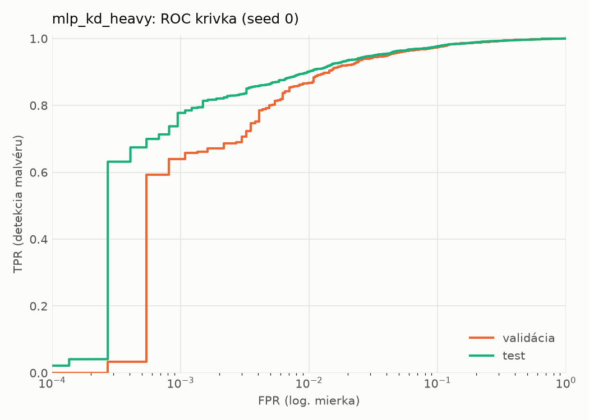
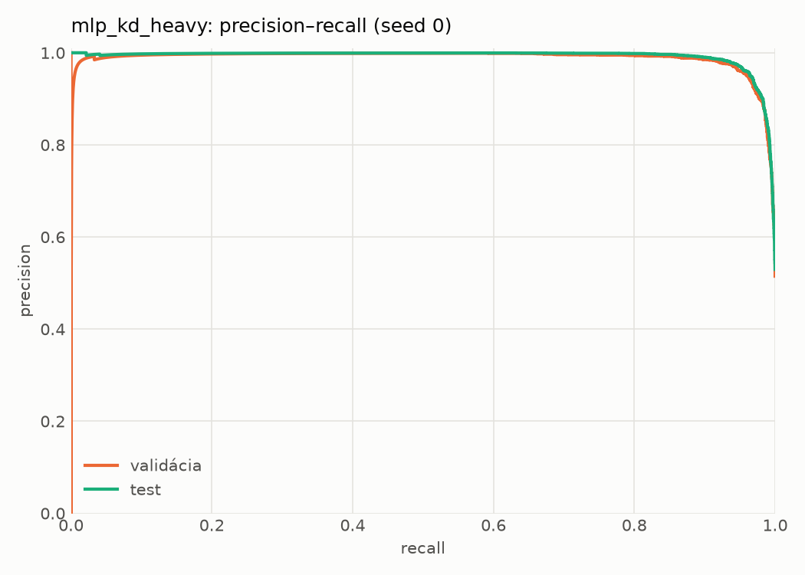
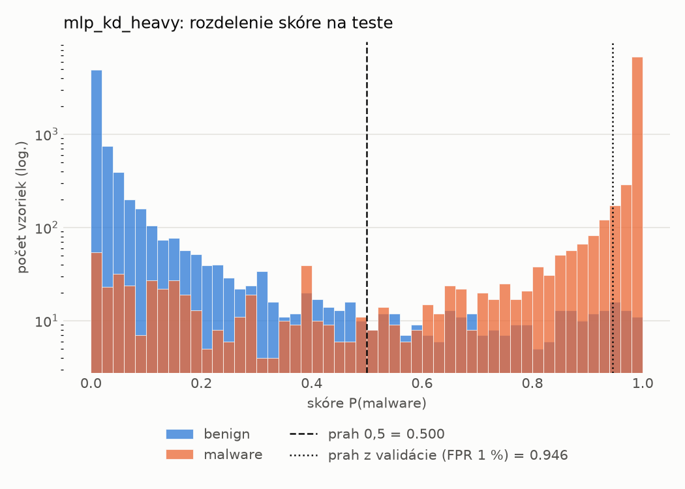
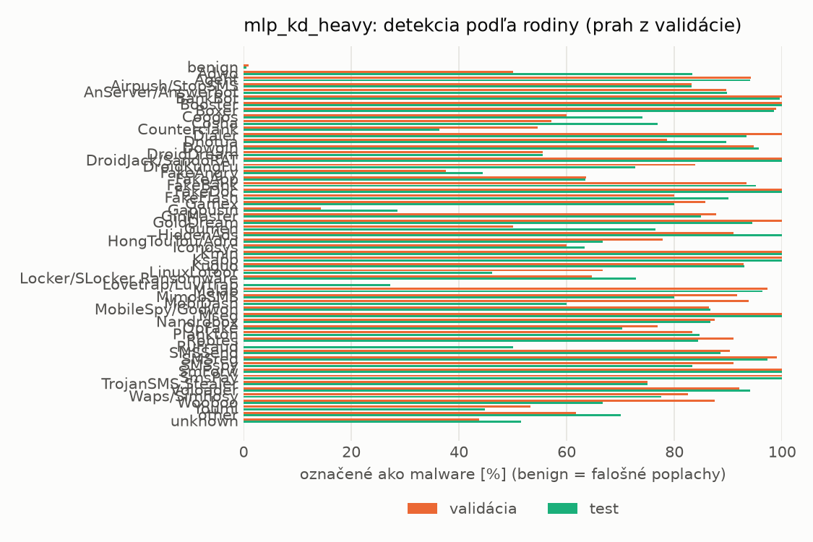
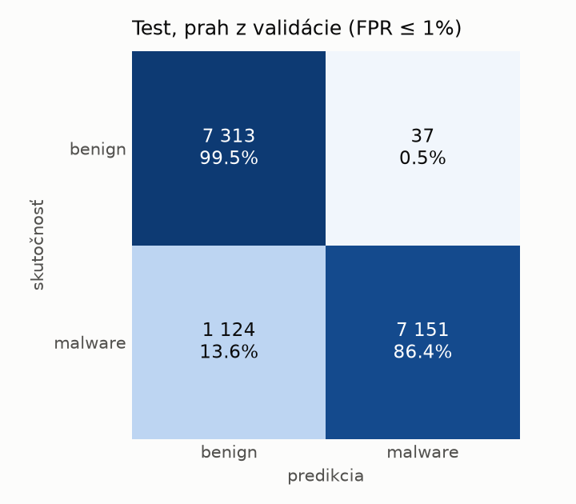
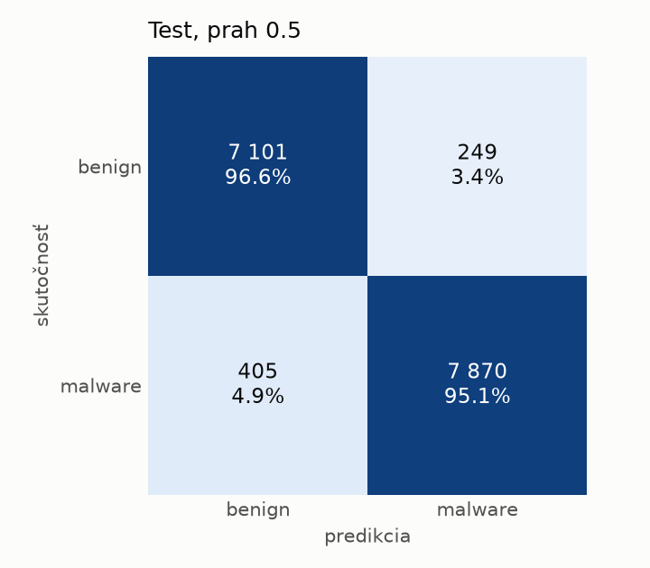
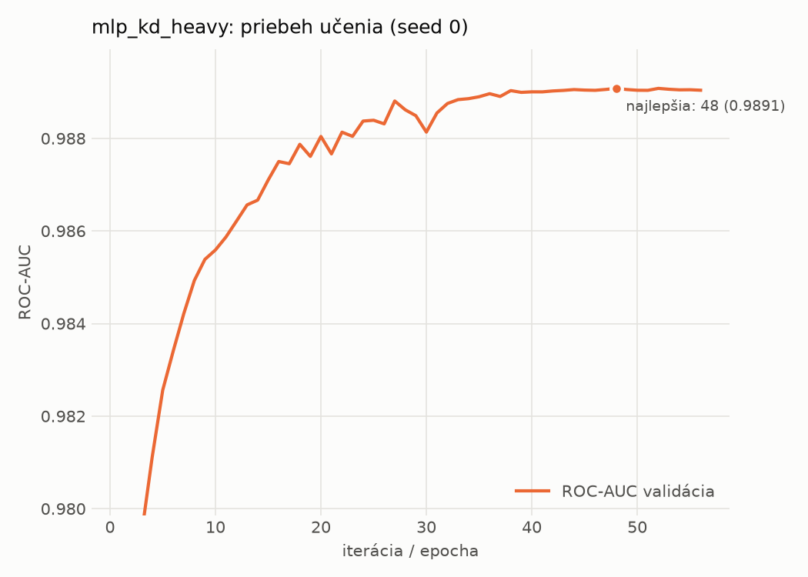

# static/mlp_kd_heavy – beh `20261122-222409`

> Automaticky generované (`src/training/run_tabular.py`). Konfigurácia: `config.yaml`, protokol: `protocol.yaml`.

- **Model:** `mlp` – študent – malé MLP učené destiláciou z mlp_large hybridu (V4)
- **Ladenie:** bez ladenia – hyperparametre prevzaté z `runs_v4/real_full/full/students_static/mlp_kd_heavy/20261122-204855`
- **Finálne modely:** seedy [0, 1, 2]; hodnoty sú priemer ± smerodajná odchýlka cez seedy
- **Najlepšie hyperparametre:** `{"hidden_layers": 1, "max_epochs": 100, "patience": 8, "hidden_width": 64, "dropout": 0.04239795529418809, "lr": 0.0021920597062990285, "weight_decay": 0.0001469802566586536, "batch_size": 1024, "kd_alpha": 0.8931311185241001, "kd_temperature": 5.447798930063548}`

## Detekčná kvalita (bez prahu)
| metrika | train (podvzorka) | validácia | test |
|---|---|---|---|
| ROC-AUC | 0.9940 ± 0.0000 | 0.9891 ± 0.0003 | 0.9904 ± 0.0001 |
| PR-AUC | 0.9952 ± 0.0000 | 0.9893 ± 0.0015 | 0.9925 ± 0.0003 |
| TPR pri FPR 1 % | 0.9363 ± 0.0014 | 0.8668 ± 0.0014 | 0.8988 ± 0.0023 |
| TPR pri FPR 0,1 % | 0.8156 ± 0.0070 | 0.5092 ± 0.2330 | 0.7841 ± 0.0073 |
| log loss | 0.0884 ± 0.0002 | 0.1292 ± 0.0015 | 0.1172 ± 0.0007 |
| Brier skóre | 0.0239 ± 0.0001 | 0.0347 ± 0.0004 | 0.0322 ± 0.0002 |

Rozdiel ROC-AUC train − validácia: **0.0050** (veľký rozdiel = preučenie).

## Pri prahu z validácie (FPR ≤ 1% na validácii)
| metrika | train (podvzorka) | validácia | test |
|---|---|---|---|
| accuracy | 0.9378 ± 0.0013 | 0.9267 ± 0.0007 | 0.9275 ± 0.0017 |
| balanced accuracy | 0.9385 ± 0.0013 | 0.9285 ± 0.0007 | 0.9312 ± 0.0016 |
| precision | 0.9963 ± 0.0002 | 0.9895 ± 0.0000 | 0.9942 ± 0.0006 |
| recall (TPR) | 0.8804 ± 0.0027 | 0.8668 ± 0.0014 | 0.8681 ± 0.0038 |
| FPR | 0.0034 ± 0.0002 | 0.0098 ± 0.0000 | 0.0057 ± 0.0006 |
| F1 | 0.9348 ± 0.0014 | 0.9241 ± 0.0008 | 0.9269 ± 0.0019 |
| MCC | 0.8819 ± 0.0023 | 0.8607 ± 0.0013 | 0.8633 ± 0.0028 |

## Pri pevnom prahu 0.5
| metrika | train (podvzorka) | validácia | test |
|---|---|---|---|
| accuracy | 0.9700 ± 0.0002 | 0.9560 ± 0.0010 | 0.9580 ± 0.0001 |
| balanced accuracy | 0.9701 ± 0.0001 | 0.9561 ± 0.0010 | 0.9585 ± 0.0001 |
| precision | 0.9784 ± 0.0006 | 0.9602 ± 0.0026 | 0.9690 ± 0.0004 |
| recall (TPR) | 0.9620 ± 0.0008 | 0.9542 ± 0.0012 | 0.9512 ± 0.0001 |
| FPR | 0.0217 ± 0.0006 | 0.0420 ± 0.0029 | 0.0343 ± 0.0004 |
| F1 | 0.9702 ± 0.0002 | 0.9572 ± 0.0009 | 0.9600 ± 0.0001 |
| MCC | 0.9402 ± 0.0003 | 0.9121 ± 0.0019 | 0.9161 ± 0.0003 |

## Výpočtové nároky (seed 0, testovacia množina)
| meranie | hodnota |
|---|---|
| tréning finálneho modelu | 5.1 s (priemer cez seedy) |
| ladenie spolu | 0 s |
| počet parametrov / uzlov | 10 753 |
| veľkosť modelu na disku | 0.05 MB |
| transformácia vstupu – latencia (1 vlákno) | 0.014 ms |
| transformácia vstupu – priepustnosť | 624 017 vzoriek/s |
| CPU latencia modelu (batch 1, 1 vlákno) | 0.156 ms (p95 0.166) |
| CPU priepustnosť (24 vlákien) | 2 527 336 vzoriek/s |
| GPU latencia (batch 1) | 0.289 ms (p95 0.312) |
| GPU priepustnosť | 1 885 711 vzoriek/s |
| GPU špičková pamäť | 113 MB |

## Grafy
| | |
|---|---|
|  |  |
|  |  |
|  |  |
|  |  |

## Súbory
`metrics.json` (všetky metriky po seedoch vrátane rodín), `timing.json`, `hpo_trials.csv`,
`predictions/<časť>_seed<N>.parquet` (sha256, family, label, score), `model/seed_<N>/`, `log.txt`.
