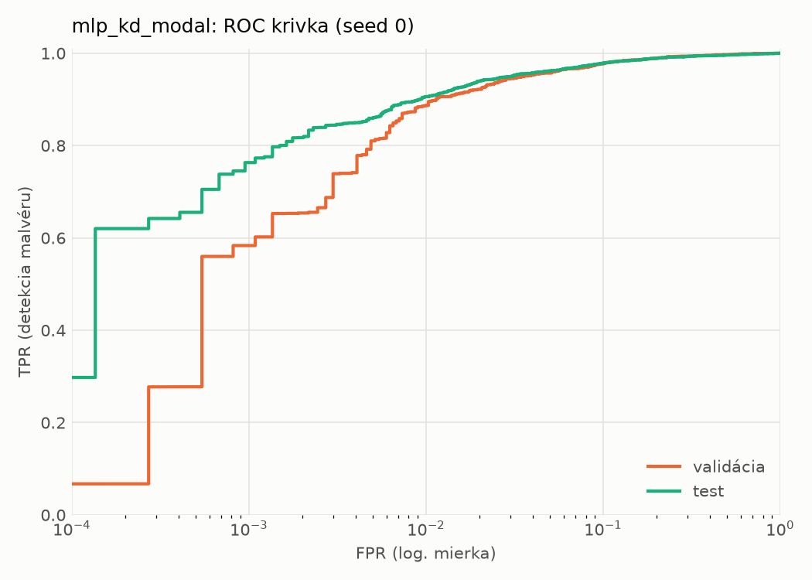
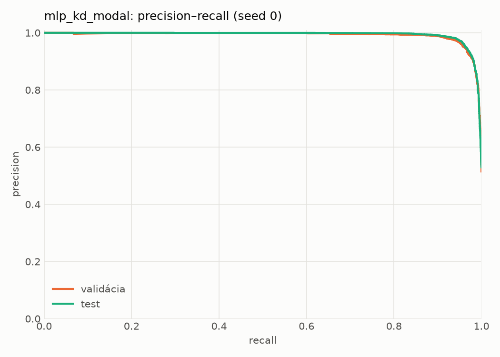
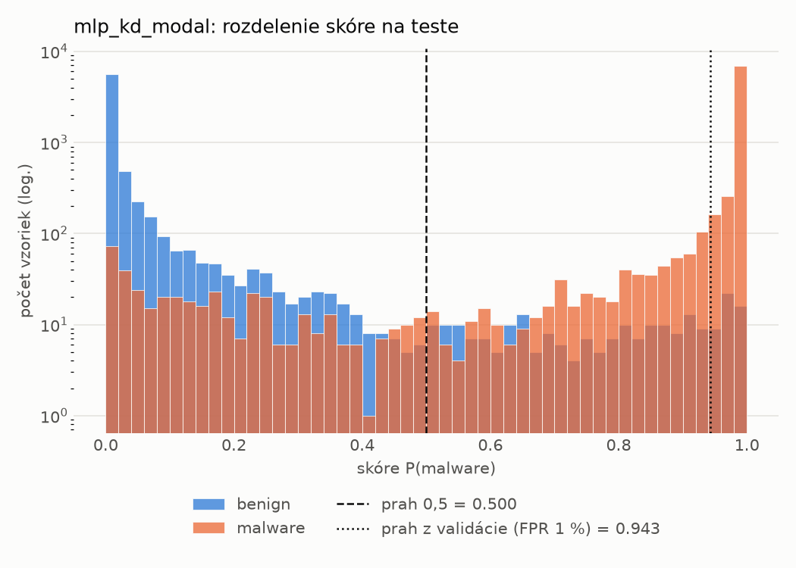
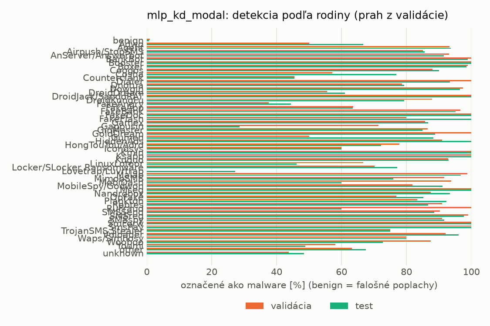
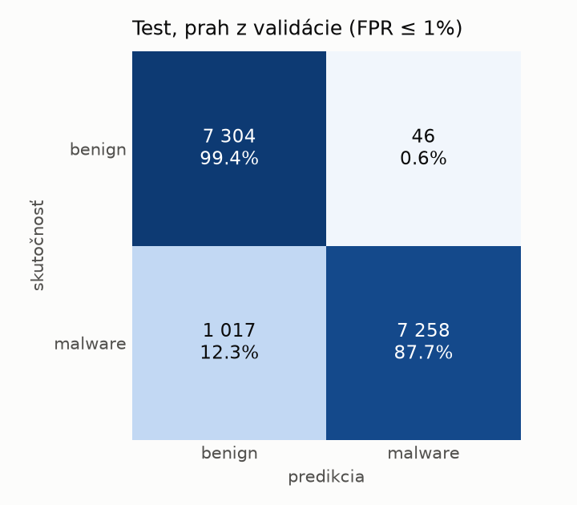
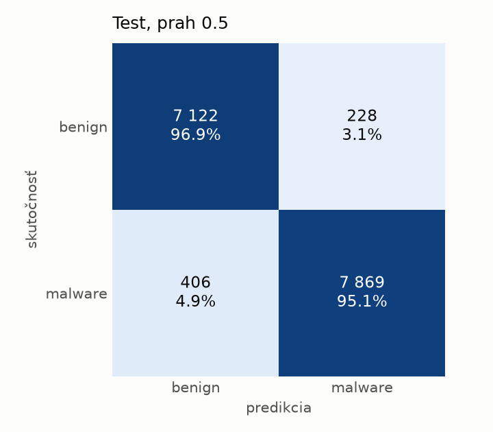
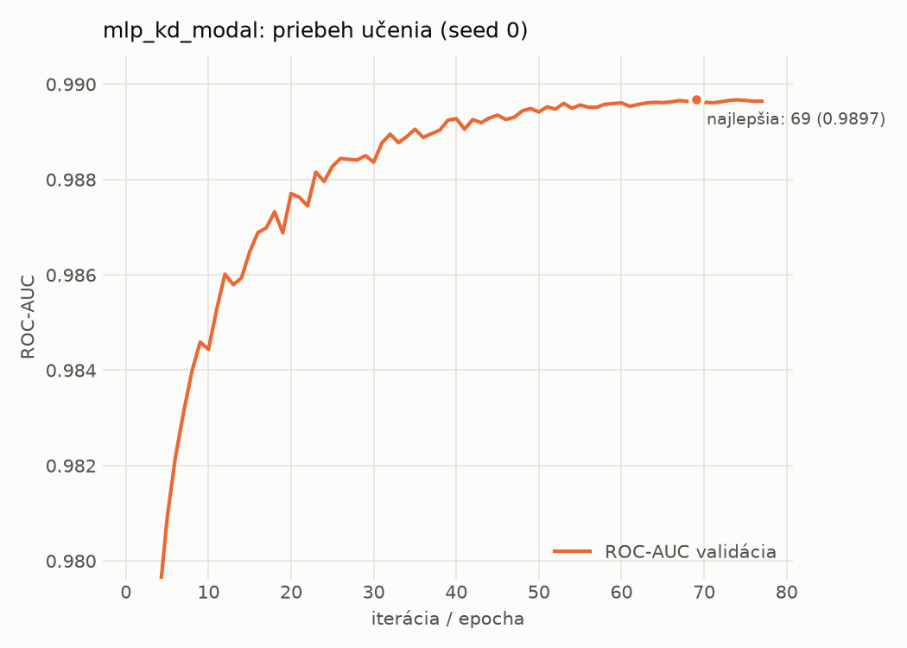

# static/mlp_kd_modal – beh `20261122-222345`

> Automaticky generované (`src/training/run_tabular.py`). Konfigurácia: `config.yaml`, protokol: `protocol.yaml`.

- **Model:** `mlp` – študent – malé MLP učené destiláciou z učiteľa rovnakej modality (variant A)
- **Ladenie:** bez ladenia – hyperparametre prevzaté z `runs_v4/real_full/full/students_static/mlp_kd_modal/20261122-204432`
- **Finálne modely:** seedy [0, 1, 2]; hodnoty sú priemer ± smerodajná odchýlka cez seedy
- **Najlepšie hyperparametre:** `{"hidden_layers": 1, "max_epochs": 100, "patience": 8, "hidden_width": 64, "dropout": 0.005196375734621726, "lr": 0.0014172842807441423, "weight_decay": 1.1835949733056038e-05, "batch_size": 1024, "kd_alpha": 0.5211229932470658, "kd_temperature": 1.6263320735090332}`

## Detekčná kvalita (bez prahu)
| metrika | train (podvzorka) | validácia | test |
|---|---|---|---|
| ROC-AUC | 0.9939 ± 0.0004 | 0.9896 ± 0.0005 | 0.9904 ± 0.0005 |
| PR-AUC | 0.9951 ± 0.0004 | 0.9909 ± 0.0008 | 0.9927 ± 0.0005 |
| TPR pri FPR 1 % | 0.9370 ± 0.0027 | 0.8851 ± 0.0050 | 0.9023 ± 0.0073 |
| TPR pri FPR 0,1 % | 0.7979 ± 0.0359 | 0.6131 ± 0.0453 | 0.7339 ± 0.0377 |
| log loss | 0.0907 ± 0.0034 | 0.1309 ± 0.0027 | 0.1224 ± 0.0021 |
| Brier skóre | 0.0242 ± 0.0009 | 0.0343 ± 0.0004 | 0.0322 ± 0.0003 |

Rozdiel ROC-AUC train − validácia: **0.0043** (veľký rozdiel = preučenie).

## Pri prahu z validácie (FPR ≤ 1% na validácii)
| metrika | train (podvzorka) | validácia | test |
|---|---|---|---|
| accuracy | 0.9432 ± 0.0036 | 0.9361 ± 0.0026 | 0.9316 ± 0.0029 |
| balanced accuracy | 0.9439 ± 0.0036 | 0.9376 ± 0.0025 | 0.9351 ± 0.0027 |
| precision | 0.9960 ± 0.0006 | 0.9897 ± 0.0001 | 0.9931 ± 0.0006 |
| recall (TPR) | 0.8914 ± 0.0066 | 0.8851 ± 0.0050 | 0.8770 ± 0.0054 |
| FPR | 0.0036 ± 0.0005 | 0.0098 ± 0.0000 | 0.0069 ± 0.0005 |
| F1 | 0.9408 ± 0.0040 | 0.9345 ± 0.0028 | 0.9314 ± 0.0031 |
| MCC | 0.8916 ± 0.0066 | 0.8776 ± 0.0047 | 0.8704 ± 0.0052 |

## Pri pevnom prahu 0.5
| metrika | train (podvzorka) | validácia | test |
|---|---|---|---|
| accuracy | 0.9694 ± 0.0010 | 0.9569 ± 0.0008 | 0.9588 ± 0.0006 |
| balanced accuracy | 0.9695 ± 0.0010 | 0.9570 ± 0.0008 | 0.9594 ± 0.0006 |
| precision | 0.9787 ± 0.0014 | 0.9634 ± 0.0011 | 0.9711 ± 0.0006 |
| recall (TPR) | 0.9604 ± 0.0008 | 0.9524 ± 0.0010 | 0.9505 ± 0.0008 |
| FPR | 0.0215 ± 0.0015 | 0.0384 ± 0.0012 | 0.0318 ± 0.0007 |
| F1 | 0.9695 ± 0.0010 | 0.9579 ± 0.0008 | 0.9607 ± 0.0006 |
| MCC | 0.9389 ± 0.0020 | 0.9138 ± 0.0016 | 0.9177 ± 0.0013 |

## Výpočtové nároky (seed 0, testovacia množina)
| meranie | hodnota |
|---|---|
| tréning finálneho modelu | 7.2 s (priemer cez seedy) |
| ladenie spolu | 0 s |
| počet parametrov / uzlov | 10 753 |
| veľkosť modelu na disku | 0.05 MB |
| transformácia vstupu – latencia (1 vlákno) | 0.014 ms |
| transformácia vstupu – priepustnosť | 620 961 vzoriek/s |
| CPU latencia modelu (batch 1, 1 vlákno) | 0.156 ms (p95 0.165) |
| CPU priepustnosť (24 vlákien) | 3 183 383 vzoriek/s |
| GPU latencia (batch 1) | 0.276 ms (p95 0.301) |
| GPU priepustnosť | 1 456 741 vzoriek/s |
| GPU špičková pamäť | 72 MB |

## Grafy
| | |
|---|---|
|  |  |
|  |  |
|  |  |
|  |  |

## Súbory
`metrics.json` (všetky metriky po seedoch vrátane rodín), `timing.json`, `hpo_trials.csv`,
`predictions/<časť>_seed<N>.parquet` (sha256, family, label, score), `model/seed_<N>/`, `log.txt`.
