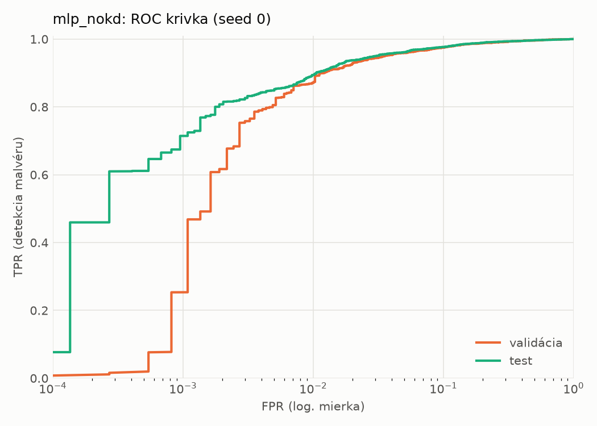
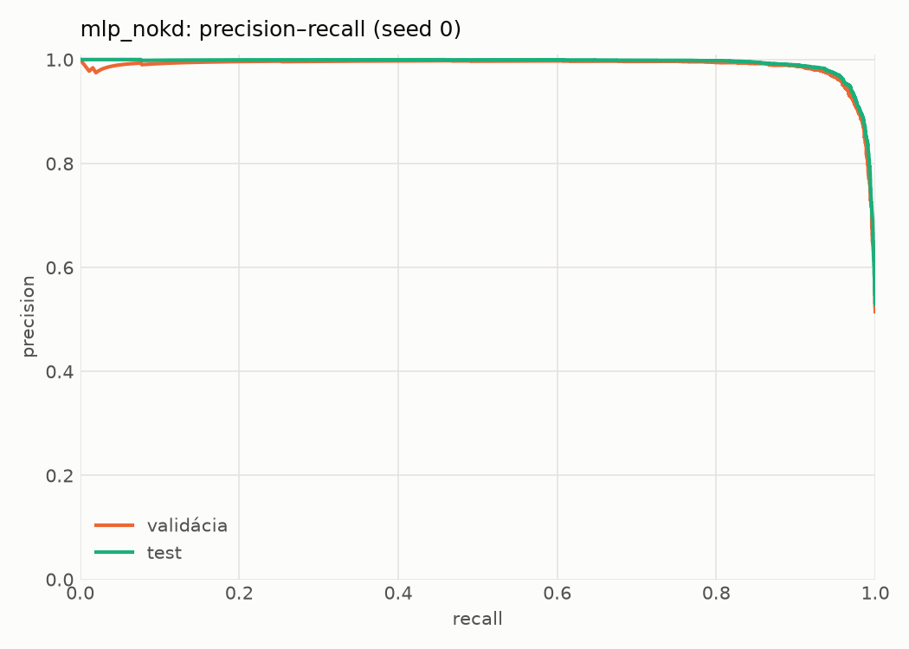
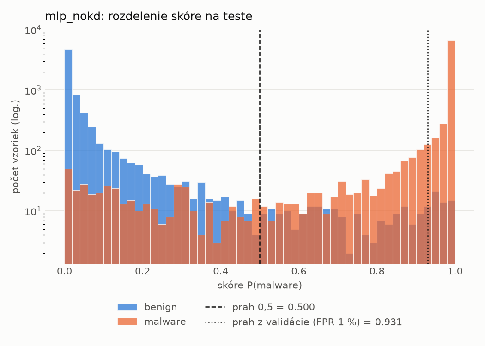
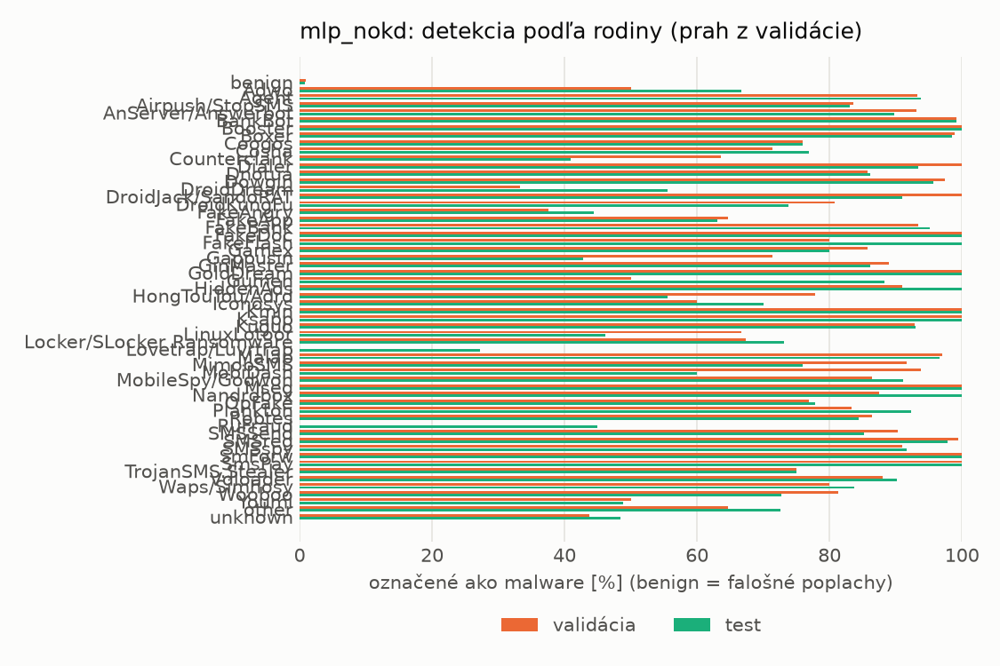
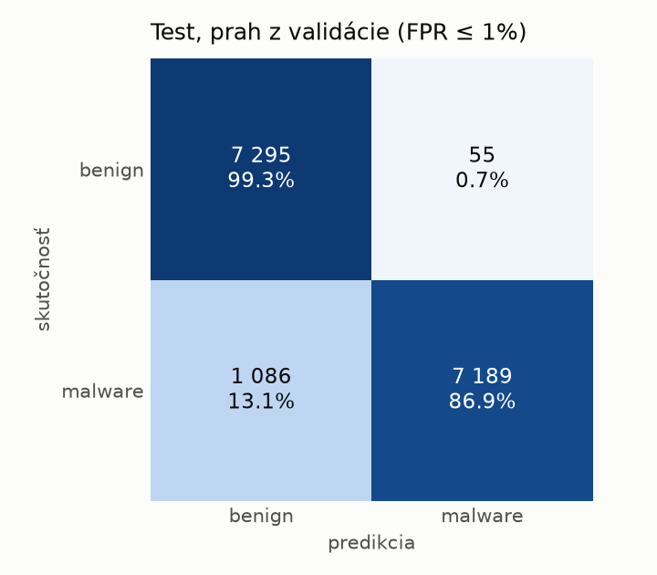
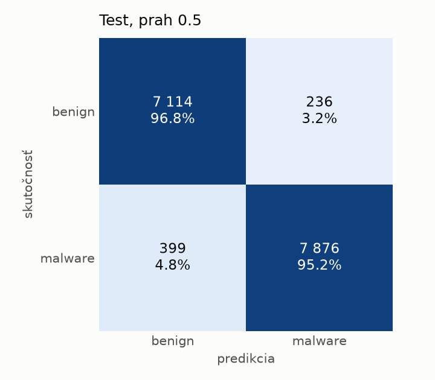
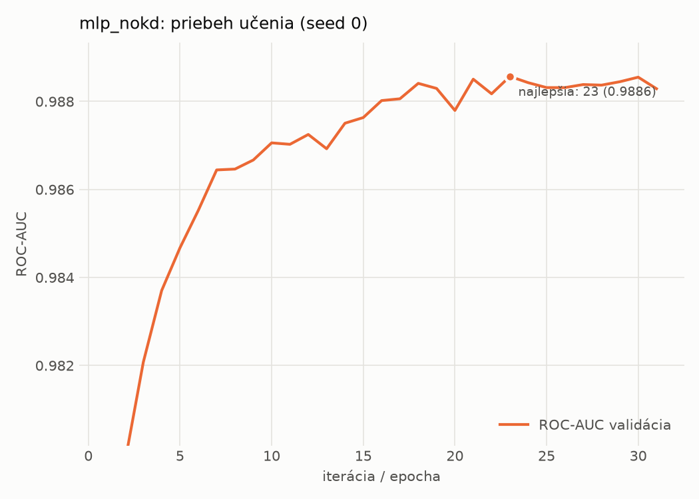

# static/mlp_nokd – beh `20261122-222316`

> Automaticky generované (`src/training/run_tabular.py`). Konfigurácia: `config.yaml`, protokol: `protocol.yaml`.

- **Model:** `mlp` – kontrola – rovnaké malé MLP bez destilácie (iba skutočné označenia)
- **Ladenie:** bez ladenia – hyperparametre prevzaté z `runs_v4/real_full/full/students_static/mlp_nokd/20261122-203844`
- **Finálne modely:** seedy [0, 1, 2]; hodnoty sú priemer ± smerodajná odchýlka cez seedy
- **Najlepšie hyperparametre:** `{"hidden_layers": 1, "max_epochs": 100, "patience": 8, "hidden_width": 64, "dropout": 0.011630579234704915, "lr": 0.0010706598847019353, "weight_decay": 3.845140400781195e-05, "batch_size": 256}`

## Detekčná kvalita (bez prahu)
| metrika | train (podvzorka) | validácia | test |
|---|---|---|---|
| ROC-AUC | 0.9948 ± 0.0004 | 0.9888 ± 0.0005 | 0.9899 ± 0.0003 |
| PR-AUC | 0.9957 ± 0.0004 | 0.9886 ± 0.0003 | 0.9922 ± 0.0003 |
| TPR pri FPR 1 % | 0.9473 ± 0.0032 | 0.8829 ± 0.0197 | 0.8998 ± 0.0094 |
| TPR pri FPR 0,1 % | 0.8274 ± 0.0363 | 0.2679 ± 0.0223 | 0.6612 ± 0.0924 |
| log loss | 0.0825 ± 0.0032 | 0.1286 ± 0.0026 | 0.1187 ± 0.0009 |
| Brier skóre | 0.0222 ± 0.0008 | 0.0334 ± 0.0009 | 0.0313 ± 0.0005 |

Rozdiel ROC-AUC train − validácia: **0.0060** (veľký rozdiel = preučenie).

## Pri prahu z validácie (FPR ≤ 1% na validácii)
| metrika | train (podvzorka) | validácia | test |
|---|---|---|---|
| accuracy | 0.9466 ± 0.0087 | 0.9350 ± 0.0101 | 0.9314 ± 0.0083 |
| balanced accuracy | 0.9472 ± 0.0085 | 0.9366 ± 0.0098 | 0.9348 ± 0.0078 |
| precision | 0.9964 ± 0.0004 | 0.9897 ± 0.0002 | 0.9928 ± 0.0003 |
| recall (TPR) | 0.8978 ± 0.0169 | 0.8829 ± 0.0197 | 0.8769 ± 0.0157 |
| FPR | 0.0033 ± 0.0003 | 0.0098 ± 0.0000 | 0.0072 ± 0.0003 |
| F1 | 0.9445 ± 0.0094 | 0.9332 ± 0.0110 | 0.9312 ± 0.0089 |
| MCC | 0.8979 ± 0.0159 | 0.8757 ± 0.0184 | 0.8700 ± 0.0148 |

## Pri pevnom prahu 0.5
| metrika | train (podvzorka) | validácia | test |
|---|---|---|---|
| accuracy | 0.9719 ± 0.0009 | 0.9575 ± 0.0011 | 0.9607 ± 0.0016 |
| balanced accuracy | 0.9720 ± 0.0009 | 0.9577 ± 0.0011 | 0.9613 ± 0.0017 |
| precision | 0.9820 ± 0.0019 | 0.9642 ± 0.0020 | 0.9732 ± 0.0023 |
| recall (TPR) | 0.9621 ± 0.0005 | 0.9529 ± 0.0013 | 0.9520 ± 0.0010 |
| FPR | 0.0181 ± 0.0019 | 0.0376 ± 0.0022 | 0.0295 ± 0.0026 |
| F1 | 0.9719 ± 0.0008 | 0.9585 ± 0.0010 | 0.9625 ± 0.0015 |
| MCC | 0.9439 ± 0.0017 | 0.9151 ± 0.0021 | 0.9215 ± 0.0033 |

## Výpočtové nároky (seed 0, testovacia množina)
| meranie | hodnota |
|---|---|
| tréning finálneho modelu | 9.3 s (priemer cez seedy) |
| ladenie spolu | 0 s |
| počet parametrov / uzlov | 10 753 |
| veľkosť modelu na disku | 0.05 MB |
| transformácia vstupu – latencia (1 vlákno) | 0.015 ms |
| transformácia vstupu – priepustnosť | 618 489 vzoriek/s |
| CPU latencia modelu (batch 1, 1 vlákno) | 0.157 ms (p95 0.167) |
| CPU priepustnosť (24 vlákien) | 2 579 064 vzoriek/s |
| GPU latencia (batch 1) | 0.276 ms (p95 0.342) |
| GPU priepustnosť | 1 442 046 vzoriek/s |
| GPU špičková pamäť | 113 MB |

## Grafy
| | |
|---|---|
|  |  |
|  |  |
|  |  |
|  |  |

## Súbory
`metrics.json` (všetky metriky po seedoch vrátane rodín), `timing.json`, `hpo_trials.csv`,
`predictions/<časť>_seed<N>.parquet` (sha256, family, label, score), `model/seed_<N>/`, `log.txt`.
