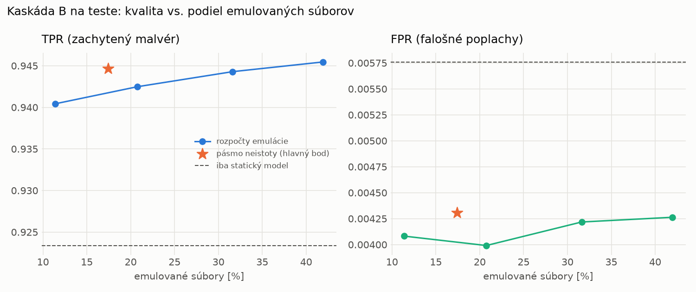

# Kaskáda B `b_baselines` – beh `20261122-224751`

> Generované `src/cascade/evaluate_b.py` (2026-11-22T22:47:51+01:00). Seedy: [0, 1, 2]; hodnoty = priemer ± sm. odchýlka.
> Všetky prahy a pásmo neistoty sú z validácie; test sa na nič nenastavuje. Postup: `docs/09_plan_v2.md`.

| rola | beh |
|---|---|
| static | `runs_v4/real_full/lofo/Locker_SLocker_Ransomware/static/lightgbm/20261122-222917` |
| dynamic | `runs_v4/real_full/lofo/Locker_SLocker_Ransomware/dynamic/lightgbm/20261122-223201` |
| hybrid | `runs_v4/real_full/lofo/Locker_SLocker_Ransomware/hybrid/lightgbm/20261122-223452` |

Druhý stupeň: **dynamic**. Pásmo neistoty statického modelu: FPR ≤ 0.1% nad `hi`,
najviac 1% malvéru validácie pod `lo` (seed 0: lo = 0.0195, hi = 0.9985, seed 1: lo = 0.0240, hi = 0.9983, seed 2: lo = 0.0142, hi = 0.9993).

## Test
| prístup | accuracy | balanced_accuracy | precision | recall_tpr | fpr | f1 | mcc |
|---|---|---|---|---|---|---|---|
| kaskáda B | 0.9687 ± 0.0003 | 0.9702 ± 0.0003 | 0.9960 ± 0.0001 | 0.9447 ± 0.0006 | 0.0043 ± 0.0001 | 0.9696 ± 0.0003 | 0.9387 ± 0.0006 |
| statický | 0.9567 ± 0.0011 | 0.9588 ± 0.0010 | 0.9945 ± 0.0002 | 0.9234 ± 0.0019 | 0.0058 ± 0.0002 | 0.9576 ± 0.0011 | 0.9161 ± 0.0020 |
| dynamický | 0.9171 ± 0.0008 | 0.9213 ± 0.0007 | 0.9908 ± 0.0008 | 0.8514 ± 0.0021 | 0.0089 ± 0.0008 | 0.9158 ± 0.0009 | 0.8444 ± 0.0012 |
| hybrid (každá vzorka) | 0.9722 ± 0.0001 | 0.9733 ± 0.0001 | 0.9930 ± 0.0001 | 0.9541 ± 0.0001 | 0.0075 ± 0.0002 | 0.9732 ± 0.0001 | 0.9451 ± 0.0002 |

- **emulované súbory: 17.43%** (ostatné rozhodne iba statický model); na hybrid ide 4.67% súborov
- chyby pri istom rozhodnutí statického modelu (seed 0): 174
- validácia: emulované 15.33%, na hybrid 3.95%

## Validácia
| prístup | accuracy | balanced_accuracy | precision | recall_tpr | fpr | f1 | mcc |
|---|---|---|---|---|---|---|---|
| kaskáda B | 0.9810 ± 0.0005 | 0.9815 ± 0.0005 | 0.9951 ± 0.0004 | 0.9682 ± 0.0005 | 0.0052 ± 0.0005 | 0.9815 ± 0.0005 | 0.9624 ± 0.0009 |
| statický | 0.9696 ± 0.0009 | 0.9704 ± 0.0009 | 0.9907 ± 0.0003 | 0.9504 ± 0.0014 | 0.0096 ± 0.0003 | 0.9701 ± 0.0009 | 0.9401 ± 0.0017 |
| dynamický | 0.9299 ± 0.0017 | 0.9320 ± 0.0017 | 0.9897 ± 0.0000 | 0.8738 ± 0.0033 | 0.0098 ± 0.0000 | 0.9282 ± 0.0019 | 0.8666 ± 0.0031 |
| hybrid (každá vzorka) | 0.9810 ± 0.0001 | 0.9814 ± 0.0001 | 0.9909 ± 0.0001 | 0.9724 ± 0.0003 | 0.0096 ± 0.0002 | 0.9815 ± 0.0001 | 0.9622 ± 0.0001 |

## Januárové vzorky vynechanej rodiny (iba malvér → TPR)
| prístup | TPR |
|---|---|
| kaskáda B | 0.3493 ± 0.0014 |
| statický | 0.3166 ± 0.0012 |
| dynamický | 0.5138 ± 0.0027 |
| hybrid (každá vzorka) | 0.4087 ± 0.0029 |

Podiel emulovaných: 56.43%

## Krivka rozpočtu emulácie (test, priemer cez seedy)
| budget_val | emulation_rate | hybrid_rate | recall_tpr | fpr | f1 |
|---|---|---|---|---|---|
| 0.1000 | 0.1138 | 0.0387 | 0.9404 | 0.0041 | 0.9675 |
| 0.2000 | 0.2075 | 0.0544 | 0.9425 | 0.0040 | 0.9686 |
| 0.3000 | 0.3162 | 0.0657 | 0.9443 | 0.0042 | 0.9695 |
| 0.4000 | 0.4193 | 0.0756 | 0.9455 | 0.0043 | 0.9701 |

## Výpočtové nároky
Čas dynamickej analýzy (beh v emulátore alebo na zariadení) dataset neuvádza, preto sa neodhaduje. Úspora kaskády B = podiel súborov s dynamickou analýzou: **17.43%** (ostatné prístupy 100 %).

_Chýba benchmark niektorého komponentu (v zero-day behoch sa nemeria)._

