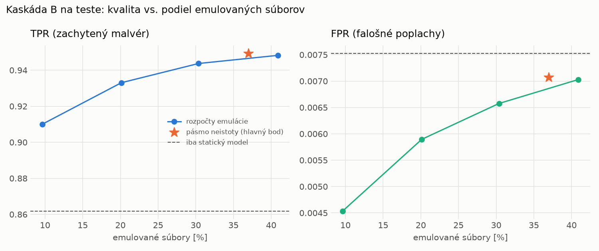

# Kaskáda B `b_direct` – beh `20261122-224747`

> Generované `src/cascade/evaluate_b.py` (2026-11-22T22:47:48+01:00). Seedy: [0, 1, 2]; hodnoty = priemer ± sm. odchýlka.
> Všetky prahy a pásmo neistoty sú z validácie; test sa na nič nenastavuje. Postup: `docs/09_plan_v2.md`.

| rola | beh |
|---|---|
| static | `runs_v4/real_full/lofo/Locker_SLocker_Ransomware/students_static/mlp_kd/20261122-224208` |
| hybrid | `runs_v4/real_full/lofo/Locker_SLocker_Ransomware/hybrid/lightgbm/20261122-223452` |

Druhý stupeň: **hybrid**. Pásmo neistoty statického modelu: FPR ≤ 0.1% nad `hi`,
najviac 1% malvéru validácie pod `lo` (seed 0: lo = 0.0263, hi = 0.9998, seed 1: lo = 0.0241, hi = 0.9999, seed 2: lo = 0.0227, hi = 0.9989).

## Test
| prístup | accuracy | balanced_accuracy | precision | recall_tpr | fpr | f1 | mcc |
|---|---|---|---|---|---|---|---|
| kaskáda B | 0.9699 ± 0.0004 | 0.9712 ± 0.0004 | 0.9934 ± 0.0002 | 0.9494 ± 0.0006 | 0.0071 ± 0.0002 | 0.9709 ± 0.0004 | 0.9407 ± 0.0008 |
| statický | 0.9233 ± 0.0017 | 0.9272 ± 0.0016 | 0.9923 ± 0.0003 | 0.8618 ± 0.0030 | 0.0075 ± 0.0003 | 0.9225 ± 0.0018 | 0.8556 ± 0.0030 |
| hybrid (každá vzorka) | 0.9722 ± 0.0001 | 0.9733 ± 0.0001 | 0.9930 ± 0.0001 | 0.9541 ± 0.0001 | 0.0075 ± 0.0002 | 0.9732 ± 0.0001 | 0.9451 ± 0.0002 |

- **emulované súbory: 36.98%** (ostatné rozhodne iba statický model); na hybrid ide 36.98% súborov
- chyby pri istom rozhodnutí statického modelu (seed 0): 167
- validácia: emulované 35.98%, na hybrid 35.98%

## Validácia
| prístup | accuracy | balanced_accuracy | precision | recall_tpr | fpr | f1 | mcc |
|---|---|---|---|---|---|---|---|
| kaskáda B | 0.9802 ± 0.0000 | 0.9806 ± 0.0000 | 0.9914 ± 0.0004 | 0.9702 ± 0.0004 | 0.0091 ± 0.0004 | 0.9807 ± 0.0000 | 0.9606 ± 0.0000 |
| statický | 0.9371 ± 0.0018 | 0.9390 ± 0.0017 | 0.9899 ± 0.0000 | 0.8877 ± 0.0035 | 0.0098 ± 0.0000 | 0.9360 ± 0.0020 | 0.8795 ± 0.0033 |
| hybrid (každá vzorka) | 0.9810 ± 0.0001 | 0.9814 ± 0.0001 | 0.9909 ± 0.0001 | 0.9724 ± 0.0003 | 0.0096 ± 0.0002 | 0.9815 ± 0.0001 | 0.9622 ± 0.0001 |

## Januárové vzorky vynechanej rodiny (iba malvér → TPR)
| prístup | TPR |
|---|---|
| kaskáda B | 0.3807 ± 0.0035 |
| statický | 0.2842 ± 0.0247 |
| hybrid (každá vzorka) | 0.4087 ± 0.0029 |

Podiel emulovaných: 51.65%

## Krivka rozpočtu emulácie (test, priemer cez seedy)
| budget_val | emulation_rate | hybrid_rate | recall_tpr | fpr | f1 |
|---|---|---|---|---|---|
| 0.1000 | 0.0963 | 0.0963 | 0.9100 | 0.0045 | 0.9509 |
| 0.2000 | 0.2013 | 0.2013 | 0.9331 | 0.0059 | 0.9628 |
| 0.3000 | 0.3038 | 0.3038 | 0.9437 | 0.0066 | 0.9681 |
| 0.4000 | 0.4089 | 0.4089 | 0.9482 | 0.0070 | 0.9703 |

## Výpočtové nároky
Čas dynamickej analýzy (beh v emulátore alebo na zariadení) dataset neuvádza, preto sa neodhaduje. Úspora kaskády B = podiel súborov s dynamickou analýzou: **36.98%** (ostatné prístupy 100 %).

_Chýba benchmark niektorého komponentu (v zero-day behoch sa nemeria)._

