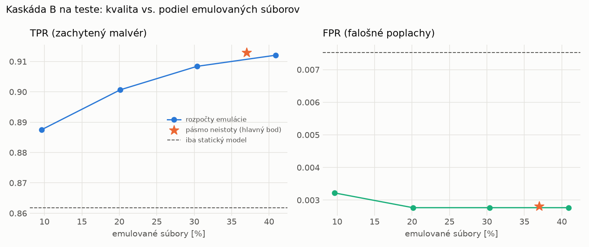

# Kaskáda B `b_heavy` – beh `20261122-224749`

> Generované `src/cascade/evaluate_b.py` (2026-11-22T22:47:50+01:00). Seedy: [0, 1, 2]; hodnoty = priemer ± sm. odchýlka.
> Všetky prahy a pásmo neistoty sú z validácie; test sa na nič nenastavuje. Postup: `docs/09_plan_v2.md`.

| rola | beh |
|---|---|
| static | `runs_v4/real_full/lofo/Locker_SLocker_Ransomware/students_static/mlp_kd/20261122-224208` |
| dynamic | `runs_v4/real_full/lofo/Locker_SLocker_Ransomware/students_dynamic/mlp_kd/20261122-224334` |
| hybrid | `runs_v4/real_full/lofo/Locker_SLocker_Ransomware/hybrid/mlp_large/20261122-223631` |

Druhý stupeň: **dynamic**. Pásmo neistoty statického modelu: FPR ≤ 0.1% nad `hi`,
najviac 1% malvéru validácie pod `lo` (seed 0: lo = 0.0263, hi = 0.9998, seed 1: lo = 0.0241, hi = 0.9999, seed 2: lo = 0.0227, hi = 0.9989).

## Test
| prístup | accuracy | balanced_accuracy | precision | recall_tpr | fpr | f1 | mcc |
|---|---|---|---|---|---|---|---|
| kaskáda B | 0.9526 ± 0.0017 | 0.9551 ± 0.0016 | 0.9973 ± 0.0005 | 0.9130 ± 0.0037 | 0.0028 ± 0.0005 | 0.9533 ± 0.0018 | 0.9090 ± 0.0031 |
| statický | 0.9233 ± 0.0017 | 0.9272 ± 0.0016 | 0.9923 ± 0.0003 | 0.8618 ± 0.0030 | 0.0075 ± 0.0003 | 0.9225 ± 0.0018 | 0.8556 ± 0.0030 |
| dynamický | 0.8631 ± 0.0027 | 0.8702 ± 0.0026 | 0.9883 ± 0.0006 | 0.7505 ± 0.0056 | 0.0100 ± 0.0006 | 0.8531 ± 0.0035 | 0.7537 ± 0.0042 |
| hybrid (každá vzorka) | 0.9665 ± 0.0036 | 0.9680 ± 0.0034 | 0.9930 ± 0.0003 | 0.9435 ± 0.0071 | 0.0075 ± 0.0004 | 0.9676 ± 0.0036 | 0.9344 ± 0.0068 |

- **emulované súbory: 36.98%** (ostatné rozhodne iba statický model); na hybrid ide 9.10% súborov
- chyby pri istom rozhodnutí statického modelu (seed 0): 167
- validácia: emulované 35.98%, na hybrid 9.00%

## Validácia
| prístup | accuracy | balanced_accuracy | precision | recall_tpr | fpr | f1 | mcc |
|---|---|---|---|---|---|---|---|
| kaskáda B | 0.9650 ± 0.0016 | 0.9661 ± 0.0015 | 0.9953 ± 0.0006 | 0.9369 ± 0.0030 | 0.0047 ± 0.0006 | 0.9652 ± 0.0016 | 0.9318 ± 0.0030 |
| statický | 0.9371 ± 0.0018 | 0.9390 ± 0.0017 | 0.9899 ± 0.0000 | 0.8877 ± 0.0035 | 0.0098 ± 0.0000 | 0.9360 ± 0.0020 | 0.8795 ± 0.0033 |
| dynamický | 0.8767 ± 0.0030 | 0.8807 ± 0.0029 | 0.9883 ± 0.0001 | 0.7713 ± 0.0058 | 0.0098 ± 0.0000 | 0.8664 ± 0.0037 | 0.7752 ± 0.0049 |
| hybrid (každá vzorka) | 0.9740 ± 0.0028 | 0.9746 ± 0.0027 | 0.9906 ± 0.0001 | 0.9590 ± 0.0055 | 0.0098 ± 0.0000 | 0.9746 ± 0.0028 | 0.9486 ± 0.0055 |

## Januárové vzorky vynechanej rodiny (iba malvér → TPR)
| prístup | TPR |
|---|---|
| kaskáda B | 0.4028 ± 0.1250 |
| statický | 0.2842 ± 0.0247 |
| dynamický | 0.4549 ± 0.0091 |
| hybrid (každá vzorka) | 0.6015 ± 0.1348 |

Podiel emulovaných: 51.65%

## Krivka rozpočtu emulácie (test, priemer cez seedy)
| budget_val | emulation_rate | hybrid_rate | recall_tpr | fpr | f1 |
|---|---|---|---|---|---|
| 0.1000 | 0.0963 | 0.0397 | 0.8875 | 0.0032 | 0.9390 |
| 0.2000 | 0.2013 | 0.0711 | 0.9007 | 0.0028 | 0.9465 |
| 0.3000 | 0.3038 | 0.0889 | 0.9084 | 0.0028 | 0.9508 |
| 0.4000 | 0.4089 | 0.1024 | 0.9121 | 0.0028 | 0.9528 |

## Výpočtové nároky
Čas dynamickej analýzy (beh v emulátore alebo na zariadení) dataset neuvádza, preto sa neodhaduje. Úspora kaskády B = podiel súborov s dynamickou analýzou: **36.98%** (ostatné prístupy 100 %).

_Chýba benchmark niektorého komponentu (v zero-day behoch sa nemeria)._

