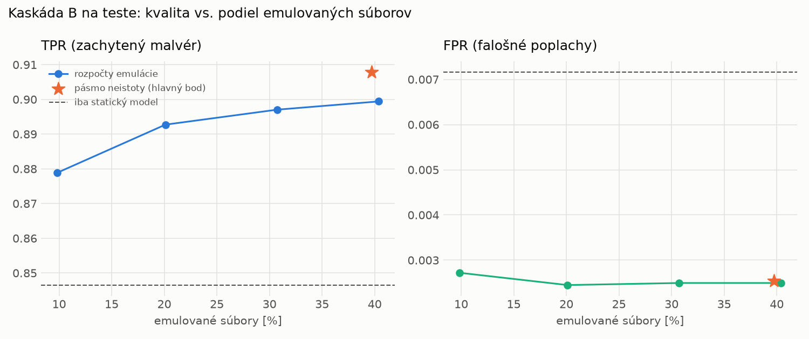

# Kaskáda B `b_heavyteacher` – beh `20261122-224755`

> Generované `src/cascade/evaluate_b.py` (2026-11-22T22:47:55+01:00). Seedy: [0, 1, 2]; hodnoty = priemer ± sm. odchýlka.
> Všetky prahy a pásmo neistoty sú z validácie; test sa na nič nenastavuje. Postup: `docs/09_plan_v2.md`.

| rola | beh |
|---|---|
| static | `runs_v4/real_full/lofo/Locker_SLocker_Ransomware/students_static/mlp_kd_heavy/20261122-224318` |
| dynamic | `runs_v4/real_full/lofo/Locker_SLocker_Ransomware/students_dynamic/mlp_kd_heavy/20261122-224609` |
| hybrid | `runs_v4/real_full/lofo/Locker_SLocker_Ransomware/hybrid/lightgbm/20261122-223452` |

Druhý stupeň: **dynamic**. Pásmo neistoty statického modelu: FPR ≤ 0.1% nad `hi`,
najviac 1% malvéru validácie pod `lo` (seed 0: lo = 0.0404, hi = 0.9991, seed 1: lo = 0.0501, hi = 0.9992, seed 2: lo = 0.0403, hi = 0.9995).

## Test
| prístup | accuracy | balanced_accuracy | precision | recall_tpr | fpr | f1 | mcc |
|---|---|---|---|---|---|---|---|
| kaskáda B | 0.9500 ± 0.0020 | 0.9527 ± 0.0019 | 0.9975 ± 0.0001 | 0.9079 ± 0.0038 | 0.0025 ± 0.0002 | 0.9506 ± 0.0021 | 0.9044 ± 0.0036 |
| statický | 0.9153 ± 0.0048 | 0.9197 ± 0.0044 | 0.9925 ± 0.0012 | 0.8465 ± 0.0100 | 0.0072 ± 0.0013 | 0.9137 ± 0.0054 | 0.8419 ± 0.0079 |
| dynamický | 0.8552 ± 0.0053 | 0.8629 ± 0.0050 | 0.9905 ± 0.0007 | 0.7337 ± 0.0100 | 0.0079 ± 0.0005 | 0.8429 ± 0.0067 | 0.7419 ± 0.0085 |
| hybrid (každá vzorka) | 0.9722 ± 0.0001 | 0.9733 ± 0.0001 | 0.9930 ± 0.0001 | 0.9541 ± 0.0001 | 0.0075 ± 0.0002 | 0.9732 ± 0.0001 | 0.9451 ± 0.0002 |

- **emulované súbory: 39.73%** (ostatné rozhodne iba statický model); na hybrid ide 10.12% súborov
- chyby pri istom rozhodnutí statického modelu (seed 0): 173
- validácia: emulované 38.31%, na hybrid 9.84%

## Validácia
| prístup | accuracy | balanced_accuracy | precision | recall_tpr | fpr | f1 | mcc |
|---|---|---|---|---|---|---|---|
| kaskáda B | 0.9646 ± 0.0021 | 0.9657 ± 0.0020 | 0.9953 ± 0.0002 | 0.9362 ± 0.0040 | 0.0048 ± 0.0002 | 0.9648 ± 0.0021 | 0.9311 ± 0.0039 |
| statický | 0.9303 ± 0.0075 | 0.9324 ± 0.0073 | 0.9897 ± 0.0002 | 0.8746 ± 0.0145 | 0.0098 ± 0.0000 | 0.9285 ± 0.0083 | 0.8673 ± 0.0134 |
| dynamický | 0.8709 ± 0.0053 | 0.8751 ± 0.0051 | 0.9884 ± 0.0002 | 0.7599 ± 0.0104 | 0.0096 ± 0.0002 | 0.8592 ± 0.0067 | 0.7657 ± 0.0087 |
| hybrid (každá vzorka) | 0.9810 ± 0.0001 | 0.9814 ± 0.0001 | 0.9909 ± 0.0001 | 0.9724 ± 0.0003 | 0.0096 ± 0.0002 | 0.9815 ± 0.0001 | 0.9622 ± 0.0001 |

## Januárové vzorky vynechanej rodiny (iba malvér → TPR)
| prístup | TPR |
|---|---|
| kaskáda B | 0.2993 ± 0.0238 |
| statický | 0.2558 ± 0.0171 |
| dynamický | 0.4387 ± 0.0033 |
| hybrid (každá vzorka) | 0.4087 ± 0.0029 |

Podiel emulovaných: 70.00%

## Krivka rozpočtu emulácie (test, priemer cez seedy)
| budget_val | emulation_rate | hybrid_rate | recall_tpr | fpr | f1 |
|---|---|---|---|---|---|
| 0.1000 | 0.0982 | 0.0429 | 0.8789 | 0.0027 | 0.9343 |
| 0.2000 | 0.2011 | 0.0748 | 0.8927 | 0.0024 | 0.9422 |
| 0.3000 | 0.3072 | 0.0932 | 0.8970 | 0.0025 | 0.9446 |
| 0.4000 | 0.4038 | 0.1036 | 0.8994 | 0.0025 | 0.9459 |

## Výpočtové nároky
Čas dynamickej analýzy (beh v emulátore alebo na zariadení) dataset neuvádza, preto sa neodhaduje. Úspora kaskády B = podiel súborov s dynamickou analýzou: **39.73%** (ostatné prístupy 100 %).

_Chýba benchmark niektorého komponentu (v zero-day behoch sa nemeria)._

