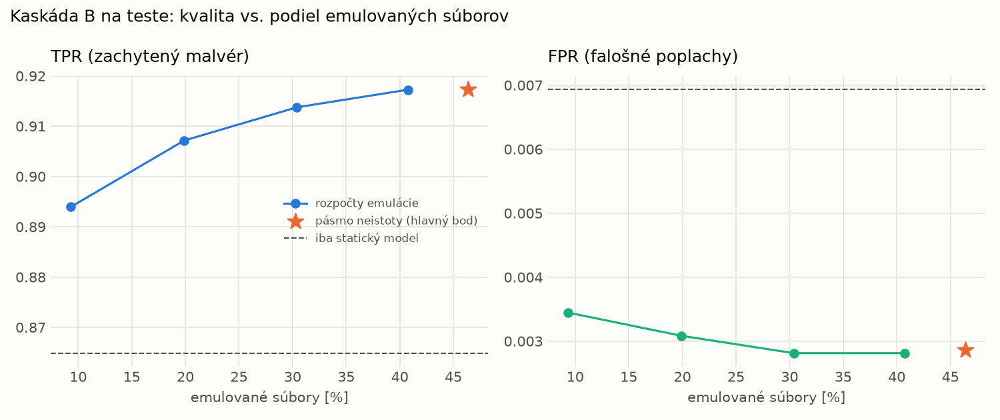

# Kaskáda B `b_nokd` – beh `20261122-224753`

> Generované `src/cascade/evaluate_b.py` (2026-11-22T22:47:53+01:00). Seedy: [0, 1, 2]; hodnoty = priemer ± sm. odchýlka.
> Všetky prahy a pásmo neistoty sú z validácie; test sa na nič nenastavuje. Postup: `docs/09_plan_v2.md`.

| rola | beh |
|---|---|
| static | `runs_v4/real_full/lofo/Locker_SLocker_Ransomware/students_static/mlp_nokd/20261122-224223` |
| dynamic | `runs_v4/real_full/lofo/Locker_SLocker_Ransomware/students_dynamic/mlp_nokd/20261122-224422` |
| hybrid | `runs_v4/real_full/lofo/Locker_SLocker_Ransomware/hybrid/lightgbm/20261122-223452` |

Druhý stupeň: **dynamic**. Pásmo neistoty statického modelu: FPR ≤ 0.1% nad `hi`,
najviac 1% malvéru validácie pod `lo` (seed 0: lo = 0.0466, hi = 0.9999, seed 1: lo = 0.0457, hi = 0.9999, seed 2: lo = 0.0422, hi = 0.9999).

## Test
| prístup | accuracy | balanced_accuracy | precision | recall_tpr | fpr | f1 | mcc |
|---|---|---|---|---|---|---|---|
| kaskáda B | 0.9549 ± 0.0008 | 0.9573 ± 0.0008 | 0.9972 ± 0.0003 | 0.9174 ± 0.0017 | 0.0029 ± 0.0003 | 0.9556 ± 0.0008 | 0.9132 ± 0.0015 |
| statický | 0.9252 ± 0.0027 | 0.9290 ± 0.0026 | 0.9929 ± 0.0004 | 0.8649 ± 0.0056 | 0.0069 ± 0.0005 | 0.9245 ± 0.0030 | 0.8590 ± 0.0047 |
| dynamický | 0.8584 ± 0.0029 | 0.8658 ± 0.0027 | 0.9900 ± 0.0009 | 0.7401 ± 0.0049 | 0.0084 ± 0.0008 | 0.8470 ± 0.0035 | 0.7467 ± 0.0048 |
| hybrid (každá vzorka) | 0.9722 ± 0.0001 | 0.9733 ± 0.0001 | 0.9930 ± 0.0001 | 0.9541 ± 0.0001 | 0.0075 ± 0.0002 | 0.9732 ± 0.0001 | 0.9451 ± 0.0002 |

- **emulované súbory: 46.37%** (ostatné rozhodne iba statický model); na hybrid ide 10.72% súborov
- chyby pri istom rozhodnutí statického modelu (seed 0): 183
- validácia: emulované 45.66%, na hybrid 10.76%

## Validácia
| prístup | accuracy | balanced_accuracy | precision | recall_tpr | fpr | f1 | mcc |
|---|---|---|---|---|---|---|---|
| kaskáda B | 0.9688 ± 0.0009 | 0.9697 ± 0.0009 | 0.9951 ± 0.0004 | 0.9445 ± 0.0017 | 0.0050 ± 0.0004 | 0.9691 ± 0.0010 | 0.9390 ± 0.0018 |
| statický | 0.9362 ± 0.0052 | 0.9381 ± 0.0050 | 0.9898 ± 0.0001 | 0.8861 ± 0.0101 | 0.0098 ± 0.0000 | 0.9351 ± 0.0057 | 0.8780 ± 0.0095 |
| dynamický | 0.8736 ± 0.0023 | 0.8777 ± 0.0022 | 0.9882 ± 0.0001 | 0.7653 ± 0.0044 | 0.0098 ± 0.0000 | 0.8626 ± 0.0028 | 0.7701 ± 0.0037 |
| hybrid (každá vzorka) | 0.9810 ± 0.0001 | 0.9814 ± 0.0001 | 0.9909 ± 0.0001 | 0.9724 ± 0.0003 | 0.0096 ± 0.0002 | 0.9815 ± 0.0001 | 0.9622 ± 0.0001 |

## Januárové vzorky vynechanej rodiny (iba malvér → TPR)
| prístup | TPR |
|---|---|
| kaskáda B | 0.3243 ± 0.0347 |
| statický | 0.2975 ± 0.0486 |
| dynamický | 0.4359 ± 0.0127 |
| hybrid (každá vzorka) | 0.4087 ± 0.0029 |

Podiel emulovaných: 53.83%

## Krivka rozpočtu emulácie (test, priemer cez seedy)
| budget_val | emulation_rate | hybrid_rate | recall_tpr | fpr | f1 |
|---|---|---|---|---|---|
| 0.1000 | 0.0931 | 0.0397 | 0.8939 | 0.0034 | 0.9425 |
| 0.2000 | 0.1989 | 0.0712 | 0.9072 | 0.0031 | 0.9499 |
| 0.3000 | 0.3040 | 0.0850 | 0.9138 | 0.0028 | 0.9537 |
| 0.4000 | 0.4076 | 0.0981 | 0.9173 | 0.0028 | 0.9556 |

## Výpočtové nároky
Čas dynamickej analýzy (beh v emulátore alebo na zariadení) dataset neuvádza, preto sa neodhaduje. Úspora kaskády B = podiel súborov s dynamickou analýzou: **46.37%** (ostatné prístupy 100 %).

_Chýba benchmark niektorého komponentu (v zero-day behoch sa nemeria)._

