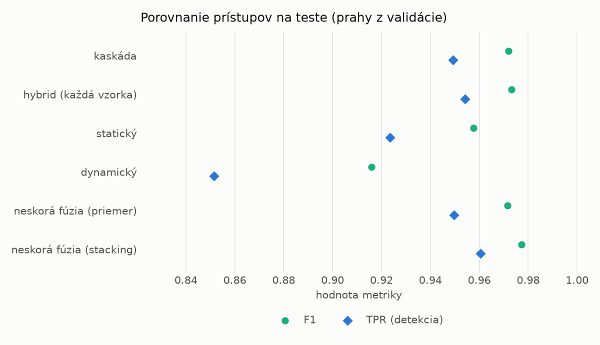
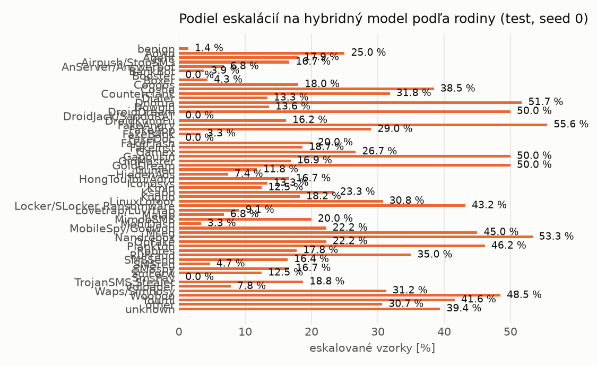

# Kaskáda `baselines` – beh `20261122-224741`

> Generované `src/cascade/evaluate.py` (2026-11-22T22:47:42+01:00). Seedy: [0, 1, 2]; hodnoty = priemer ± sm. odchýlka.
> Všetky prahy sú určené na validácii (FPR ≤ 1 %); test sa na nič nenastavuje.

| rola | beh |
|---|---|
| static | `runs_v4/real_full/lofo/Locker_SLocker_Ransomware/static/lightgbm/20261122-222917` |
| dynamic | `runs_v4/real_full/lofo/Locker_SLocker_Ransomware/dynamic/lightgbm/20261122-223201` |
| hybrid | `runs_v4/real_full/lofo/Locker_SLocker_Ransomware/hybrid/lightgbm/20261122-223452` |

## Test
| prístup | accuracy | balanced_accuracy | precision | recall_tpr | fpr | f1 | mcc |
|---|---|---|---|---|---|---|---|
| kaskáda | 0.9711 ± 0.0004 | 0.9725 ± 0.0004 | 0.9960 ± 0.0001 | 0.9492 ± 0.0008 | 0.0043 ± 0.0001 | 0.9720 ± 0.0004 | 0.9433 ± 0.0007 |
| hybrid (každá vzorka) | 0.9722 ± 0.0001 | 0.9733 ± 0.0001 | 0.9930 ± 0.0001 | 0.9541 ± 0.0001 | 0.0075 ± 0.0002 | 0.9732 ± 0.0001 | 0.9451 ± 0.0002 |
| statický | 0.9567 ± 0.0011 | 0.9588 ± 0.0010 | 0.9945 ± 0.0002 | 0.9234 ± 0.0019 | 0.0058 ± 0.0002 | 0.9576 ± 0.0011 | 0.9161 ± 0.0020 |
| dynamický | 0.9171 ± 0.0008 | 0.9213 ± 0.0007 | 0.9908 ± 0.0008 | 0.8514 ± 0.0021 | 0.0089 ± 0.0008 | 0.9158 ± 0.0009 | 0.8444 ± 0.0012 |
| neskorá fúzia (priemer) | 0.9705 ± 0.0011 | 0.9718 ± 0.0010 | 0.9943 ± 0.0004 | 0.9496 ± 0.0021 | 0.0061 ± 0.0004 | 0.9715 ± 0.0011 | 0.9419 ± 0.0021 |
| neskorá fúzia (stacking) | 0.9764 ± 0.0001 | 0.9774 ± 0.0001 | 0.9947 ± 0.0003 | 0.9606 ± 0.0003 | 0.0058 ± 0.0003 | 0.9773 ± 0.0001 | 0.9533 ± 0.0002 |

## Validácia
| prístup | accuracy | balanced_accuracy | precision | recall_tpr | fpr | f1 | mcc |
|---|---|---|---|---|---|---|---|
| kaskáda | 0.9824 ± 0.0005 | 0.9828 ± 0.0005 | 0.9951 ± 0.0004 | 0.9708 ± 0.0006 | 0.0052 ± 0.0005 | 0.9828 ± 0.0005 | 0.9651 ± 0.0011 |
| hybrid (každá vzorka) | 0.9810 ± 0.0001 | 0.9814 ± 0.0001 | 0.9909 ± 0.0001 | 0.9724 ± 0.0003 | 0.0096 ± 0.0002 | 0.9815 ± 0.0001 | 0.9622 ± 0.0001 |
| statický | 0.9696 ± 0.0009 | 0.9704 ± 0.0009 | 0.9907 ± 0.0003 | 0.9504 ± 0.0014 | 0.0096 ± 0.0003 | 0.9701 ± 0.0009 | 0.9401 ± 0.0017 |
| dynamický | 0.9299 ± 0.0017 | 0.9320 ± 0.0017 | 0.9897 ± 0.0000 | 0.8738 ± 0.0033 | 0.0098 ± 0.0000 | 0.9282 ± 0.0019 | 0.8666 ± 0.0031 |
| neskorá fúzia (priemer) | 0.9798 ± 0.0011 | 0.9802 ± 0.0011 | 0.9907 ± 0.0000 | 0.9702 ± 0.0022 | 0.0098 ± 0.0000 | 0.9803 ± 0.0011 | 0.9598 ± 0.0022 |
| neskorá fúzia (stacking) | 0.9851 ± 0.0003 | 0.9852 ± 0.0003 | 0.9909 ± 0.0001 | 0.9802 ± 0.0005 | 0.0097 ± 0.0002 | 0.9855 ± 0.0003 | 0.9702 ± 0.0005 |

## Správanie kaskády (test, seed 0)
- podiel eskalácií na hybrid: **9.13%** (1426 vzoriek)
- chyby pri zhode študentov (kaskáda ich nemôže opraviť): **286**
  (2.014% zo zhôd; FP 1, FN 285)
- úspešnosť na eskalovaných vzorkách: hybrid 0.8786816269284713, statický 0.7145862552594671,
  dynamický 0.28541374474053294  → prínos hybridu pri nezhode

## Výpočtové nároky (odhad z benchmarkov komponentov)
_Chýba benchmark niektorého komponentu (`python -m src.evaluation.benchmark`)._

