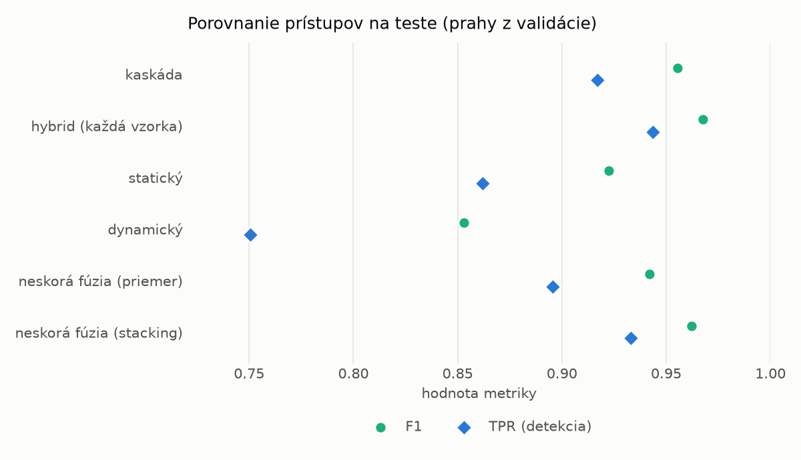
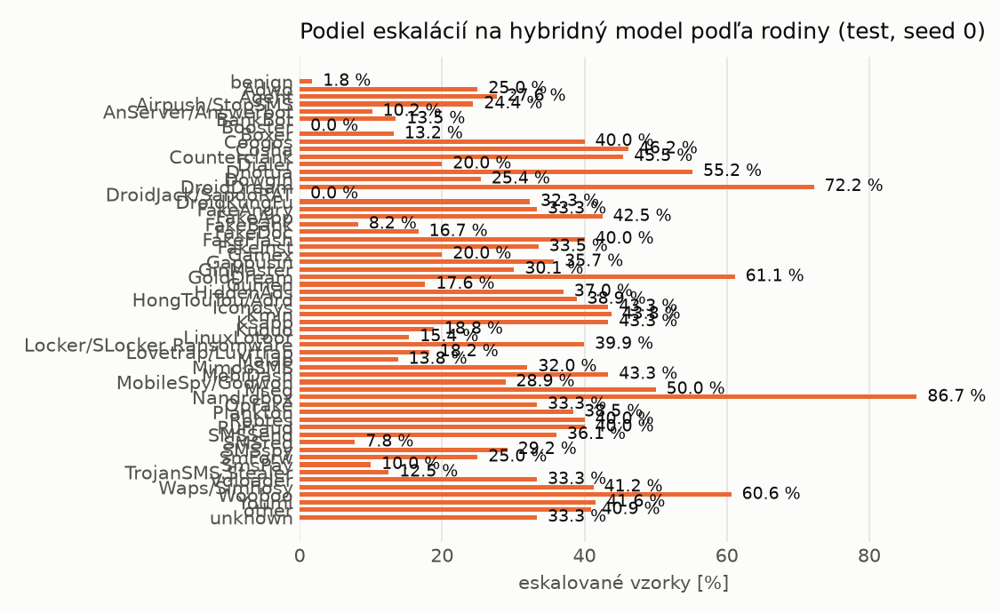

# Kaskáda `heavy` – beh `20261122-224739`

> Generované `src/cascade/evaluate.py` (2026-11-22T22:47:39+01:00). Seedy: [0, 1, 2]; hodnoty = priemer ± sm. odchýlka.
> Všetky prahy sú určené na validácii (FPR ≤ 1 %); test sa na nič nenastavuje.

| rola | beh |
|---|---|
| static | `runs_v4/real_full/lofo/Locker_SLocker_Ransomware/students_static/mlp_kd/20261122-224208` |
| dynamic | `runs_v4/real_full/lofo/Locker_SLocker_Ransomware/students_dynamic/mlp_kd/20261122-224334` |
| hybrid | `runs_v4/real_full/lofo/Locker_SLocker_Ransomware/hybrid/mlp_large/20261122-223631` |

## Test
| prístup | accuracy | balanced_accuracy | precision | recall_tpr | fpr | f1 | mcc |
|---|---|---|---|---|---|---|---|
| kaskáda | 0.9547 ± 0.0027 | 0.9571 ± 0.0025 | 0.9973 ± 0.0004 | 0.9169 ± 0.0054 | 0.0028 ± 0.0005 | 0.9554 ± 0.0028 | 0.9128 ± 0.0048 |
| hybrid (každá vzorka) | 0.9665 ± 0.0036 | 0.9680 ± 0.0034 | 0.9930 ± 0.0003 | 0.9435 ± 0.0071 | 0.0075 ± 0.0004 | 0.9676 ± 0.0036 | 0.9344 ± 0.0068 |
| statický | 0.9233 ± 0.0017 | 0.9272 ± 0.0016 | 0.9923 ± 0.0003 | 0.8618 ± 0.0030 | 0.0075 ± 0.0003 | 0.9225 ± 0.0018 | 0.8556 ± 0.0030 |
| dynamický | 0.8631 ± 0.0027 | 0.8702 ± 0.0026 | 0.9883 ± 0.0006 | 0.7505 ± 0.0056 | 0.0100 ± 0.0006 | 0.8531 ± 0.0035 | 0.7537 ± 0.0042 |
| neskorá fúzia (priemer) | 0.9415 ± 0.0014 | 0.9444 ± 0.0013 | 0.9935 ± 0.0008 | 0.8954 ± 0.0033 | 0.0066 ± 0.0008 | 0.9419 ± 0.0015 | 0.8882 ± 0.0024 |
| neskorá fúzia (stacking) | 0.9613 ± 0.0009 | 0.9631 ± 0.0009 | 0.9935 ± 0.0008 | 0.9330 ± 0.0016 | 0.0069 ± 0.0009 | 0.9623 ± 0.0009 | 0.9245 ± 0.0018 |

## Validácia
| prístup | accuracy | balanced_accuracy | precision | recall_tpr | fpr | f1 | mcc |
|---|---|---|---|---|---|---|---|
| kaskáda | 0.9658 ± 0.0015 | 0.9669 ± 0.0015 | 0.9955 ± 0.0006 | 0.9383 ± 0.0031 | 0.0045 ± 0.0006 | 0.9661 ± 0.0016 | 0.9334 ± 0.0029 |
| hybrid (každá vzorka) | 0.9740 ± 0.0028 | 0.9746 ± 0.0027 | 0.9906 ± 0.0001 | 0.9590 ± 0.0055 | 0.0098 ± 0.0000 | 0.9746 ± 0.0028 | 0.9486 ± 0.0055 |
| statický | 0.9371 ± 0.0018 | 0.9390 ± 0.0017 | 0.9899 ± 0.0000 | 0.8877 ± 0.0035 | 0.0098 ± 0.0000 | 0.9360 ± 0.0020 | 0.8795 ± 0.0033 |
| dynamický | 0.8767 ± 0.0030 | 0.8807 ± 0.0029 | 0.9883 ± 0.0001 | 0.7713 ± 0.0058 | 0.0098 ± 0.0000 | 0.8664 ± 0.0037 | 0.7752 ± 0.0049 |
| neskorá fúzia (priemer) | 0.9494 ± 0.0003 | 0.9508 ± 0.0003 | 0.9901 ± 0.0000 | 0.9114 ± 0.0006 | 0.0098 ± 0.0000 | 0.9491 ± 0.0003 | 0.9020 ± 0.0006 |
| neskorá fúzia (stacking) | 0.9702 ± 0.0013 | 0.9709 ± 0.0012 | 0.9906 ± 0.0002 | 0.9515 ± 0.0024 | 0.0097 ± 0.0002 | 0.9706 ± 0.0013 | 0.9411 ± 0.0025 |

## Správanie kaskády (test, seed 0)
- podiel eskalácií na hybrid: **13.68%** (2138 vzoriek)
- chyby pri zhode študentov (kaskáda ich nemôže opraviť): **586**
  (4.345% zo zhôd; FP 1, FN 585)
- úspešnosť na eskalovaných vzorkách: hybrid 0.9303086997193639, statický 0.7109448082319925,
  dynamický 0.2890551917680075  → prínos hybridu pri nezhode

## Výpočtové nároky (odhad z benchmarkov komponentov)
_Chýba benchmark niektorého komponentu (`python -m src.evaluation.benchmark`)._

