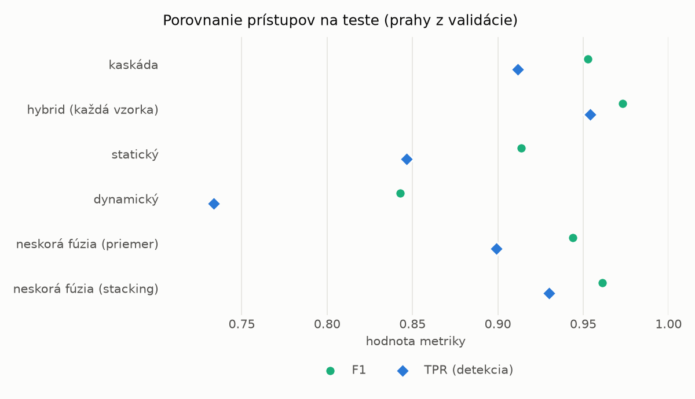
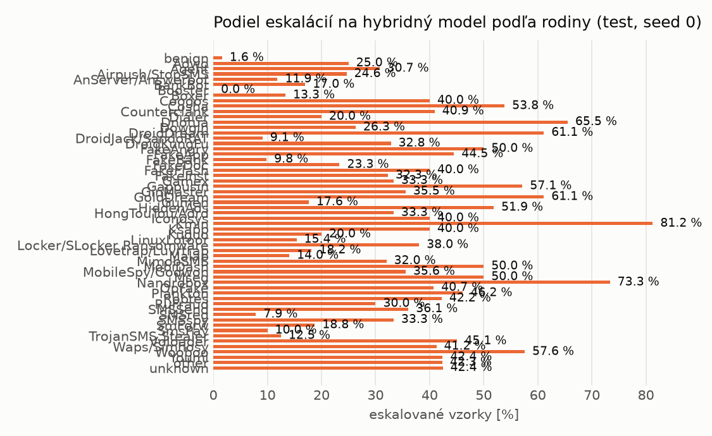

# Kaskáda `heavyteacher` – beh `20261122-224744`

> Generované `src/cascade/evaluate.py` (2026-11-22T22:47:44+01:00). Seedy: [0, 1, 2]; hodnoty = priemer ± sm. odchýlka.
> Všetky prahy sú určené na validácii (FPR ≤ 1 %); test sa na nič nenastavuje.

| rola | beh |
|---|---|
| static | `runs_v4/real_full/lofo/Locker_SLocker_Ransomware/students_static/mlp_kd_heavy/20261122-224318` |
| dynamic | `runs_v4/real_full/lofo/Locker_SLocker_Ransomware/students_dynamic/mlp_kd_heavy/20261122-224609` |
| hybrid | `runs_v4/real_full/lofo/Locker_SLocker_Ransomware/hybrid/lightgbm/20261122-223452` |

## Test
| prístup | accuracy | balanced_accuracy | precision | recall_tpr | fpr | f1 | mcc |
|---|---|---|---|---|---|---|---|
| kaskáda | 0.9519 ± 0.0020 | 0.9545 ± 0.0019 | 0.9973 ± 0.0002 | 0.9117 ± 0.0038 | 0.0028 ± 0.0002 | 0.9526 ± 0.0021 | 0.9078 ± 0.0036 |
| hybrid (každá vzorka) | 0.9722 ± 0.0001 | 0.9733 ± 0.0001 | 0.9930 ± 0.0001 | 0.9541 ± 0.0001 | 0.0075 ± 0.0002 | 0.9732 ± 0.0001 | 0.9451 ± 0.0002 |
| statický | 0.9153 ± 0.0048 | 0.9197 ± 0.0044 | 0.9925 ± 0.0012 | 0.8465 ± 0.0100 | 0.0072 ± 0.0013 | 0.9137 ± 0.0054 | 0.8419 ± 0.0079 |
| dynamický | 0.8552 ± 0.0053 | 0.8629 ± 0.0050 | 0.9905 ± 0.0007 | 0.7337 ± 0.0100 | 0.0079 ± 0.0005 | 0.8429 ± 0.0067 | 0.7419 ± 0.0085 |
| neskorá fúzia (priemer) | 0.9436 ± 0.0029 | 0.9464 ± 0.0026 | 0.9939 ± 0.0011 | 0.8990 ± 0.0062 | 0.0063 ± 0.0012 | 0.9441 ± 0.0030 | 0.8920 ± 0.0050 |
| neskorá fúzia (stacking) | 0.9603 ± 0.0007 | 0.9622 ± 0.0006 | 0.9947 ± 0.0008 | 0.9300 ± 0.0019 | 0.0055 ± 0.0009 | 0.9613 ± 0.0007 | 0.9229 ± 0.0013 |

## Validácia
| prístup | accuracy | balanced_accuracy | precision | recall_tpr | fpr | f1 | mcc |
|---|---|---|---|---|---|---|---|
| kaskáda | 0.9659 ± 0.0023 | 0.9670 ± 0.0022 | 0.9954 ± 0.0003 | 0.9386 ± 0.0043 | 0.0046 ± 0.0003 | 0.9662 ± 0.0024 | 0.9335 ± 0.0044 |
| hybrid (každá vzorka) | 0.9810 ± 0.0001 | 0.9814 ± 0.0001 | 0.9909 ± 0.0001 | 0.9724 ± 0.0003 | 0.0096 ± 0.0002 | 0.9815 ± 0.0001 | 0.9622 ± 0.0001 |
| statický | 0.9303 ± 0.0075 | 0.9324 ± 0.0073 | 0.9897 ± 0.0002 | 0.8746 ± 0.0145 | 0.0098 ± 0.0000 | 0.9285 ± 0.0083 | 0.8673 ± 0.0134 |
| dynamický | 0.8709 ± 0.0053 | 0.8751 ± 0.0051 | 0.9884 ± 0.0002 | 0.7599 ± 0.0104 | 0.0096 ± 0.0002 | 0.8592 ± 0.0067 | 0.7657 ± 0.0087 |
| neskorá fúzia (priemer) | 0.9524 ± 0.0038 | 0.9537 ± 0.0037 | 0.9902 ± 0.0001 | 0.9172 ± 0.0073 | 0.0098 ± 0.0000 | 0.9523 ± 0.0040 | 0.9076 ± 0.0070 |
| neskorá fúzia (stacking) | 0.9689 ± 0.0011 | 0.9697 ± 0.0011 | 0.9905 ± 0.0000 | 0.9492 ± 0.0022 | 0.0098 ± 0.0000 | 0.9694 ± 0.0011 | 0.9388 ± 0.0021 |

## Správanie kaskády (test, seed 0)
- podiel eskalácií na hybrid: **14.11%** (2205 vzoriek)
- chyby pri zhode študentov (kaskáda ich nemôže opraviť): **627**
  (4.672% zo zhôd; FP 1, FN 626)
- úspešnosť na eskalovaných vzorkách: hybrid 0.9510204081632653, statický 0.7156462585034014,
  dynamický 0.28435374149659864  → prínos hybridu pri nezhode

## Výpočtové nároky (odhad z benchmarkov komponentov)
_Chýba benchmark niektorého komponentu (`python -m src.evaluation.benchmark`)._

