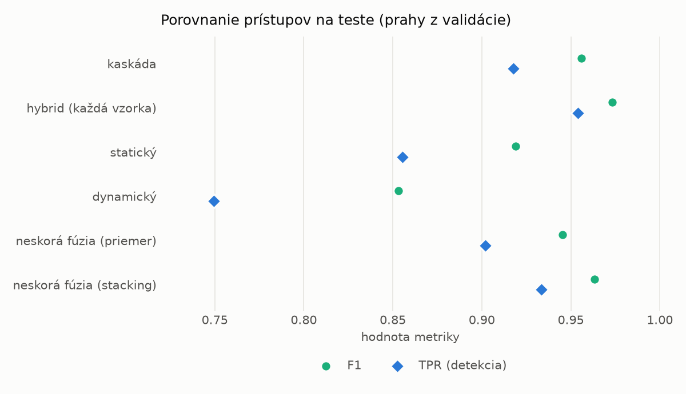
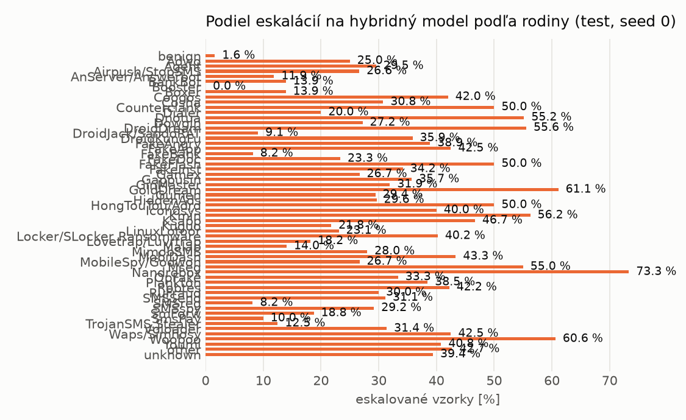

# Kaskáda `modal` – beh `20261122-224737`

> Generované `src/cascade/evaluate.py` (2026-11-22T22:47:37+01:00). Seedy: [0, 1, 2]; hodnoty = priemer ± sm. odchýlka.
> Všetky prahy sú určené na validácii (FPR ≤ 1 %); test sa na nič nenastavuje.

| rola | beh |
|---|---|
| static | `runs_v4/real_full/lofo/Locker_SLocker_Ransomware/students_static/mlp_kd_modal/20261122-224301` |
| dynamic | `runs_v4/real_full/lofo/Locker_SLocker_Ransomware/students_dynamic/mlp_kd_modal/20261122-224523` |
| hybrid | `runs_v4/real_full/lofo/Locker_SLocker_Ransomware/hybrid/lightgbm/20261122-223452` |

## Test
| prístup | accuracy | balanced_accuracy | precision | recall_tpr | fpr | f1 | mcc |
|---|---|---|---|---|---|---|---|
| kaskáda | 0.9552 ± 0.0014 | 0.9576 ± 0.0013 | 0.9975 ± 0.0002 | 0.9177 ± 0.0026 | 0.0025 ± 0.0002 | 0.9560 ± 0.0014 | 0.9139 ± 0.0025 |
| hybrid (každá vzorka) | 0.9722 ± 0.0001 | 0.9733 ± 0.0001 | 0.9930 ± 0.0001 | 0.9541 ± 0.0001 | 0.0075 ± 0.0002 | 0.9732 ± 0.0001 | 0.9451 ± 0.0002 |
| statický | 0.9200 ± 0.0041 | 0.9241 ± 0.0038 | 0.9927 ± 0.0003 | 0.8553 ± 0.0079 | 0.0071 ± 0.0003 | 0.9188 ± 0.0045 | 0.8499 ± 0.0070 |
| dynamický | 0.8634 ± 0.0018 | 0.8706 ± 0.0017 | 0.9901 ± 0.0008 | 0.7496 ± 0.0031 | 0.0085 ± 0.0007 | 0.8532 ± 0.0022 | 0.7548 ± 0.0031 |
| neskorá fúzia (priemer) | 0.9449 ± 0.0072 | 0.9476 ± 0.0067 | 0.9935 ± 0.0014 | 0.9019 ± 0.0150 | 0.0067 ± 0.0016 | 0.9454 ± 0.0076 | 0.8944 ± 0.0128 |
| neskorá fúzia (stacking) | 0.9622 ± 0.0018 | 0.9640 ± 0.0018 | 0.9948 ± 0.0005 | 0.9335 ± 0.0032 | 0.0055 ± 0.0005 | 0.9632 ± 0.0018 | 0.9264 ± 0.0035 |

## Validácia
| prístup | accuracy | balanced_accuracy | precision | recall_tpr | fpr | f1 | mcc |
|---|---|---|---|---|---|---|---|
| kaskáda | 0.9695 ± 0.0016 | 0.9704 ± 0.0015 | 0.9957 ± 0.0000 | 0.9451 ± 0.0031 | 0.0044 ± 0.0000 | 0.9698 ± 0.0016 | 0.9403 ± 0.0030 |
| hybrid (každá vzorka) | 0.9810 ± 0.0001 | 0.9814 ± 0.0001 | 0.9909 ± 0.0001 | 0.9724 ± 0.0003 | 0.0096 ± 0.0002 | 0.9815 ± 0.0001 | 0.9622 ± 0.0001 |
| statický | 0.9332 ± 0.0052 | 0.9352 ± 0.0050 | 0.9898 ± 0.0001 | 0.8802 ± 0.0100 | 0.0098 ± 0.0000 | 0.9318 ± 0.0056 | 0.8725 ± 0.0093 |
| dynamický | 0.8782 ± 0.0020 | 0.8822 ± 0.0020 | 0.9885 ± 0.0002 | 0.7740 ± 0.0038 | 0.0097 ± 0.0002 | 0.8682 ± 0.0025 | 0.7777 ± 0.0034 |
| neskorá fúzia (priemer) | 0.9560 ± 0.0089 | 0.9572 ± 0.0085 | 0.9902 ± 0.0002 | 0.9241 ± 0.0171 | 0.0098 ± 0.0000 | 0.9560 ± 0.0092 | 0.9143 ± 0.0166 |
| neskorá fúzia (stacking) | 0.9705 ± 0.0020 | 0.9712 ± 0.0020 | 0.9905 ± 0.0000 | 0.9522 ± 0.0039 | 0.0098 ± 0.0000 | 0.9710 ± 0.0021 | 0.9418 ± 0.0039 |

## Správanie kaskády (test, seed 0)
- podiel eskalácií na hybrid: **14.17%** (2214 vzoriek)
- chyby pri zhode študentov (kaskáda ich nemôže opraviť): **617**
  (4.601% zo zhôd; FP 1, FN 616)
- úspešnosť na eskalovaných vzorkách: hybrid 0.955736224028907, statický 0.6951219512195121,
  dynamický 0.3048780487804878  → prínos hybridu pri nezhode

## Výpočtové nároky (odhad z benchmarkov komponentov)
_Chýba benchmark niektorého komponentu (`python -m src.evaluation.benchmark`)._

