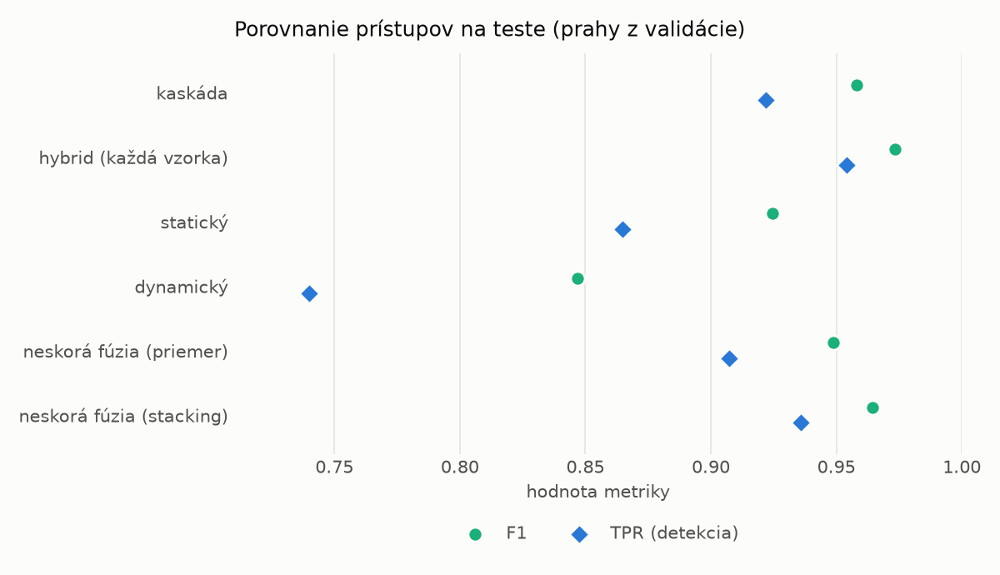
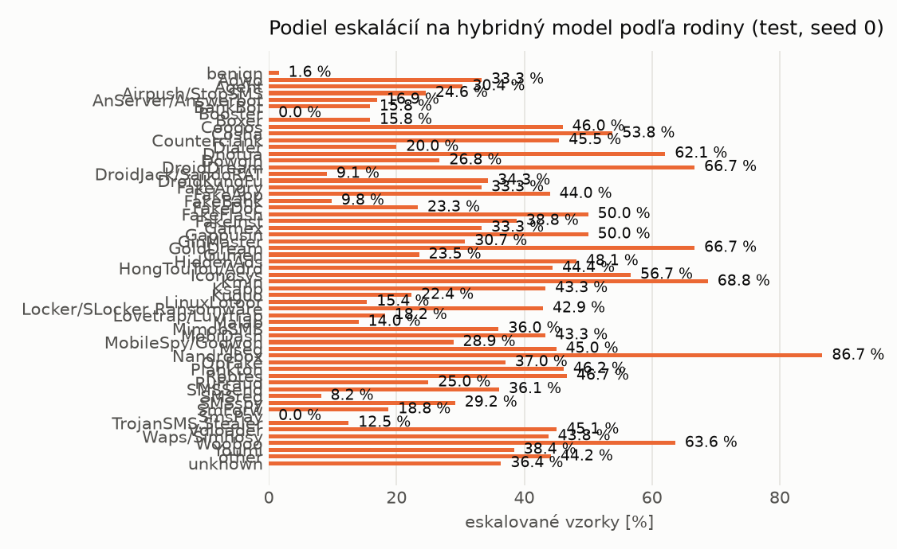

# Kaskáda `nokd` – beh `20261122-224734`

> Generované `src/cascade/evaluate.py` (2026-11-22T22:47:35+01:00). Seedy: [0, 1, 2]; hodnoty = priemer ± sm. odchýlka.
> Všetky prahy sú určené na validácii (FPR ≤ 1 %); test sa na nič nenastavuje.

| rola | beh |
|---|---|
| static | `runs_v4/real_full/lofo/Locker_SLocker_Ransomware/students_static/mlp_nokd/20261122-224223` |
| dynamic | `runs_v4/real_full/lofo/Locker_SLocker_Ransomware/students_dynamic/mlp_nokd/20261122-224422` |
| hybrid | `runs_v4/real_full/lofo/Locker_SLocker_Ransomware/hybrid/lightgbm/20261122-223452` |

## Test
| prístup | accuracy | balanced_accuracy | precision | recall_tpr | fpr | f1 | mcc |
|---|---|---|---|---|---|---|---|
| kaskáda | 0.9572 ± 0.0008 | 0.9595 ± 0.0008 | 0.9972 ± 0.0002 | 0.9219 ± 0.0016 | 0.0029 ± 0.0002 | 0.9581 ± 0.0008 | 0.9175 ± 0.0015 |
| hybrid (každá vzorka) | 0.9722 ± 0.0001 | 0.9733 ± 0.0001 | 0.9930 ± 0.0001 | 0.9541 ± 0.0001 | 0.0075 ± 0.0002 | 0.9732 ± 0.0001 | 0.9451 ± 0.0002 |
| statický | 0.9252 ± 0.0027 | 0.9290 ± 0.0026 | 0.9929 ± 0.0004 | 0.8649 ± 0.0056 | 0.0069 ± 0.0005 | 0.9245 ± 0.0030 | 0.8590 ± 0.0047 |
| dynamický | 0.8584 ± 0.0029 | 0.8658 ± 0.0027 | 0.9900 ± 0.0009 | 0.7401 ± 0.0049 | 0.0084 ± 0.0008 | 0.8470 ± 0.0035 | 0.7467 ± 0.0048 |
| neskorá fúzia (priemer) | 0.9483 ± 0.0032 | 0.9508 ± 0.0030 | 0.9944 ± 0.0006 | 0.9074 ± 0.0066 | 0.0057 ± 0.0006 | 0.9489 ± 0.0034 | 0.9006 ± 0.0057 |
| neskorá fúzia (stacking) | 0.9632 ± 0.0007 | 0.9650 ± 0.0007 | 0.9945 ± 0.0007 | 0.9358 ± 0.0016 | 0.0058 ± 0.0008 | 0.9642 ± 0.0007 | 0.9283 ± 0.0013 |

## Validácia
| prístup | accuracy | balanced_accuracy | precision | recall_tpr | fpr | f1 | mcc |
|---|---|---|---|---|---|---|---|
| kaskáda | 0.9699 ± 0.0008 | 0.9708 ± 0.0008 | 0.9952 ± 0.0003 | 0.9465 ± 0.0015 | 0.0049 ± 0.0003 | 0.9702 ± 0.0008 | 0.9410 ± 0.0015 |
| hybrid (každá vzorka) | 0.9810 ± 0.0001 | 0.9814 ± 0.0001 | 0.9909 ± 0.0001 | 0.9724 ± 0.0003 | 0.0096 ± 0.0002 | 0.9815 ± 0.0001 | 0.9622 ± 0.0001 |
| statický | 0.9362 ± 0.0052 | 0.9381 ± 0.0050 | 0.9898 ± 0.0001 | 0.8861 ± 0.0101 | 0.0098 ± 0.0000 | 0.9351 ± 0.0057 | 0.8780 ± 0.0095 |
| dynamický | 0.8736 ± 0.0023 | 0.8777 ± 0.0022 | 0.9882 ± 0.0001 | 0.7653 ± 0.0044 | 0.0098 ± 0.0000 | 0.8626 ± 0.0028 | 0.7701 ± 0.0037 |
| neskorá fúzia (priemer) | 0.9582 ± 0.0042 | 0.9593 ± 0.0041 | 0.9903 ± 0.0001 | 0.9284 ± 0.0081 | 0.0098 ± 0.0000 | 0.9584 ± 0.0044 | 0.9184 ± 0.0079 |
| neskorá fúzia (stacking) | 0.9724 ± 0.0010 | 0.9730 ± 0.0009 | 0.9907 ± 0.0001 | 0.9558 ± 0.0019 | 0.0097 ± 0.0002 | 0.9729 ± 0.0010 | 0.9454 ± 0.0019 |

## Správanie kaskády (test, seed 0)
- podiel eskalácií na hybrid: **14.55%** (2273 vzoriek)
- chyby pri zhode študentov (kaskáda ich nemôže opraviť): **555**
  (4.157% zo zhôd; FP 1, FN 554)
- úspešnosť na eskalovaných vzorkách: hybrid 0.9516058073031236, statický 0.7470303563572371,
  dynamický 0.25296964364276286  → prínos hybridu pri nezhode

## Výpočtové nároky (odhad z benchmarkov komponentov)
_Chýba benchmark niektorého komponentu (`python -m src.evaluation.benchmark`)._

