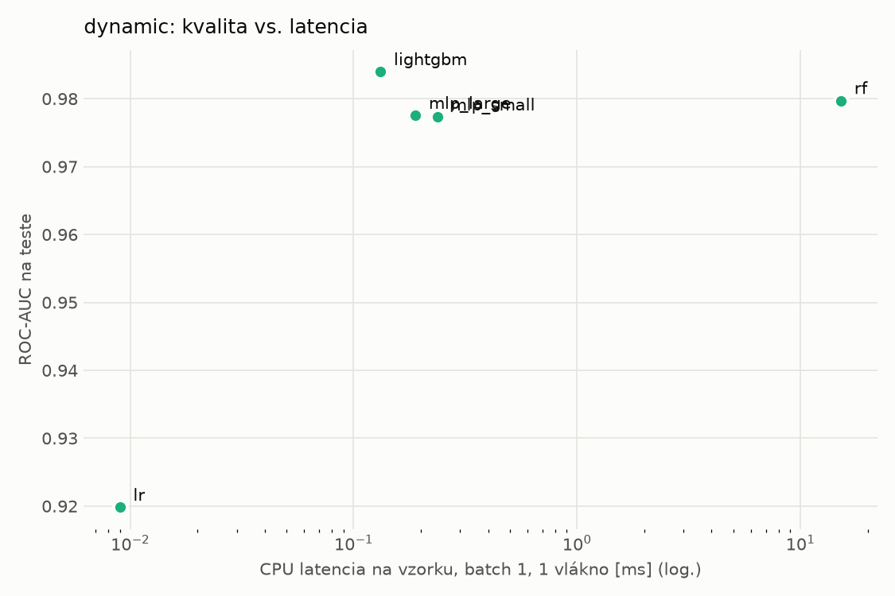
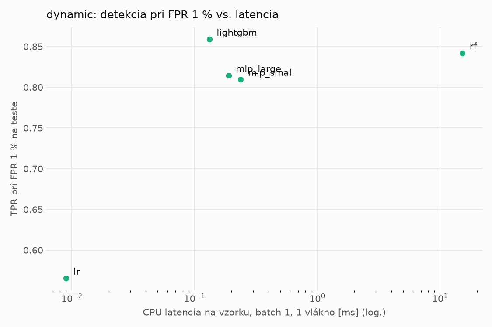
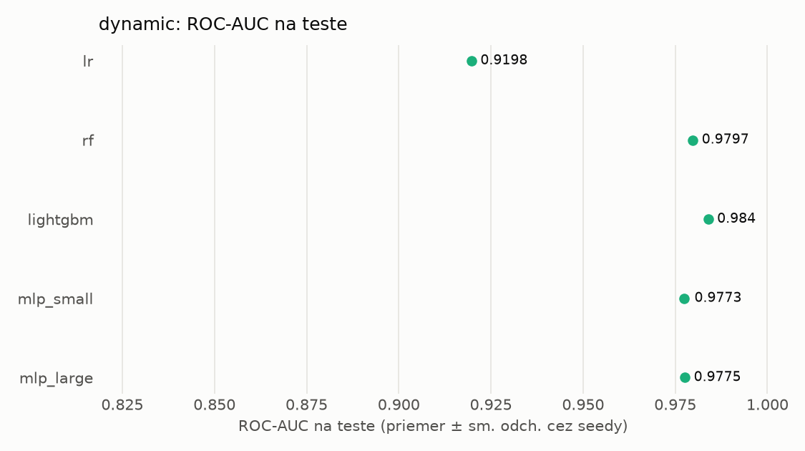
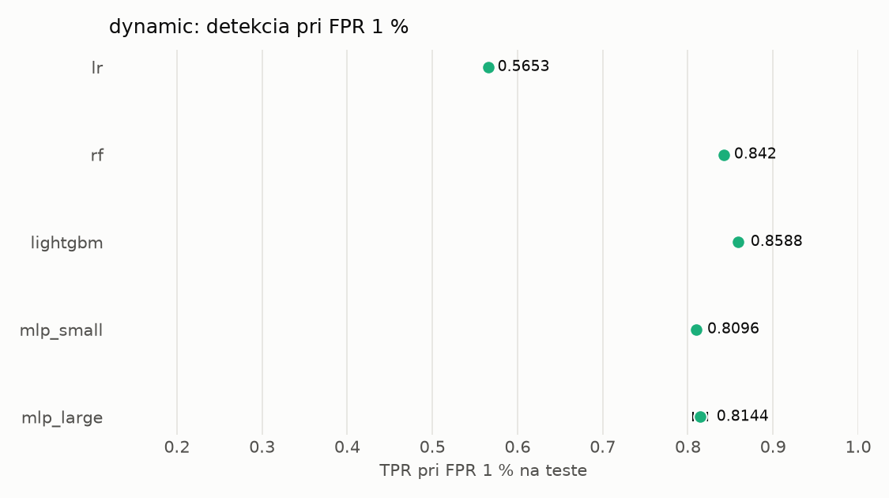

# Porovnanie modelov – dynamic

> Generované `src/evaluation/compare.py` (2026-11-22T22:34:38+01:00); použitý je posledný beh každého modelu.
> Metriky sú priemer cez seedy. \* = pri prahu určenom na validácii (FPR ≤ 1 %).
> CPU ms/vz. = medián latencie jednej vzorky na 1 vlákne vrátane transformácie vstupu (meranie hneď po tréningu,
> orientačné). Oficiálne merania spotreby sú v časti „Spotreba zdrojov pri inferencii“.

## Detekčná kvalita a orientačné časy
| model | ROC-AUC val | ROC-AUC test | TPR@FPR 1 % test | TPR@FPR 0,1 % test | F1 test* | FPR test* | gap train−val | CPU ms/vz. | CPU vz./s | GPU ms/vz. | parametre | MB | tréning s | ladenie min |
|---|---|---|---|---|---|---|---|---|---|---|---|---|---|---|
| [lr](../../dynamic/lr/20261122-223139/README.md) | 0.9235 | 0.9198 ± 0.0000 | 0.5653 | 0.4417 | 0.7272 | 0.0116 | 0.0035 | 0.009 | 4 119 105 | – | 132 | 0.01 | 0.4 | 0.0 |
| [rf](../../dynamic/rf/20261122-223141/README.md) | 0.9799 | 0.9797 ± 0.0001 | 0.8420 | 0.7592 | 0.9019 | 0.0075 | 0.0194 | 15.195 | 105 392 | – | 4 468 310 | 357.88 | 3.1 | 0.0 |
| [lightgbm](../../dynamic/lightgbm/20261122-223201/README.md) | 0.9845 | 0.9840 ± 0.0000 | 0.8588 | 0.7627 | 0.9158 | 0.0089 | 0.0145 | 0.132 | 87 728 | – | 352 704 | 19.35 | 15.2 | 0.0 |
| [mlp_small](../../dynamic/mlp_small/20261122-223300/README.md) | 0.9775 | 0.9773 ± 0.0006 | 0.8096 | 0.6503 | 0.8790 | 0.0069 | 0.0103 | 0.238 | 2 342 263 | 0.643 | 67 585 | 0.28 | 24.5 | 0.0 |
| [mlp_large](../../dynamic/mlp_large/20261122-223416/README.md) | 0.9789 | 0.9775 ± 0.0002 | 0.8144 | 0.6540 | 0.8820 | 0.0069 | 0.0116 | 0.189 | 561 584 | 0.439 | 596 481 | 2.41 | 6.5 | 0.0 |

## Nízka prevalencia malvéru (test, prah z validácie)
| model | TPR | FPR | precision @ 1 % | falošné na 1 skutočný poplach @ 1 % | precision @ 0.1 % | falošné na 1 skutočný poplach @ 0.1 % |
|---|---|---|---|---|---|---|
| lr | 0.5772 | 0.0116 | 0.335 | 1.98 | 0.048 | 20.02 |
| rf | 0.8268 | 0.0075 | 0.526 | 0.90 | 0.099 | 9.10 |
| lightgbm | 0.8514 | 0.0089 | 0.490 | 1.04 | 0.087 | 10.48 |
| mlp_small | 0.7890 | 0.0069 | 0.536 | 0.86 | 0.103 | 8.73 |
| mlp_large | 0.7937 | 0.0069 | 0.538 | 0.86 | 0.103 | 8.68 |

Prepočet: TPR a FPR nezávisia od podielu malvéru, preto sa dajú preniesť na nízku prevalenciu (v reálnej prevádzke je malvéru ~1 % alebo menej; v teste 54 %). „Falošné na 1 skutočný poplach“ = koľko neškodných súborov je označených na každý zachytený malvér.

## Spotreba zdrojov pri inferencii (benchmark, testovacia množina)
_Benchmark zatiaľ nebol spustený (`python -m src.evaluation.benchmark --approach dynamic`)._

## Grafy

