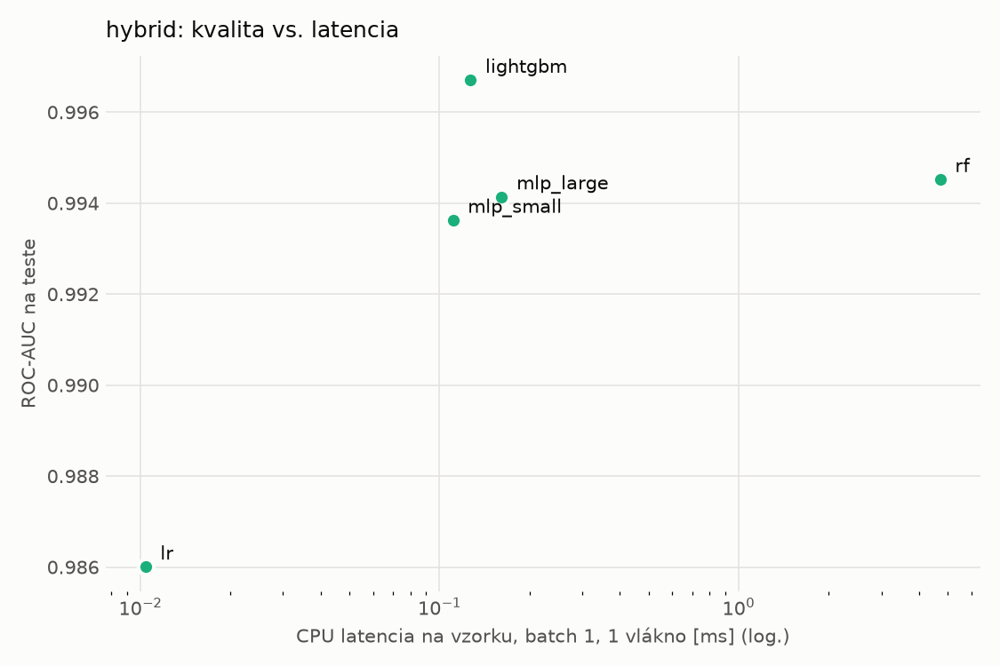
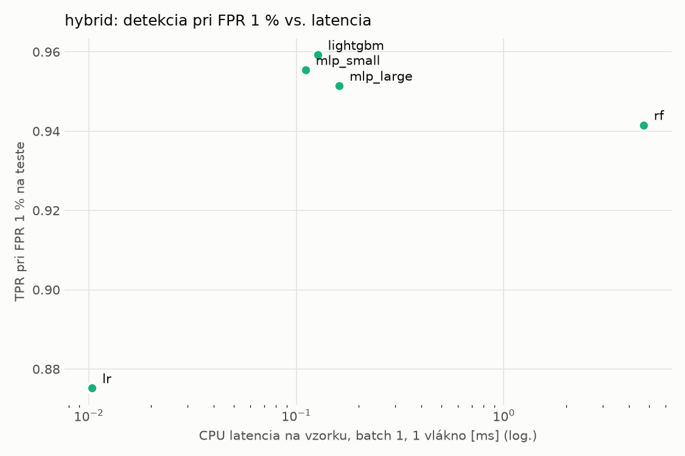
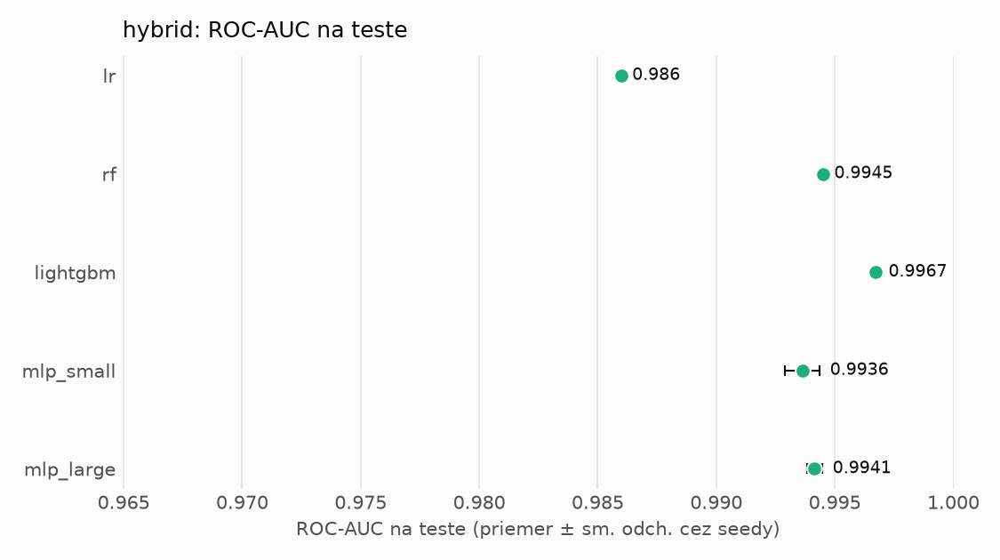
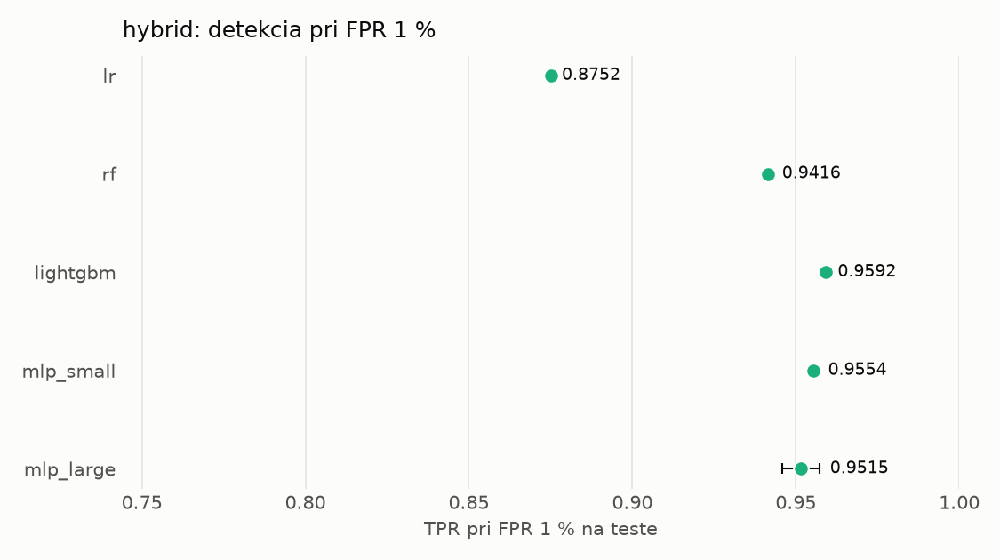

# Porovnanie modelov – hybrid

> Generované `src/evaluation/compare.py` (2026-11-22T22:37:08+01:00); použitý je posledný beh každého modelu.
> Metriky sú priemer cez seedy. \* = pri prahu určenom na validácii (FPR ≤ 1 %).
> CPU ms/vz. = medián latencie jednej vzorky na 1 vlákne vrátane transformácie vstupu (meranie hneď po tréningu,
> orientačné). Oficiálne merania spotreby sú v časti „Spotreba zdrojov pri inferencii“.

## Detekčná kvalita a orientačné časy
| model | ROC-AUC val | ROC-AUC test | TPR@FPR 1 % test | TPR@FPR 0,1 % test | F1 test* | FPR test* | gap train−val | CPU ms/vz. | CPU vz./s | GPU ms/vz. | parametre | MB | tréning s | ladenie min |
|---|---|---|---|---|---|---|---|---|---|---|---|---|---|---|
| [lr](../../hybrid/lr/20261122-223441/README.md) | 0.9881 | 0.9860 ± 0.0000 | 0.8752 | 0.5833 | 0.9151 | 0.0073 | 0.0011 | 0.010 | 2 185 682 | – | 296 | 0.01 | 0.3 | 0.0 |
| [rf](../../hybrid/rf/20261122-223444/README.md) | 0.9964 | 0.9945 ± 0.0000 | 0.9416 | 0.8862 | 0.9620 | 0.0064 | 0.0036 | 4.721 | 240 345 | – | 751 148 | 60.37 | 1.3 | 0.0 |
| [lightgbm](../../hybrid/lightgbm/20261122-223452/README.md) | 0.9975 | 0.9967 ± 0.0001 | 0.9592 | 0.9070 | 0.9732 | 0.0075 | 0.0025 | 0.127 | 121 709 | – | 346 425 | 19.28 | 17.7 | 0.0 |
| [mlp_small](../../hybrid/mlp_small/20261122-223557/README.md) | 0.9952 | 0.9936 ± 0.0007 | 0.9554 | 0.8669 | 0.9685 | 0.0075 | 0.0039 | 0.111 | 913 994 | 0.419 | 109 569 | 0.45 | 10.4 | 0.0 |
| [mlp_large](../../hybrid/mlp_large/20261122-223631/README.md) | 0.9952 | 0.9941 ± 0.0003 | 0.9515 | 0.8765 | 0.9676 | 0.0075 | 0.0032 | 0.161 | 599 366 | 0.460 | 317 697 | 1.29 | 11.6 | 0.0 |

## Nízka prevalencia malvéru (test, prah z validácie)
| model | TPR | FPR | precision @ 1 % | falošné na 1 skutočný poplach @ 1 % | precision @ 0.1 % | falošné na 1 skutočný poplach @ 0.1 % |
|---|---|---|---|---|---|---|
| lr | 0.8489 | 0.0073 | 0.539 | 0.86 | 0.104 | 8.65 |
| rf | 0.9320 | 0.0064 | 0.596 | 0.68 | 0.127 | 6.85 |
| lightgbm | 0.9541 | 0.0075 | 0.561 | 0.78 | 0.113 | 7.88 |
| mlp_small | 0.9452 | 0.0075 | 0.561 | 0.78 | 0.112 | 7.91 |
| mlp_large | 0.9435 | 0.0075 | 0.560 | 0.79 | 0.112 | 7.92 |

Prepočet: TPR a FPR nezávisia od podielu malvéru, preto sa dajú preniesť na nízku prevalenciu (v reálnej prevádzke je malvéru ~1 % alebo menej; v teste 54 %). „Falošné na 1 skutočný poplach“ = koľko neškodných súborov je označených na každý zachytený malvér.

## Spotreba zdrojov pri inferencii (benchmark, testovacia množina)
_Benchmark zatiaľ nebol spustený (`python -m src.evaluation.benchmark --approach hybrid`)._

## Grafy

