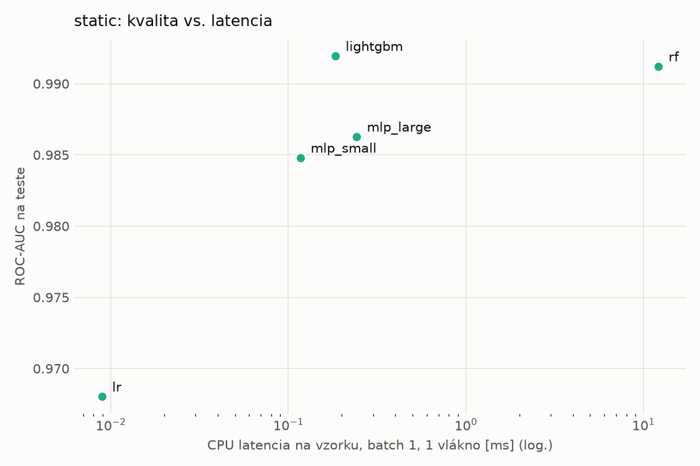
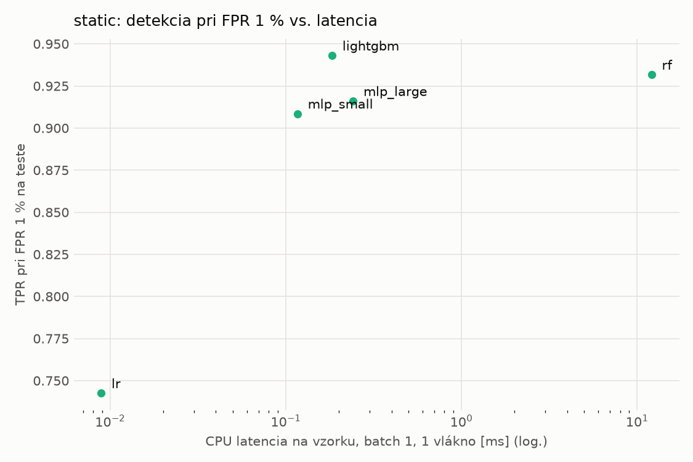
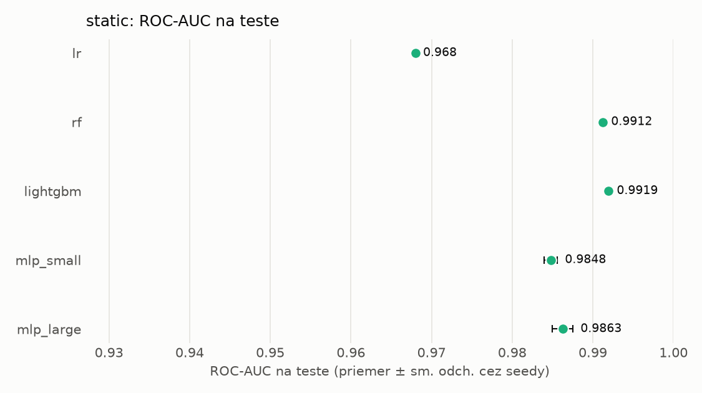
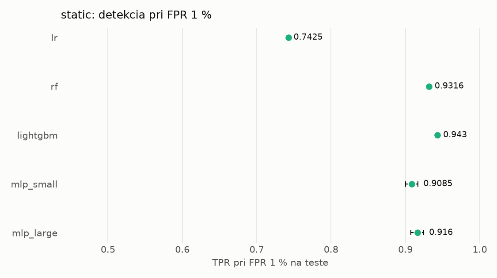

# Porovnanie modelov – static

> Generované `src/evaluation/compare.py` (2026-11-22T22:31:36+01:00); použitý je posledný beh každého modelu.
> Metriky sú priemer cez seedy. \* = pri prahu určenom na validácii (FPR ≤ 1 %).
> CPU ms/vz. = medián latencie jednej vzorky na 1 vlákne vrátane transformácie vstupu (meranie hneď po tréningu,
> orientačné). Oficiálne merania spotreby sú v časti „Spotreba zdrojov pri inferencii“.

## Detekčná kvalita a orientačné časy
| model | ROC-AUC val | ROC-AUC test | TPR@FPR 1 % test | TPR@FPR 0,1 % test | F1 test* | FPR test* | gap train−val | CPU ms/vz. | CPU vz./s | GPU ms/vz. | parametre | MB | tréning s | ladenie min |
|---|---|---|---|---|---|---|---|---|---|---|---|---|---|---|
| [lr](../../static/lr/20261122-222859/README.md) | 0.9731 | 0.9680 ± 0.0000 | 0.7425 | 0.2361 | 0.7748 | 0.0072 | 0.0016 | 0.009 | 3 701 905 | – | 165 | 0.01 | 0.2 | 0.0 |
| [rf](../../static/rf/20261122-222903/README.md) | 0.9946 | 0.9912 ± 0.0001 | 0.9316 | 0.8450 | 0.9538 | 0.0065 | 0.0054 | 12.092 | 150 626 | – | 2 537 214 | 203.35 | 1.9 | 0.0 |
| [lightgbm](../../static/lightgbm/20261122-222917/README.md) | 0.9951 | 0.9919 ± 0.0001 | 0.9430 | 0.8238 | 0.9576 | 0.0058 | 0.0049 | 0.184 | 79 610 | – | 649 382 | 36.10 | 14.2 | 0.0 |
| [mlp_small](../../static/mlp_small/20261122-223021/README.md) | 0.9918 | 0.9848 ± 0.0008 | 0.9085 | 0.6775 | 0.9340 | 0.0062 | 0.0058 | 0.117 | 1 629 845 | 0.381 | 76 033 | 0.32 | 12.1 | 0.0 |
| [mlp_large](../../static/mlp_large/20261122-223059/README.md) | 0.9918 | 0.9863 ± 0.0013 | 0.9160 | 0.7411 | 0.9354 | 0.0057 | 0.0058 | 0.242 | 835 687 | 0.529 | 250 625 | 1.02 | 11.5 | 0.0 |

## Nízka prevalencia malvéru (test, prah z validácie)
| model | TPR | FPR | precision @ 1 % | falošné na 1 skutočný poplach @ 1 % | precision @ 0.1 % | falošné na 1 skutočný poplach @ 0.1 % |
|---|---|---|---|---|---|---|
| lr | 0.6364 | 0.0072 | 0.471 | 1.12 | 0.081 | 11.32 |
| rf | 0.9170 | 0.0065 | 0.586 | 0.71 | 0.123 | 7.11 |
| lightgbm | 0.9234 | 0.0058 | 0.618 | 0.62 | 0.138 | 6.23 |
| mlp_small | 0.8811 | 0.0062 | 0.589 | 0.70 | 0.124 | 7.04 |
| mlp_large | 0.8831 | 0.0057 | 0.610 | 0.64 | 0.134 | 6.46 |

Prepočet: TPR a FPR nezávisia od podielu malvéru, preto sa dajú preniesť na nízku prevalenciu (v reálnej prevádzke je malvéru ~1 % alebo menej; v teste 54 %). „Falošné na 1 skutočný poplach“ = koľko neškodných súborov je označených na každý zachytený malvér.

## Spotreba zdrojov pri inferencii (benchmark, testovacia množina)
_Benchmark zatiaľ nebol spustený (`python -m src.evaluation.benchmark --approach static`)._

## Grafy

