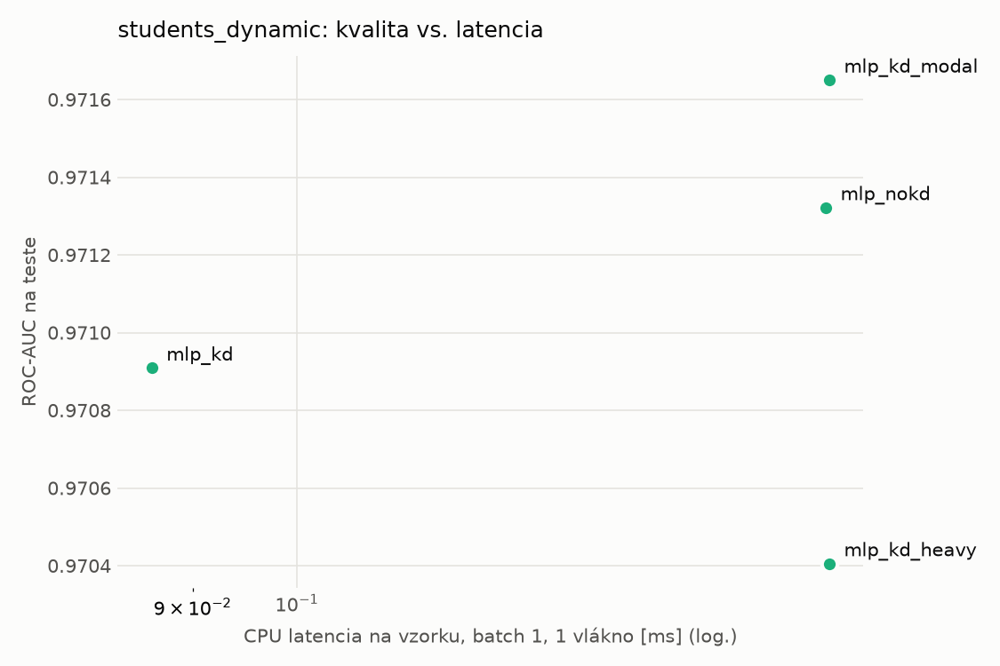
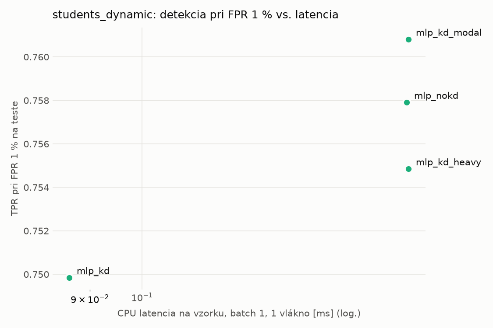
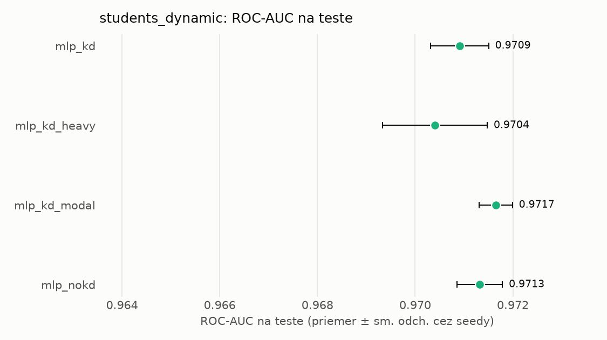
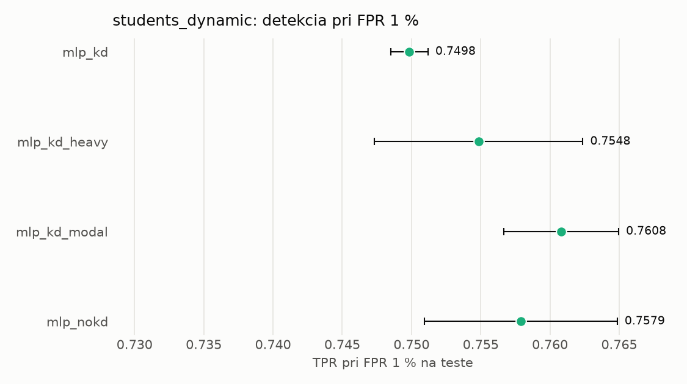

# Porovnanie modelov – students_dynamic

> Generované `src/evaluation/compare.py` (2026-11-22T22:47:30+01:00); použitý je posledný beh každého modelu.
> Metriky sú priemer cez seedy. \* = pri prahu určenom na validácii (FPR ≤ 1 %).
> CPU ms/vz. = medián latencie jednej vzorky na 1 vlákne vrátane transformácie vstupu (meranie hneď po tréningu,
> orientačné). Oficiálne merania spotreby sú v časti „Spotreba zdrojov pri inferencii“.

## Detekčná kvalita a orientačné časy
| model | ROC-AUC val | ROC-AUC test | TPR@FPR 1 % test | TPR@FPR 0,1 % test | F1 test* | FPR test* | gap train−val | CPU ms/vz. | CPU vz./s | GPU ms/vz. | parametre | MB | tréning s | ladenie min |
|---|---|---|---|---|---|---|---|---|---|---|---|---|---|---|
| [mlp_kd](../../students_dynamic/mlp_kd/20261122-224334/README.md) | 0.9704 | 0.9709 ± 0.0006 | 0.7498 | 0.5733 | 0.8531 | 0.0100 | 0.0053 | 0.086 | 7 557 071 | 0.268 | 8 641 | 0.04 | 15.3 | 0.0 |
| [mlp_kd_heavy](../../students_dynamic/mlp_kd_heavy/20261122-224609/README.md) | 0.9704 | 0.9704 ± 0.0011 | 0.7548 | 0.5805 | 0.8429 | 0.0079 | 0.0064 | 0.171 | 8 519 629 | 0.296 | 8 641 | 0.04 | 26.3 | 0.0 |
| [mlp_kd_modal](../../students_dynamic/mlp_kd_modal/20261122-224523/README.md) | 0.9720 | 0.9717 ± 0.0003 | 0.7608 | 0.6027 | 0.8532 | 0.0085 | 0.0041 | 0.171 | 9 091 174 | 0.280 | 8 641 | 0.04 | 14.7 | 0.0 |
| [mlp_nokd](../../students_dynamic/mlp_nokd/20261122-224422/README.md) | 0.9711 | 0.9713 ± 0.0005 | 0.7579 | 0.5952 | 0.8470 | 0.0084 | 0.0070 | 0.171 | 8 995 912 | 0.281 | 8 641 | 0.04 | 19.8 | 0.0 |

## Nízka prevalencia malvéru (test, prah z validácie)
| model | TPR | FPR | precision @ 1 % | falošné na 1 skutočný poplach @ 1 % | precision @ 0.1 % | falošné na 1 skutočný poplach @ 0.1 % |
|---|---|---|---|---|---|---|
| mlp_kd | 0.7505 | 0.0100 | 0.431 | 1.32 | 0.070 | 13.34 |
| mlp_kd_heavy | 0.7337 | 0.0079 | 0.483 | 1.07 | 0.085 | 10.81 |
| mlp_kd_modal | 0.7496 | 0.0085 | 0.472 | 1.12 | 0.081 | 11.30 |
| mlp_nokd | 0.7401 | 0.0084 | 0.470 | 1.13 | 0.081 | 11.39 |

Prepočet: TPR a FPR nezávisia od podielu malvéru, preto sa dajú preniesť na nízku prevalenciu (v reálnej prevádzke je malvéru ~1 % alebo menej; v teste 54 %). „Falošné na 1 skutočný poplach“ = koľko neškodných súborov je označených na každý zachytený malvér.

## Spotreba zdrojov pri inferencii (benchmark, testovacia množina)
_Benchmark zatiaľ nebol spustený (`python -m src.evaluation.benchmark --approach students_dynamic`)._

## Grafy

