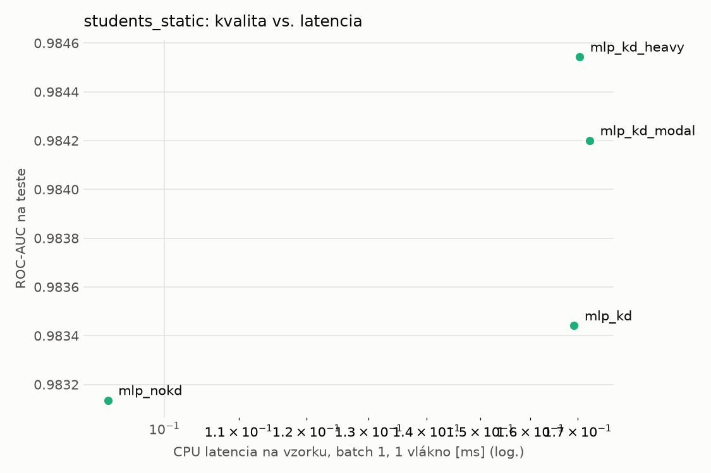
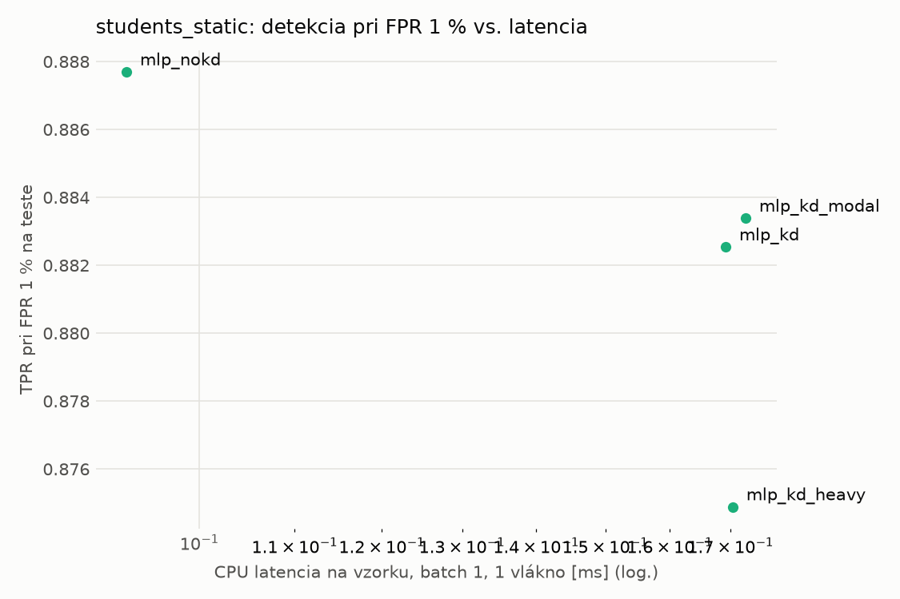
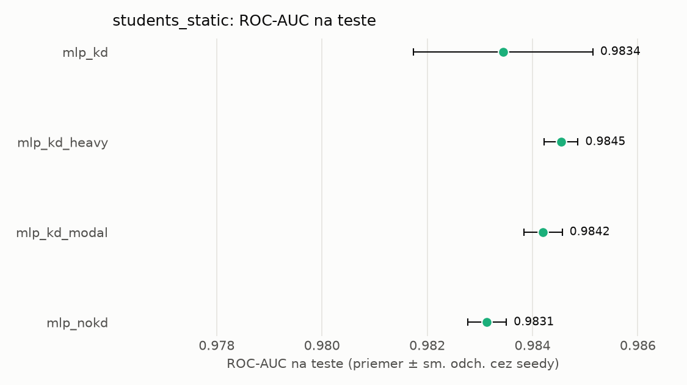
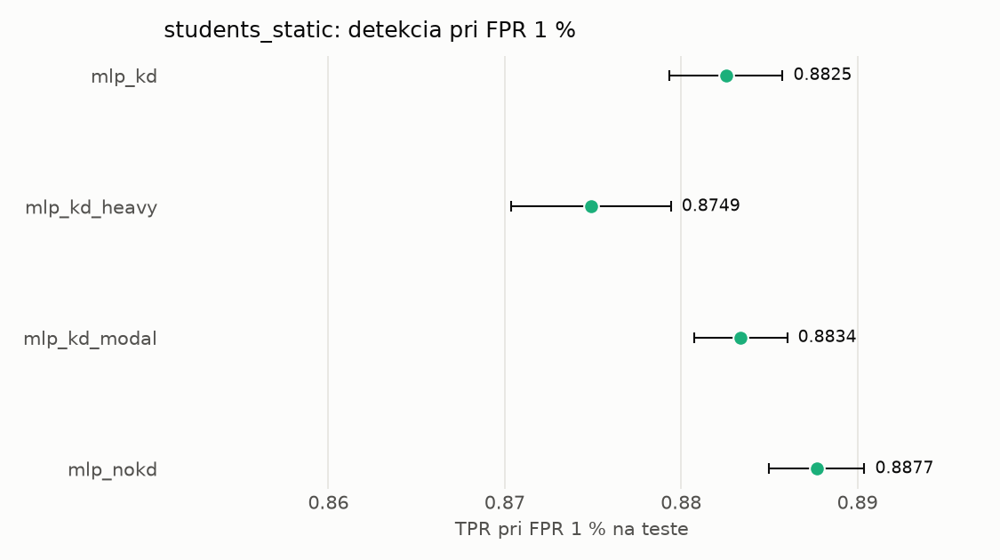

# Porovnanie modelov – students_static

> Generované `src/evaluation/compare.py` (2026-11-22T22:43:31+01:00); použitý je posledný beh každého modelu.
> Metriky sú priemer cez seedy. \* = pri prahu určenom na validácii (FPR ≤ 1 %).
> CPU ms/vz. = medián latencie jednej vzorky na 1 vlákne vrátane transformácie vstupu (meranie hneď po tréningu,
> orientačné). Oficiálne merania spotreby sú v časti „Spotreba zdrojov pri inferencii“.

## Detekčná kvalita a orientačné časy
| model | ROC-AUC val | ROC-AUC test | TPR@FPR 1 % test | TPR@FPR 0,1 % test | F1 test* | FPR test* | gap train−val | CPU ms/vz. | CPU vz./s | GPU ms/vz. | parametre | MB | tréning s | ladenie min |
|---|---|---|---|---|---|---|---|---|---|---|---|---|---|---|
| [mlp_kd](../../students_static/mlp_kd/20261122-224208/README.md) | 0.9895 | 0.9834 ± 0.0017 | 0.8825 | 0.6943 | 0.9225 | 0.0075 | 0.0043 | 0.169 | 2 914 459 | 0.472 | 10 753 | 0.05 | 4.3 | 0.0 |
| [mlp_kd_heavy](../../students_static/mlp_kd_heavy/20261122-224318/README.md) | 0.9885 | 0.9845 ± 0.0003 | 0.8749 | 0.7041 | 0.9137 | 0.0072 | 0.0050 | 0.170 | 2 546 323 | 0.289 | 10 753 | 0.05 | 3.6 | 0.0 |
| [mlp_kd_modal](../../students_static/mlp_kd_modal/20261122-224301/README.md) | 0.9893 | 0.9842 ± 0.0004 | 0.8834 | 0.7091 | 0.9188 | 0.0071 | 0.0040 | 0.173 | 2 578 043 | 0.287 | 10 753 | 0.05 | 5.0 | 0.0 |
| [mlp_nokd](../../students_static/mlp_nokd/20261122-224223/README.md) | 0.9894 | 0.9831 ± 0.0004 | 0.8877 | 0.6100 | 0.9245 | 0.0069 | 0.0055 | 0.093 | 3 289 543 | 0.279 | 10 753 | 0.05 | 11.9 | 0.0 |

## Nízka prevalencia malvéru (test, prah z validácie)
| model | TPR | FPR | precision @ 1 % | falošné na 1 skutočný poplach @ 1 % | precision @ 0.1 % | falošné na 1 skutočný poplach @ 0.1 % |
|---|---|---|---|---|---|---|
| mlp_kd | 0.8618 | 0.0075 | 0.536 | 0.86 | 0.103 | 8.73 |
| mlp_kd_heavy | 0.8465 | 0.0072 | 0.544 | 0.84 | 0.106 | 8.46 |
| mlp_kd_modal | 0.8553 | 0.0071 | 0.548 | 0.82 | 0.107 | 8.32 |
| mlp_nokd | 0.8649 | 0.0069 | 0.557 | 0.79 | 0.111 | 8.02 |

Prepočet: TPR a FPR nezávisia od podielu malvéru, preto sa dajú preniesť na nízku prevalenciu (v reálnej prevádzke je malvéru ~1 % alebo menej; v teste 54 %). „Falošné na 1 skutočný poplach“ = koľko neškodných súborov je označených na každý zachytený malvér.

## Spotreba zdrojov pri inferencii (benchmark, testovacia množina)
_Benchmark zatiaľ nebol spustený (`python -m src.evaluation.benchmark --approach students_static`)._

## Grafy

