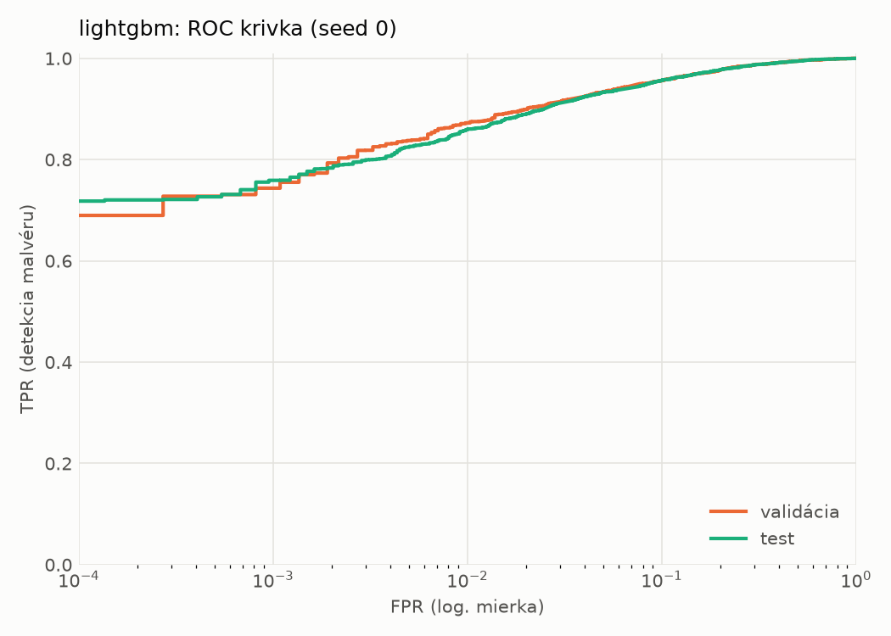
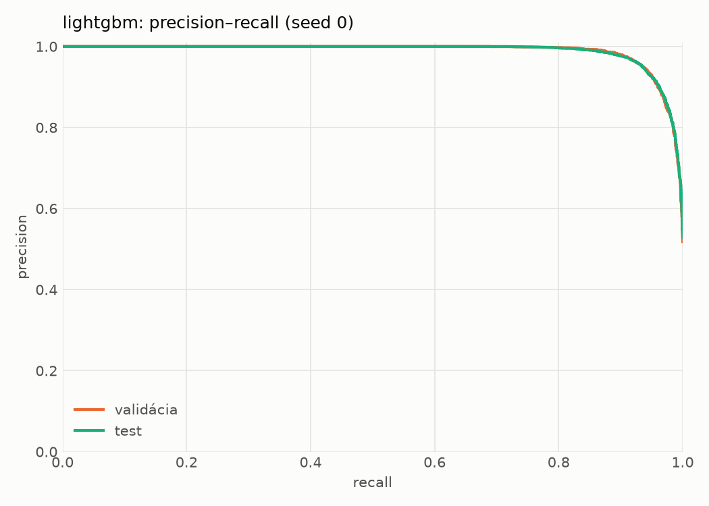
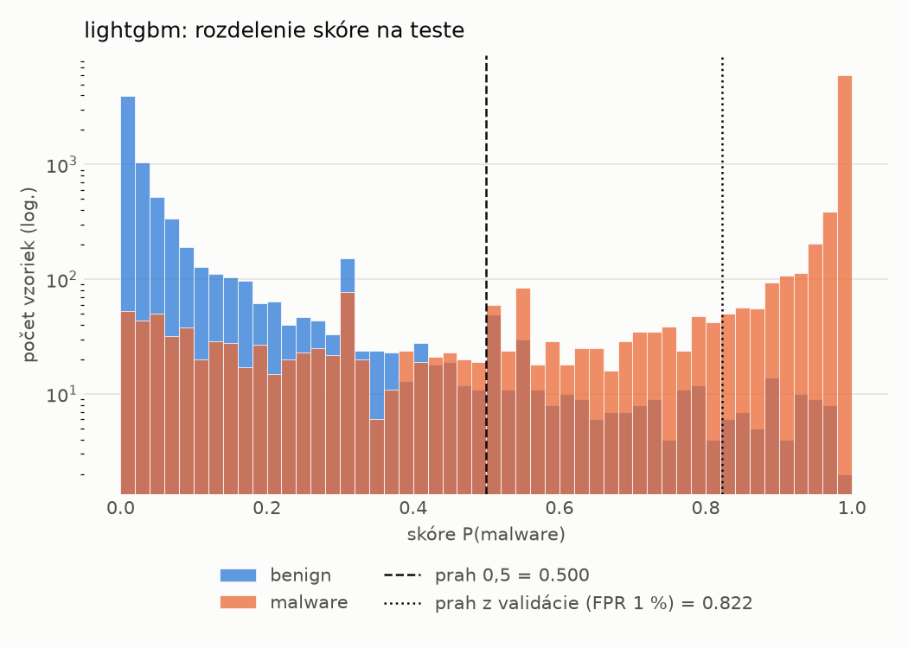
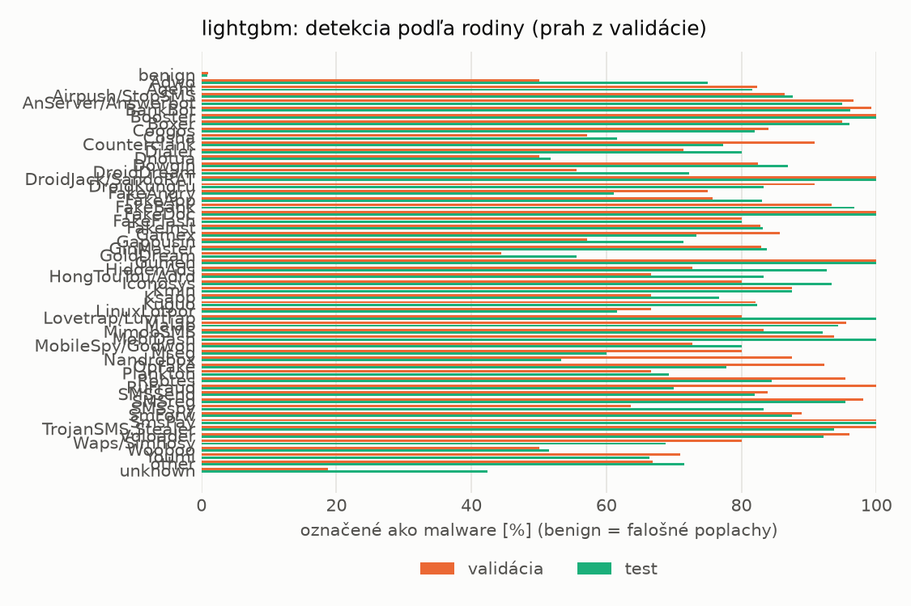
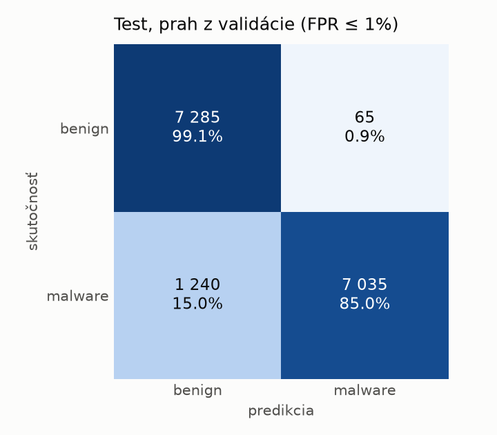
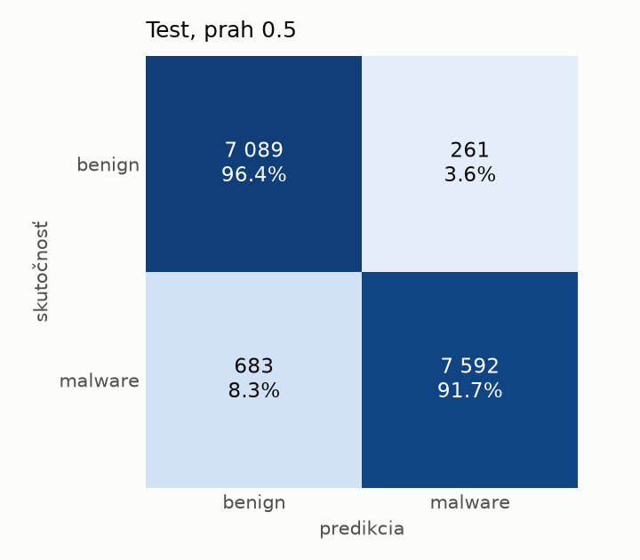
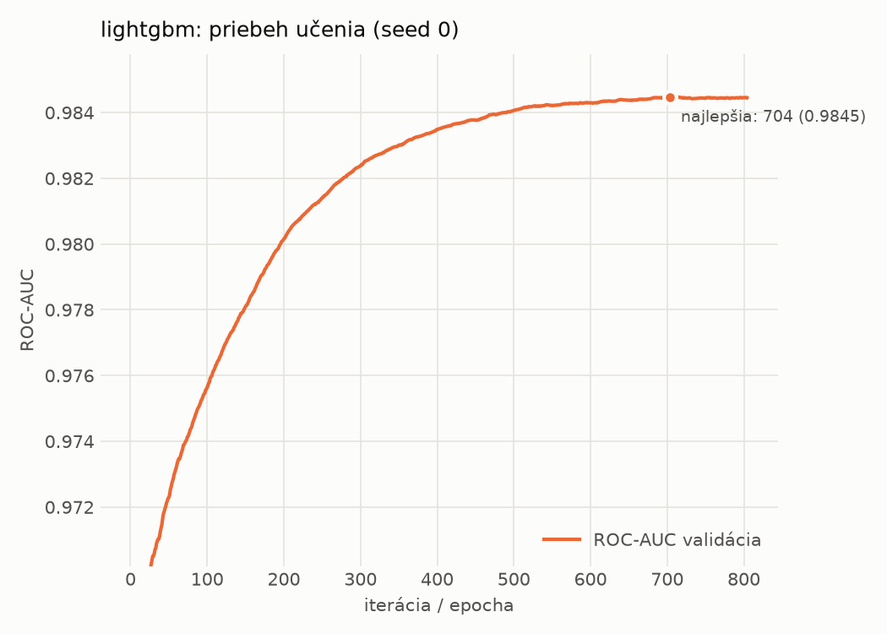

# dynamic/lightgbm – beh `20261122-223201`

> Automaticky generované (`src/training/run_tabular.py`). Konfigurácia: `config.yaml`, protokol: `protocol.yaml`.

- **Model:** `lightgbm` – LightGBM, gradient boosting stromov s early stopping na validácii (pôvodné hodnoty príznakov)
- **Ladenie:** bez ladenia – hyperparametre prevzaté z `runs_v4/real_full/full/dynamic/lightgbm/20261122-191914`
- **Finálne modely:** seedy [0, 1, 2]; hodnoty sú priemer ± smerodajná odchýlka cez seedy
- **Najlepšie hyperparametre:** `{"num_boost_round": 5000, "early_stopping_rounds": 100, "learning_rate": 0.017901592505193763, "num_leaves": 251, "min_child_samples": 52, "feature_fraction": 0.9358255991772038, "bagging_fraction": 0.8815171244905227, "lambda_l1": 0.02987319702672823, "lambda_l2": 0.017348460156736675}`

## Detekčná kvalita (bez prahu)
| metrika | train (podvzorka) | validácia | test |
|---|---|---|---|
| ROC-AUC | 0.9990 ± 0.0001 | 0.9845 ± 0.0001 | 0.9840 ± 0.0000 |
| PR-AUC | 0.9991 ± 0.0001 | 0.9881 ± 0.0001 | 0.9880 ± 0.0000 |
| TPR pri FPR 1 % | 0.9687 ± 0.0015 | 0.8738 ± 0.0033 | 0.8588 ± 0.0036 |
| TPR pri FPR 0,1 % | 0.9593 ± 0.0018 | 0.7508 ± 0.0072 | 0.7627 ± 0.0056 |
| log loss | 0.0522 ± 0.0039 | 0.1501 ± 0.0004 | 0.1570 ± 0.0004 |
| Brier skóre | 0.0128 ± 0.0009 | 0.0434 ± 0.0002 | 0.0458 ± 0.0001 |

Rozdiel ROC-AUC train − validácia: **0.0145** (veľký rozdiel = preučenie).

## Pri prahu z validácie (FPR ≤ 1% na validácii)
| metrika | train (podvzorka) | validácia | test |
|---|---|---|---|
| accuracy | 0.9680 ± 0.0021 | 0.9299 ± 0.0017 | 0.9171 ± 0.0008 |
| balanced accuracy | 0.9687 ± 0.0020 | 0.9320 ± 0.0017 | 0.9213 ± 0.0007 |
| precision | 0.9997 ± 0.0003 | 0.9897 ± 0.0000 | 0.9908 ± 0.0008 |
| recall (TPR) | 0.9377 ± 0.0037 | 0.8738 ± 0.0033 | 0.8514 ± 0.0021 |
| FPR | 0.0003 ± 0.0003 | 0.0098 ± 0.0000 | 0.0089 ± 0.0008 |
| F1 | 0.9677 ± 0.0021 | 0.9282 ± 0.0019 | 0.9158 ± 0.0009 |
| MCC | 0.9379 ± 0.0039 | 0.8666 ± 0.0031 | 0.8444 ± 0.0012 |

## Pri pevnom prahu 0.5
| metrika | train (podvzorka) | validácia | test |
|---|---|---|---|
| accuracy | 0.9832 ± 0.0007 | 0.9417 ± 0.0002 | 0.9395 ± 0.0003 |
| balanced accuracy | 0.9833 ± 0.0006 | 0.9423 ± 0.0002 | 0.9409 ± 0.0002 |
| precision | 0.9890 ± 0.0000 | 0.9596 ± 0.0004 | 0.9667 ± 0.0001 |
| recall (TPR) | 0.9781 ± 0.0013 | 0.9265 ± 0.0006 | 0.9174 ± 0.0005 |
| FPR | 0.0115 ± 0.0000 | 0.0420 ± 0.0004 | 0.0356 ± 0.0001 |
| F1 | 0.9835 ± 0.0007 | 0.9428 ± 0.0002 | 0.9414 ± 0.0003 |
| MCC | 0.9664 ± 0.0013 | 0.8839 ± 0.0004 | 0.8803 ± 0.0005 |

## Výpočtové nároky (seed 0, testovacia množina)
| meranie | hodnota |
|---|---|
| tréning finálneho modelu | 15.2 s (priemer cez seedy) |
| ladenie spolu | 0 s |
| počet parametrov / uzlov | 352 704 |
| veľkosť modelu na disku | 19.35 MB |
| CPU latencia modelu (batch 1, 1 vlákno) | 0.132 ms (p95 0.160) |
| CPU priepustnosť (24 vlákien) | 87 728 vzoriek/s |

## Grafy
| | |
|---|---|
|  |  |
|  |  |
|  |  |
|  |  |

## Súbory
`metrics.json` (všetky metriky po seedoch vrátane rodín), `timing.json`, `hpo_trials.csv`,
`predictions/<časť>_seed<N>.parquet` (sha256, family, label, score), `model/seed_<N>/`, `log.txt`.
