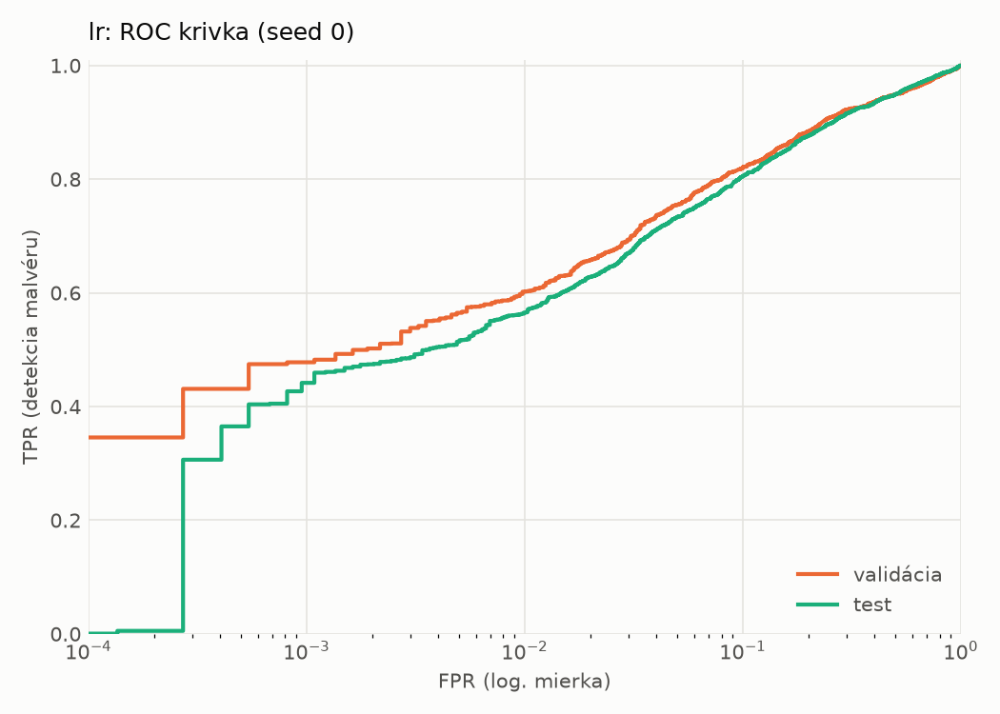
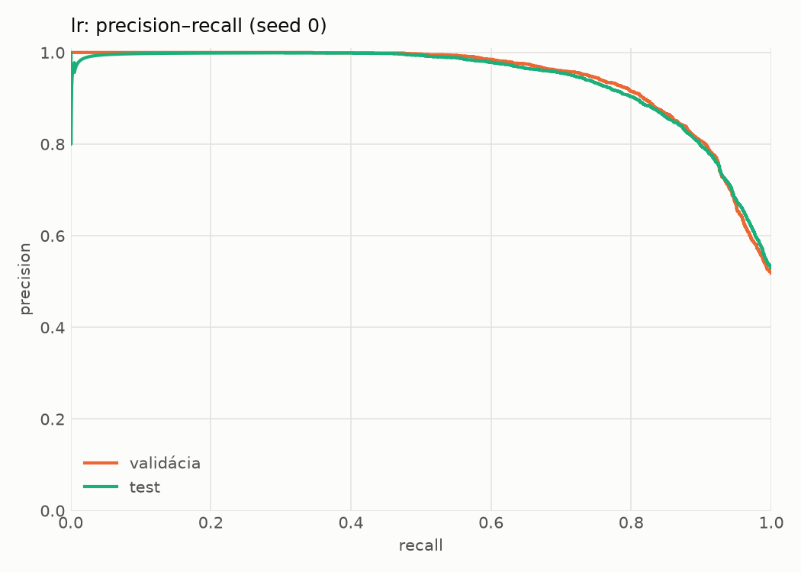
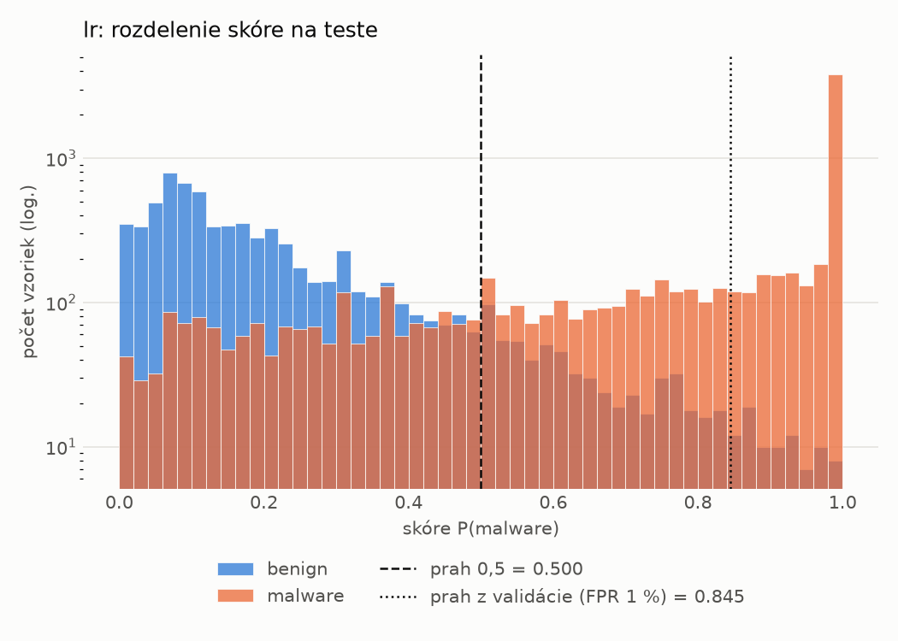
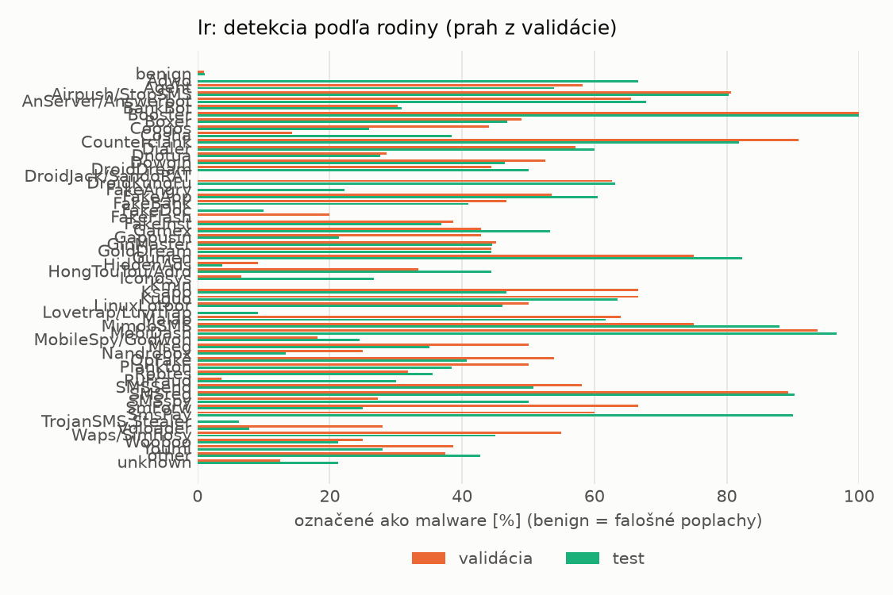
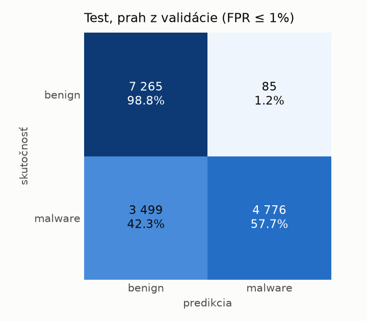
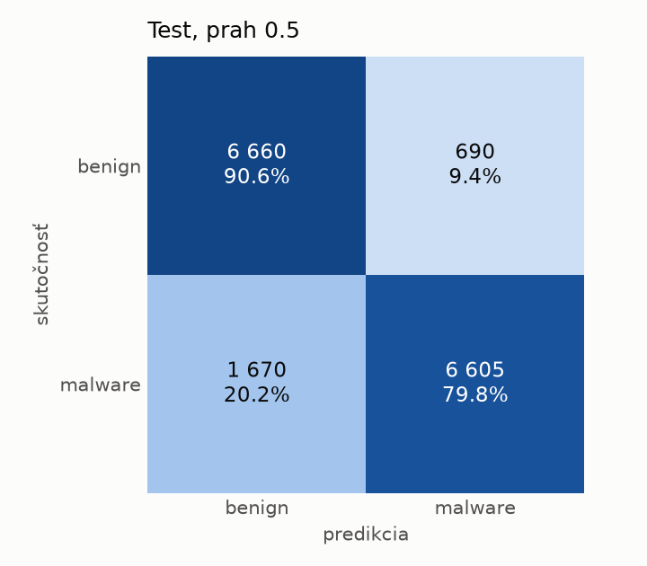

# dynamic/lr – beh `20261122-223139`

> Automaticky generované (`src/training/run_tabular.py`). Konfigurácia: `config.yaml`, protokol: `protocol.yaml`.

- **Model:** `logreg` – logistická regresia s L2 regularizáciou (vstup signed log1p + štandardizácia)
- **Ladenie:** bez ladenia – hyperparametre prevzaté z `runs_v4/real_full/full/dynamic/lr/20261122-191725`
- **Finálne modely:** seedy [0, 1, 2]; hodnoty sú priemer ± smerodajná odchýlka cez seedy
- **Najlepšie hyperparametre:** `{"max_iter": 2000, "C": 3.784688828069828}`

## Detekčná kvalita (bez prahu)
| metrika | train (podvzorka) | validácia | test |
|---|---|---|---|
| ROC-AUC | 0.9270 ± 0.0000 | 0.9235 ± 0.0000 | 0.9198 ± 0.0000 |
| PR-AUC | 0.9426 ± 0.0000 | 0.9439 ± 0.0000 | 0.9406 ± 0.0000 |
| TPR pri FPR 1 % | 0.6013 ± 0.0000 | 0.6020 ± 0.0000 | 0.5653 ± 0.0000 |
| TPR pri FPR 0,1 % | 0.4063 ± 0.0000 | 0.4779 ± 0.0000 | 0.4417 ± 0.0000 |
| log loss | 0.3368 ± 0.0000 | 0.3387 ± 0.0000 | 0.3544 ± 0.0000 |
| Brier skóre | 0.1037 ± 0.0000 | 0.1044 ± 0.0000 | 0.1101 ± 0.0000 |

Rozdiel ROC-AUC train − validácia: **0.0035** (veľký rozdiel = preučenie).

## Pri prahu z validácie (FPR ≤ 1% na validácii)
| metrika | train (podvzorka) | validácia | test |
|---|---|---|---|
| accuracy | 0.7881 ± 0.0000 | 0.7890 ± 0.0000 | 0.7706 ± 0.0000 |
| balanced accuracy | 0.7930 ± 0.0000 | 0.7961 ± 0.0000 | 0.7828 ± 0.0000 |
| precision | 0.9855 ± 0.0000 | 0.9851 ± 0.0000 | 0.9825 ± 0.0000 |
| recall (TPR) | 0.5952 ± 0.0000 | 0.6020 ± 0.0000 | 0.5772 ± 0.0000 |
| FPR | 0.0092 ± 0.0000 | 0.0098 ± 0.0000 | 0.0116 ± 0.0000 |
| F1 | 0.7422 ± 0.0000 | 0.7473 ± 0.0000 | 0.7272 ± 0.0000 |
| MCC | 0.6336 ± 0.0000 | 0.6361 ± 0.0000 | 0.6098 ± 0.0000 |

## Pri pevnom prahu 0.5
| metrika | train (podvzorka) | validácia | test |
|---|---|---|---|
| accuracy | 0.8585 ± 0.0000 | 0.8583 ± 0.0000 | 0.8490 ± 0.0000 |
| balanced accuracy | 0.8597 ± 0.0000 | 0.8599 ± 0.0000 | 0.8522 ± 0.0000 |
| precision | 0.9038 ± 0.0000 | 0.8994 ± 0.0000 | 0.9054 ± 0.0000 |
| recall (TPR) | 0.8101 ± 0.0000 | 0.8182 ± 0.0000 | 0.7982 ± 0.0000 |
| FPR | 0.0906 ± 0.0000 | 0.0985 ± 0.0000 | 0.0939 ± 0.0000 |
| F1 | 0.8544 ± 0.0000 | 0.8569 ± 0.0000 | 0.8484 ± 0.0000 |
| MCC | 0.7216 ± 0.0000 | 0.7204 ± 0.0000 | 0.7046 ± 0.0000 |

## Výpočtové nároky (seed 0, testovacia množina)
| meranie | hodnota |
|---|---|
| tréning finálneho modelu | 0.4 s (priemer cez seedy) |
| ladenie spolu | 0 s |
| počet parametrov / uzlov | 132 |
| veľkosť modelu na disku | 0.01 MB |
| transformácia vstupu – latencia (1 vlákno) | 0.005 ms |
| transformácia vstupu – priepustnosť | 1 280 475 vzoriek/s |
| CPU latencia modelu (batch 1, 1 vlákno) | 0.004 ms (p95 0.004) |
| CPU priepustnosť (24 vlákien) | 4 119 105 vzoriek/s |

## Grafy
| | |
|---|---|
|  |  |
|  |  |
|  |  |
|  |  |

## Súbory
`metrics.json` (všetky metriky po seedoch vrátane rodín), `timing.json`, `hpo_trials.csv`,
`predictions/<časť>_seed<N>.parquet` (sha256, family, label, score), `model/seed_<N>/`, `log.txt`.
