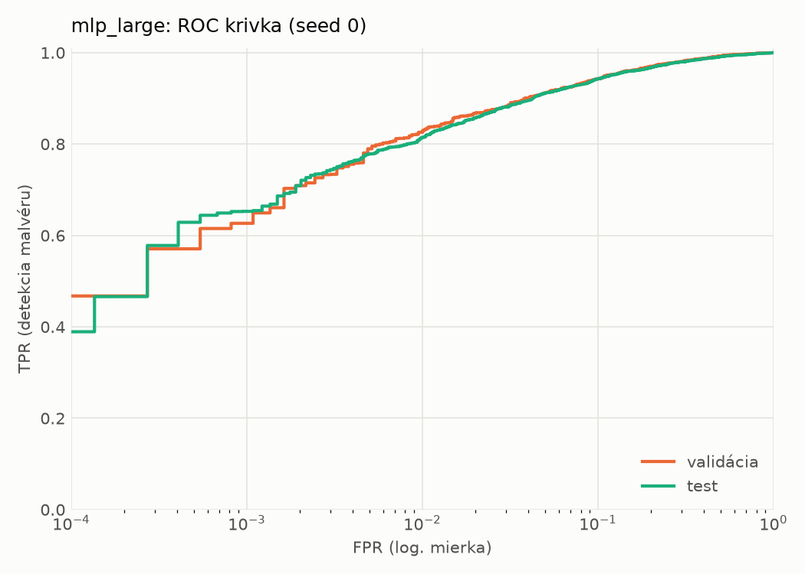
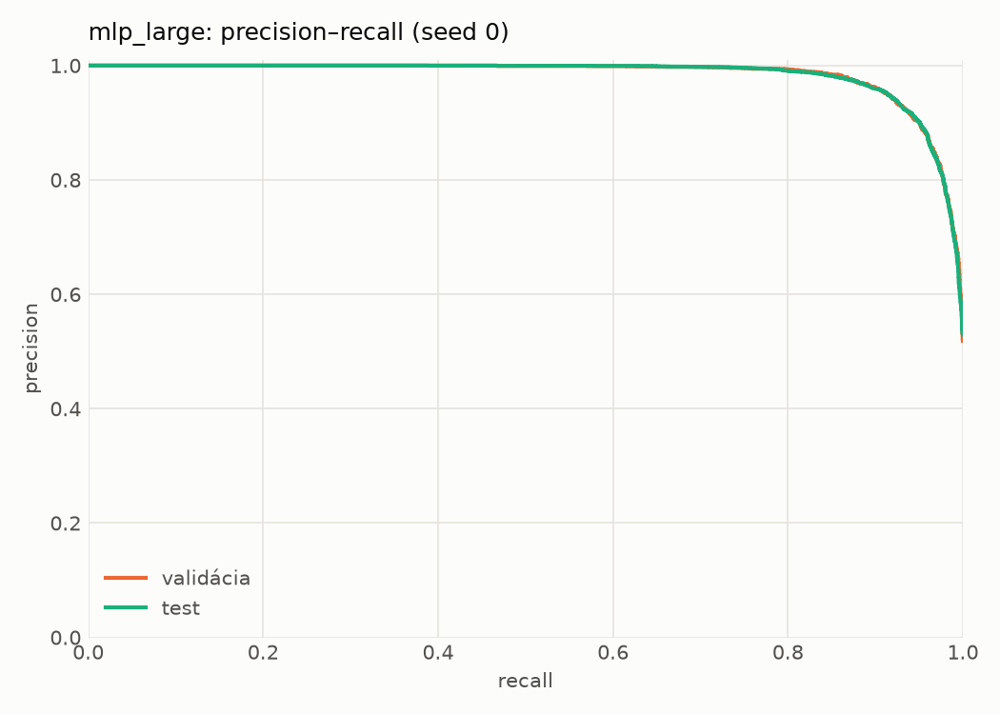
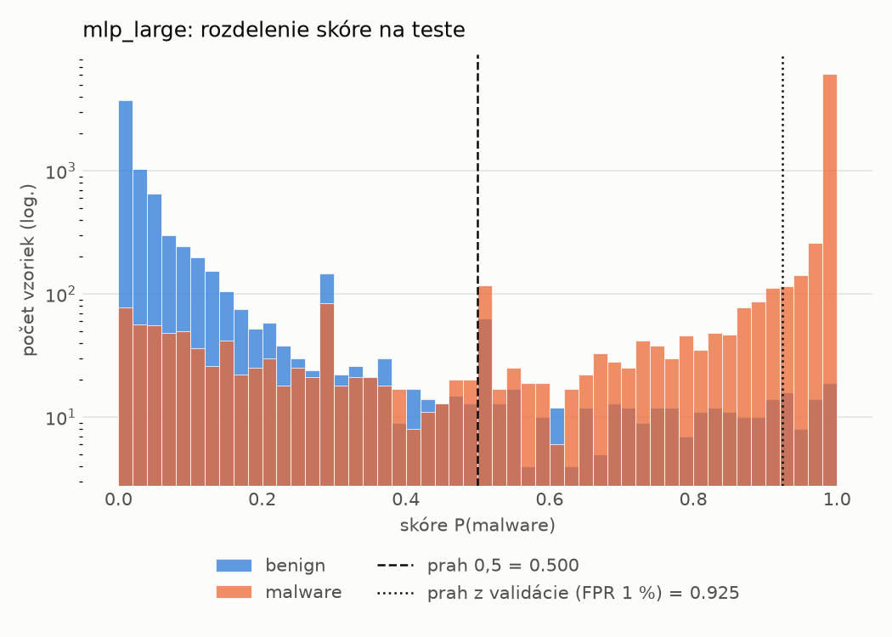
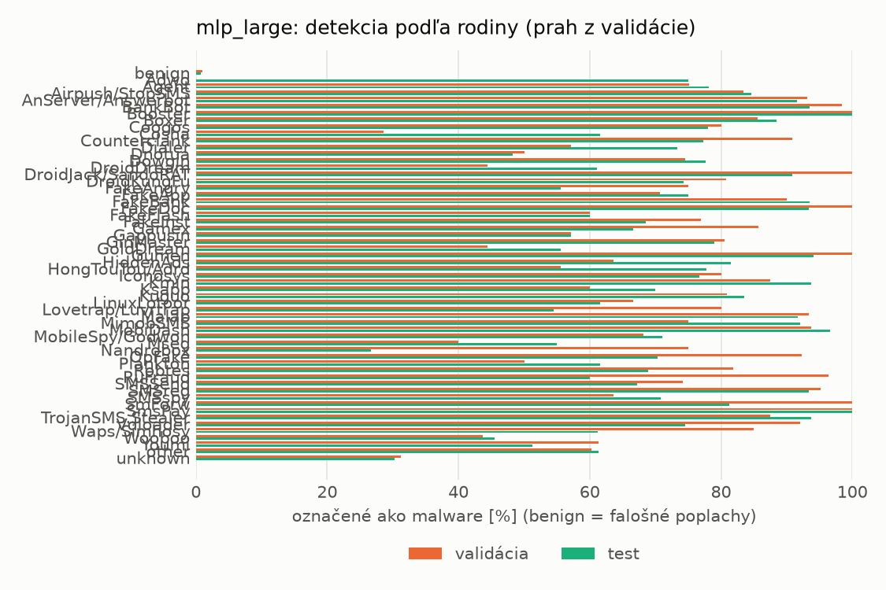
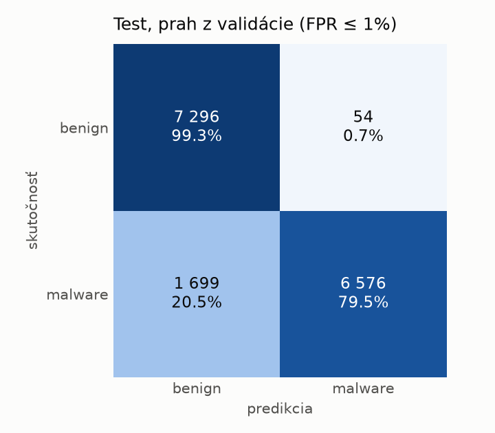
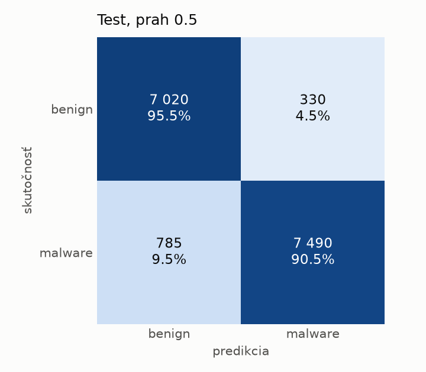
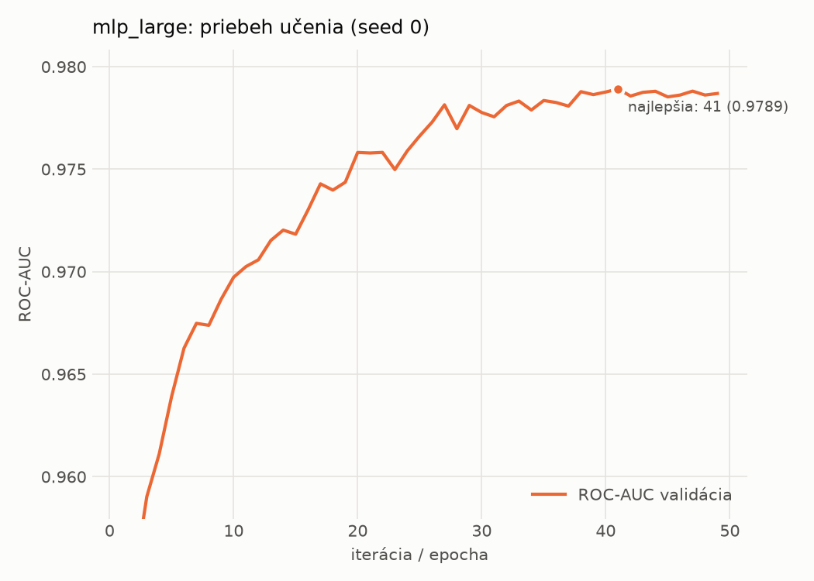

# dynamic/mlp_large – beh `20261122-223416`

> Automaticky generované (`src/training/run_tabular.py`). Konfigurácia: `config.yaml`, protokol: `protocol.yaml`.

- **Model:** `mlp` – veľká neurónová sieť (3–5 skrytých vrstiev, 512–2048 neurónov), kandidát na učiteľa
- **Ladenie:** bez ladenia – hyperparametre prevzaté z `runs_v4/real_full/full/dynamic/mlp_large/20261122-194320`
- **Finálne modely:** seedy [0, 1, 2]; hodnoty sú priemer ± smerodajná odchýlka cez seedy
- **Najlepšie hyperparametre:** `{"max_epochs": 100, "patience": 8, "hidden_layers": 3, "hidden_width": 512, "width_decay": 1.0, "dropout": 0.16077310300541978, "lr": 0.0005048635567863703, "weight_decay": 0.004783411439856203, "batch_size": 1024}`

## Detekčná kvalita (bez prahu)
| metrika | train (podvzorka) | validácia | test |
|---|---|---|---|
| ROC-AUC | 0.9905 ± 0.0022 | 0.9789 ± 0.0007 | 0.9775 ± 0.0002 |
| PR-AUC | 0.9922 ± 0.0017 | 0.9836 ± 0.0006 | 0.9833 ± 0.0001 |
| TPR pri FPR 1 % | 0.9081 ± 0.0177 | 0.8240 ± 0.0076 | 0.8144 ± 0.0082 |
| TPR pri FPR 0,1 % | 0.8285 ± 0.0338 | 0.6412 ± 0.0181 | 0.6540 ± 0.0013 |
| log loss | 0.1170 ± 0.0148 | 0.1876 ± 0.0022 | 0.1932 ± 0.0028 |
| Brier skóre | 0.0340 ± 0.0043 | 0.0528 ± 0.0009 | 0.0540 ± 0.0011 |

Rozdiel ROC-AUC train − validácia: **0.0116** (veľký rozdiel = preučenie).

## Pri prahu z validácie (FPR ≤ 1% na validácii)
| metrika | train (podvzorka) | validácia | test |
|---|---|---|---|
| accuracy | 0.9139 ± 0.0080 | 0.9041 ± 0.0040 | 0.8875 ± 0.0058 |
| balanced accuracy | 0.9160 ± 0.0078 | 0.9072 ± 0.0038 | 0.8934 ± 0.0055 |
| precision | 0.9987 ± 0.0008 | 0.9892 ± 0.0002 | 0.9923 ± 0.0004 |
| recall (TPR) | 0.8331 ± 0.0151 | 0.8240 ± 0.0076 | 0.7937 ± 0.0110 |
| FPR | 0.0012 ± 0.0007 | 0.0097 ± 0.0002 | 0.0069 ± 0.0004 |
| F1 | 0.9083 ± 0.0092 | 0.8991 ± 0.0046 | 0.8820 ± 0.0068 |
| MCC | 0.8406 ± 0.0139 | 0.8215 ± 0.0068 | 0.7948 ± 0.0097 |

## Pri pevnom prahu 0.5
| metrika | train (podvzorka) | validácia | test |
|---|---|---|---|
| accuracy | 0.9550 ± 0.0047 | 0.9298 ± 0.0015 | 0.9297 ± 0.0018 |
| balanced accuracy | 0.9554 ± 0.0046 | 0.9302 ± 0.0015 | 0.9309 ± 0.0016 |
| precision | 0.9726 ± 0.0029 | 0.9446 ± 0.0036 | 0.9549 ± 0.0027 |
| recall (TPR) | 0.9387 ± 0.0065 | 0.9183 ± 0.0034 | 0.9103 ± 0.0049 |
| FPR | 0.0278 ± 0.0029 | 0.0580 ± 0.0041 | 0.0484 ± 0.0032 |
| F1 | 0.9553 ± 0.0047 | 0.9313 ± 0.0015 | 0.9321 ± 0.0019 |
| MCC | 0.9106 ± 0.0092 | 0.8598 ± 0.0031 | 0.8604 ± 0.0033 |

## Výpočtové nároky (seed 0, testovacia množina)
| meranie | hodnota |
|---|---|
| tréning finálneho modelu | 6.5 s (priemer cez seedy) |
| ladenie spolu | 0 s |
| počet parametrov / uzlov | 596 481 |
| veľkosť modelu na disku | 2.41 MB |
| transformácia vstupu – latencia (1 vlákno) | 0.015 ms |
| transformácia vstupu – priepustnosť | 744 714 vzoriek/s |
| CPU latencia modelu (batch 1, 1 vlákno) | 0.175 ms (p95 0.357) |
| CPU priepustnosť (24 vlákien) | 561 584 vzoriek/s |
| GPU latencia (batch 1) | 0.439 ms (p95 0.928) |
| GPU priepustnosť | 2 179 614 vzoriek/s |
| GPU špičková pamäť | 128 MB |

## Grafy
| | |
|---|---|
|  |  |
|  |  |
|  |  |
|  |  |

## Súbory
`metrics.json` (všetky metriky po seedoch vrátane rodín), `timing.json`, `hpo_trials.csv`,
`predictions/<časť>_seed<N>.parquet` (sha256, family, label, score), `model/seed_<N>/`, `log.txt`.
