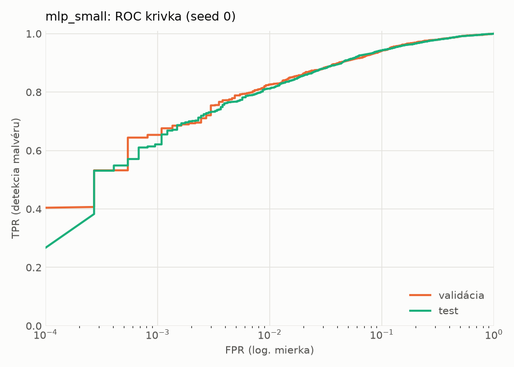
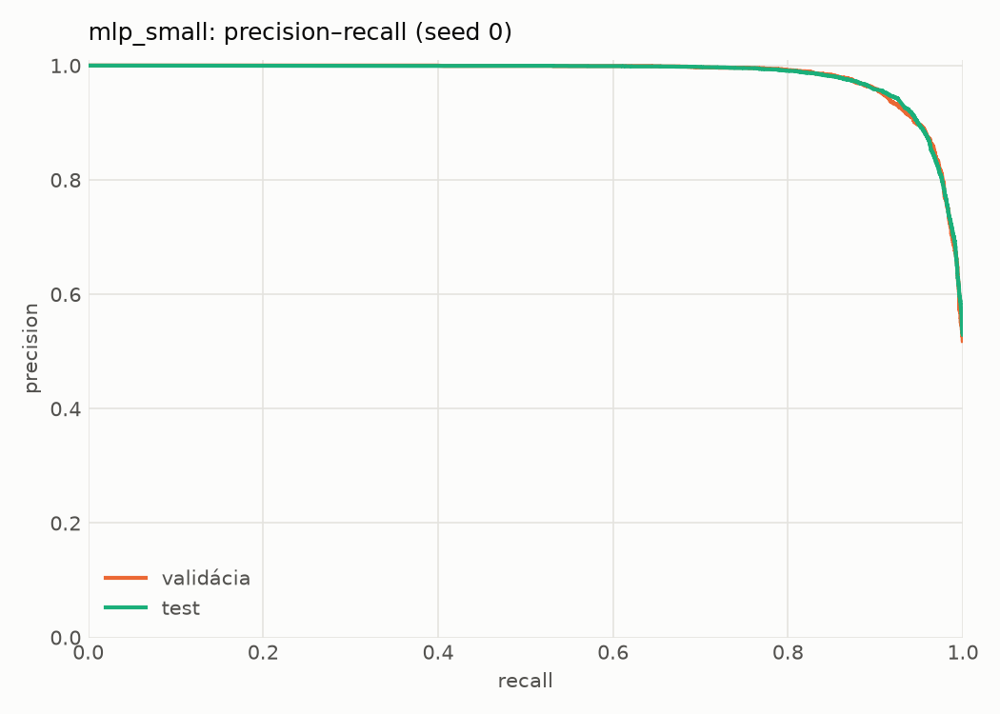
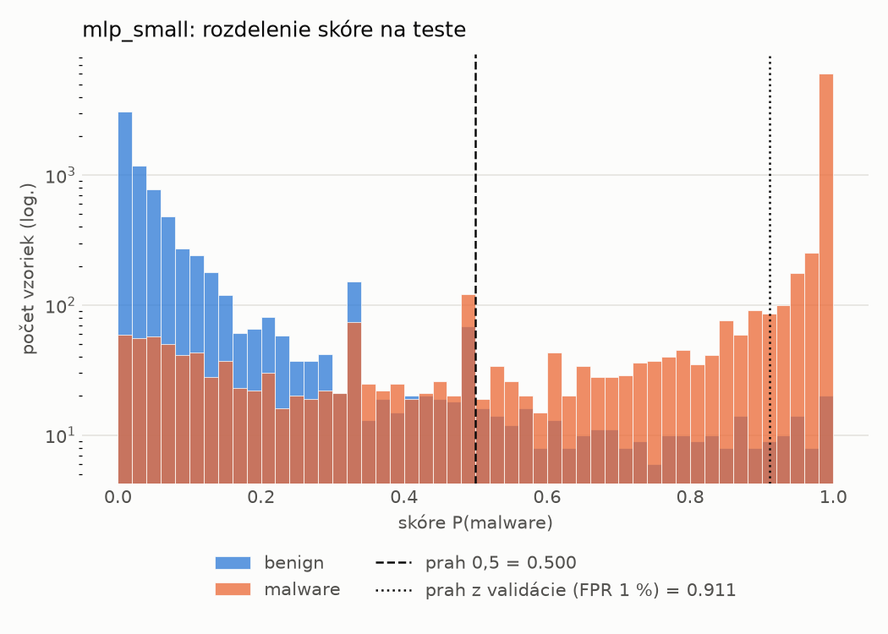
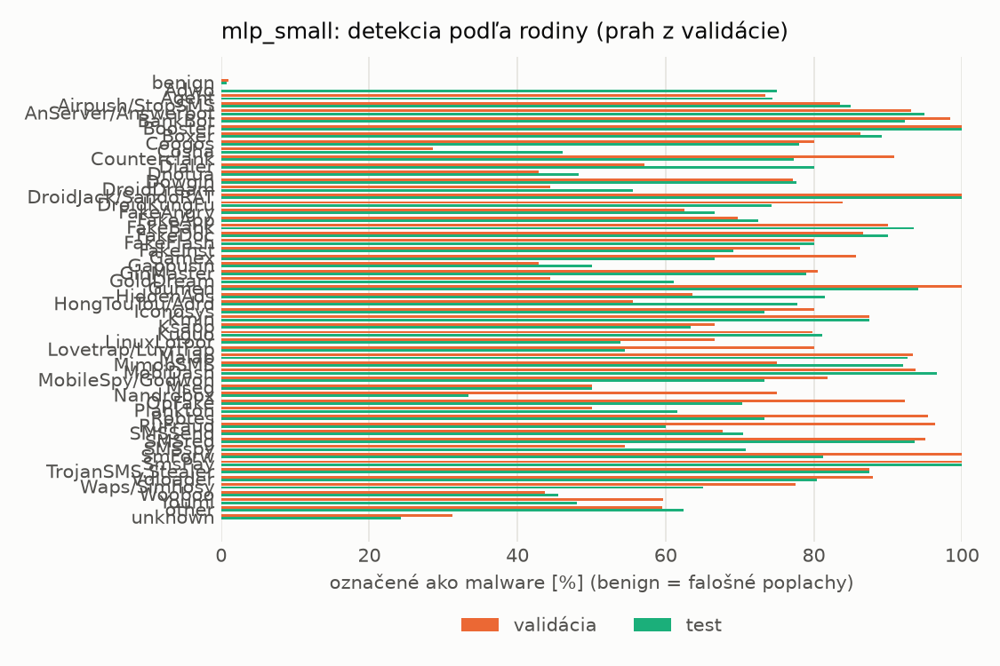
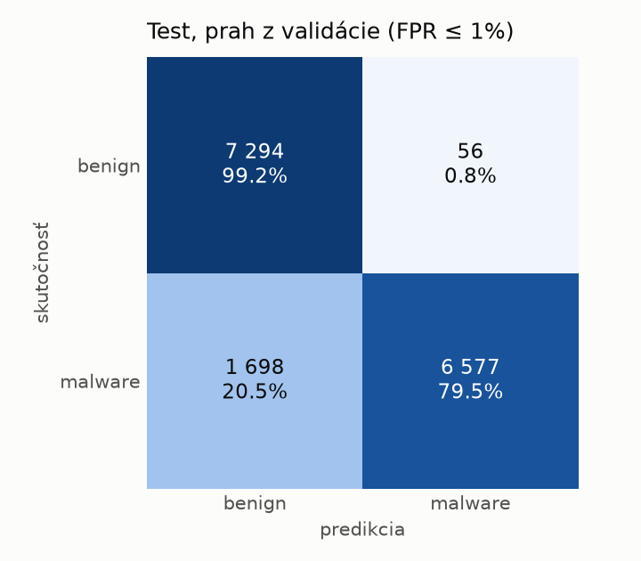
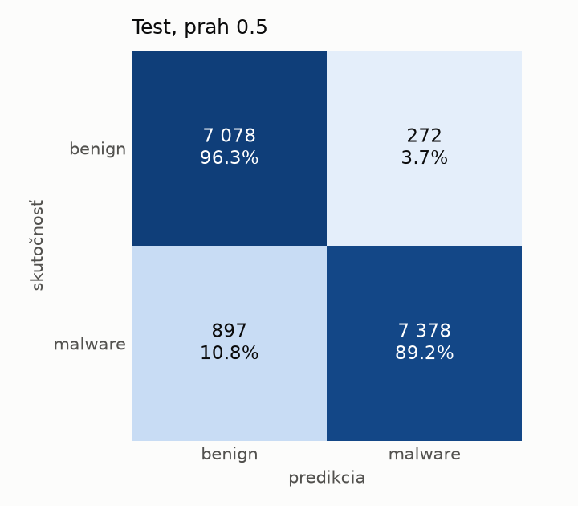
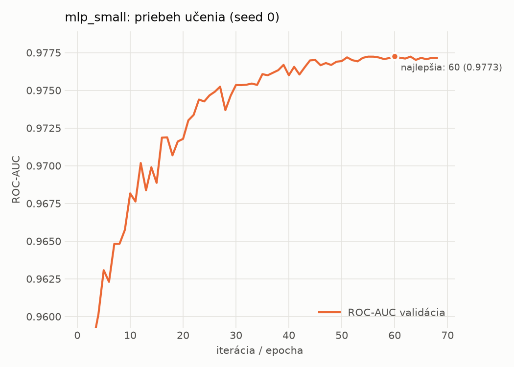

# dynamic/mlp_small – beh `20261122-223300`

> Automaticky generované (`src/training/run_tabular.py`). Konfigurácia: `config.yaml`, protokol: `protocol.yaml`.

- **Model:** `mlp` – malá neurónová sieť (1–2 skryté vrstvy), kandidát na ľahkého študenta
- **Ladenie:** bez ladenia – hyperparametre prevzaté z `runs_v4/real_full/full/dynamic/mlp_small/20261122-193213`
- **Finálne modely:** seedy [0, 1, 2]; hodnoty sú priemer ± smerodajná odchýlka cez seedy
- **Najlepšie hyperparametre:** `{"width_decay": 0.5, "max_epochs": 100, "patience": 8, "hidden_layers": 2, "hidden_width": 256, "dropout": 0.2449160262890371, "lr": 0.002872548733508973, "weight_decay": 4.509331245708397e-06, "batch_size": 256}`

## Detekčná kvalita (bez prahu)
| metrika | train (podvzorka) | validácia | test |
|---|---|---|---|
| ROC-AUC | 0.9878 ± 0.0006 | 0.9775 ± 0.0004 | 0.9773 ± 0.0006 |
| PR-AUC | 0.9902 ± 0.0005 | 0.9827 ± 0.0004 | 0.9830 ± 0.0004 |
| TPR pri FPR 1 % | 0.8914 ± 0.0059 | 0.8197 ± 0.0096 | 0.8096 ± 0.0020 |
| TPR pri FPR 0,1 % | 0.7836 ± 0.0059 | 0.6271 ± 0.0291 | 0.6503 ± 0.0349 |
| log loss | 0.1330 ± 0.0039 | 0.1906 ± 0.0014 | 0.1924 ± 0.0011 |
| Brier skóre | 0.0386 ± 0.0012 | 0.0536 ± 0.0010 | 0.0547 ± 0.0004 |

Rozdiel ROC-AUC train − validácia: **0.0103** (veľký rozdiel = preučenie).

## Pri prahu z validácie (FPR ≤ 1% na validácii)
| metrika | train (podvzorka) | validácia | test |
|---|---|---|---|
| accuracy | 0.9072 ± 0.0042 | 0.9018 ± 0.0050 | 0.8850 ± 0.0052 |
| balanced accuracy | 0.9094 ± 0.0041 | 0.9050 ± 0.0048 | 0.8911 ± 0.0049 |
| precision | 0.9973 ± 0.0013 | 0.9890 ± 0.0001 | 0.9923 ± 0.0010 |
| recall (TPR) | 0.8212 ± 0.0088 | 0.8197 ± 0.0096 | 0.7890 ± 0.0108 |
| FPR | 0.0023 ± 0.0011 | 0.0098 ± 0.0000 | 0.0069 ± 0.0010 |
| F1 | 0.9007 ± 0.0050 | 0.8964 ± 0.0058 | 0.8790 ± 0.0063 |
| MCC | 0.8288 ± 0.0069 | 0.8175 ± 0.0085 | 0.7907 ± 0.0083 |

## Pri pevnom prahu 0.5
| metrika | train (podvzorka) | validácia | test |
|---|---|---|---|
| accuracy | 0.9484 ± 0.0017 | 0.9284 ± 0.0007 | 0.9267 ± 0.0013 |
| balanced accuracy | 0.9491 ± 0.0017 | 0.9293 ± 0.0007 | 0.9286 ± 0.0011 |
| precision | 0.9772 ± 0.0014 | 0.9536 ± 0.0020 | 0.9630 ± 0.0015 |
| recall (TPR) | 0.9209 ± 0.0039 | 0.9059 ± 0.0033 | 0.8960 ± 0.0039 |
| FPR | 0.0226 ± 0.0015 | 0.0474 ± 0.0023 | 0.0388 ± 0.0018 |
| F1 | 0.9482 ± 0.0018 | 0.9292 ± 0.0009 | 0.9283 ± 0.0015 |
| MCC | 0.8985 ± 0.0032 | 0.8580 ± 0.0013 | 0.8558 ± 0.0022 |

## Výpočtové nároky (seed 0, testovacia množina)
| meranie | hodnota |
|---|---|
| tréning finálneho modelu | 24.5 s (priemer cez seedy) |
| ladenie spolu | 0 s |
| počet parametrov / uzlov | 67 585 |
| veľkosť modelu na disku | 0.28 MB |
| transformácia vstupu – latencia (1 vlákno) | 0.007 ms |
| transformácia vstupu – priepustnosť | 994 621 vzoriek/s |
| CPU latencia modelu (batch 1, 1 vlákno) | 0.230 ms (p95 0.242) |
| CPU priepustnosť (24 vlákien) | 2 342 263 vzoriek/s |
| GPU latencia (batch 1) | 0.643 ms (p95 0.678) |
| GPU priepustnosť | 1 777 912 vzoriek/s |
| GPU špičková pamäť | 75 MB |

## Grafy
| | |
|---|---|
|  |  |
|  |  |
|  |  |
|  |  |

## Súbory
`metrics.json` (všetky metriky po seedoch vrátane rodín), `timing.json`, `hpo_trials.csv`,
`predictions/<časť>_seed<N>.parquet` (sha256, family, label, score), `model/seed_<N>/`, `log.txt`.
