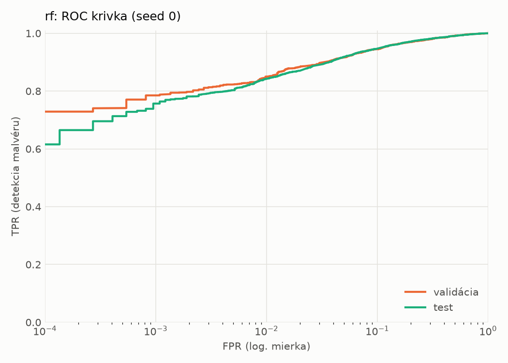
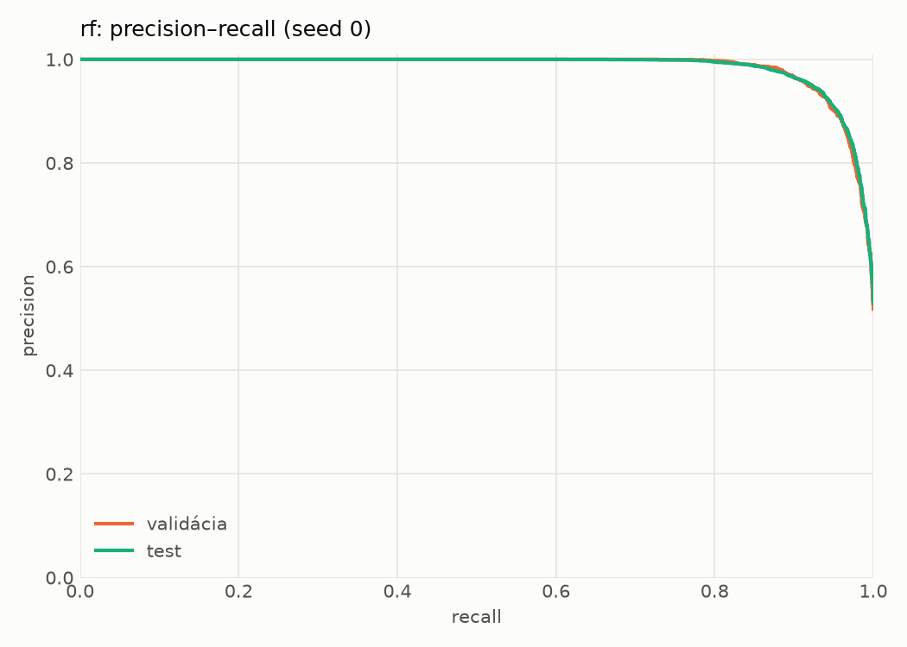
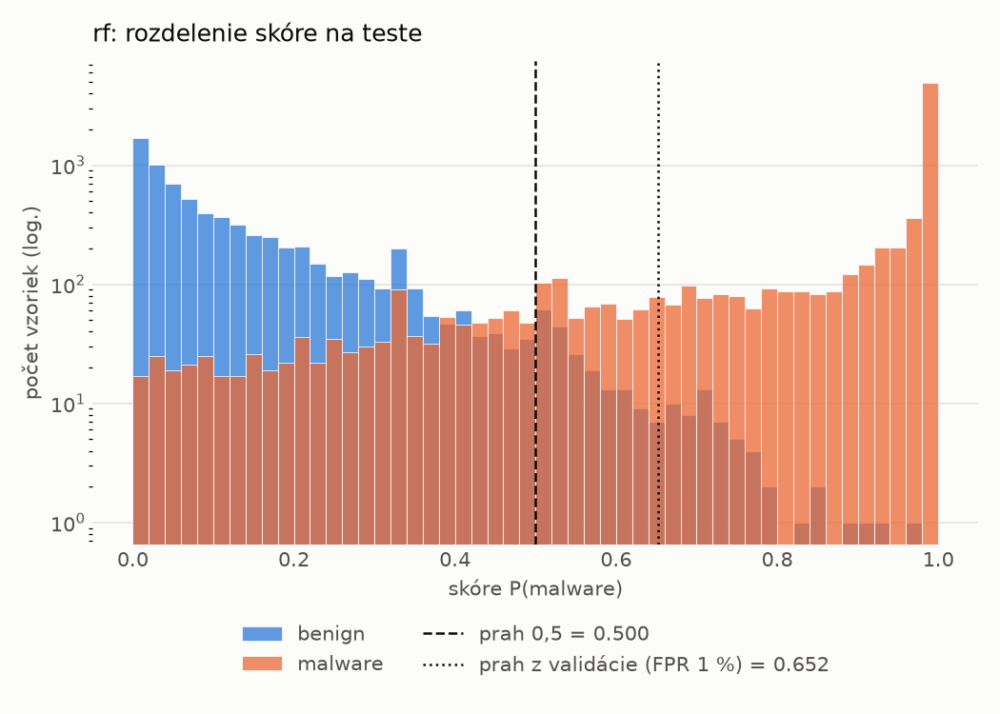
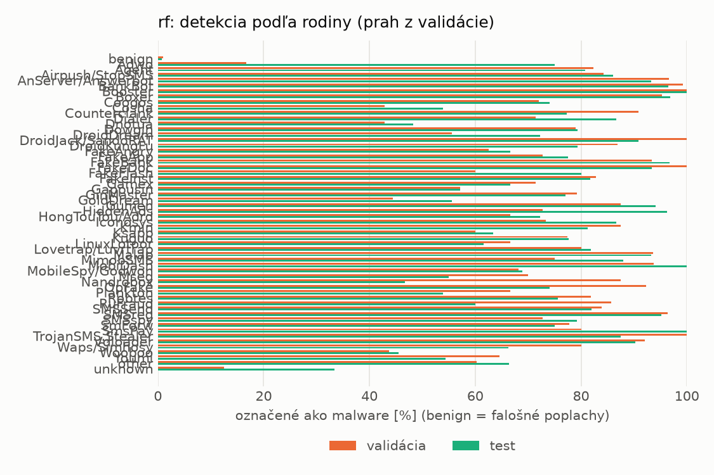
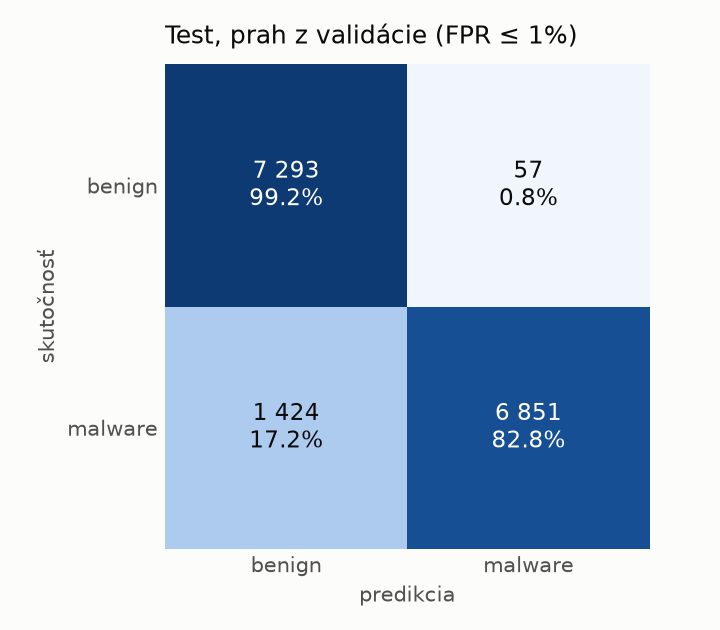
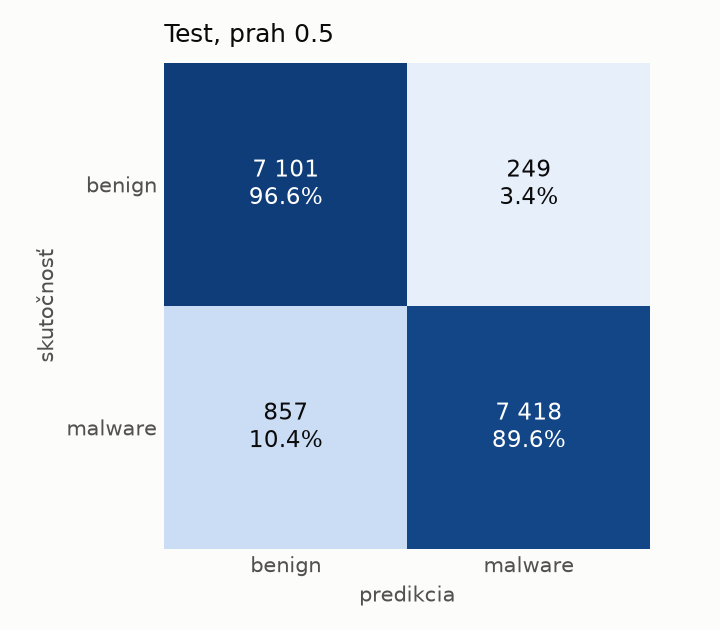

# dynamic/rf – beh `20261122-223141`

> Automaticky generované (`src/training/run_tabular.py`). Konfigurácia: `config.yaml`, protokol: `protocol.yaml`.

- **Model:** `random_forest` – Random Forest (pôvodné hodnoty príznakov)
- **Ladenie:** bez ladenia – hyperparametre prevzaté z `runs_v4/real_full/full/dynamic/rf/20261122-191738`
- **Finálne modely:** seedy [0, 1, 2]; hodnoty sú priemer ± smerodajná odchýlka cez seedy
- **Najlepšie hyperparametre:** `{"n_estimators": 500, "max_depth": 32, "min_samples_leaf": 1, "max_features": "sqrt"}`

## Detekčná kvalita (bez prahu)
| metrika | train (podvzorka) | validácia | test |
|---|---|---|---|
| ROC-AUC | 0.9993 ± 0.0000 | 0.9799 ± 0.0000 | 0.9797 ± 0.0001 |
| PR-AUC | 0.9993 ± 0.0000 | 0.9849 ± 0.0000 | 0.9852 ± 0.0001 |
| TPR pri FPR 1 % | 0.9791 ± 0.0051 | 0.8504 ± 0.0015 | 0.8420 ± 0.0010 |
| TPR pri FPR 0,1 % | 0.9706 ± 0.0006 | 0.7872 ± 0.0023 | 0.7592 ± 0.0020 |
| log loss | 0.0684 ± 0.0001 | 0.1825 ± 0.0001 | 0.1906 ± 0.0004 |
| Brier skóre | 0.0140 ± 0.0000 | 0.0526 ± 0.0000 | 0.0555 ± 0.0002 |

Rozdiel ROC-AUC train − validácia: **0.0194** (veľký rozdiel = preučenie).

## Pri prahu z validácie (FPR ≤ 1% na validácii)
| metrika | train (podvzorka) | validácia | test |
|---|---|---|---|
| accuracy | 0.9788 ± 0.0004 | 0.9177 ± 0.0008 | 0.9047 ± 0.0004 |
| balanced accuracy | 0.9793 ± 0.0004 | 0.9203 ± 0.0008 | 0.9096 ± 0.0004 |
| precision | 1.0000 ± 0.0000 | 0.9894 ± 0.0000 | 0.9920 ± 0.0002 |
| recall (TPR) | 0.9586 ± 0.0007 | 0.8504 ± 0.0015 | 0.8268 ± 0.0010 |
| FPR | 0.0000 ± 0.0000 | 0.0098 ± 0.0000 | 0.0075 ± 0.0002 |
| F1 | 0.9789 ± 0.0004 | 0.9147 ± 0.0009 | 0.9019 ± 0.0005 |
| MCC | 0.9585 ± 0.0007 | 0.8451 ± 0.0014 | 0.8235 ± 0.0007 |

## Pri pevnom prahu 0.5
| metrika | train (podvzorka) | validácia | test |
|---|---|---|---|
| accuracy | 0.9874 ± 0.0003 | 0.9324 ± 0.0003 | 0.9290 ± 0.0008 |
| balanced accuracy | 0.9875 ± 0.0003 | 0.9333 ± 0.0003 | 0.9311 ± 0.0008 |
| precision | 0.9904 ± 0.0001 | 0.9594 ± 0.0009 | 0.9675 ± 0.0004 |
| recall (TPR) | 0.9849 ± 0.0006 | 0.9080 ± 0.0004 | 0.8960 ± 0.0013 |
| FPR | 0.0100 ± 0.0001 | 0.0414 ± 0.0010 | 0.0338 ± 0.0003 |
| F1 | 0.9877 ± 0.0003 | 0.9330 ± 0.0002 | 0.9304 ± 0.0008 |
| MCC | 0.9748 ± 0.0005 | 0.8662 ± 0.0006 | 0.8608 ± 0.0016 |

## Výpočtové nároky (seed 0, testovacia množina)
| meranie | hodnota |
|---|---|
| tréning finálneho modelu | 3.1 s (priemer cez seedy) |
| ladenie spolu | 0 s |
| počet parametrov / uzlov | 4 468 310 |
| veľkosť modelu na disku | 357.88 MB |
| CPU latencia modelu (batch 1, 1 vlákno) | 15.195 ms (p95 15.600) |
| CPU priepustnosť (24 vlákien) | 105 392 vzoriek/s |

## Grafy
| | |
|---|---|
|  |  |
|  |  |
|  |  |
|  |  |

## Súbory
`metrics.json` (všetky metriky po seedoch vrátane rodín), `timing.json`, `hpo_trials.csv`,
`predictions/<časť>_seed<N>.parquet` (sha256, family, label, score), `model/seed_<N>/`, `log.txt`.
