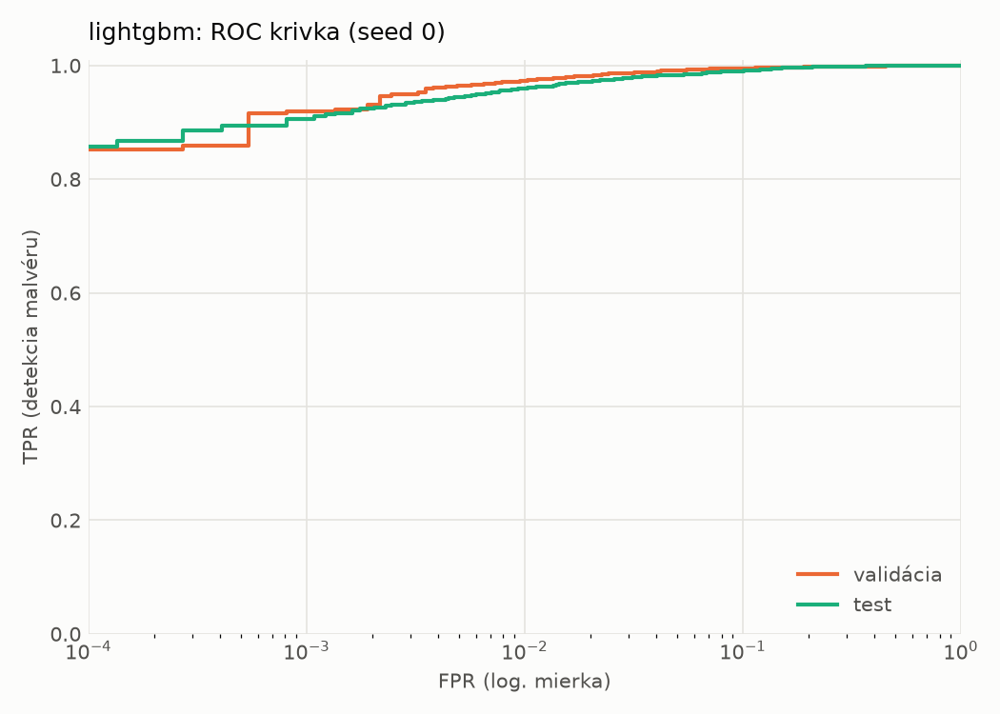
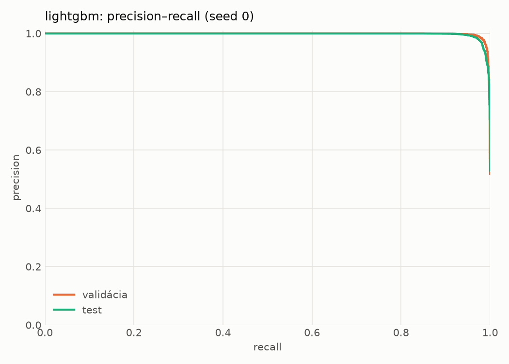
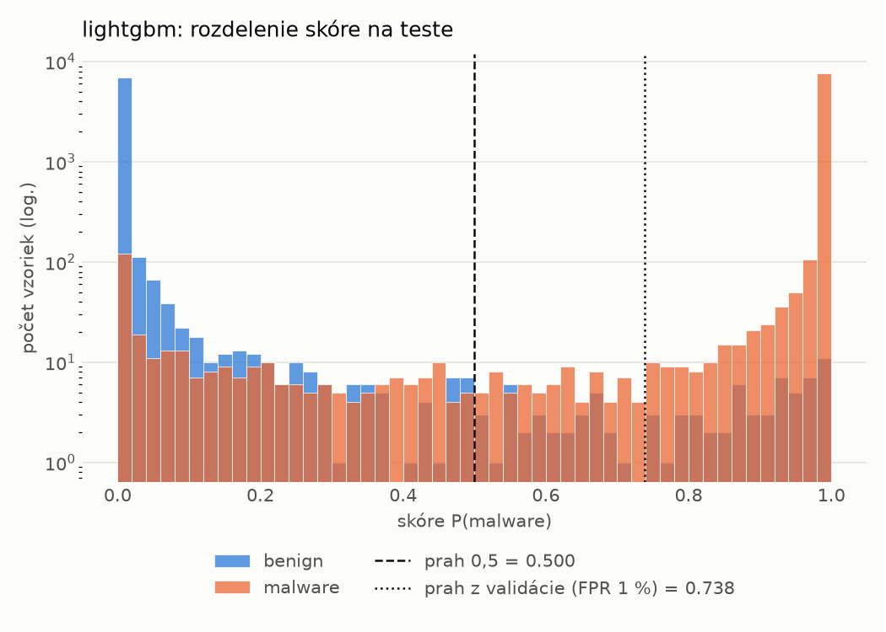
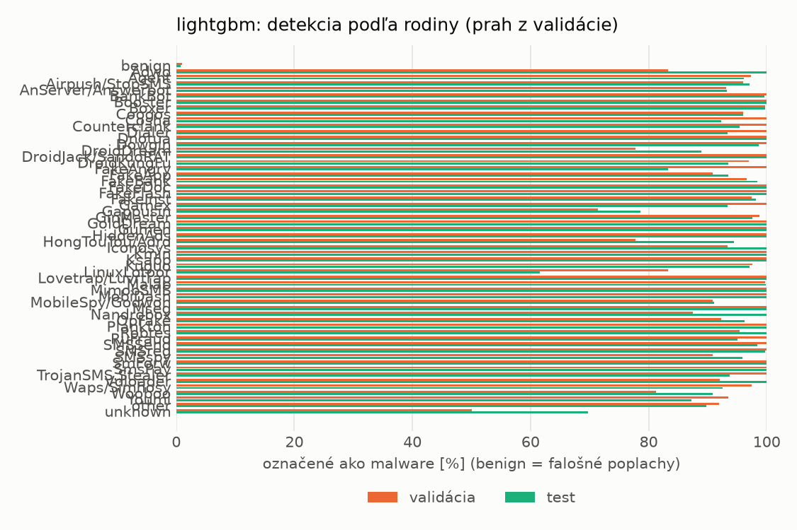
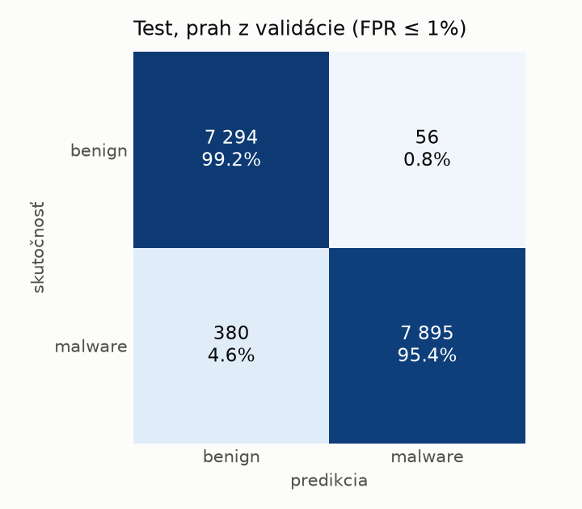
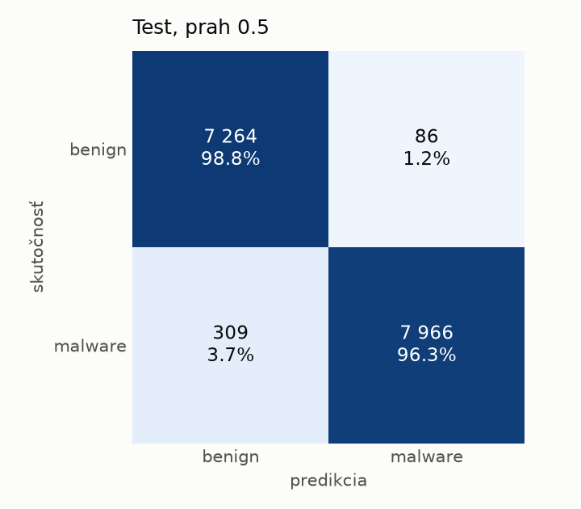
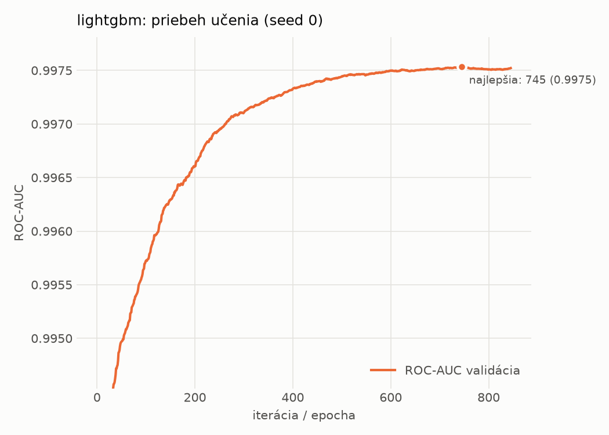

# hybrid/lightgbm – beh `20261122-223452`

> Automaticky generované (`src/training/run_tabular.py`). Konfigurácia: `config.yaml`, protokol: `protocol.yaml`.

- **Model:** `lightgbm` – LightGBM, gradient boosting stromov s early stopping na validácii (pôvodné hodnoty príznakov)
- **Ladenie:** bez ladenia – hyperparametre prevzaté z `runs_v4/real_full/full/hybrid/lightgbm/20261122-195127`
- **Finálne modely:** seedy [0, 1, 2]; hodnoty sú priemer ± smerodajná odchýlka cez seedy
- **Najlepšie hyperparametre:** `{"num_boost_round": 5000, "early_stopping_rounds": 100, "learning_rate": 0.018196998780495684, "num_leaves": 233, "min_child_samples": 23, "feature_fraction": 0.6390322800765896, "bagging_fraction": 0.9532240144545877, "lambda_l1": 0.008505404243799093, "lambda_l2": 0.007794186652208281}`

## Detekčná kvalita (bez prahu)
| metrika | train (podvzorka) | validácia | test |
|---|---|---|---|
| ROC-AUC | 1.0000 ± 0.0000 | 0.9975 ± 0.0000 | 0.9967 ± 0.0001 |
| PR-AUC | 1.0000 ± 0.0000 | 0.9981 ± 0.0000 | 0.9974 ± 0.0001 |
| TPR pri FPR 1 % | 1.0000 ± 0.0000 | 0.9724 ± 0.0003 | 0.9592 ± 0.0003 |
| TPR pri FPR 0,1 % | 1.0000 ± 0.0000 | 0.9205 ± 0.0047 | 0.9070 ± 0.0007 |
| log loss | 0.0018 ± 0.0009 | 0.0581 ± 0.0014 | 0.0844 ± 0.0025 |
| Brier skóre | 0.0001 ± 0.0000 | 0.0144 ± 0.0001 | 0.0205 ± 0.0001 |

Rozdiel ROC-AUC train − validácia: **0.0025** (veľký rozdiel = preučenie).

## Pri prahu z validácie (FPR ≤ 1% na validácii)
| metrika | train (podvzorka) | validácia | test |
|---|---|---|---|
| accuracy | 0.9999 ± 0.0000 | 0.9810 ± 0.0001 | 0.9722 ± 0.0001 |
| balanced accuracy | 0.9999 ± 0.0000 | 0.9814 ± 0.0001 | 0.9733 ± 0.0001 |
| precision | 1.0000 ± 0.0000 | 0.9909 ± 0.0001 | 0.9930 ± 0.0001 |
| recall (TPR) | 0.9998 ± 0.0000 | 0.9724 ± 0.0003 | 0.9541 ± 0.0001 |
| FPR | 0.0000 ± 0.0000 | 0.0096 ± 0.0002 | 0.0075 ± 0.0002 |
| F1 | 0.9999 ± 0.0000 | 0.9815 ± 0.0001 | 0.9732 ± 0.0001 |
| MCC | 0.9998 ± 0.0000 | 0.9622 ± 0.0001 | 0.9451 ± 0.0002 |

## Pri pevnom prahu 0.5
| metrika | train (podvzorka) | validácia | test |
|---|---|---|---|
| accuracy | 1.0000 ± 0.0001 | 0.9818 ± 0.0001 | 0.9748 ± 0.0001 |
| balanced accuracy | 1.0000 ± 0.0001 | 0.9819 ± 0.0001 | 0.9756 ± 0.0001 |
| precision | 1.0000 ± 0.0000 | 0.9843 ± 0.0006 | 0.9895 ± 0.0002 |
| recall (TPR) | 0.9999 ± 0.0001 | 0.9805 ± 0.0007 | 0.9626 ± 0.0001 |
| FPR | 0.0000 ± 0.0000 | 0.0168 ± 0.0006 | 0.0115 ± 0.0002 |
| F1 | 1.0000 ± 0.0001 | 0.9824 ± 0.0001 | 0.9759 ± 0.0001 |
| MCC | 0.9999 ± 0.0001 | 0.9636 ± 0.0001 | 0.9499 ± 0.0001 |

## Výpočtové nároky (seed 0, testovacia množina)
| meranie | hodnota |
|---|---|
| tréning finálneho modelu | 17.7 s (priemer cez seedy) |
| ladenie spolu | 0 s |
| počet parametrov / uzlov | 346 425 |
| veľkosť modelu na disku | 19.28 MB |
| CPU latencia modelu (batch 1, 1 vlákno) | 0.127 ms (p95 0.151) |
| CPU priepustnosť (24 vlákien) | 121 709 vzoriek/s |

## Grafy
| | |
|---|---|
|  |  |
|  |  |
|  |  |
|  |  |

## Súbory
`metrics.json` (všetky metriky po seedoch vrátane rodín), `timing.json`, `hpo_trials.csv`,
`predictions/<časť>_seed<N>.parquet` (sha256, family, label, score), `model/seed_<N>/`, `log.txt`.
