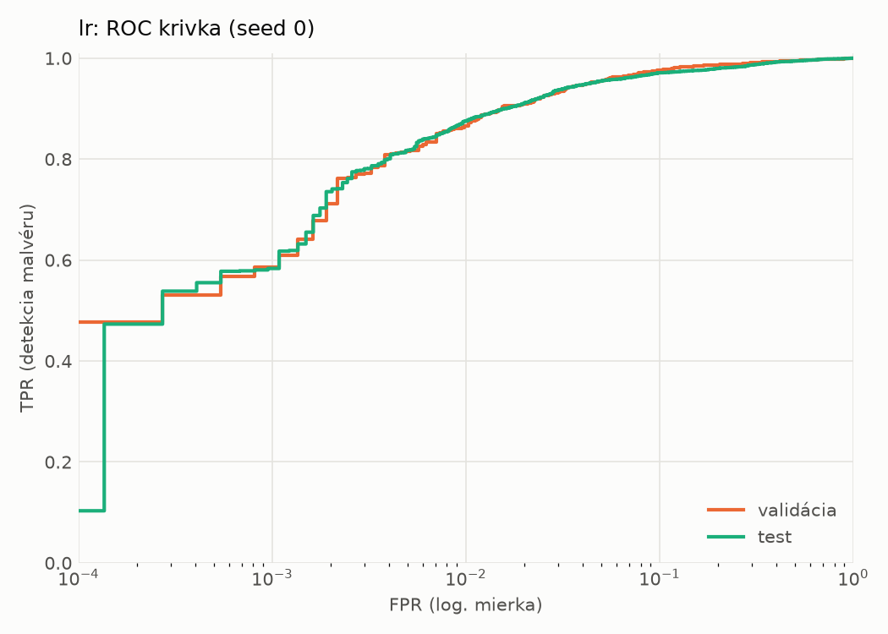
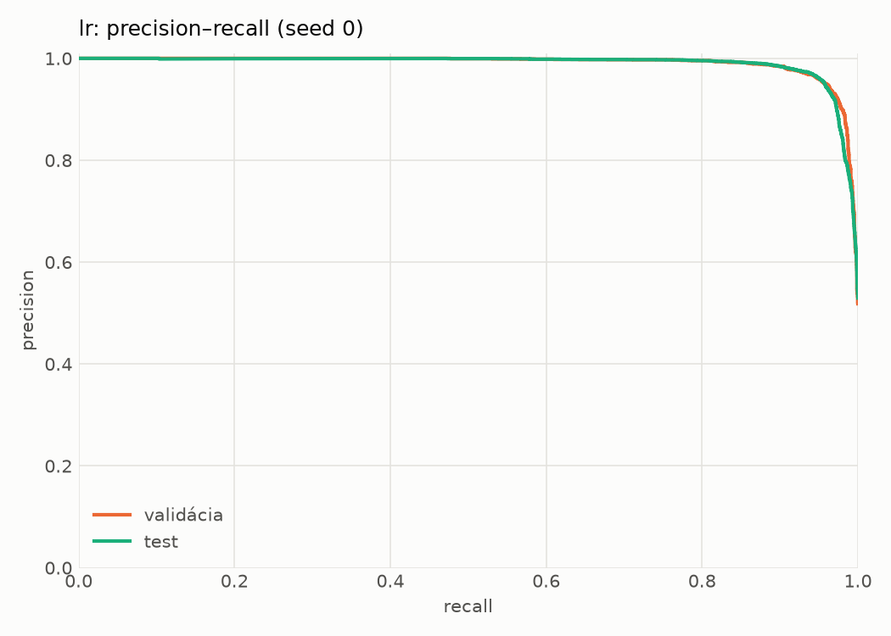
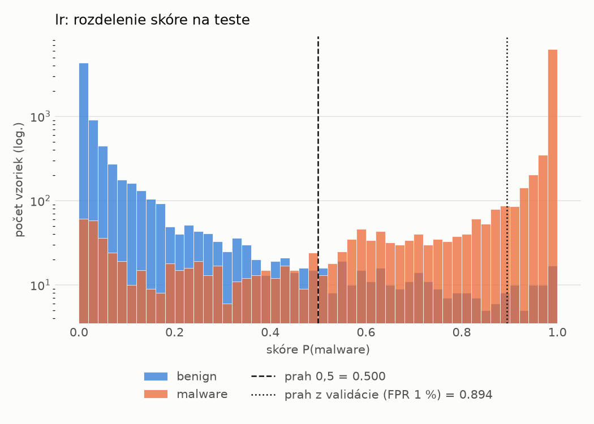
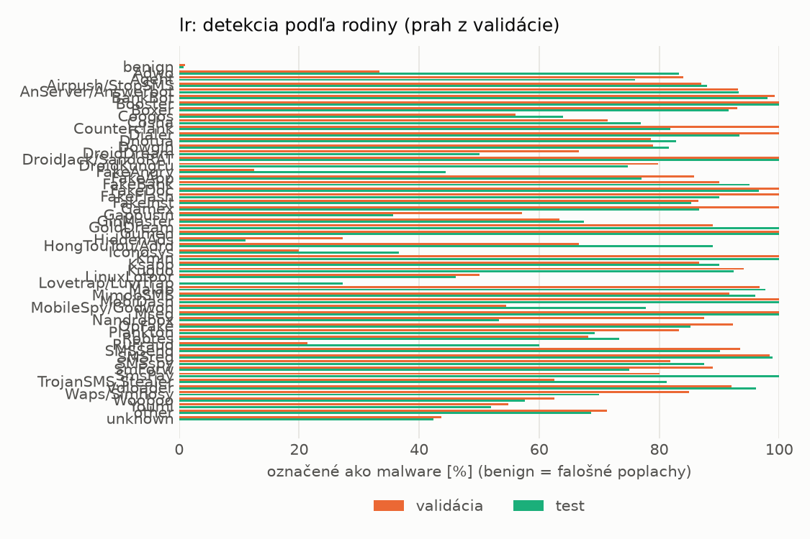
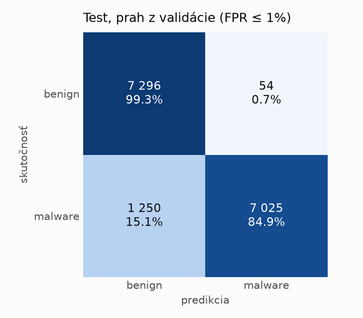
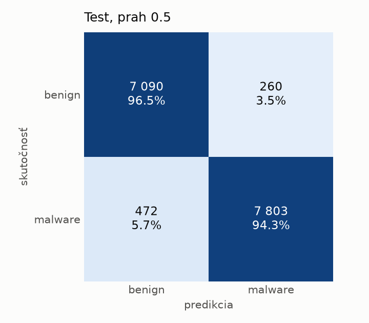

# hybrid/lr – beh `20261122-223441`

> Automaticky generované (`src/training/run_tabular.py`). Konfigurácia: `config.yaml`, protokol: `protocol.yaml`.

- **Model:** `logreg` – logistická regresia s L2 regularizáciou (vstup signed log1p + štandardizácia)
- **Ladenie:** bez ladenia – hyperparametre prevzaté z `runs_v4/real_full/full/hybrid/lr/20261122-195001`
- **Finálne modely:** seedy [0, 1, 2]; hodnoty sú priemer ± smerodajná odchýlka cez seedy
- **Najlepšie hyperparametre:** `{"max_iter": 2000, "C": 0.30240503427727145}`

## Detekčná kvalita (bez prahu)
| metrika | train (podvzorka) | validácia | test |
|---|---|---|---|
| ROC-AUC | 0.9891 ± 0.0000 | 0.9881 ± 0.0000 | 0.9860 ± 0.0000 |
| PR-AUC | 0.9914 ± 0.0000 | 0.9906 ± 0.0000 | 0.9894 ± 0.0000 |
| TPR pri FPR 1 % | 0.8852 ± 0.0000 | 0.8650 ± 0.0000 | 0.8752 ± 0.0000 |
| TPR pri FPR 0,1 % | 0.6840 ± 0.0000 | 0.5856 ± 0.0000 | 0.5833 ± 0.0000 |
| log loss | 0.1247 ± 0.0000 | 0.1320 ± 0.0000 | 0.1419 ± 0.0000 |
| Brier skóre | 0.0342 ± 0.0000 | 0.0358 ± 0.0000 | 0.0378 ± 0.0000 |

Rozdiel ROC-AUC train − validácia: **0.0011** (veľký rozdiel = preučenie).

## Pri prahu z validácie (FPR ≤ 1% na validácii)
| metrika | train (podvzorka) | validácia | test |
|---|---|---|---|
| accuracy | 0.9244 ± 0.0000 | 0.9253 ± 0.0000 | 0.9165 ± 0.0000 |
| balanced accuracy | 0.9261 ± 0.0000 | 0.9276 ± 0.0000 | 0.9208 ± 0.0000 |
| precision | 0.9928 ± 0.0000 | 0.9896 ± 0.0000 | 0.9924 ± 0.0000 |
| recall (TPR) | 0.8587 ± 0.0000 | 0.8650 ± 0.0000 | 0.8489 ± 0.0000 |
| FPR | 0.0066 ± 0.0000 | 0.0098 ± 0.0000 | 0.0073 ± 0.0000 |
| F1 | 0.9209 ± 0.0000 | 0.9231 ± 0.0000 | 0.9151 ± 0.0000 |
| MCC | 0.8574 ± 0.0000 | 0.8584 ± 0.0000 | 0.8438 ± 0.0000 |

## Pri pevnom prahu 0.5
| metrika | train (podvzorka) | validácia | test |
|---|---|---|---|
| accuracy | 0.9565 ± 0.0000 | 0.9531 ± 0.0000 | 0.9532 ± 0.0000 |
| balanced accuracy | 0.9567 ± 0.0000 | 0.9534 ± 0.0000 | 0.9538 ± 0.0000 |
| precision | 0.9647 ± 0.0000 | 0.9632 ± 0.0000 | 0.9678 ± 0.0000 |
| recall (TPR) | 0.9498 ± 0.0000 | 0.9456 ± 0.0000 | 0.9430 ± 0.0000 |
| FPR | 0.0365 ± 0.0000 | 0.0389 ± 0.0000 | 0.0354 ± 0.0000 |
| F1 | 0.9572 ± 0.0000 | 0.9543 ± 0.0000 | 0.9552 ± 0.0000 |
| MCC | 0.9131 ± 0.0000 | 0.9063 ± 0.0000 | 0.9065 ± 0.0000 |

## Výpočtové nároky (seed 0, testovacia množina)
| meranie | hodnota |
|---|---|
| tréning finálneho modelu | 0.3 s (priemer cez seedy) |
| ladenie spolu | 0 s |
| počet parametrov / uzlov | 296 |
| veľkosť modelu na disku | 0.01 MB |
| transformácia vstupu – latencia (1 vlákno) | 0.007 ms |
| transformácia vstupu – priepustnosť | 491 437 vzoriek/s |
| CPU latencia modelu (batch 1, 1 vlákno) | 0.004 ms (p95 0.004) |
| CPU priepustnosť (24 vlákien) | 2 185 682 vzoriek/s |

## Grafy
| | |
|---|---|
|  |  |
|  |  |
|  |  |
|  |  |

## Súbory
`metrics.json` (všetky metriky po seedoch vrátane rodín), `timing.json`, `hpo_trials.csv`,
`predictions/<časť>_seed<N>.parquet` (sha256, family, label, score), `model/seed_<N>/`, `log.txt`.
