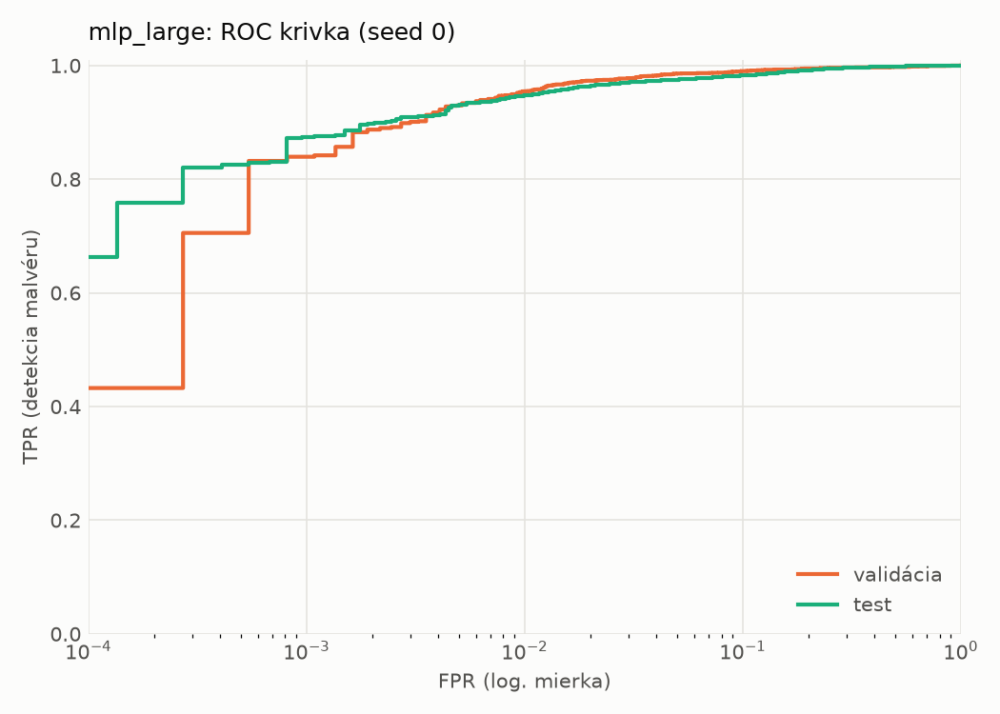
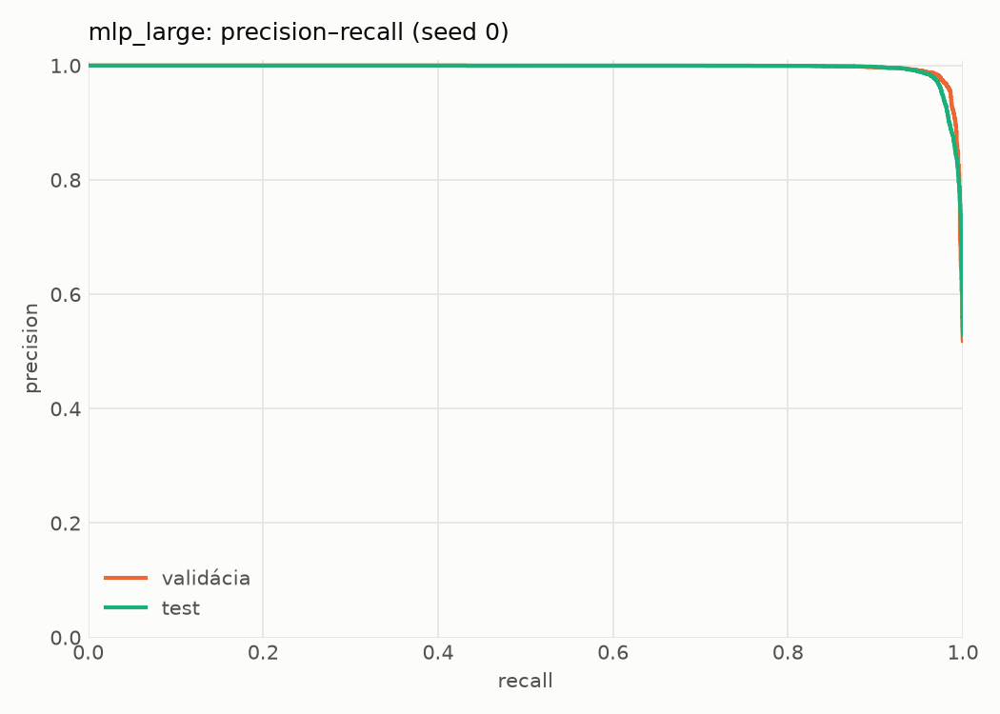
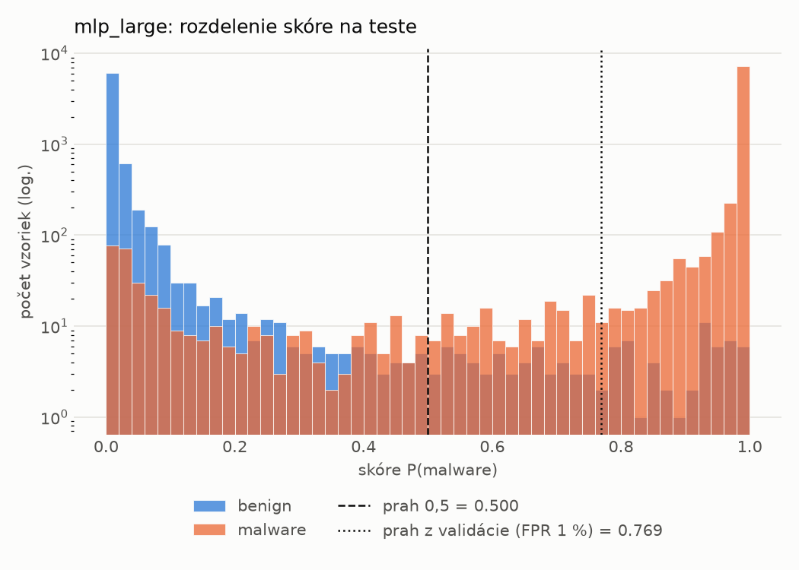
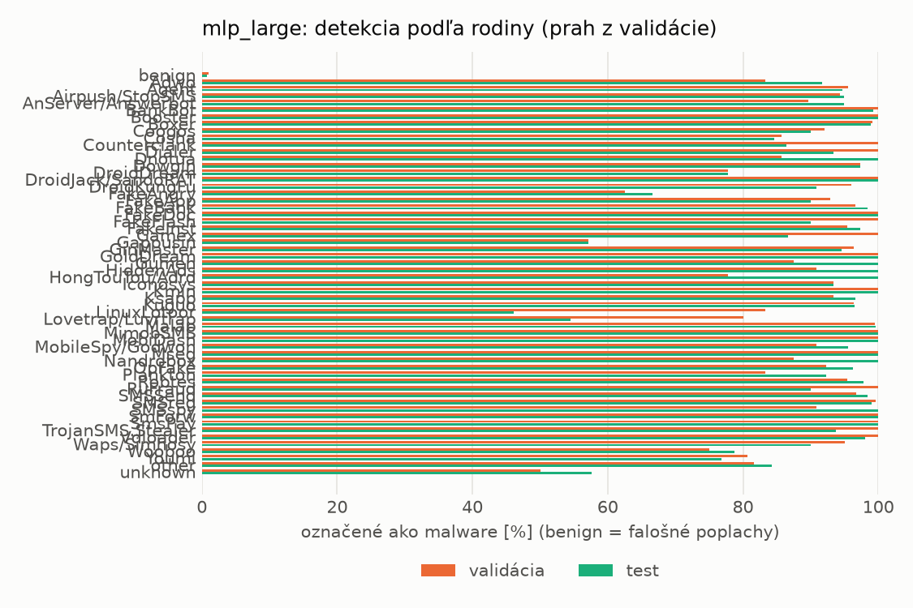
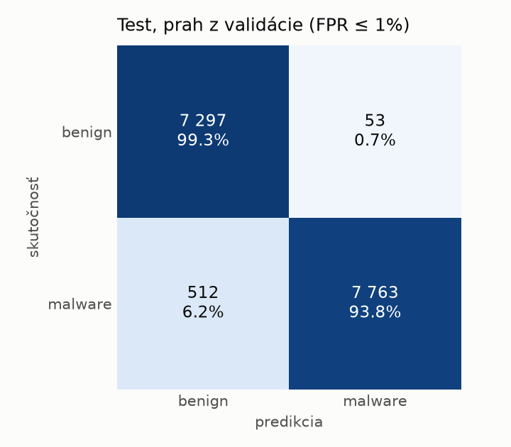
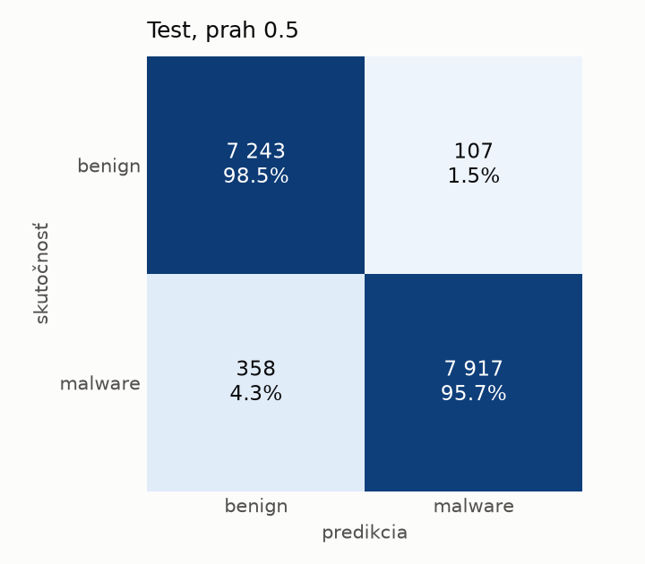
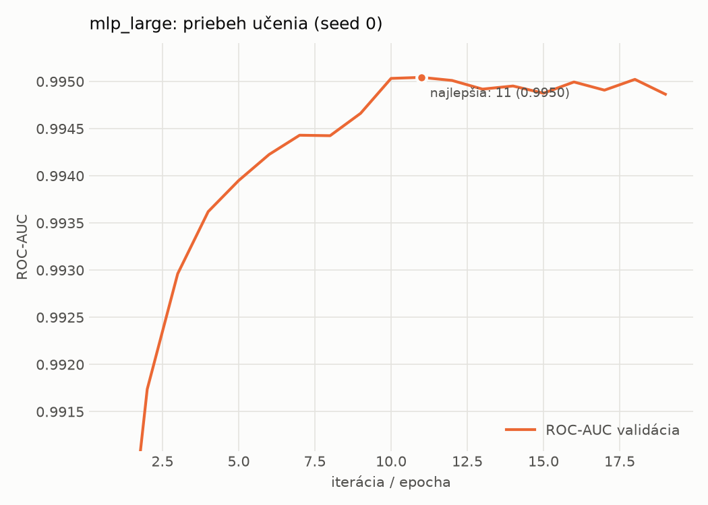

# hybrid/mlp_large – beh `20261122-223631`

> Automaticky generované (`src/training/run_tabular.py`). Konfigurácia: `config.yaml`, protokol: `protocol.yaml`.

- **Model:** `mlp` – veľká neurónová sieť (3–5 skrytých vrstiev, 512–2048 neurónov), kandidát na učiteľa
- **Ladenie:** bez ladenia – hyperparametre prevzaté z `runs_v4/real_full/full/hybrid/mlp_large/20261122-201300`
- **Finálne modely:** seedy [0, 1, 2]; hodnoty sú priemer ± smerodajná odchýlka cez seedy
- **Najlepšie hyperparametre:** `{"max_epochs": 100, "patience": 8, "hidden_layers": 3, "hidden_width": 512, "width_decay": 0.5, "dropout": 0.18171623767667733, "lr": 0.00010022812541545209, "weight_decay": 7.819097276436122e-06, "batch_size": 256}`

## Detekčná kvalita (bez prahu)
| metrika | train (podvzorka) | validácia | test |
|---|---|---|---|
| ROC-AUC | 0.9984 ± 0.0006 | 0.9952 ± 0.0002 | 0.9941 ± 0.0003 |
| PR-AUC | 0.9987 ± 0.0004 | 0.9957 ± 0.0011 | 0.9957 ± 0.0003 |
| TPR pri FPR 1 % | 0.9849 ± 0.0045 | 0.9590 ± 0.0055 | 0.9515 ± 0.0057 |
| TPR pri FPR 0,1 % | 0.9591 ± 0.0181 | 0.8513 ± 0.0189 | 0.8765 ± 0.0045 |
| log loss | 0.0402 ± 0.0098 | 0.0739 ± 0.0022 | 0.0907 ± 0.0037 |
| Brier skóre | 0.0101 ± 0.0026 | 0.0183 ± 0.0010 | 0.0231 ± 0.0014 |

Rozdiel ROC-AUC train − validácia: **0.0032** (veľký rozdiel = preučenie).

## Pri prahu z validácie (FPR ≤ 1% na validácii)
| metrika | train (podvzorka) | validácia | test |
|---|---|---|---|
| accuracy | 0.9828 ± 0.0045 | 0.9740 ± 0.0028 | 0.9665 ± 0.0036 |
| balanced accuracy | 0.9832 ± 0.0044 | 0.9746 ± 0.0027 | 0.9680 ± 0.0034 |
| precision | 0.9987 ± 0.0007 | 0.9906 ± 0.0001 | 0.9930 ± 0.0003 |
| recall (TPR) | 0.9677 ± 0.0081 | 0.9590 ± 0.0055 | 0.9435 ± 0.0071 |
| FPR | 0.0014 ± 0.0007 | 0.0098 ± 0.0000 | 0.0075 ± 0.0004 |
| F1 | 0.9829 ± 0.0045 | 0.9746 ± 0.0028 | 0.9676 ± 0.0036 |
| MCC | 0.9660 ± 0.0087 | 0.9486 ± 0.0055 | 0.9344 ± 0.0068 |

## Pri pevnom prahu 0.5
| metrika | train (podvzorka) | validácia | test |
|---|---|---|---|
| accuracy | 0.9872 ± 0.0034 | 0.9776 ± 0.0008 | 0.9719 ± 0.0019 |
| balanced accuracy | 0.9874 ± 0.0033 | 0.9778 ± 0.0008 | 0.9727 ± 0.0018 |
| precision | 0.9945 ± 0.0012 | 0.9836 ± 0.0011 | 0.9867 ± 0.0004 |
| recall (TPR) | 0.9805 ± 0.0057 | 0.9731 ± 0.0028 | 0.9600 ± 0.0039 |
| FPR | 0.0057 ± 0.0012 | 0.0175 ± 0.0013 | 0.0146 ± 0.0005 |
| F1 | 0.9874 ± 0.0033 | 0.9783 ± 0.0009 | 0.9731 ± 0.0019 |
| MCC | 0.9746 ± 0.0066 | 0.9553 ± 0.0016 | 0.9442 ± 0.0037 |

## Výpočtové nároky (seed 0, testovacia množina)
| meranie | hodnota |
|---|---|
| tréning finálneho modelu | 11.6 s (priemer cez seedy) |
| ladenie spolu | 0 s |
| počet parametrov / uzlov | 317 697 |
| veľkosť modelu na disku | 1.29 MB |
| transformácia vstupu – latencia (1 vlákno) | 0.017 ms |
| transformácia vstupu – priepustnosť | 282 720 vzoriek/s |
| CPU latencia modelu (batch 1, 1 vlákno) | 0.144 ms (p95 0.321) |
| CPU priepustnosť (24 vlákien) | 599 366 vzoriek/s |
| GPU latencia (batch 1) | 0.460 ms (p95 0.946) |
| GPU priepustnosť | 971 777 vzoriek/s |
| GPU špičková pamäť | 216 MB |

## Grafy
| | |
|---|---|
|  |  |
|  |  |
|  |  |
|  |  |

## Súbory
`metrics.json` (všetky metriky po seedoch vrátane rodín), `timing.json`, `hpo_trials.csv`,
`predictions/<časť>_seed<N>.parquet` (sha256, family, label, score), `model/seed_<N>/`, `log.txt`.
