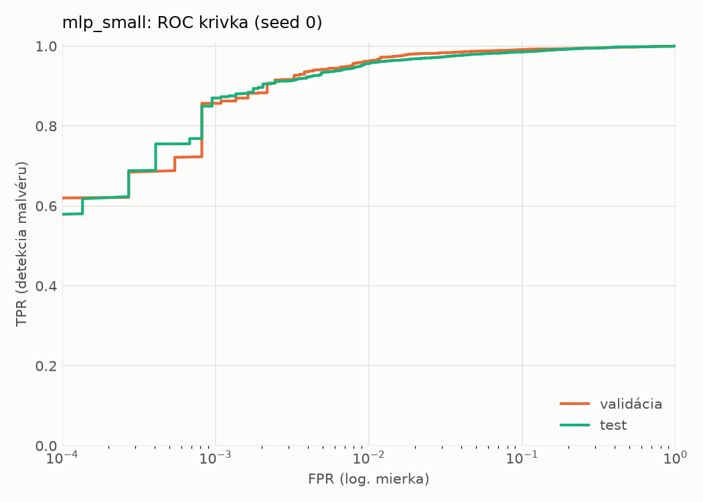
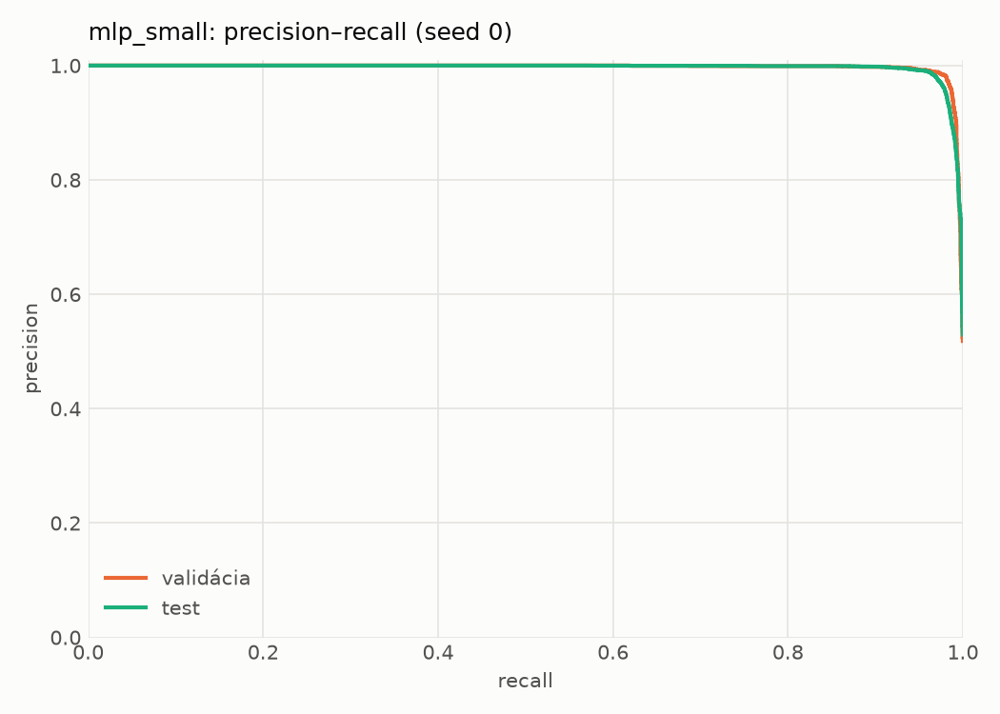
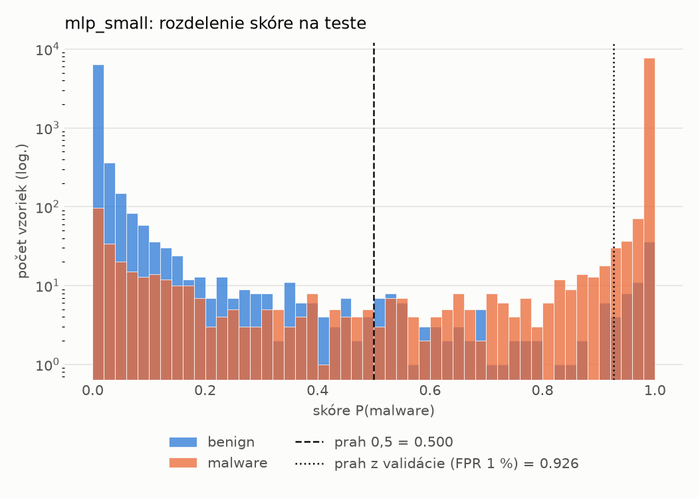
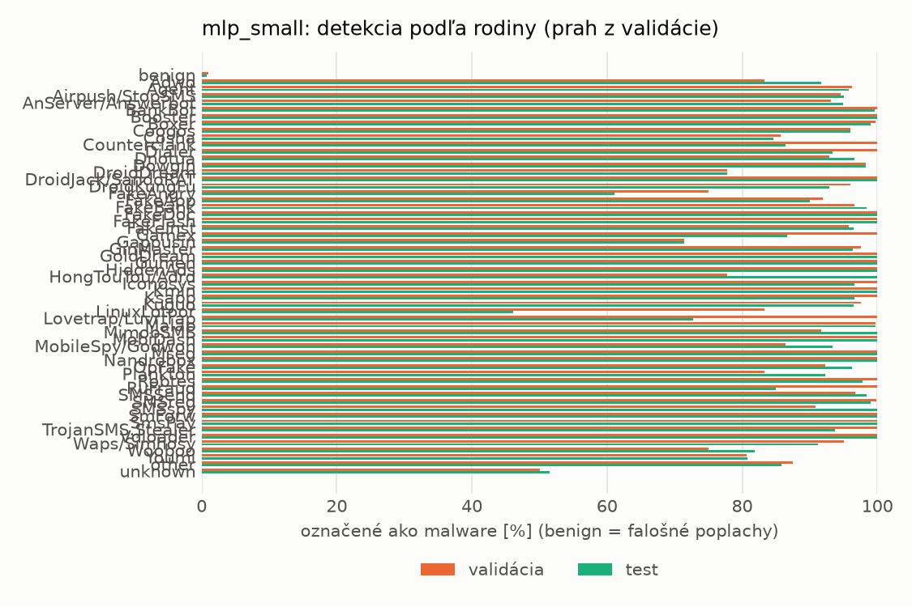
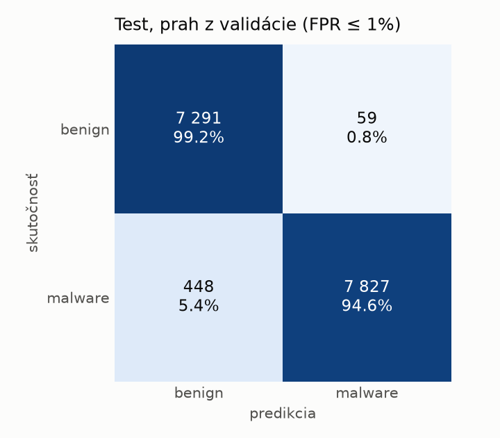
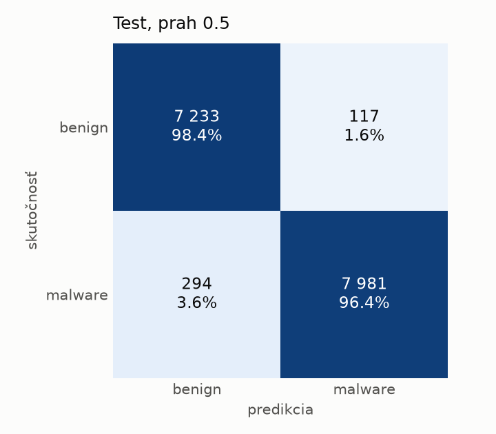
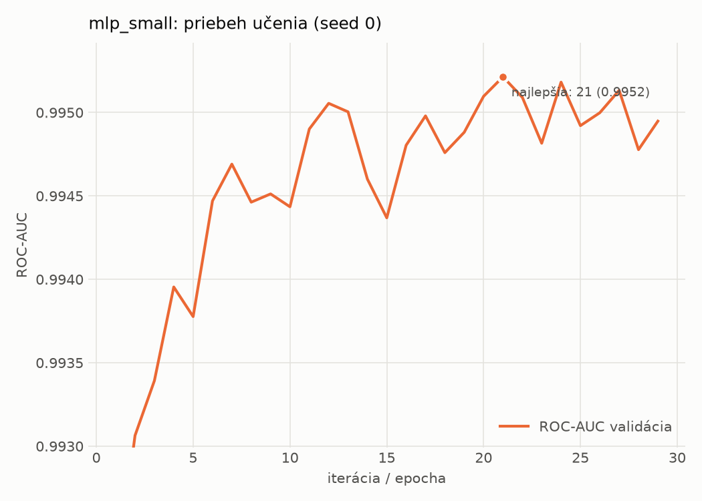

# hybrid/mlp_small – beh `20261122-223557`

> Automaticky generované (`src/training/run_tabular.py`). Konfigurácia: `config.yaml`, protokol: `protocol.yaml`.

- **Model:** `mlp` – malá neurónová sieť (1–2 skryté vrstvy), kandidát na ľahkého študenta
- **Ladenie:** bez ladenia – hyperparametre prevzaté z `runs_v4/real_full/full/hybrid/mlp_small/20261122-200826`
- **Finálne modely:** seedy [0, 1, 2]; hodnoty sú priemer ± smerodajná odchýlka cez seedy
- **Najlepšie hyperparametre:** `{"width_decay": 0.5, "max_epochs": 100, "patience": 8, "hidden_layers": 2, "hidden_width": 256, "dropout": 0.19625503285105284, "lr": 0.0008594281758471675, "weight_decay": 0.001025897876119634, "batch_size": 256}`

## Detekčná kvalita (bez prahu)
| metrika | train (podvzorka) | validácia | test |
|---|---|---|---|
| ROC-AUC | 0.9991 ± 0.0001 | 0.9952 ± 0.0001 | 0.9936 ± 0.0007 |
| PR-AUC | 0.9993 ± 0.0001 | 0.9962 ± 0.0004 | 0.9954 ± 0.0005 |
| TPR pri FPR 1 % | 0.9913 ± 0.0015 | 0.9597 ± 0.0019 | 0.9554 ± 0.0011 |
| TPR pri FPR 0,1 % | 0.9807 ± 0.0042 | 0.8115 ± 0.0618 | 0.8669 ± 0.0240 |
| log loss | 0.0271 ± 0.0029 | 0.0824 ± 0.0009 | 0.0991 ± 0.0032 |
| Brier skóre | 0.0067 ± 0.0009 | 0.0179 ± 0.0007 | 0.0223 ± 0.0005 |

Rozdiel ROC-AUC train − validácia: **0.0039** (veľký rozdiel = preučenie).

## Pri prahu z validácie (FPR ≤ 1% na validácii)
| metrika | train (podvzorka) | validácia | test |
|---|---|---|---|
| accuracy | 0.9846 ± 0.0012 | 0.9745 ± 0.0010 | 0.9674 ± 0.0010 |
| balanced accuracy | 0.9850 ± 0.0011 | 0.9750 ± 0.0010 | 0.9688 ± 0.0009 |
| precision | 0.9997 ± 0.0001 | 0.9908 ± 0.0002 | 0.9930 ± 0.0004 |
| recall (TPR) | 0.9703 ± 0.0024 | 0.9597 ± 0.0019 | 0.9452 ± 0.0020 |
| FPR | 0.0003 ± 0.0001 | 0.0096 ± 0.0002 | 0.0075 ± 0.0005 |
| F1 | 0.9847 ± 0.0012 | 0.9750 ± 0.0010 | 0.9685 ± 0.0010 |
| MCC | 0.9696 ± 0.0022 | 0.9495 ± 0.0020 | 0.9361 ± 0.0019 |

## Pri pevnom prahu 0.5
| metrika | train (podvzorka) | validácia | test |
|---|---|---|---|
| accuracy | 0.9917 ± 0.0014 | 0.9787 ± 0.0014 | 0.9731 ± 0.0009 |
| balanced accuracy | 0.9918 ± 0.0014 | 0.9787 ± 0.0014 | 0.9737 ± 0.0010 |
| precision | 0.9963 ± 0.0010 | 0.9808 ± 0.0024 | 0.9852 ± 0.0019 |
| recall (TPR) | 0.9875 ± 0.0021 | 0.9780 ± 0.0007 | 0.9637 ± 0.0008 |
| FPR | 0.0038 ± 0.0011 | 0.0206 ± 0.0026 | 0.0163 ± 0.0021 |
| F1 | 0.9919 ± 0.0014 | 0.9794 ± 0.0013 | 0.9743 ± 0.0009 |
| MCC | 0.9835 ± 0.0028 | 0.9573 ± 0.0027 | 0.9463 ± 0.0019 |

## Výpočtové nároky (seed 0, testovacia množina)
| meranie | hodnota |
|---|---|
| tréning finálneho modelu | 10.4 s (priemer cez seedy) |
| ladenie spolu | 0 s |
| počet parametrov / uzlov | 109 569 |
| veľkosť modelu na disku | 0.45 MB |
| transformácia vstupu – latencia (1 vlákno) | 0.007 ms |
| transformácia vstupu – priepustnosť | 441 528 vzoriek/s |
| CPU latencia modelu (batch 1, 1 vlákno) | 0.104 ms (p95 0.113) |
| CPU priepustnosť (24 vlákien) | 913 994 vzoriek/s |
| GPU latencia (batch 1) | 0.419 ms (p95 0.447) |
| GPU priepustnosť | 1 067 289 vzoriek/s |
| GPU špičková pamäť | 126 MB |

## Grafy
| | |
|---|---|
|  |  |
|  |  |
|  |  |
|  |  |

## Súbory
`metrics.json` (všetky metriky po seedoch vrátane rodín), `timing.json`, `hpo_trials.csv`,
`predictions/<časť>_seed<N>.parquet` (sha256, family, label, score), `model/seed_<N>/`, `log.txt`.
