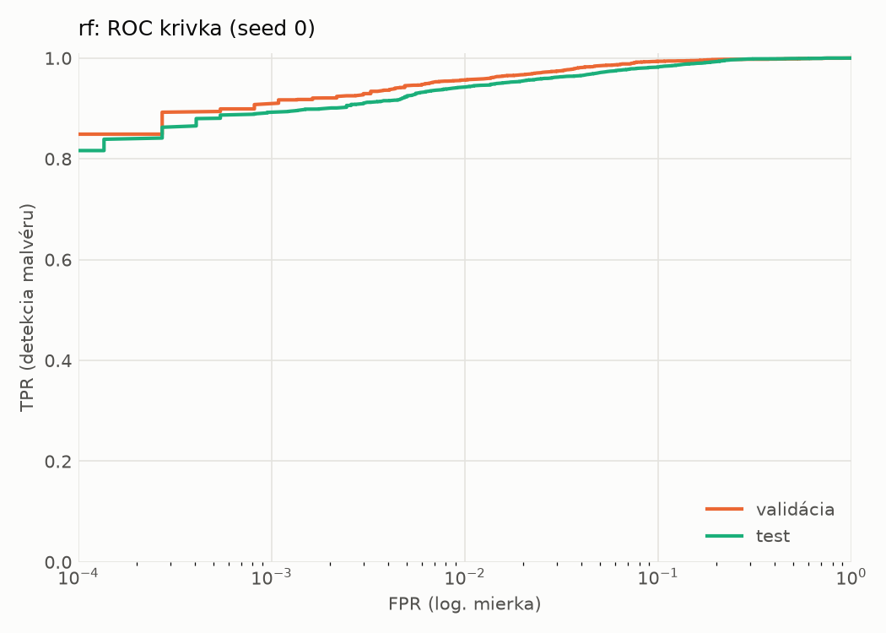
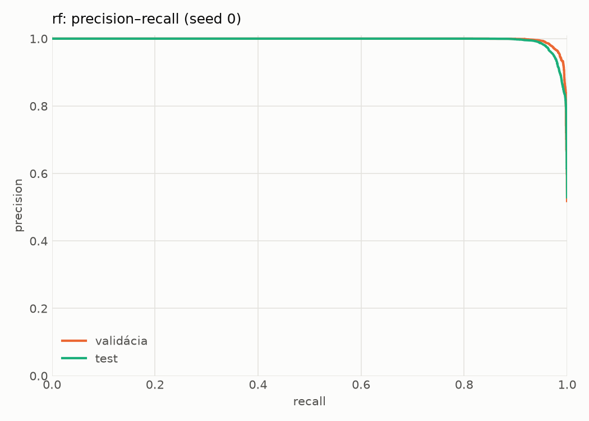
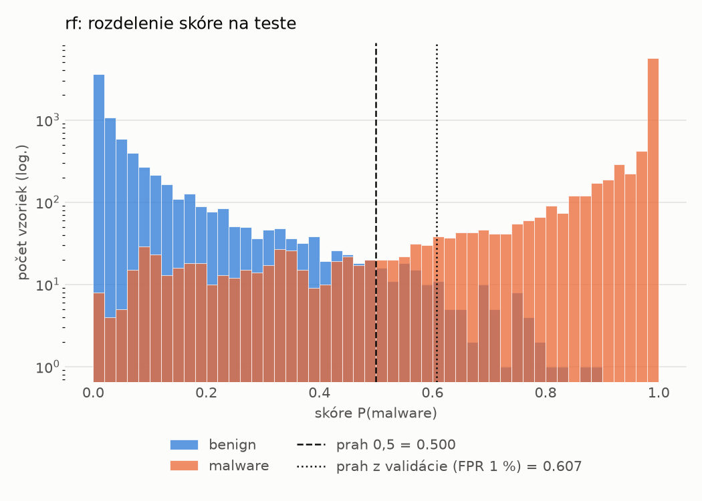
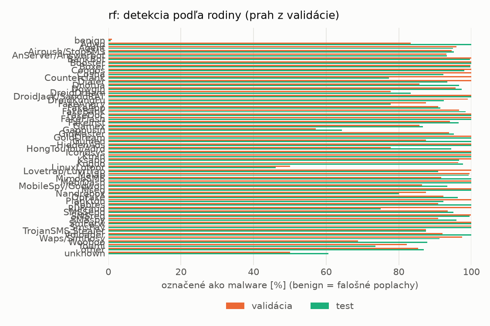
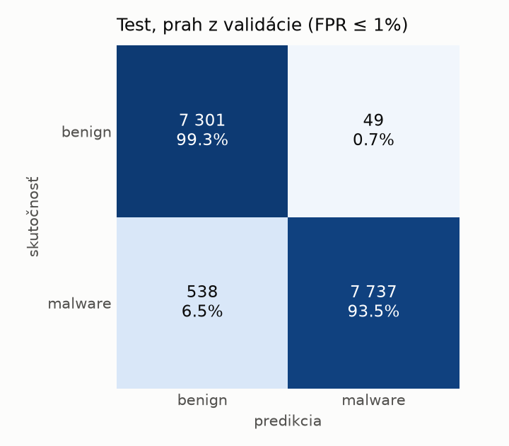
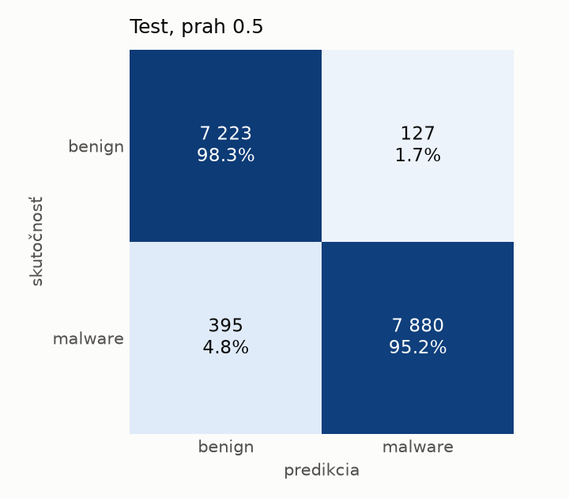

# hybrid/rf – beh `20261122-223444`

> Automaticky generované (`src/training/run_tabular.py`). Konfigurácia: `config.yaml`, protokol: `protocol.yaml`.

- **Model:** `random_forest` – Random Forest (pôvodné hodnoty príznakov)
- **Ladenie:** bez ladenia – hyperparametre prevzaté z `runs_v4/real_full/full/hybrid/rf/20261122-195013`
- **Finálne modely:** seedy [0, 1, 2]; hodnoty sú priemer ± smerodajná odchýlka cez seedy
- **Najlepšie hyperparametre:** `{"n_estimators": 150, "max_depth": 32, "min_samples_leaf": 1, "max_features": 0.05}`

## Detekčná kvalita (bez prahu)
| metrika | train (podvzorka) | validácia | test |
|---|---|---|---|
| ROC-AUC | 1.0000 ± 0.0000 | 0.9964 ± 0.0000 | 0.9945 ± 0.0000 |
| PR-AUC | 1.0000 ± 0.0000 | 0.9972 ± 0.0000 | 0.9957 ± 0.0000 |
| TPR pri FPR 1 % | 1.0000 ± 0.0000 | 0.9542 ± 0.0019 | 0.9416 ± 0.0010 |
| TPR pri FPR 0,1 % | 1.0000 ± 0.0000 | 0.9093 ± 0.0028 | 0.8862 ± 0.0065 |
| log loss | 0.0253 ± 0.0002 | 0.0858 ± 0.0003 | 0.1029 ± 0.0004 |
| Brier skóre | 0.0031 ± 0.0000 | 0.0218 ± 0.0001 | 0.0279 ± 0.0001 |

Rozdiel ROC-AUC train − validácia: **0.0036** (veľký rozdiel = preučenie).

## Pri prahu z validácie (FPR ≤ 1% na validácii)
| metrika | train (podvzorka) | validácia | test |
|---|---|---|---|
| accuracy | 0.9986 ± 0.0005 | 0.9716 ± 0.0010 | 0.9610 ± 0.0016 |
| balanced accuracy | 0.9986 ± 0.0005 | 0.9723 ± 0.0010 | 0.9628 ± 0.0015 |
| precision | 1.0000 ± 0.0000 | 0.9907 ± 0.0002 | 0.9939 ± 0.0007 |
| recall (TPR) | 0.9973 ± 0.0010 | 0.9542 ± 0.0019 | 0.9320 ± 0.0029 |
| FPR | 0.0000 ± 0.0000 | 0.0096 ± 0.0002 | 0.0064 ± 0.0007 |
| F1 | 0.9986 ± 0.0005 | 0.9721 ± 0.0010 | 0.9620 ± 0.0016 |
| MCC | 0.9972 ± 0.0010 | 0.9439 ± 0.0020 | 0.9240 ± 0.0031 |

## Pri pevnom prahu 0.5
| metrika | train (podvzorka) | validácia | test |
|---|---|---|---|
| accuracy | 1.0000 ± 0.0001 | 0.9728 ± 0.0008 | 0.9668 ± 0.0002 |
| balanced accuracy | 1.0000 ± 0.0001 | 0.9730 ± 0.0008 | 0.9677 ± 0.0002 |
| precision | 1.0000 ± 0.0000 | 0.9782 ± 0.0010 | 0.9845 ± 0.0003 |
| recall (TPR) | 0.9999 ± 0.0001 | 0.9692 ± 0.0005 | 0.9522 ± 0.0003 |
| FPR | 0.0000 ± 0.0000 | 0.0232 ± 0.0011 | 0.0169 ± 0.0004 |
| F1 | 1.0000 ± 0.0001 | 0.9737 ± 0.0007 | 0.9681 ± 0.0002 |
| MCC | 0.9999 ± 0.0001 | 0.9456 ± 0.0015 | 0.9340 ± 0.0004 |

## Výpočtové nároky (seed 0, testovacia množina)
| meranie | hodnota |
|---|---|
| tréning finálneho modelu | 1.3 s (priemer cez seedy) |
| ladenie spolu | 0 s |
| počet parametrov / uzlov | 751 148 |
| veľkosť modelu na disku | 60.37 MB |
| CPU latencia modelu (batch 1, 1 vlákno) | 4.721 ms (p95 5.037) |
| CPU priepustnosť (24 vlákien) | 240 345 vzoriek/s |

## Grafy
| | |
|---|---|
|  |  |
|  |  |
|  |  |
|  |  |

## Súbory
`metrics.json` (všetky metriky po seedoch vrátane rodín), `timing.json`, `hpo_trials.csv`,
`predictions/<časť>_seed<N>.parquet` (sha256, family, label, score), `model/seed_<N>/`, `log.txt`.
