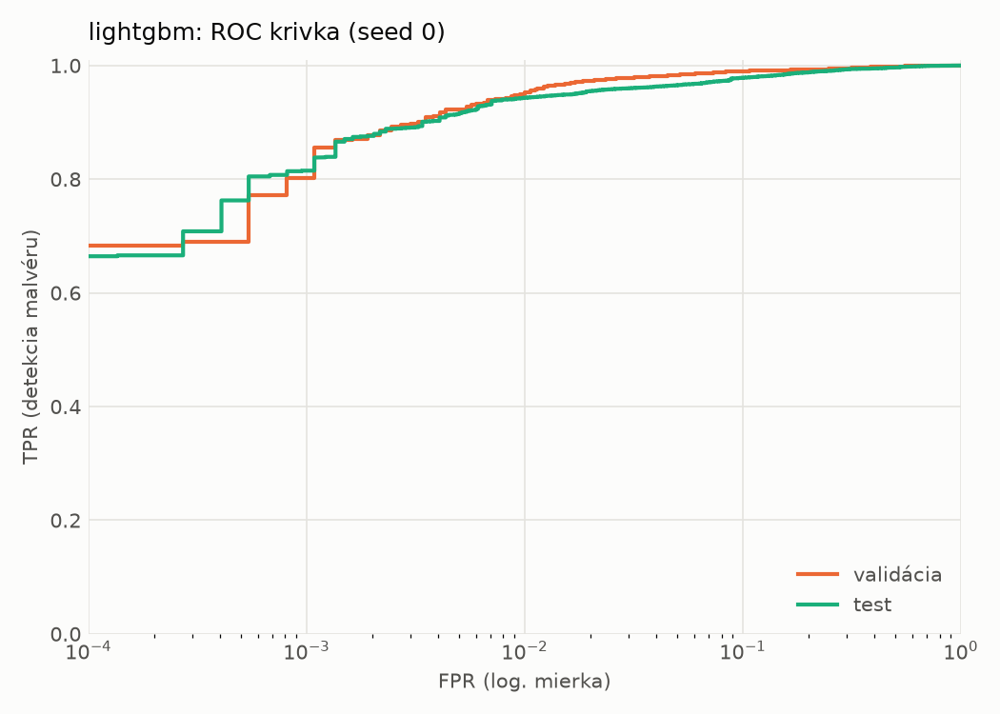
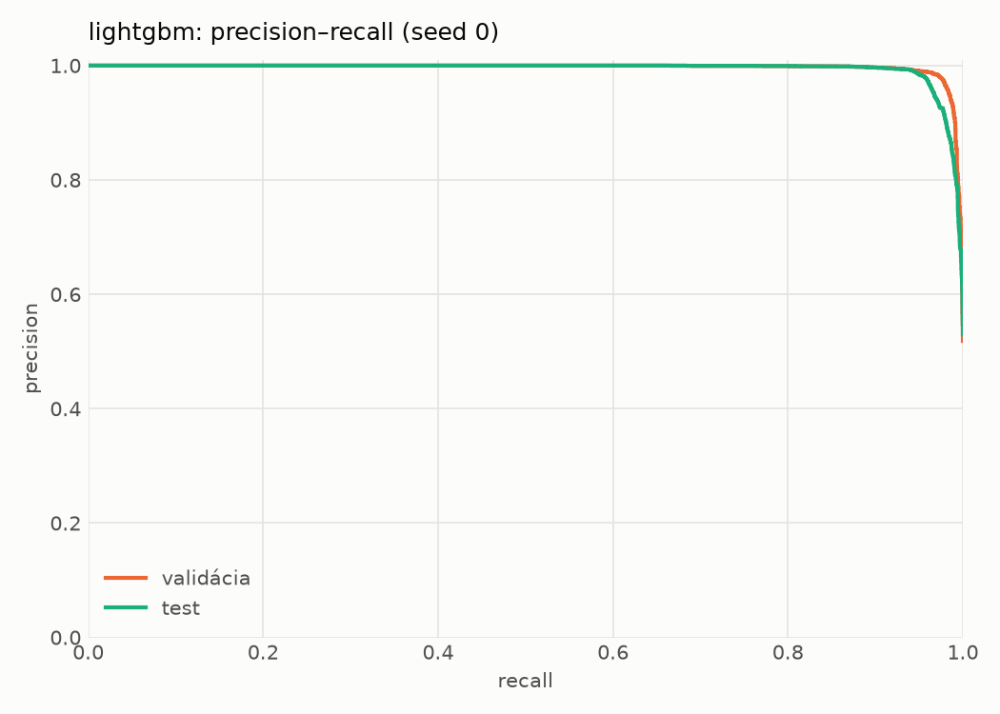
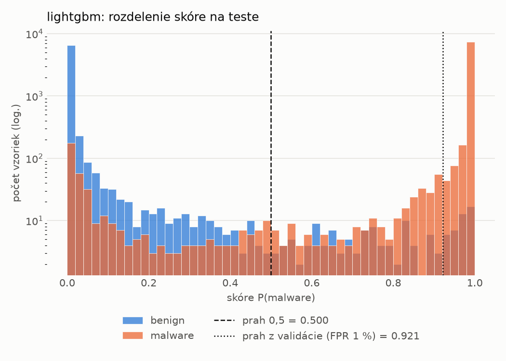
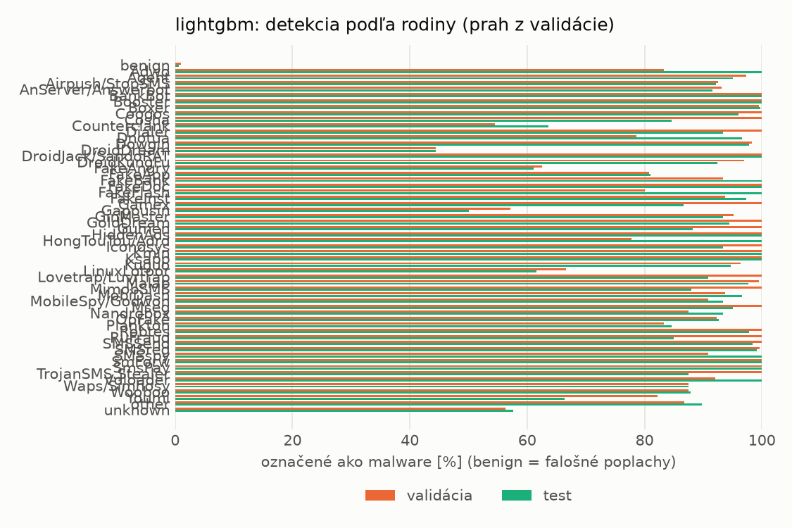
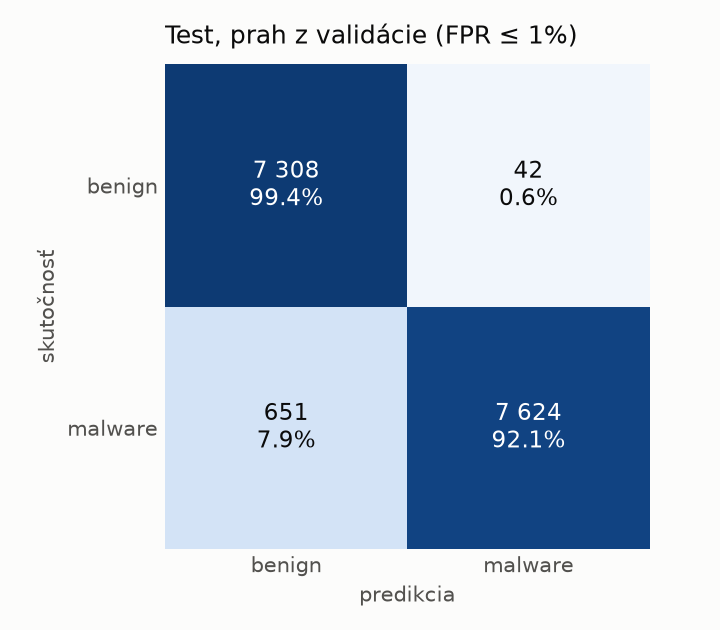
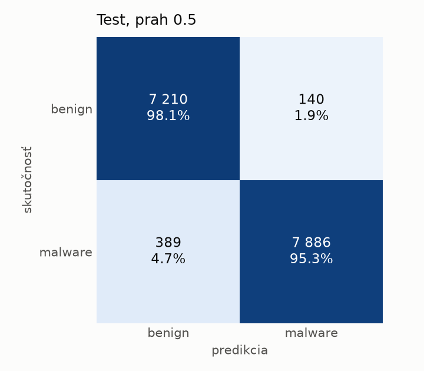
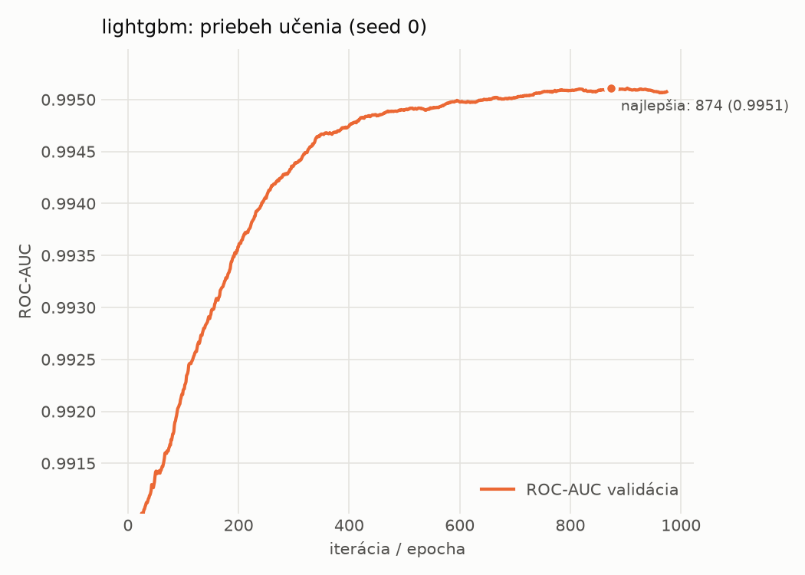

# static/lightgbm – beh `20261122-222917`

> Automaticky generované (`src/training/run_tabular.py`). Konfigurácia: `config.yaml`, protokol: `protocol.yaml`.

- **Model:** `lightgbm` – LightGBM, gradient boosting stromov s early stopping na validácii (pôvodné hodnoty príznakov)
- **Ladenie:** bez ladenia – hyperparametre prevzaté z `runs_v4/real_full/full/static/lightgbm/20261122-184829`
- **Finálne modely:** seedy [0, 1, 2]; hodnoty sú priemer ± smerodajná odchýlka cez seedy
- **Najlepšie hyperparametre:** `{"num_boost_round": 5000, "early_stopping_rounds": 100, "learning_rate": 0.015567978603457627, "num_leaves": 372, "min_child_samples": 12, "feature_fraction": 0.7551391358223217, "bagging_fraction": 0.6871892431836363, "lambda_l1": 1.3651906778474808e-06, "lambda_l2": 0.003382199534052785}`

## Detekčná kvalita (bez prahu)
| metrika | train (podvzorka) | validácia | test |
|---|---|---|---|
| ROC-AUC | 1.0000 ± 0.0000 | 0.9951 ± 0.0000 | 0.9919 ± 0.0001 |
| PR-AUC | 1.0000 ± 0.0000 | 0.9962 ± 0.0000 | 0.9941 ± 0.0001 |
| TPR pri FPR 1 % | 1.0000 ± 0.0000 | 0.9504 ± 0.0014 | 0.9430 ± 0.0006 |
| TPR pri FPR 0,1 % | 1.0000 ± 0.0000 | 0.7897 ± 0.0140 | 0.8238 ± 0.0084 |
| log loss | 0.0041 ± 0.0011 | 0.0874 ± 0.0028 | 0.1271 ± 0.0046 |
| Brier skóre | 0.0003 ± 0.0001 | 0.0202 ± 0.0001 | 0.0287 ± 0.0001 |

Rozdiel ROC-AUC train − validácia: **0.0049** (veľký rozdiel = preučenie).

## Pri prahu z validácie (FPR ≤ 1% na validácii)
| metrika | train (podvzorka) | validácia | test |
|---|---|---|---|
| accuracy | 0.9950 ± 0.0014 | 0.9696 ± 0.0009 | 0.9567 ± 0.0011 |
| balanced accuracy | 0.9951 ± 0.0013 | 0.9704 ± 0.0009 | 0.9588 ± 0.0010 |
| precision | 1.0000 ± 0.0000 | 0.9907 ± 0.0003 | 0.9945 ± 0.0002 |
| recall (TPR) | 0.9902 ± 0.0026 | 0.9504 ± 0.0014 | 0.9234 ± 0.0019 |
| FPR | 0.0000 ± 0.0000 | 0.0096 ± 0.0003 | 0.0058 ± 0.0002 |
| F1 | 0.9951 ± 0.0013 | 0.9701 ± 0.0009 | 0.9576 ± 0.0011 |
| MCC | 0.9900 ± 0.0027 | 0.9401 ± 0.0017 | 0.9161 ± 0.0020 |

## Pri pevnom prahu 0.5
| metrika | train (podvzorka) | validácia | test |
|---|---|---|---|
| accuracy | 0.9998 ± 0.0000 | 0.9758 ± 0.0005 | 0.9664 ± 0.0003 |
| balanced accuracy | 0.9998 ± 0.0000 | 0.9759 ± 0.0005 | 0.9672 ± 0.0003 |
| precision | 1.0000 ± 0.0000 | 0.9780 ± 0.0006 | 0.9827 ± 0.0004 |
| recall (TPR) | 0.9996 ± 0.0000 | 0.9753 ± 0.0003 | 0.9533 ± 0.0003 |
| FPR | 0.0000 ± 0.0000 | 0.0236 ± 0.0007 | 0.0189 ± 0.0004 |
| F1 | 0.9998 ± 0.0000 | 0.9767 ± 0.0004 | 0.9678 ± 0.0003 |
| MCC | 0.9996 ± 0.0000 | 0.9516 ± 0.0009 | 0.9332 ± 0.0006 |

## Výpočtové nároky (seed 0, testovacia množina)
| meranie | hodnota |
|---|---|
| tréning finálneho modelu | 14.2 s (priemer cez seedy) |
| ladenie spolu | 0 s |
| počet parametrov / uzlov | 649 382 |
| veľkosť modelu na disku | 36.10 MB |
| CPU latencia modelu (batch 1, 1 vlákno) | 0.184 ms (p95 0.227) |
| CPU priepustnosť (24 vlákien) | 79 610 vzoriek/s |

## Grafy
| | |
|---|---|
|  |  |
|  |  |
|  |  |
|  |  |

## Súbory
`metrics.json` (všetky metriky po seedoch vrátane rodín), `timing.json`, `hpo_trials.csv`,
`predictions/<časť>_seed<N>.parquet` (sha256, family, label, score), `model/seed_<N>/`, `log.txt`.
