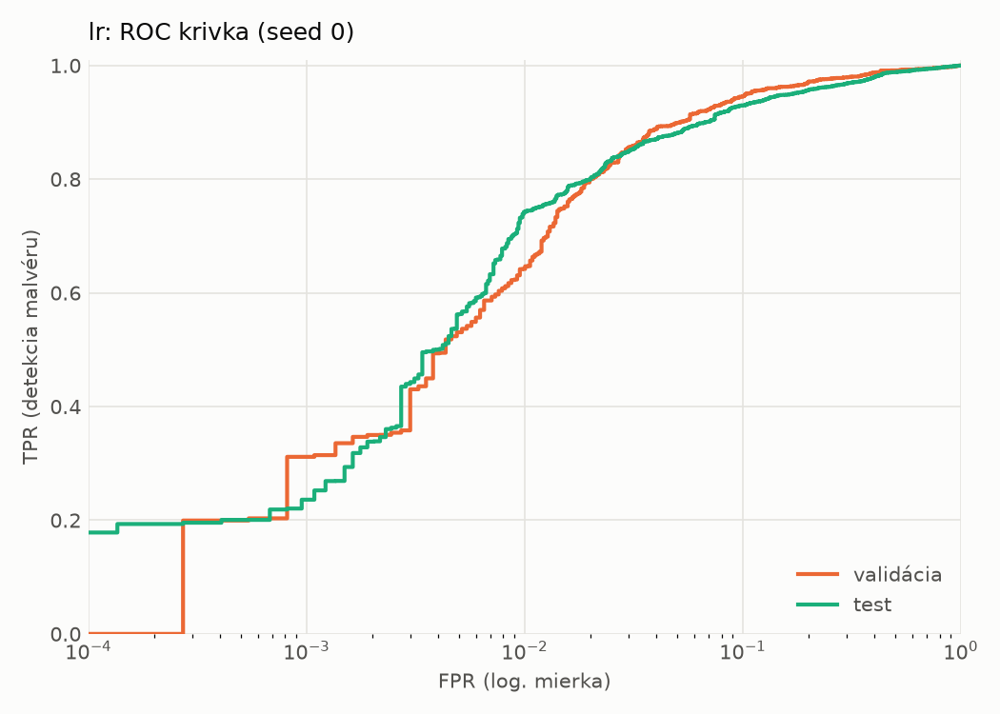
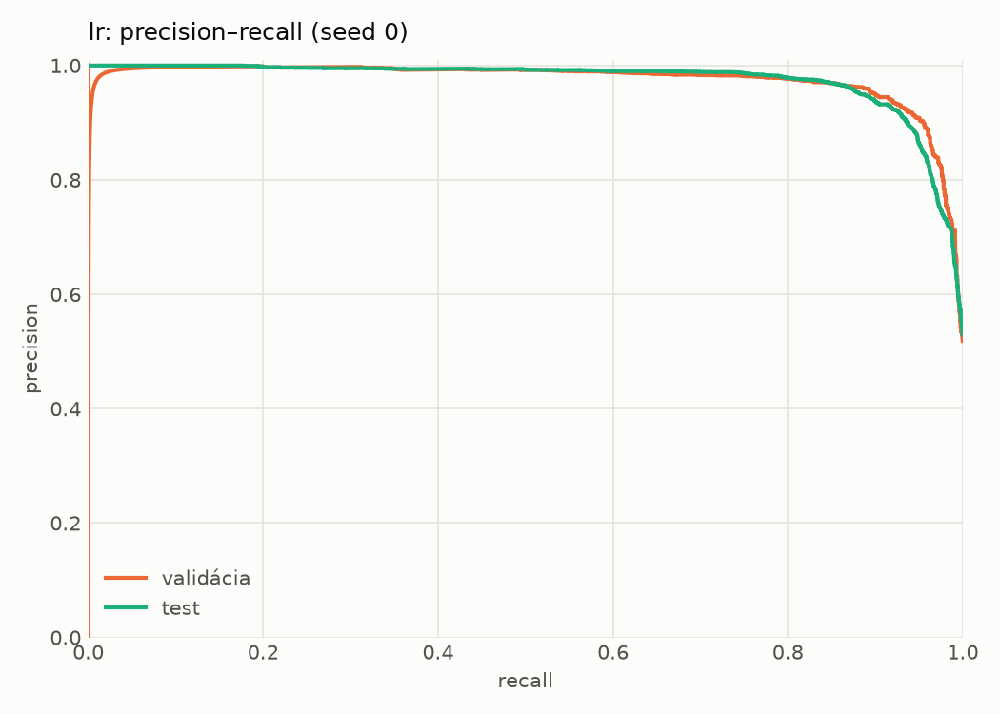
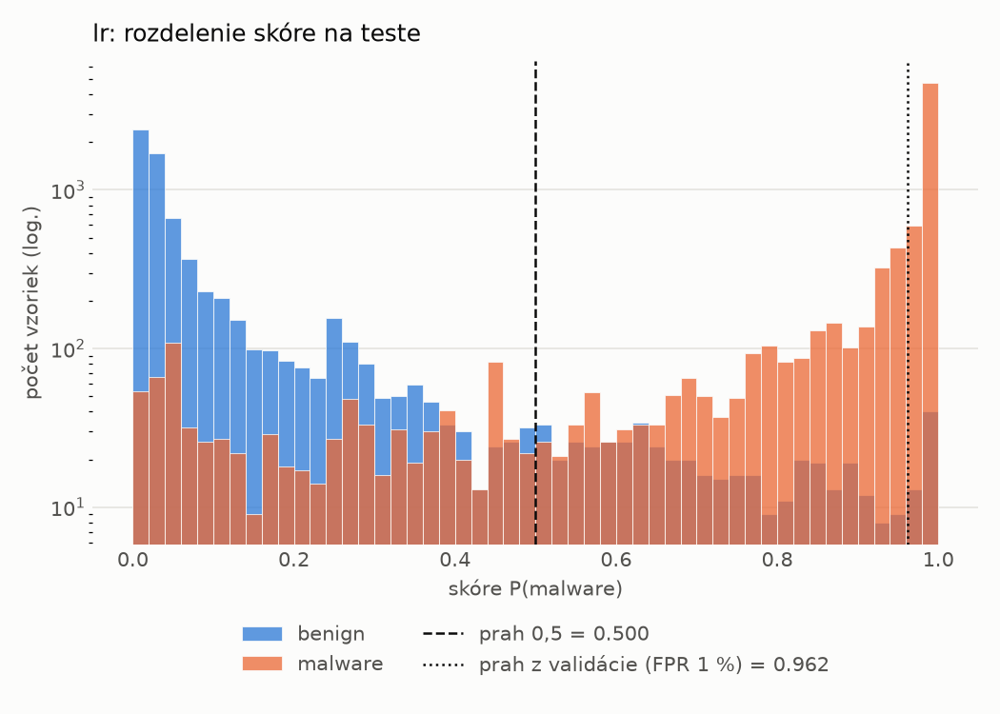
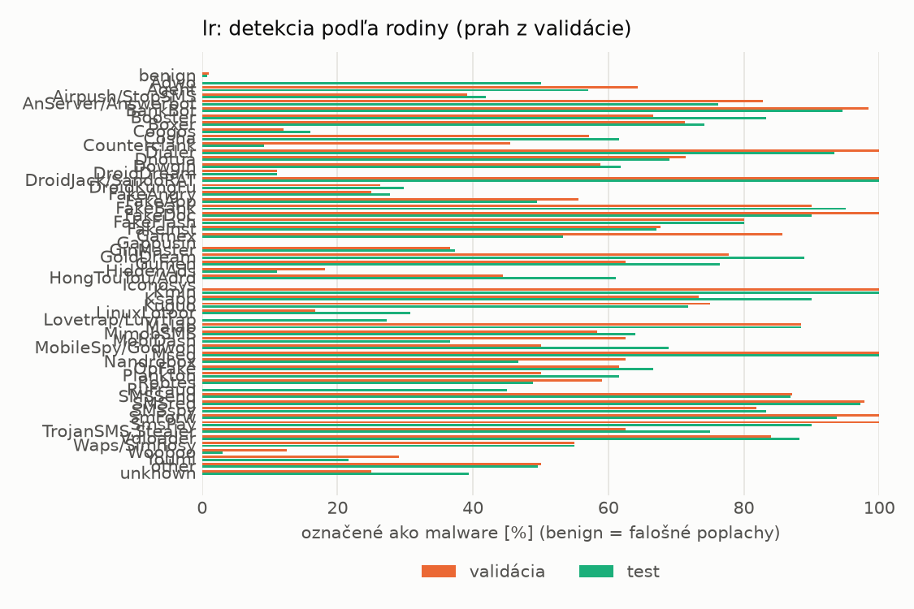
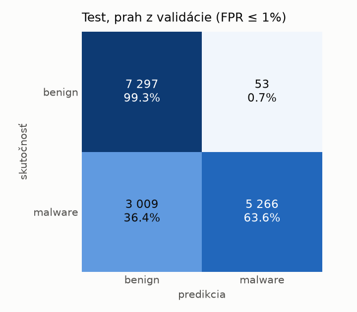
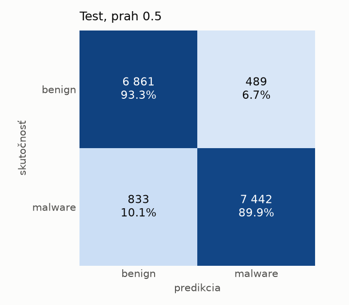

# static/lr – beh `20261122-222859`

> Automaticky generované (`src/training/run_tabular.py`). Konfigurácia: `config.yaml`, protokol: `protocol.yaml`.

- **Model:** `logreg` – logistická regresia s L2 regularizáciou (vstup signed log1p + štandardizácia)
- **Ladenie:** bez ladenia – hyperparametre prevzaté z `runs_v4/real_full/full/static/lr/20261122-184714`
- **Finálne modely:** seedy [0, 1, 2]; hodnoty sú priemer ± smerodajná odchýlka cez seedy
- **Najlepšie hyperparametre:** `{"max_iter": 2000, "C": 2.1423021757741068}`

## Detekčná kvalita (bez prahu)
| metrika | train (podvzorka) | validácia | test |
|---|---|---|---|
| ROC-AUC | 0.9746 ± 0.0000 | 0.9731 ± 0.0000 | 0.9680 ± 0.0000 |
| PR-AUC | 0.9779 ± 0.0000 | 0.9757 ± 0.0000 | 0.9745 ± 0.0000 |
| TPR pri FPR 1 % | 0.7000 ± 0.0000 | 0.6420 ± 0.0000 | 0.7425 ± 0.0000 |
| TPR pri FPR 0,1 % | 0.3425 ± 0.0000 | 0.3115 ± 0.0000 | 0.2361 ± 0.0000 |
| log loss | 0.2011 ± 0.0000 | 0.2082 ± 0.0000 | 0.2264 ± 0.0000 |
| Brier skóre | 0.0567 ± 0.0000 | 0.0565 ± 0.0000 | 0.0632 ± 0.0000 |

Rozdiel ROC-AUC train − validácia: **0.0016** (veľký rozdiel = preučenie).

## Pri prahu z validácie (FPR ≤ 1% na validácii)
| metrika | train (podvzorka) | validácia | test |
|---|---|---|---|
| accuracy | 0.8103 ± 0.0000 | 0.8097 ± 0.0000 | 0.8040 ± 0.0000 |
| balanced accuracy | 0.8147 ± 0.0000 | 0.8161 ± 0.0000 | 0.8146 ± 0.0000 |
| precision | 0.9885 ± 0.0000 | 0.9860 ± 0.0000 | 0.9900 ± 0.0000 |
| recall (TPR) | 0.6372 ± 0.0000 | 0.6420 ± 0.0000 | 0.6364 ± 0.0000 |
| FPR | 0.0078 ± 0.0000 | 0.0098 ± 0.0000 | 0.0072 ± 0.0000 |
| F1 | 0.7749 ± 0.0000 | 0.7776 ± 0.0000 | 0.7748 ± 0.0000 |
| MCC | 0.6689 ± 0.0000 | 0.6680 ± 0.0000 | 0.6627 ± 0.0000 |

## Pri pevnom prahu 0.5
| metrika | train (podvzorka) | validácia | test |
|---|---|---|---|
| accuracy | 0.9248 ± 0.0000 | 0.9258 ± 0.0000 | 0.9154 ± 0.0000 |
| balanced accuracy | 0.9251 ± 0.0000 | 0.9260 ± 0.0000 | 0.9164 ± 0.0000 |
| precision | 0.9369 ± 0.0000 | 0.9353 ± 0.0000 | 0.9383 ± 0.0000 |
| recall (TPR) | 0.9149 ± 0.0000 | 0.9206 ± 0.0000 | 0.8993 ± 0.0000 |
| FPR | 0.0648 ± 0.0000 | 0.0686 ± 0.0000 | 0.0665 ± 0.0000 |
| F1 | 0.9258 ± 0.0000 | 0.9279 ± 0.0000 | 0.9184 ± 0.0000 |
| MCC | 0.8498 ± 0.0000 | 0.8516 ± 0.0000 | 0.8314 ± 0.0000 |

## Výpočtové nároky (seed 0, testovacia množina)
| meranie | hodnota |
|---|---|
| tréning finálneho modelu | 0.2 s (priemer cez seedy) |
| ladenie spolu | 0 s |
| počet parametrov / uzlov | 165 |
| veľkosť modelu na disku | 0.01 MB |
| transformácia vstupu – latencia (1 vlákno) | 0.005 ms |
| transformácia vstupu – priepustnosť | 1 016 736 vzoriek/s |
| CPU latencia modelu (batch 1, 1 vlákno) | 0.004 ms (p95 0.005) |
| CPU priepustnosť (24 vlákien) | 3 701 905 vzoriek/s |

## Grafy
| | |
|---|---|
|  |  |
|  |  |
|  |  |
|  |  |

## Súbory
`metrics.json` (všetky metriky po seedoch vrátane rodín), `timing.json`, `hpo_trials.csv`,
`predictions/<časť>_seed<N>.parquet` (sha256, family, label, score), `model/seed_<N>/`, `log.txt`.
