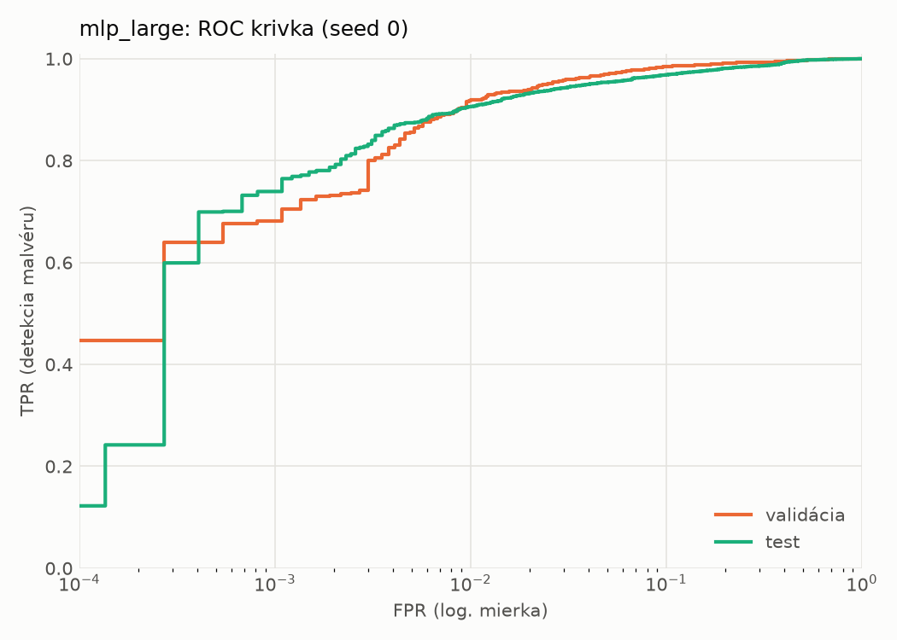
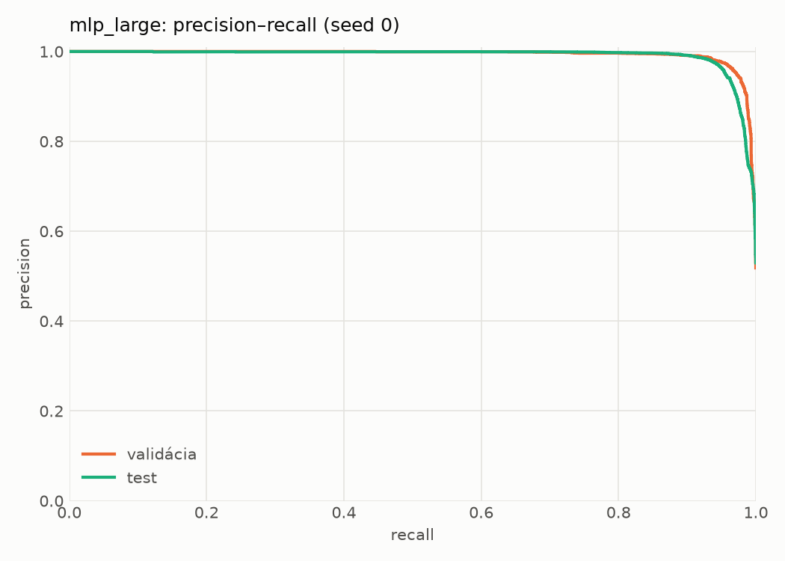
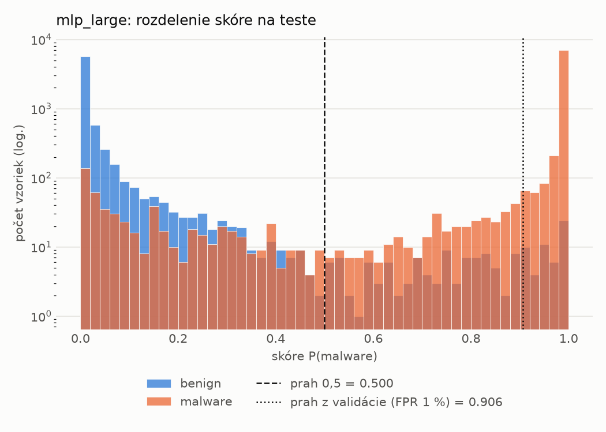
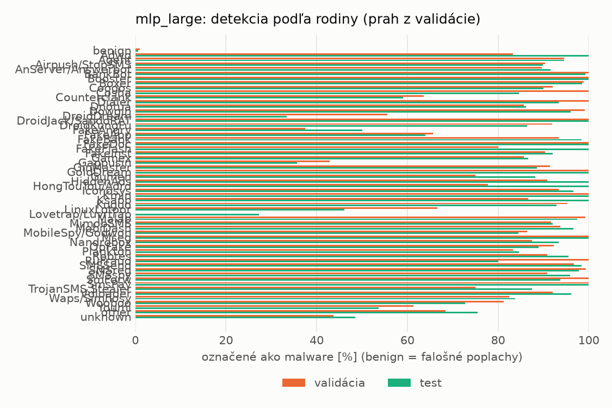
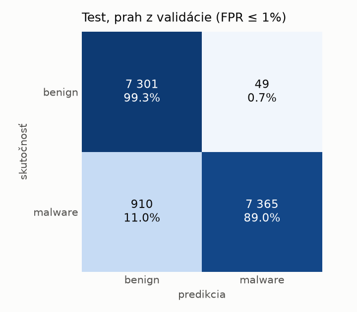
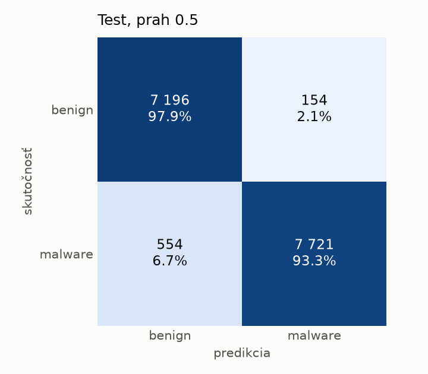
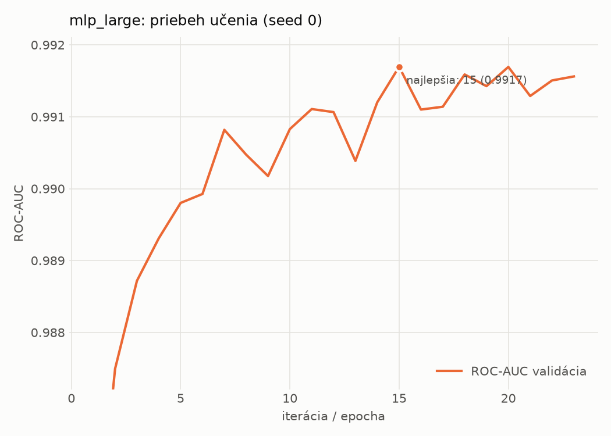

# static/mlp_large – beh `20261122-223059`

> Automaticky generované (`src/training/run_tabular.py`). Konfigurácia: `config.yaml`, protokol: `protocol.yaml`.

- **Model:** `mlp` – veľká neurónová sieť (3–5 skrytých vrstiev, 512–2048 neurónov), kandidát na učiteľa
- **Ladenie:** bez ladenia – hyperparametre prevzaté z `runs_v4/real_full/full/static/mlp_large/20261122-190815`
- **Finálne modely:** seedy [0, 1, 2]; hodnoty sú priemer ± smerodajná odchýlka cez seedy
- **Najlepšie hyperparametre:** `{"max_epochs": 100, "patience": 8, "hidden_layers": 3, "hidden_width": 512, "width_decay": 0.5, "dropout": 0.18301180344828658, "lr": 0.000378062291460712, "weight_decay": 1.421525321060219e-06, "batch_size": 256}`

## Detekčná kvalita (bez prahu)
| metrika | train (podvzorka) | validácia | test |
|---|---|---|---|
| ROC-AUC | 0.9976 ± 0.0005 | 0.9918 ± 0.0001 | 0.9863 ± 0.0013 |
| PR-AUC | 0.9980 ± 0.0004 | 0.9929 ± 0.0004 | 0.9902 ± 0.0006 |
| TPR pri FPR 1 % | 0.9714 ± 0.0053 | 0.9122 ± 0.0058 | 0.9160 ± 0.0087 |
| TPR pri FPR 0,1 % | 0.9267 ± 0.0117 | 0.5827 ± 0.0892 | 0.7411 ± 0.0116 |
| log loss | 0.0548 ± 0.0072 | 0.1136 ± 0.0022 | 0.1490 ± 0.0058 |
| Brier skóre | 0.0149 ± 0.0021 | 0.0276 ± 0.0012 | 0.0358 ± 0.0007 |

Rozdiel ROC-AUC train − validácia: **0.0058** (veľký rozdiel = preučenie).

## Pri prahu z validácie (FPR ≤ 1% na validácii)
| metrika | train (podvzorka) | validácia | test |
|---|---|---|---|
| accuracy | 0.9565 ± 0.0030 | 0.9498 ± 0.0030 | 0.9354 ± 0.0028 |
| balanced accuracy | 0.9576 ± 0.0029 | 0.9512 ± 0.0029 | 0.9387 ± 0.0026 |
| precision | 0.9993 ± 0.0009 | 0.9901 ± 0.0001 | 0.9943 ± 0.0008 |
| recall (TPR) | 0.9158 ± 0.0065 | 0.9122 ± 0.0058 | 0.8831 ± 0.0060 |
| FPR | 0.0007 ± 0.0008 | 0.0098 ± 0.0000 | 0.0057 ± 0.0009 |
| F1 | 0.9557 ± 0.0032 | 0.9495 ± 0.0032 | 0.9354 ± 0.0030 |
| MCC | 0.9166 ± 0.0055 | 0.9027 ± 0.0056 | 0.8774 ± 0.0048 |

## Pri pevnom prahu 0.5
| metrika | train (podvzorka) | validácia | test |
|---|---|---|---|
| accuracy | 0.9801 ± 0.0024 | 0.9651 ± 0.0014 | 0.9561 ± 0.0015 |
| balanced accuracy | 0.9804 ± 0.0023 | 0.9654 ± 0.0014 | 0.9574 ± 0.0015 |
| precision | 0.9914 ± 0.0009 | 0.9740 ± 0.0005 | 0.9812 ± 0.0007 |
| recall (TPR) | 0.9696 ± 0.0037 | 0.9582 ± 0.0028 | 0.9349 ± 0.0023 |
| FPR | 0.0088 ± 0.0009 | 0.0275 ± 0.0005 | 0.0202 ± 0.0007 |
| F1 | 0.9804 ± 0.0024 | 0.9661 ± 0.0014 | 0.9575 ± 0.0015 |
| MCC | 0.9604 ± 0.0046 | 0.9303 ± 0.0028 | 0.9132 ± 0.0030 |

## Výpočtové nároky (seed 0, testovacia množina)
| meranie | hodnota |
|---|---|
| tréning finálneho modelu | 11.5 s (priemer cez seedy) |
| ladenie spolu | 0 s |
| počet parametrov / uzlov | 250 625 |
| veľkosť modelu na disku | 1.02 MB |
| transformácia vstupu – latencia (1 vlákno) | 0.015 ms |
| transformácia vstupu – priepustnosť | 615 686 vzoriek/s |
| CPU latencia modelu (batch 1, 1 vlákno) | 0.227 ms (p95 0.324) |
| CPU priepustnosť (24 vlákien) | 835 687 vzoriek/s |
| GPU latencia (batch 1) | 0.529 ms (p95 0.593) |
| GPU priepustnosť | 890 202 vzoriek/s |
| GPU špičková pamäť | 144 MB |

## Grafy
| | |
|---|---|
|  |  |
|  |  |
|  |  |
|  |  |

## Súbory
`metrics.json` (všetky metriky po seedoch vrátane rodín), `timing.json`, `hpo_trials.csv`,
`predictions/<časť>_seed<N>.parquet` (sha256, family, label, score), `model/seed_<N>/`, `log.txt`.
