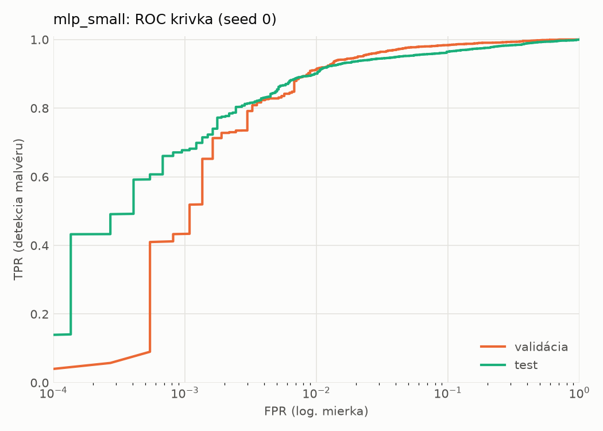
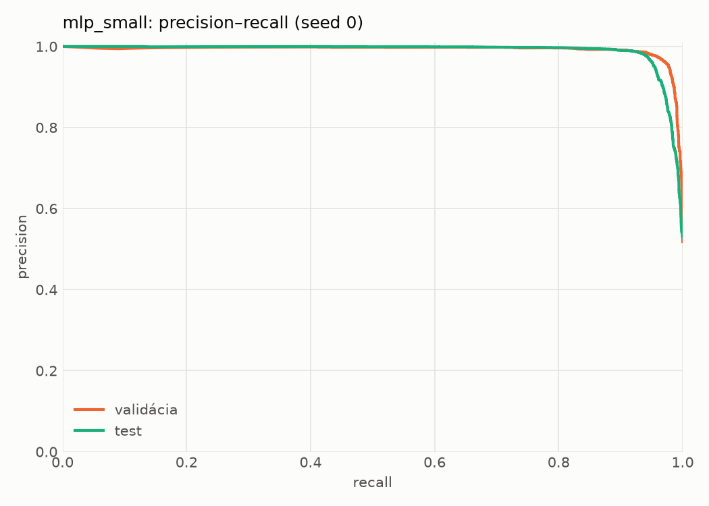
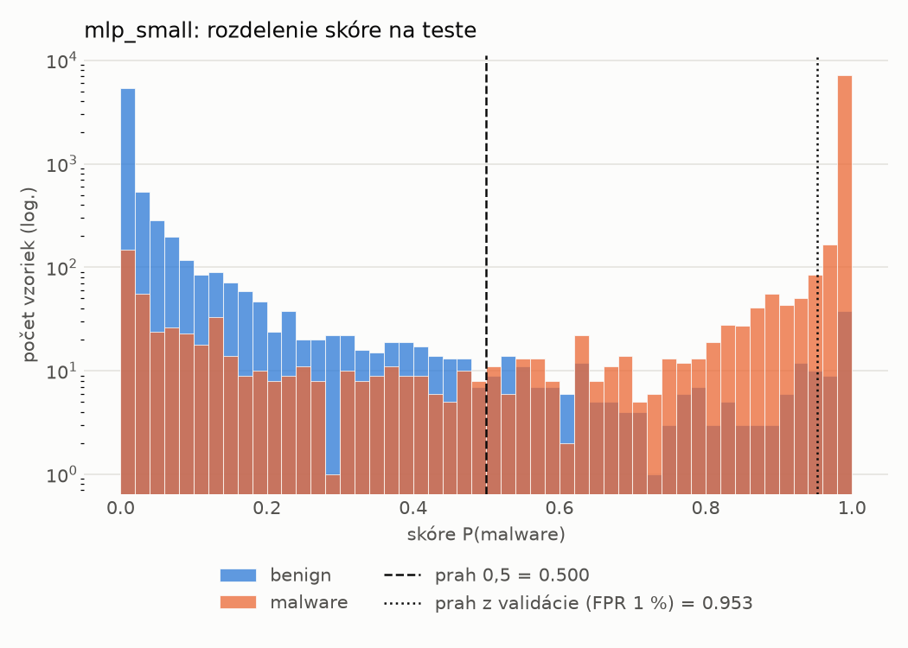
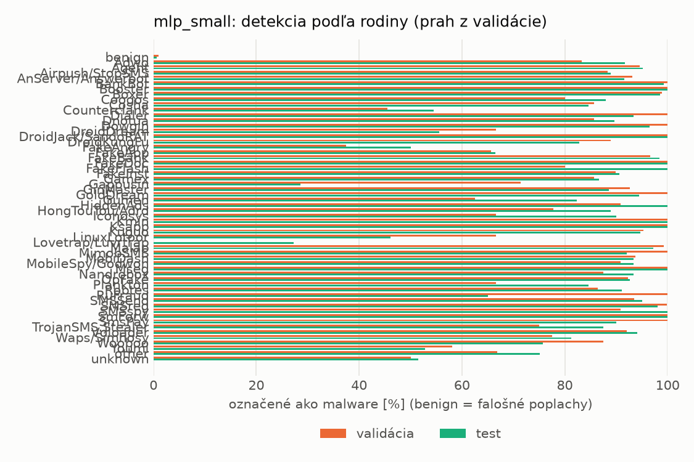
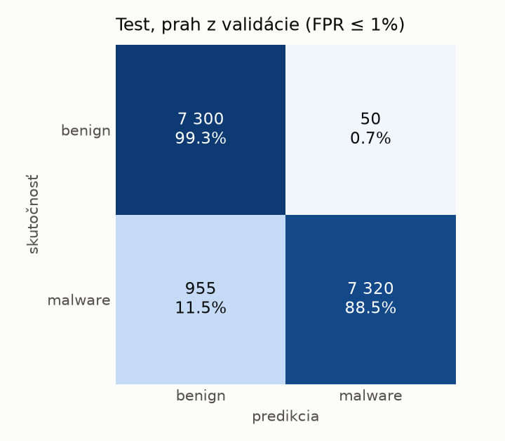
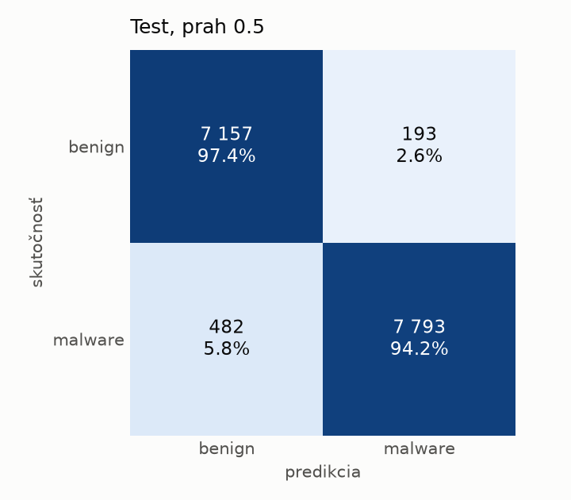
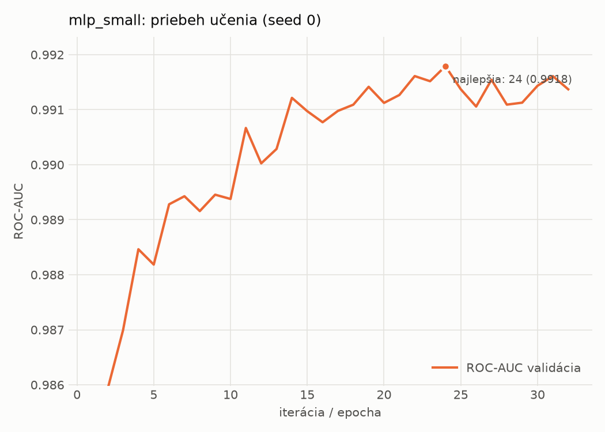

# static/mlp_small – beh `20261122-223021`

> Automaticky generované (`src/training/run_tabular.py`). Konfigurácia: `config.yaml`, protokol: `protocol.yaml`.

- **Model:** `mlp` – malá neurónová sieť (1–2 skryté vrstvy), kandidát na ľahkého študenta
- **Ladenie:** bez ladenia – hyperparametre prevzaté z `runs_v4/real_full/full/static/mlp_small/20261122-190134`
- **Finálne modely:** seedy [0, 1, 2]; hodnoty sú priemer ± smerodajná odchýlka cez seedy
- **Najlepšie hyperparametre:** `{"width_decay": 0.5, "max_epochs": 100, "patience": 8, "hidden_layers": 2, "hidden_width": 256, "dropout": 0.05428236214064427, "lr": 0.00041374253133077954, "weight_decay": 5.569517746104647e-06, "batch_size": 256}`

## Detekčná kvalita (bez prahu)
| metrika | train (podvzorka) | validácia | test |
|---|---|---|---|
| ROC-AUC | 0.9975 ± 0.0003 | 0.9918 ± 0.0001 | 0.9848 ± 0.0008 |
| PR-AUC | 0.9980 ± 0.0004 | 0.9923 ± 0.0004 | 0.9894 ± 0.0007 |
| TPR pri FPR 1 % | 0.9738 ± 0.0010 | 0.9090 ± 0.0024 | 0.9085 ± 0.0086 |
| TPR pri FPR 0,1 % | 0.9221 ± 0.0148 | 0.4963 ± 0.0940 | 0.6775 ± 0.0164 |
| log loss | 0.0542 ± 0.0028 | 0.1125 ± 0.0005 | 0.1553 ± 0.0076 |
| Brier skóre | 0.0142 ± 0.0006 | 0.0278 ± 0.0006 | 0.0354 ± 0.0014 |

Rozdiel ROC-AUC train − validácia: **0.0058** (veľký rozdiel = preučenie).

## Pri prahu z validácie (FPR ≤ 1% na validácii)
| metrika | train (podvzorka) | validácia | test |
|---|---|---|---|
| accuracy | 0.9557 ± 0.0022 | 0.9482 ± 0.0012 | 0.9341 ± 0.0014 |
| balanced accuracy | 0.9568 ± 0.0022 | 0.9497 ± 0.0012 | 0.9374 ± 0.0013 |
| precision | 0.9992 ± 0.0003 | 0.9903 ± 0.0003 | 0.9938 ± 0.0006 |
| recall (TPR) | 0.9143 ± 0.0041 | 0.9090 ± 0.0024 | 0.8811 ± 0.0032 |
| FPR | 0.0008 ± 0.0002 | 0.0096 ± 0.0003 | 0.0062 ± 0.0006 |
| F1 | 0.9548 ± 0.0023 | 0.9479 ± 0.0013 | 0.9340 ± 0.0015 |
| MCC | 0.9150 ± 0.0041 | 0.8998 ± 0.0022 | 0.8750 ± 0.0024 |

## Pri pevnom prahu 0.5
| metrika | train (podvzorka) | validácia | test |
|---|---|---|---|
| accuracy | 0.9819 ± 0.0005 | 0.9649 ± 0.0008 | 0.9573 ± 0.0012 |
| balanced accuracy | 0.9821 ± 0.0005 | 0.9650 ± 0.0007 | 0.9583 ± 0.0012 |
| precision | 0.9896 ± 0.0013 | 0.9704 ± 0.0019 | 0.9771 ± 0.0011 |
| recall (TPR) | 0.9750 ± 0.0023 | 0.9616 ± 0.0033 | 0.9413 ± 0.0024 |
| FPR | 0.0108 ± 0.0013 | 0.0316 ± 0.0022 | 0.0248 ± 0.0013 |
| F1 | 0.9822 ± 0.0006 | 0.9660 ± 0.0008 | 0.9589 ± 0.0012 |
| MCC | 0.9639 ± 0.0010 | 0.9297 ± 0.0015 | 0.9151 ± 0.0024 |

## Výpočtové nároky (seed 0, testovacia množina)
| meranie | hodnota |
|---|---|
| tréning finálneho modelu | 12.1 s (priemer cez seedy) |
| ladenie spolu | 0 s |
| počet parametrov / uzlov | 76 033 |
| veľkosť modelu na disku | 0.32 MB |
| transformácia vstupu – latencia (1 vlákno) | 0.015 ms |
| transformácia vstupu – priepustnosť | 698 939 vzoriek/s |
| CPU latencia modelu (batch 1, 1 vlákno) | 0.102 ms (p95 0.113) |
| CPU priepustnosť (24 vlákien) | 1 629 845 vzoriek/s |
| GPU latencia (batch 1) | 0.381 ms (p95 0.407) |
| GPU priepustnosť | 758 606 vzoriek/s |
| GPU špičková pamäť | 85 MB |

## Grafy
| | |
|---|---|
|  |  |
|  |  |
|  |  |
|  |  |

## Súbory
`metrics.json` (všetky metriky po seedoch vrátane rodín), `timing.json`, `hpo_trials.csv`,
`predictions/<časť>_seed<N>.parquet` (sha256, family, label, score), `model/seed_<N>/`, `log.txt`.
