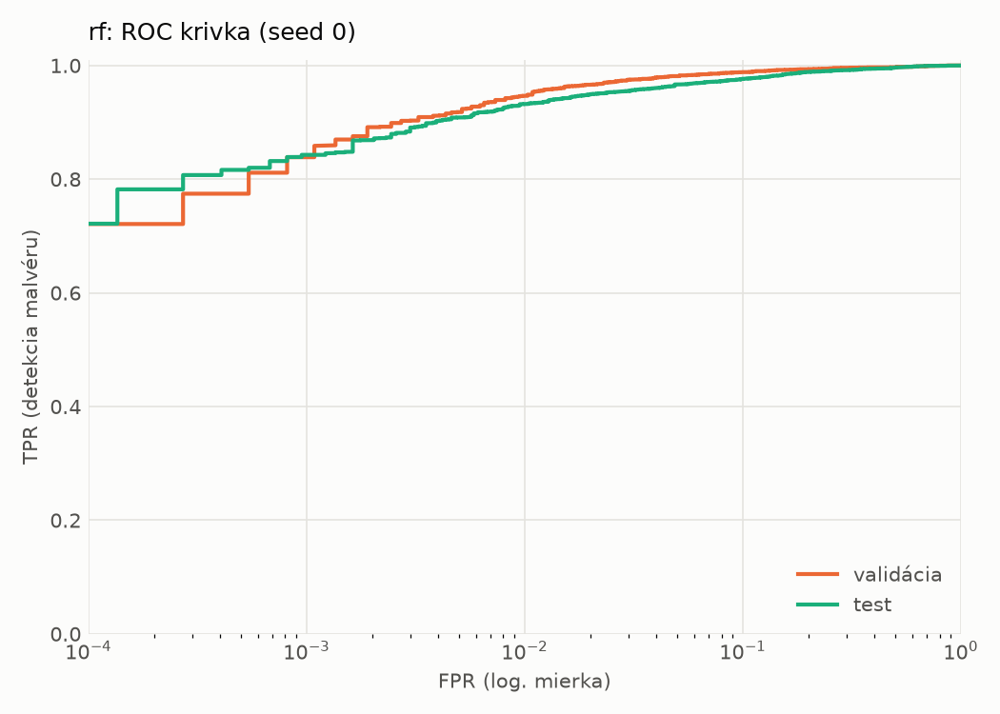
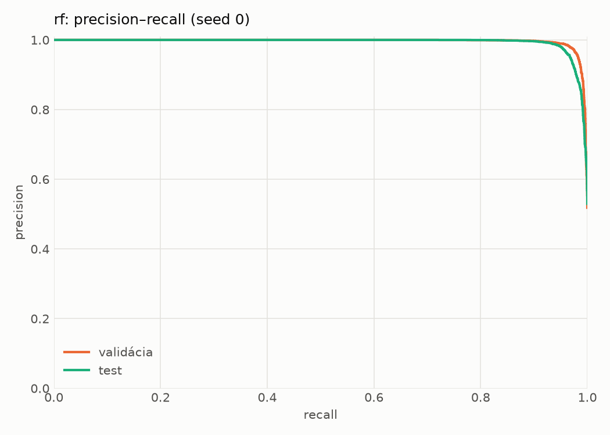
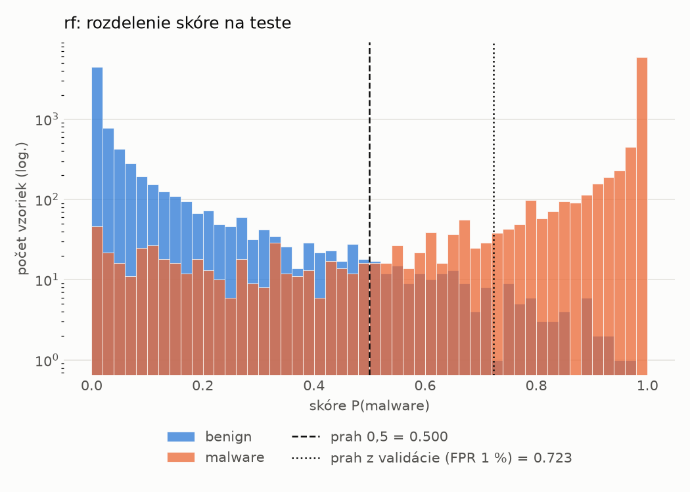
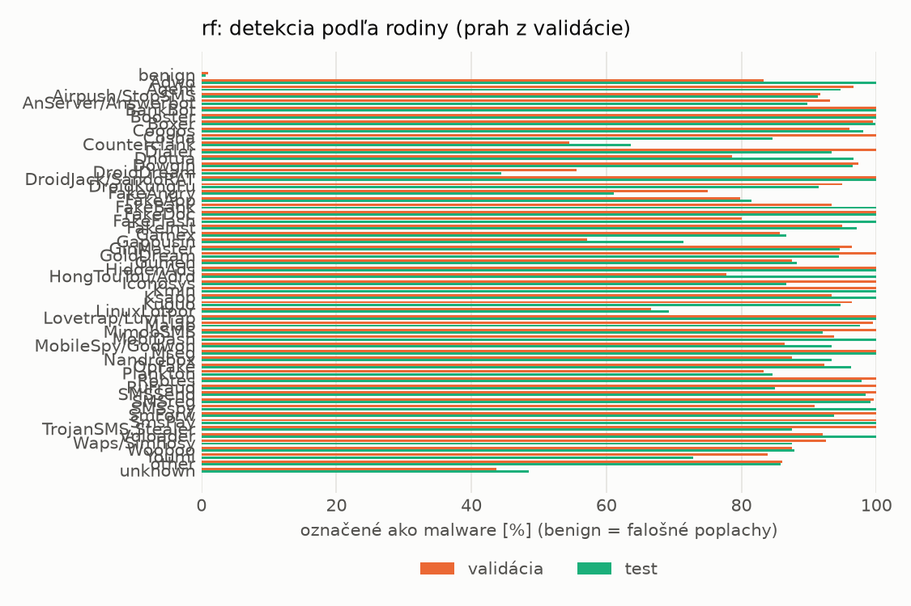
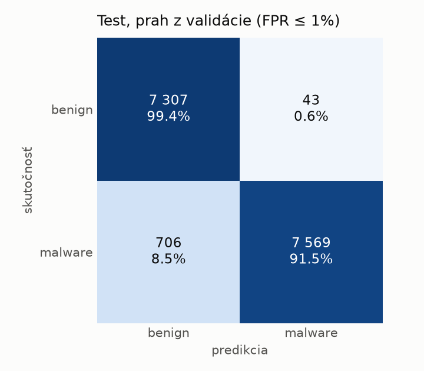
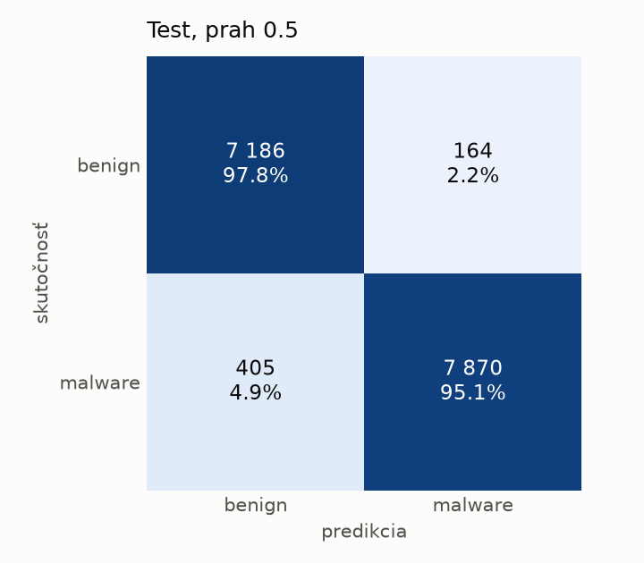

# static/rf – beh `20261122-222903`

> Automaticky generované (`src/training/run_tabular.py`). Konfigurácia: `config.yaml`, protokol: `protocol.yaml`.

- **Model:** `random_forest` – Random Forest (pôvodné hodnoty príznakov)
- **Ladenie:** bez ladenia – hyperparametre prevzaté z `runs_v4/real_full/full/static/rf/20261122-184723`
- **Finálne modely:** seedy [0, 1, 2]; hodnoty sú priemer ± smerodajná odchýlka cez seedy
- **Najlepšie hyperparametre:** `{"n_estimators": 400, "max_depth": 32, "min_samples_leaf": 1, "max_features": "sqrt"}`

## Detekčná kvalita (bez prahu)
| metrika | train (podvzorka) | validácia | test |
|---|---|---|---|
| ROC-AUC | 1.0000 ± 0.0000 | 0.9946 ± 0.0000 | 0.9912 ± 0.0001 |
| PR-AUC | 1.0000 ± 0.0000 | 0.9960 ± 0.0000 | 0.9937 ± 0.0001 |
| TPR pri FPR 1 % | 1.0000 ± 0.0000 | 0.9489 ± 0.0023 | 0.9316 ± 0.0005 |
| TPR pri FPR 0,1 % | 1.0000 ± 0.0000 | 0.8357 ± 0.0056 | 0.8450 ± 0.0024 |
| log loss | 0.0254 ± 0.0002 | 0.0875 ± 0.0000 | 0.1134 ± 0.0012 |
| Brier skóre | 0.0036 ± 0.0000 | 0.0226 ± 0.0001 | 0.0301 ± 0.0000 |

Rozdiel ROC-AUC train − validácia: **0.0054** (veľký rozdiel = preučenie).

## Pri prahu z validácie (FPR ≤ 1% na validácii)
| metrika | train (podvzorka) | validácia | test |
|---|---|---|---|
| accuracy | 0.9919 ± 0.0002 | 0.9688 ± 0.0012 | 0.9530 ± 0.0010 |
| balanced accuracy | 0.9921 ± 0.0002 | 0.9696 ± 0.0011 | 0.9552 ± 0.0009 |
| precision | 1.0000 ± 0.0000 | 0.9905 ± 0.0000 | 0.9937 ± 0.0006 |
| recall (TPR) | 0.9843 ± 0.0004 | 0.9489 ± 0.0023 | 0.9170 ± 0.0026 |
| FPR | 0.0000 ± 0.0000 | 0.0098 ± 0.0000 | 0.0065 ± 0.0007 |
| F1 | 0.9921 ± 0.0002 | 0.9693 ± 0.0012 | 0.9538 ± 0.0011 |
| MCC | 0.9840 ± 0.0004 | 0.9385 ± 0.0023 | 0.9091 ± 0.0018 |

## Pri pevnom prahu 0.5
| metrika | train (podvzorka) | validácia | test |
|---|---|---|---|
| accuracy | 0.9996 ± 0.0001 | 0.9724 ± 0.0005 | 0.9634 ± 0.0003 |
| balanced accuracy | 0.9996 ± 0.0001 | 0.9724 ± 0.0005 | 0.9642 ± 0.0003 |
| precision | 1.0000 ± 0.0000 | 0.9733 ± 0.0011 | 0.9795 ± 0.0001 |
| recall (TPR) | 0.9993 ± 0.0001 | 0.9735 ± 0.0013 | 0.9508 ± 0.0006 |
| FPR | 0.0000 ± 0.0000 | 0.0288 ± 0.0012 | 0.0224 ± 0.0001 |
| F1 | 0.9996 ± 0.0001 | 0.9734 ± 0.0005 | 0.9649 ± 0.0003 |
| MCC | 0.9993 ± 0.0001 | 0.9448 ± 0.0011 | 0.9272 ± 0.0006 |

## Výpočtové nároky (seed 0, testovacia množina)
| meranie | hodnota |
|---|---|
| tréning finálneho modelu | 1.9 s (priemer cez seedy) |
| ladenie spolu | 0 s |
| počet parametrov / uzlov | 2 537 214 |
| veľkosť modelu na disku | 203.35 MB |
| CPU latencia modelu (batch 1, 1 vlákno) | 12.092 ms (p95 12.471) |
| CPU priepustnosť (24 vlákien) | 150 626 vzoriek/s |

## Grafy
| | |
|---|---|
|  |  |
|  |  |
|  |  |
|  |  |

## Súbory
`metrics.json` (všetky metriky po seedoch vrátane rodín), `timing.json`, `hpo_trials.csv`,
`predictions/<časť>_seed<N>.parquet` (sha256, family, label, score), `model/seed_<N>/`, `log.txt`.
