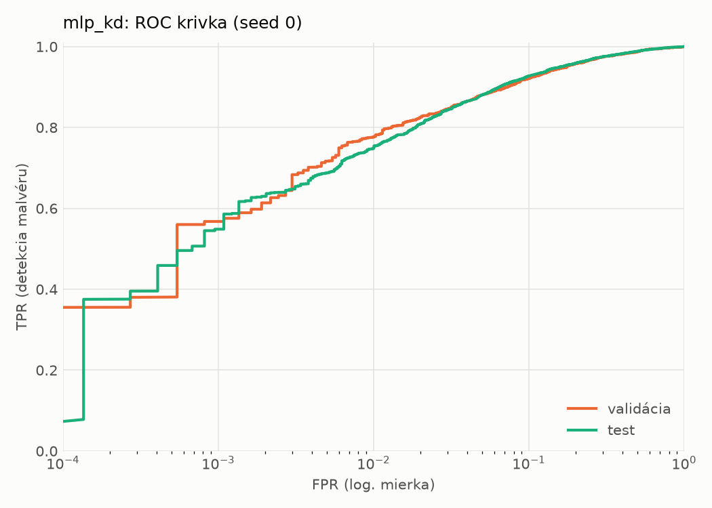
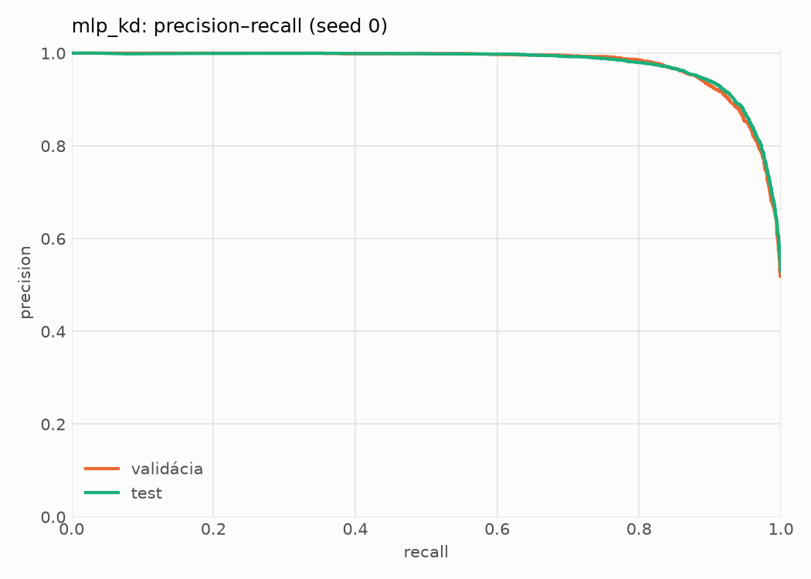
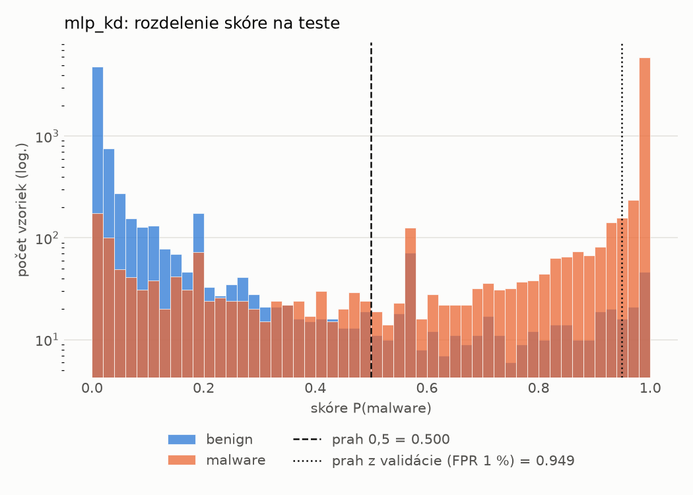
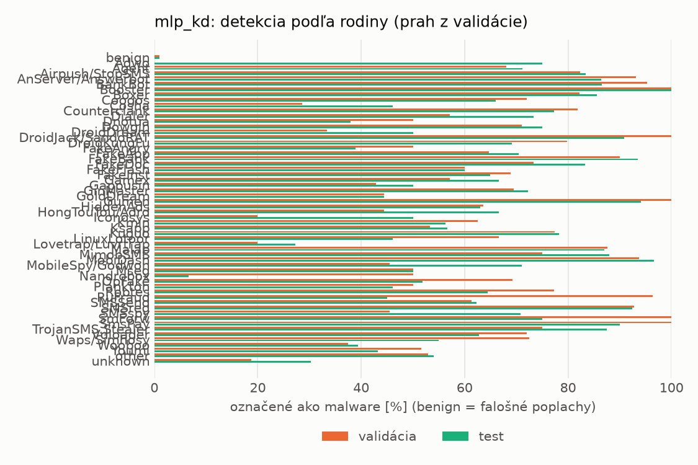
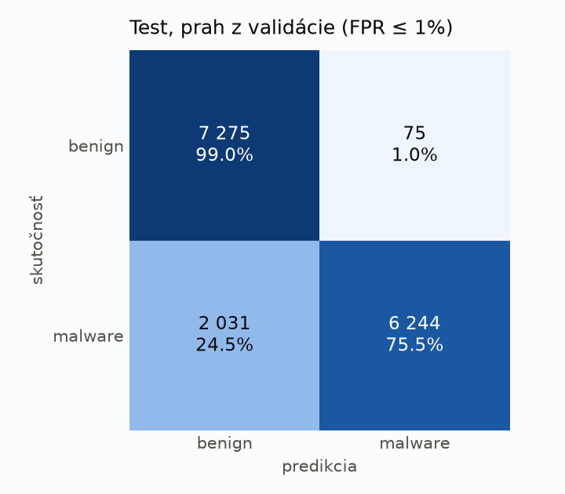
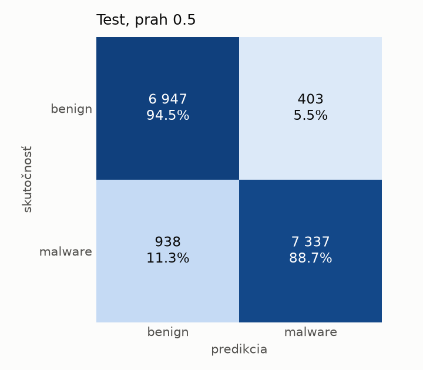
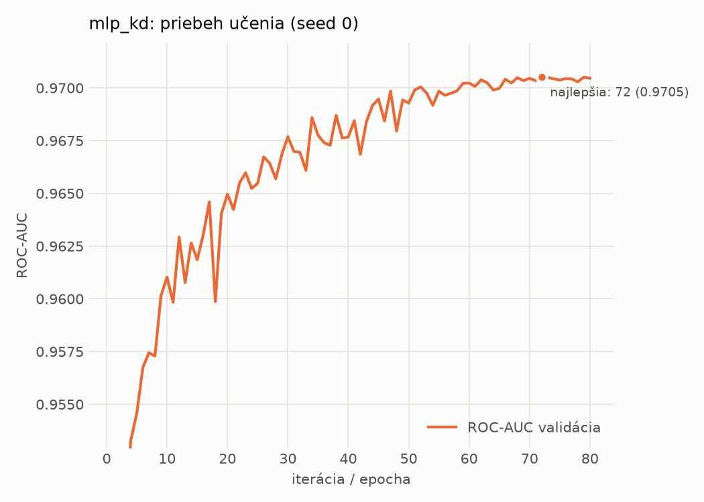

# dynamic/mlp_kd – beh `20261122-224334`

> Automaticky generované (`src/training/run_tabular.py`). Konfigurácia: `config.yaml`, protokol: `protocol.yaml`.

- **Model:** `mlp` – študent – malé MLP učené destiláciou z hybridného učiteľa
- **Ladenie:** bez ladenia – hyperparametre prevzaté z `runs_v4/real_full/full/students_dynamic/mlp_kd/20261122-205301`
- **Finálne modely:** seedy [0, 1, 2]; hodnoty sú priemer ± smerodajná odchýlka cez seedy
- **Najlepšie hyperparametre:** `{"hidden_layers": 1, "max_epochs": 100, "patience": 8, "hidden_width": 64, "dropout": 0.03643763137351852, "lr": 0.0028753520300020953, "weight_decay": 0.00022273244560059002, "batch_size": 512, "kd_alpha": 0.33129867518829337, "kd_temperature": 1.9602594769462303}`

## Detekčná kvalita (bez prahu)
| metrika | train (podvzorka) | validácia | test |
|---|---|---|---|
| ROC-AUC | 0.9758 ± 0.0009 | 0.9704 ± 0.0003 | 0.9709 ± 0.0006 |
| PR-AUC | 0.9804 ± 0.0007 | 0.9769 ± 0.0003 | 0.9777 ± 0.0005 |
| TPR pri FPR 1 % | 0.8072 ± 0.0063 | 0.7713 ± 0.0058 | 0.7498 ± 0.0013 |
| TPR pri FPR 0,1 % | 0.6321 ± 0.0099 | 0.5640 ± 0.0329 | 0.5733 ± 0.0289 |
| log loss | 0.2073 ± 0.0039 | 0.2470 ± 0.0021 | 0.2433 ± 0.0036 |
| Brier skóre | 0.0573 ± 0.0013 | 0.0661 ± 0.0001 | 0.0662 ± 0.0004 |

Rozdiel ROC-AUC train − validácia: **0.0053** (veľký rozdiel = preučenie).

## Pri prahu z validácie (FPR ≤ 1% na validácii)
| metrika | train (podvzorka) | validácia | test |
|---|---|---|---|
| accuracy | 0.8814 ± 0.0034 | 0.8767 ± 0.0030 | 0.8631 ± 0.0027 |
| balanced accuracy | 0.8842 ± 0.0033 | 0.8807 ± 0.0029 | 0.8702 ± 0.0026 |
| precision | 0.9926 ± 0.0006 | 0.9883 ± 0.0001 | 0.9883 ± 0.0006 |
| recall (TPR) | 0.7744 ± 0.0071 | 0.7713 ± 0.0058 | 0.7505 ± 0.0056 |
| FPR | 0.0061 ± 0.0005 | 0.0098 ± 0.0000 | 0.0100 ± 0.0006 |
| F1 | 0.8700 ± 0.0043 | 0.8664 ± 0.0037 | 0.8531 ± 0.0035 |
| MCC | 0.7840 ± 0.0055 | 0.7752 ± 0.0049 | 0.7537 ± 0.0042 |

## Pri pevnom prahu 0.5
| metrika | train (podvzorka) | validácia | test |
|---|---|---|---|
| accuracy | 0.9240 ± 0.0028 | 0.9135 ± 0.0004 | 0.9142 ± 0.0006 |
| balanced accuracy | 0.9248 ± 0.0026 | 0.9144 ± 0.0005 | 0.9162 ± 0.0006 |
| precision | 0.9538 ± 0.0041 | 0.9395 ± 0.0052 | 0.9524 ± 0.0039 |
| recall (TPR) | 0.8951 ± 0.0096 | 0.8906 ± 0.0052 | 0.8821 ± 0.0043 |
| FPR | 0.0456 ± 0.0047 | 0.0618 ± 0.0060 | 0.0497 ± 0.0045 |
| F1 | 0.9235 ± 0.0033 | 0.9144 ± 0.0005 | 0.9159 ± 0.0008 |
| MCC | 0.8500 ± 0.0048 | 0.8284 ± 0.0012 | 0.8311 ± 0.0013 |

## Výpočtové nároky (seed 0, testovacia množina)
| meranie | hodnota |
|---|---|
| tréning finálneho modelu | 15.3 s (priemer cez seedy) |
| ladenie spolu | 0 s |
| počet parametrov / uzlov | 8 641 |
| veľkosť modelu na disku | 0.04 MB |
| transformácia vstupu – latencia (1 vlákno) | 0.015 ms |
| transformácia vstupu – priepustnosť | 725 853 vzoriek/s |
| CPU latencia modelu (batch 1, 1 vlákno) | 0.072 ms (p95 0.090) |
| CPU priepustnosť (24 vlákien) | 7 557 071 vzoriek/s |
| GPU latencia (batch 1) | 0.268 ms (p95 0.289) |
| GPU priepustnosť | 2 823 098 vzoriek/s |
| GPU špičková pamäť | 62 MB |

## Grafy
| | |
|---|---|
|  |  |
|  |  |
|  |  |
|  |  |

## Súbory
`metrics.json` (všetky metriky po seedoch vrátane rodín), `timing.json`, `hpo_trials.csv`,
`predictions/<časť>_seed<N>.parquet` (sha256, family, label, score), `model/seed_<N>/`, `log.txt`.
