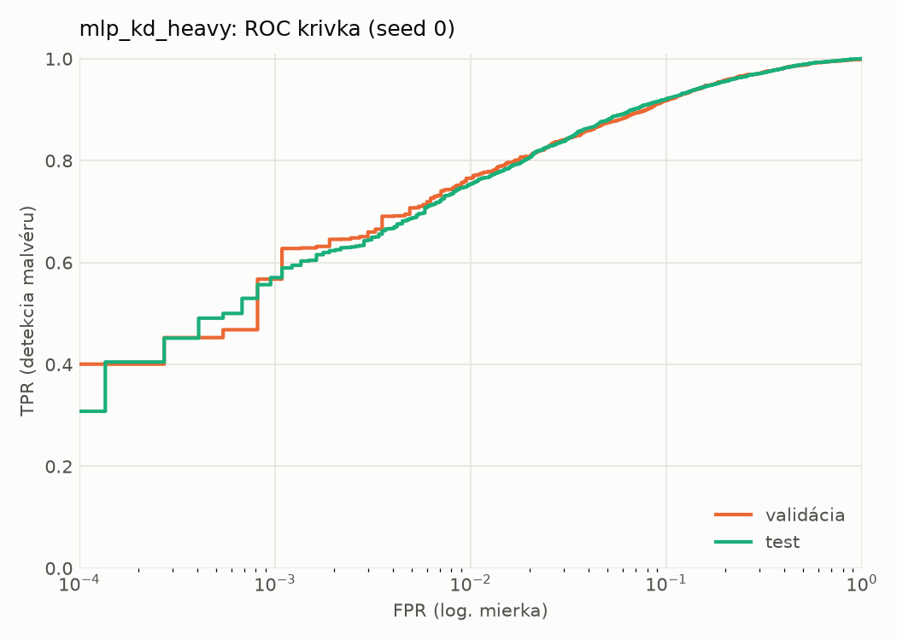
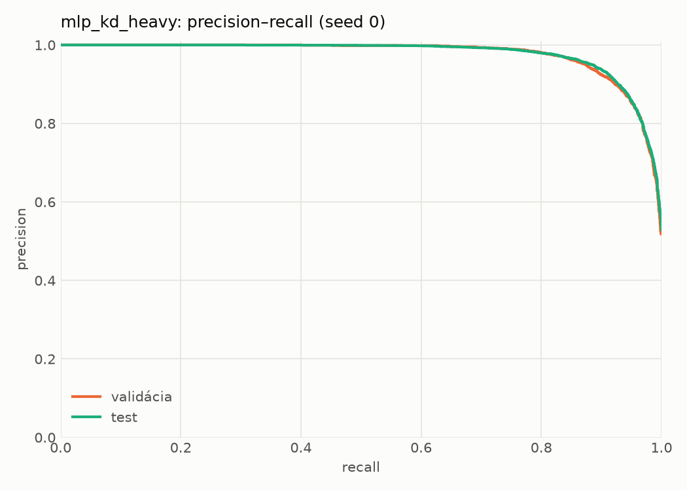
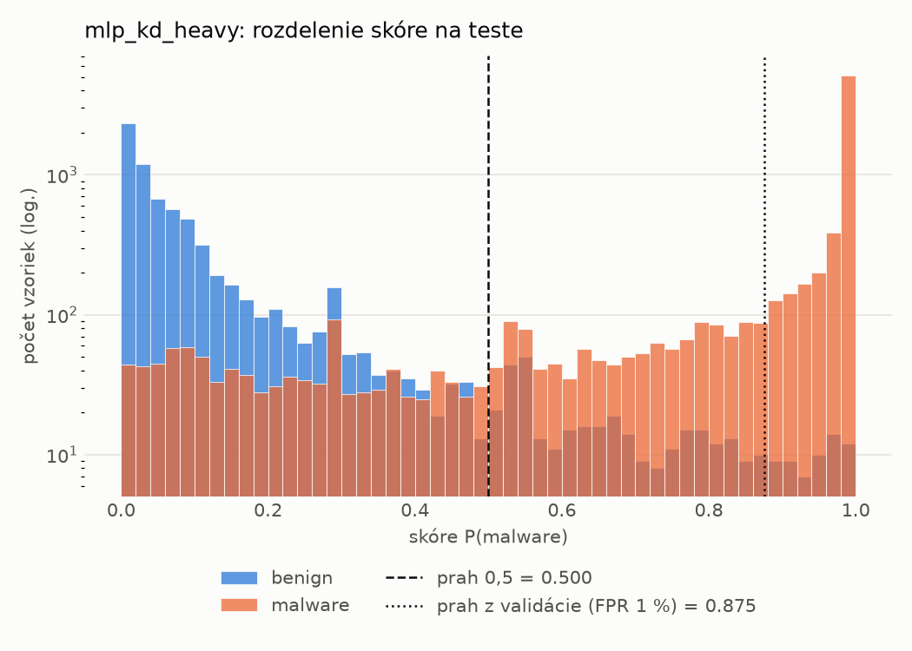
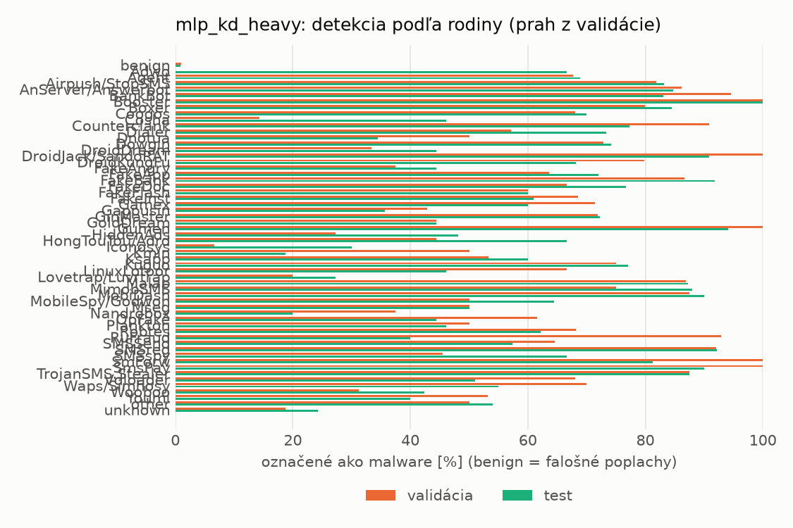
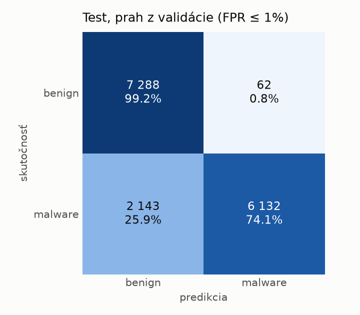
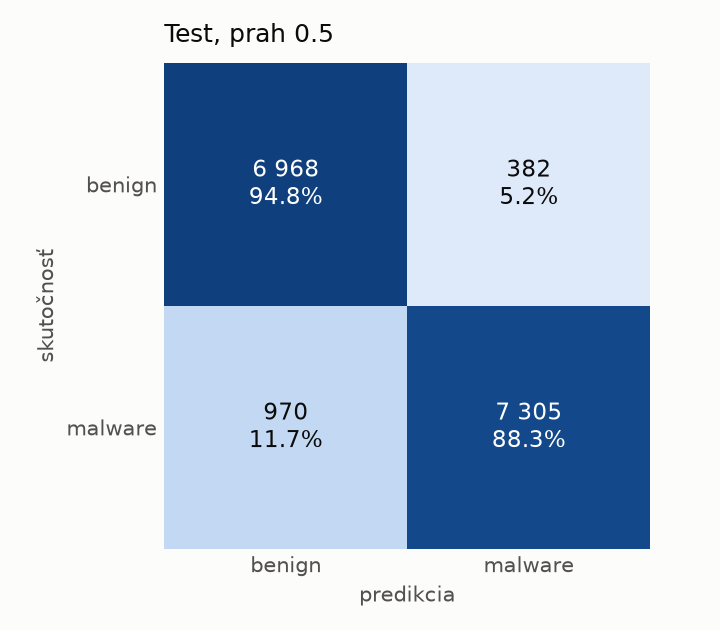
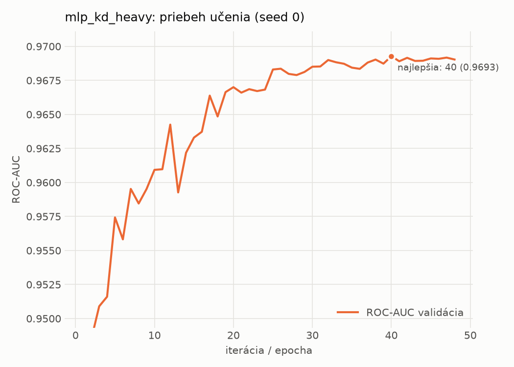

# dynamic/mlp_kd_heavy – beh `20261122-224609`

> Automaticky generované (`src/training/run_tabular.py`). Konfigurácia: `config.yaml`, protokol: `protocol.yaml`.

- **Model:** `mlp` – študent – malé MLP učené destiláciou z mlp_large hybridu (V4)
- **Ladenie:** bez ladenia – hyperparametre prevzaté z `runs_v4/real_full/full/students_dynamic/mlp_kd_heavy/20261122-211545`
- **Finálne modely:** seedy [0, 1, 2]; hodnoty sú priemer ± smerodajná odchýlka cez seedy
- **Najlepšie hyperparametre:** `{"hidden_layers": 1, "max_epochs": 100, "patience": 8, "hidden_width": 64, "dropout": 0.029123066185724737, "lr": 0.0017081972585601675, "weight_decay": 1.0334419171964511e-06, "batch_size": 256, "kd_alpha": 0.8514630095462001, "kd_temperature": 1.2684929468645387}`

## Detekčná kvalita (bez prahu)
| metrika | train (podvzorka) | validácia | test |
|---|---|---|---|
| ROC-AUC | 0.9768 ± 0.0015 | 0.9704 ± 0.0012 | 0.9704 ± 0.0011 |
| PR-AUC | 0.9815 ± 0.0012 | 0.9768 ± 0.0009 | 0.9776 ± 0.0008 |
| TPR pri FPR 1 % | 0.8181 ± 0.0123 | 0.7599 ± 0.0104 | 0.7548 ± 0.0075 |
| TPR pri FPR 0,1 % | 0.6245 ± 0.0308 | 0.5124 ± 0.0507 | 0.5805 ± 0.0123 |
| log loss | 0.1870 ± 0.0067 | 0.2165 ± 0.0046 | 0.2176 ± 0.0041 |
| Brier skóre | 0.0548 ± 0.0020 | 0.0633 ± 0.0018 | 0.0637 ± 0.0018 |

Rozdiel ROC-AUC train − validácia: **0.0064** (veľký rozdiel = preučenie).

## Pri prahu z validácie (FPR ≤ 1% na validácii)
| metrika | train (podvzorka) | validácia | test |
|---|---|---|---|
| accuracy | 0.8747 ± 0.0048 | 0.8709 ± 0.0053 | 0.8552 ± 0.0053 |
| balanced accuracy | 0.8776 ± 0.0047 | 0.8751 ± 0.0051 | 0.8629 ± 0.0050 |
| precision | 0.9938 ± 0.0019 | 0.9884 ± 0.0002 | 0.9905 ± 0.0007 |
| recall (TPR) | 0.7601 ± 0.0101 | 0.7599 ± 0.0104 | 0.7337 ± 0.0100 |
| FPR | 0.0050 ± 0.0016 | 0.0096 ± 0.0002 | 0.0079 ± 0.0005 |
| F1 | 0.8614 ± 0.0062 | 0.8592 ± 0.0067 | 0.8429 ± 0.0067 |
| MCC | 0.7732 ± 0.0077 | 0.7657 ± 0.0087 | 0.7419 ± 0.0085 |

## Pri pevnom prahu 0.5
| metrika | train (podvzorka) | validácia | test |
|---|---|---|---|
| accuracy | 0.9266 ± 0.0027 | 0.9134 ± 0.0027 | 0.9156 ± 0.0021 |
| balanced accuracy | 0.9273 ± 0.0028 | 0.9141 ± 0.0027 | 0.9175 ± 0.0021 |
| precision | 0.9539 ± 0.0062 | 0.9360 ± 0.0040 | 0.9514 ± 0.0024 |
| recall (TPR) | 0.9004 ± 0.0043 | 0.8941 ± 0.0038 | 0.8860 ± 0.0028 |
| FPR | 0.0458 ± 0.0066 | 0.0659 ± 0.0045 | 0.0510 ± 0.0026 |
| F1 | 0.9263 ± 0.0026 | 0.9145 ± 0.0026 | 0.9175 ± 0.0021 |
| MCC | 0.8548 ± 0.0057 | 0.8277 ± 0.0054 | 0.8336 ± 0.0041 |

## Výpočtové nároky (seed 0, testovacia množina)
| meranie | hodnota |
|---|---|
| tréning finálneho modelu | 26.3 s (priemer cez seedy) |
| ladenie spolu | 0 s |
| počet parametrov / uzlov | 8 641 |
| veľkosť modelu na disku | 0.04 MB |
| transformácia vstupu – latencia (1 vlákno) | 0.014 ms |
| transformácia vstupu – priepustnosť | 734 444 vzoriek/s |
| CPU latencia modelu (batch 1, 1 vlákno) | 0.157 ms (p95 0.166) |
| CPU priepustnosť (24 vlákien) | 8 519 629 vzoriek/s |
| GPU latencia (batch 1) | 0.296 ms (p95 0.350) |
| GPU priepustnosť | 2 510 282 vzoriek/s |
| GPU špičková pamäť | 94 MB |

## Grafy
| | |
|---|---|
|  |  |
|  |  |
|  |  |
|  |  |

## Súbory
`metrics.json` (všetky metriky po seedoch vrátane rodín), `timing.json`, `hpo_trials.csv`,
`predictions/<časť>_seed<N>.parquet` (sha256, family, label, score), `model/seed_<N>/`, `log.txt`.
